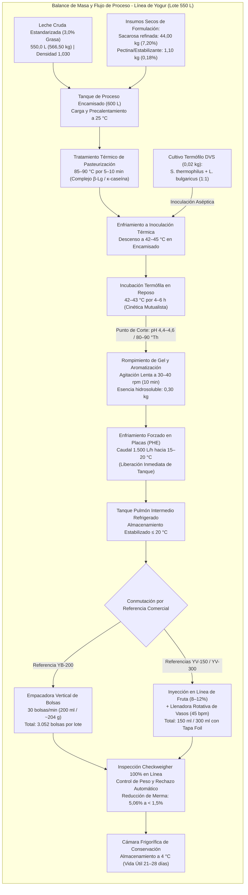
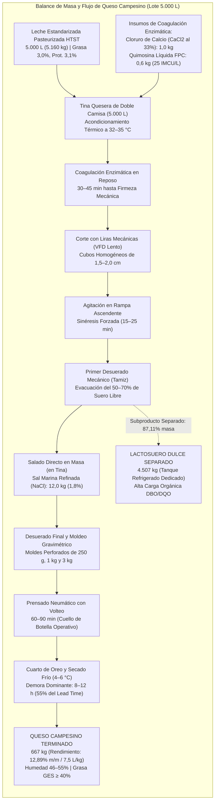
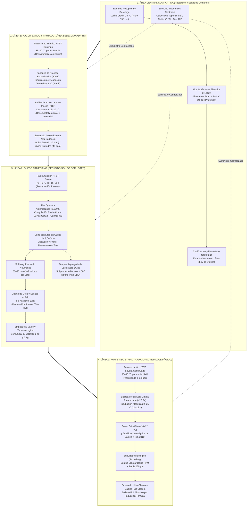

# Estado del Arte de las Tres Líneas de Derivados Lácteos y Justificación de la Línea de Yogur

**Proyecto Integrador APM 2026-2S** · Automatización de Procesos de Manufactura  
**Facultad de Ingeniería · Universidad Nacional de Colombia (Sede Bogotá)**  
**Empresa Consultora:** Cremia Automations  
**Módulo:** Módulo 1 – Transformación Digital Industrial (TDI) & Modelado de Procesos  
**Fecha de Emisión:** Octubre de 2026  
**Autor Principal del Entregable:** Especialista de Proceso y Estado del Arte (Línea Kumis e Integración)  
**Alcance:** Caracterización técnica rigurosa de tres líneas agroindustriales (Yogur Batido/Frutado, Queso Campesino y Kumis Tradicional), análisis termodinámico y biotecnológico para la Sabana de Bogotá (2.600 msnm), formulación legal, matriz multicriterio ponderada y justificación ingenieril de la línea de yogur seleccionada.

---

> [!NOTE]
> **Contexto de Operación e Insumos de Ingeniería**  
> El presente documento consolida la investigación de estado del arte y modelado de procesos para una planta multiproducto de derivados lácteos ubicada en la Sabana de Bogotá (Cundinamarca, Colombia). Se fundamenta en:
> 1. La línea base empírica medida de la planta real *La Hacienda Productos Alimenticios* (Guasca, Cundinamarca), documentada por Grimaldo, Moreno & Salamanca (2015).
> 2. El desarrollo técnico del equipo Cremia Automations para la línea de *Queso Campesino* (Hoyos & Zapata, 2026).
> 3. El informe de investigación y validación integral para la manufactura de *Kumis Industrial Tradicional* a 2.600 msnm (74 kPa) con restricción estricta de almidones y blindaje fágico contra lactosueros.
> 4. El marco técnico-legal colombiano vigente: Decreto 616 de 2006, Resolución 2310 de 1986, Resolución 2674 de 2013, Resolución 1407 de 2022, NTC 805 y NTC 750.

---

## Índice General

1. [Introducción y Marco Regulatorio del Sector Lácteo en Colombia](#1-introducción-y-marco-regulatorio-del-sector-lácteo-en-colombia)
   - 1.1 Contexto Industrial de la Sabana de Bogotá y Plantas Multiproducto
   - 1.2 Decreto 616 de 2006: Requisitos Sanitarios de la Leche y Prohibición de Lactosueros
   - 1.3 Resolución 2310 de 1986: Derivados Lácteos y Aditivos Autorizados
   - 1.4 Resolución 2674 de 2013: Buenas Prácticas de Manufactura y Diseño Sanitario
   - 1.5 Resolución 1407 de 2022: Criterios Microbiológicos Oficiales
   - 1.6 NTC 805: Leches Fermentadas y Restricciones Normativas del Anexo B
   - 1.7 NTC 750: Clasificación Fisicoquímica de Quesos
2. [Caracterización Técnica de la Línea 1: Yogur Batido y Frutado (Caso La Hacienda)](#2-caracterización-técnica-de-la-línea-1-yogur-batido-y-frutado-caso-la-hacienda)
   - 2.1 Descripción del Producto y Especificaciones Fisicoquímicas
   - 2.2 Dinámica Bioquímica: Fermentación Termófila Simbiótica
   - 2.3 Tratamiento Térmico y Parámetros Operacionales
   - 2.4 Balance de Materia y Formulación del Lote de Referencia (550 L)
   - 2.5 Diagnóstico de la Línea Base Medida (La Hacienda, 2015)
   - 2.6 Oportunidades de Mejora y Potencial de Transformación Digital Industrial (TDI)
3. [Caracterización Técnica de la Línea 2: Queso Campesino (Insumo Consolidado)](#3-caracterización-técnica-de-la-línea-2-queso-campesino-insumo-consolidado)
   - 3.1 Descripción del Producto y Presentaciones Comerciales (QC-250, QC-1K, QC-3K)
   - 3.2 Coagulación Enzimática, Corte y Desuerado
   - 3.3 Balance de Masa y Rendimiento del Lote Base (5.000 L de Leche)
   - 3.4 Cuellos de Botella y Tiempos No Productivos (Prensado y Oreo)
   - 3.5 Retos Operacionales: Generación de Lactosuero Dulce y Manipulación Discreta
4. [Caracterización Técnica de la Línea 3: Kumis Industrial Tradicional (Desarrollo Estrella)](#4-caracterización-técnica-de-la-línea-3-kumis-industrial-tradicional-desarrollo-estrella)
   - 4.1 Ficha Técnica Integral del Producto bajo NTC 805 y Resolución 2310
   - 4.2 Formulación Validada y Balance de Masa Riguroso (Lote 1.000 L / 1.030 kg)
   - 4.3 Inconsistencia Crítica y Rectificación Legal: Prohibición de Almidones y Modelo 'Egg-Box' de Pectina LMP
   - 4.4 Termodinámica e Hidráulica a 2.600 msnm (Sabana de Bogotá, Patm = 74 kPa)
     - 4.4.1 Análisis de Cavitación, NPSH y Compensaciones de Carga Estática
     - 4.4.2 Descenso de Temperatura de Ebullición (91,5 °C) y Skid Presurizado de Calentamiento
   - 4.5 Rediseño Hidráulico del Tratamiento Térmico HTST Continuo
   - 4.6 Biotecnología de la Fermentación Mesófila: Cinética y Síntesis de Diacetilo
   - 4.7 Reología, Dinámica de Coloides y Suavizado Mecánico por Bomba Lobular
   - 4.8 Vector Crítico de Bioseguridad: Contención Epidemiológica contra Bacteriófagos de Quesería (936, c2, P335)
   - 4.9 Envasado Ultralimpio (PCC-2), Maduración Fría y Criterios Microbiológicos
5. [Cuadro Comparativo Multidimensional entre las Tres Líneas](#5-cuadro-comparativo-multidimensional-entre-las-tres-líneas)
   - 5.1 Matriz Comparativa Técnica Integral (14 Dimensiones de Análisis)
   - 5.2 Análisis de Operaciones Unitarias y Fronteras de Integración (Recursos Compartidos vs. Dedicados)
6. [Matriz de Evaluación Multicriterio Ponderada para Selección de Línea](#6-matriz-de-evaluación-multicriterio-ponderada-para-selección-de-línea)
   - 6.1 Metodología de Ponderación y Definición de Criterios
   - 6.2 Tabla de Puntuación Multicriterio
   - 6.3 Justificación Analítica Detallada de Calificaciones por Criterio
7. [Justificación Rigurosa y Decisión de Ingeniería de la Línea de Yogur](#7-justificación-rigurosa-y-decisión-de-ingeniería-de-la-línea-de-yogur)
   - 7.1 Argumentación Técnica y Metodológica para el Proyecto APM
   - 7.2 Demostración Cuantitativa del Desembotellamiento: Duplicación a 1.100 L/día
   - 7.3 Alineación Estratégica con ISA-88, ISA-95 y el Gemelo Digital
   - 7.4 Escalabilidad hacia una Arquitectura Multiproducto Modular
8. [Referencias Bibliográficas](#8-referencias-bibliográficas)

---

## 1. Introducción y Marco Regulatorio del Sector Lácteo en Colombia

### 1.1 Contexto Industrial de la Sabana de Bogotá y Plantas Multiproducto
El departamento de Cundinamarca, y en particular la Sabana de Bogotá y el Valle de Ubaté y Chiquinquirá, constituye la principal cuenca lechera del altiplano cundiboyacense en Colombia. Caracterizada por una producción intensiva de leche de alta calidad composicional (predominio de razas Holstein y Jersey), esta región alberga un conglomerado industrial que abarca desde grandes corporaciones multilatinas (como Alpina Productos Alimenticios en Sopó) hasta medianas empresas transformadoras (como La Hacienda Productos Alimenticios en Guasca). 

Las plantas lácteas modernas en este ecosistema operan bajo un modelo **multiproducto**, buscando maximizar el aprovechamiento de los sólidos lácteos recibidos mediante tres grandes líneas de manufactura:
1. **Línea de Yogur:** Producto fermentado termófilo de alta rotación, formulado con fruta y azúcar, con una textura que va desde bebible hasta batido espeso.
2. **Línea de Quesos Frescos (Queso Campesino):** Derivado de coagulación enzimática que extrae caseína y grasa, generando un volumen masivo de lactosuero como subproducto.
3. **Línea de Kumis:** Leche fermentada tradicional colombiana obtenida por fermentación mesófila lenta, con acentuado perfil a diacetilo y dulzor característico.

Sin embargo, el diseño, la automatización y la operación concurrente de estas tres líneas en una misma instalación industrial impone severos desafíos multidisciplinarios:
- **Desafíos Físicos y Termodinámicos:** La altitud de la Sabana (2.600 msnm) provoca una reducción de la presión barométrica a aproximadamente 74 kPa (~0,73 atm), lo que disminuye drásticamente el $NPSH_{disponible}$ para el bombeo de fluidos calientes y abate la temperatura de ebullición del agua a 91,5 °C.
- **Desafíos Biológicos e Inmunológicos:** La coexistencia del procesamiento de quesos con líneas de leches fermentadas introduce el riesgo de contaminación cruzada por **bacteriófagos líticos** diseminados por los aerosoles del lactosuero crudo, capaces de destruir los cultivos iniciadores lácticos.
- **Desafíos Normativos:** La estricta diferenciación de identidades fisicoquímicas, microbiológicas y aditivos autorizados bajo la regulación sanitaria del INVIMA y el Ministerio de Salud y Protección Social.

### 1.2 Decreto 616 de 2006: Requisitos Sanitarios de la Leche y Prohibición de Lactosueros
El **Decreto 616 de 2006** (*Reglamento técnico sobre los requisitos que debe cumplir la leche para el consumo humano*) constituye la columna vertebral del aseguramiento de la materia prima en Colombia. Establece que la leche cruda debe provenir de hatos libres de brucelosis y tuberculosis, ser refrigerada inmediatamente tras el ordeño a $4 \pm 2\text{ }^\circ\text{C}$, y ser transportada en carrotanques isotérmicos con sello hermético.

Parámetros obligatorios de aceptación de leche cruda en plataforma:
- **Temperatura de recepción:** $\le 6\text{ }^\circ\text{C}$ (máximo $8\text{ }^\circ\text{C}$ en casos excepcionales de transporte).
- **Densidad a 15 °C:** 1,030 a 1,033 g/mL.
- **Acidez titulable:** 0,13 a 0,17 % m/v expresada como ácido láctico (14 a 17 °Dornic).
- **Materia grasa:** Mínimo 3,0 % m/m.
- **Sólidos totales (ST):** Mínimo 11,30 % m/m; Sólidos no grasos (ESD): Mínimo 8,30 % m/m.
- **Prueba de alcohol (68 % y 75 % v/v):** Negativa (ausencia de precipitación o inestabilidad micelar).
- **Prueba de reductasa (azul de metileno):** Tiempo de decoloración $> 3\text{ h}$.
- **Residuos de antibióticos y adulterantes:** Ausencia estricta (negativo).
- **Punto crioscópico:** $-0,530\text{ }^\circ\text{C}$ a $-0,510\text{ }^\circ\text{C}$.

> [!IMPORTANT]
> **Prohibición Taxativa de Adición de Lactosueros (Decreto 616 de 2006)**  
> El artículo 14 prohíbe taxativamente la adición de lactosueros a la leche en todas las etapas de la cadena productiva. La presencia de caseinomacropéptido (CMP) en concentraciones anómalas constituye fraude por adulteración. En una planta multiproducto que procesa queso, el lactosuero debe confinarse en circuitos completamente segregados para evitar cualquier cruce inadvertido hacia las líneas de leche líquida, yogur o kumis.

### 1.3 Resolución 2310 de 1986: Derivados Lácteos y Aditivos Autorizados
La **Resolución 2310 de 1986** del Ministerio de Salud reglamenta el procesamiento, composición, requisitos y comercialización de derivados lácteos. Define los parámetros de identidad de leches fermentadas (artículos 29 al 35) y quesos (artículos 45 al 70).
- **Kumis:** Leche higienizada, fermentada por cultivos de *Lactococcus lactis* (anteriormente clasificados como *Streptococcus lactis* / *cremoris*), con adición o no de azúcar y esencias naturales o idénticas a las naturales.
- **Yogur:** Leche higienizada, fermentada por la acción simbiótica de *Streptococcus thermophilus* y *Lactobacillus delbrueckii* subsp. *bulgaricus*, con o sin adición de frutas, edulcorantes y estabilizantes.
- **Aditivos autorizados:** Permite el uso de estabilizantes (hidrocoloides vegetales), colorantes naturales y sustancias aromatizantes específicas, siempre que se declaren en el rótulo comercial.

### 1.4 Resolución 2674 de 2013: Buenas Prácticas de Manufactura y Diseño Sanitario
La **Resolución 2674 de 2013** establece los requisitos sanitarios para la fabricación, procesamiento, envase, almacenamiento, transporte y comercialización de alimentos en Colombia:
- **Diseño de instalaciones y equipos:** Superficies de contacto con alimentos en acero inoxidable grado AISI 304 o AISI 316L, con acabado sanitario superficial (rugosidad $Ra \le 0,8\text{ }\mu\text{m}$), uniones soldadas continuas sin grietas ni puntos muertos (*dead-legs* $< 1,5 D$), y pendientes de drenaje sanitario $\ge 1,5\text{ \%}$.
- **Control ambiental y cuartos limpios:** Zonas de envasado aséptico y fermentación con inyección de aire filtrado, control de condensación, diferenciales de presión positiva respecto a pasillos y zonas sucias, y protocolos estrictos de indumentaria y desinfección.
- **Sistemas de Limpieza In Situ (CIP):** Automatización obligatoria de ciclos térmicos y químicos con trazabilidad de temperatura, concentración y flujo turbulento ($v > 1,5\text{ m/s}$).

### 1.5 Resolución 1407 de 2022: Criterios Microbiológicos Oficiales
La **Resolución 1407 de 2022** del Ministerio de Salud y Protección Social derogó los parámetros microbiológicos obsoletos de resoluciones anteriores y fijó los límites microbiológicos oficiales basados en planes de muestreo de tres clases ($n, c, m, M$) y dos clases:

| Categoría de Alimento | Microorganismo Evaluado | Plan de Muestreo | Límite $m$ | Límite $M$ |
|---|---|:---:|:---:|:---:|
| **Leches Fermentadas** (Yogur, Kumis) | Coliformes totales | $n=5, c=2$ | $10\text{ UFC/g}$ | $100\text{ UFC/g}$ |
| | *Escherichia coli* | $n=5, c=1$ | $< 10\text{ UFC/g}$ | $10\text{ UFC/g}$ |
| | Mohos y Levaduras | $n=5, c=2$ | $100\text{ UFC/g}$ | $500\text{ UFC/g}$ |
| | *Staphylococcus aureus* (coag. +) | $n=5, c=1$ | $10\text{ UFC/g}$ | $100\text{ UFC/g}$ |
| | *Salmonella spp.* | $n=5, c=0$ | Ausencia en 25 g | — |
| | *Listeria monocytogenes* | $n=5, c=0$ | Ausencia en 25 g | — |
| | **Bacterias Ácido-Lácticas (BAL)** | $n=5, c=0$ | **$\ge 10^7\text{ UFC/g}$** | — |
| **Queso Campesino** (Queso Fresco no madurado) | Coliformes fecales | $n=5, c=2$ | $100\text{ UFC/g}$ | $1.000\text{ UFC/g}$ |
| | *Staphylococcus aureus* (coag. +) | $n=5, c=1$ | $100\text{ UFC/g}$ | $1.000\text{ UFC/g}$ |
| | *Salmonella spp.* | $n=5, c=0$ | Ausencia en 25 g | — |
| | *Listeria monocytogenes* | $n=5, c=0$ | Ausencia en 25 g | — |

### 1.6 NTC 805: Leches Fermentadas y Restricciones Normativas del Anexo B
La **NTC 805 (Cuarta actualización)** establece los requisitos fisicoquímicos y microbiológicos para las leches fermentadas en Colombia:
- **Materia grasa láctea:** Entero $\ge 2,5\text{ \%}$, Semidescremado $1,0\text{ a }2,4\text{ \%}$, Descremado $< 1,0\text{ \%}$.
- **Proteína láctea:** Mínimo **$2,6\text{ \% m/m}$**.
- **Extracto seco desengrasado (ESD):** Mínimo **$8,5\text{ \% m/m}$**.
- **Acidez titulable:**
  - Yogur: $0,60\text{ a }1,50\text{ \%}$ expresada como ácido láctico ($60\text{ a }150\text{ }^\circ\text{Dornic}$).
  - Kumis: $0,60\text{ a }1,50\text{ \%}$ expresada como ácido láctico ($60\text{ a }150\text{ }^\circ\text{Dornic}$), usualmente en el rango de $0,75\text{ a }0,85\text{ \%}$.
- **Viabilidad del cultivo:** Mínimo **$10^7\text{ UFC/g}$** de bacterias lácticas específicas vivas hasta el final de la vida útil comercial.

> [!CAUTION]
> **Restricción Normativa del Anexo B de la NTC 805 (Almidones Prohibidos)**  
> El Anexo B (Normativo) de la NTC 805 especifica taxativamente los aditivos autorizados. Los **almidones modificados y la gelatina están PROHIBIDOS en leches fermentadas tradicionales con microorganismos vivos**. Su uso se restringe de forma exclusiva a leches que han sido sometidas a tratamiento térmico *posterior* a la fermentación (leches fermentadas termizadas o de larga vida, donde las bacterias lácteas están inactivadas). En el Kumis y Yogur tradicionales vivos, la estabilización contra la sinéresis debe lograrse mediante incremento de proteína láctea (LPD) y el uso exclusivo de **Pectina de Bajo Metoxilo (LMP)**.

### 1.7 NTC 750: Clasificación Fisicoquímica de Quesos
La **NTC 750** clasifica los quesos según su contenido de humedad sin materia grasa (HSMG) y materia grasa en extracto seco (GES).
- **Queso Campesino:** Clasificado como **queso fresco, semiduro y graso**:
  - Humedad: $46\text{ a }55\text{ \%}$ (pasta blanda/semidura, no madurado).
  - Grasa en extracto seco (GES): $\ge 40\text{ \%}$.
  - Sal (NaCl): $1,6\text{ a }2,0\text{ \%}$.
  - pH: $6,2\text{ a }6,6$.

---

## 2. Caracterización Técnica de la Línea 1: Yogur Batido y Frutado (Caso La Hacienda)

### 2.1 Descripción del Producto y Especificaciones Fisicoquímicas
El yogur es un derivado lácteo obtenido por fermentación ácido-láctica de leche pasteurizada mediante un cultivo termófilo proto-cooperativo. El producto objeto de este análisis corresponde a la línea base de la empresa **La Hacienda Productos Alimenticios** (Guasca, Cundinamarca), que elabora yogur entero batido con saborizantes y yogur frutado en presentaciones individuales y familiares.

| Parámetro | Especificación Técnica |
|---|---|
| Clasificación (NTC 805) | Leche fermentada, tipo yogur entero batido / frutado |
| Grasa láctea | $2,80\text{ a }3,10\text{ \% m/m}$ (cumple mínimo 2,5 %) |
| Proteína láctea | $2,80\text{ a }3,20\text{ \% m/m}$ (cumple mínimo 2,6 %) |
| Sólidos no grasos (ESD) | $\ge 11,5\text{ \% m/m}$ |
| Azúcar añadido (sacarosa) | $8,0\text{ a }10,0\text{ \% m/m}$ |
| Dulce de fruta (YV-150 / YV-300) | $8\text{ \%}$ (mora) y $12\text{ \%}$ (melocotón) en base a formulación |
| Acidez titulable final | $0,80\text{ a }0,90\text{ \%}$ ácido láctico ($80\text{ a }90\text{ }^\circ\text{Thörner}$ / $72\text{ a }81\text{ }^\circ\text{Dornic}$) |
| pH final de coagulación | $4,40\text{ a }4,60$ |
| Viabilidad BAL (*S. thermophilus* + *L. bulgaricus*) | $\ge 10^7\text{ UFC/g}$ durante 28 días a $4\text{ }^\circ\text{C}$ |
| Viscosidad aparente a 10 °C | $2.500\text{ a }3.500\text{ cP (mPa}\cdot\text{s)}$ |
| Vida útil comercial | 21 a 28 días bajo refrigeración continua a $2\text{ a }6\text{ }^\circ\text{C}$ |

### 2.2 Dinámica Bioquímica: Fermentación Termófila Simbiótica
La fermentación del yogur depende de la proto-cooperación mutualista entre dos cepas termófilas en relación balanceada 1:1:
1. ***Streptococcus thermophilus:*** Bacteria homofermentativa de rápido crecimiento inicial. Consume carbohidratos (lactosa) y aminoácidos libres, produciendo ácido láctico, dióxido de carbono y ácido fórmico. Esta rápida caída de potencial redox estimula a su contraparte.
2. ***Lactobacillus delbrueckii* subsp. *bulgaricus*:*** Posee una proteasa de pared celular ligada a la membrana (PrtS/PrtB) capaz de hidrolizar la caseína en pequeños oligopéptidos y aminoácidos libres (especialmente valina, histidina, metionina y ácido glutámico), de los cuales carece *S. thermophilus*.

```
   [Lactosa] ──(S. thermophilus)──► Ácido Láctico + Formato + CO2
                                             │ (estímulo)
                                             ▼
   [Caseína] ──(L. bulgaricus PrtB)──► Péptidos / Valina ──(nutrición)──► S. thermophilus
                                             │
                                             ▼
                               Acetaldehído (CH3CHO) + Diacetilo
                               (Aroma y frescura característica del yogur)
```

- **Cinética Térmica:** La temperatura óptima de incubación es de **$42\text{ a }45\text{ }^\circ\text{C}$**. En este rango, el ciclo de fermentación se completa en **$4\text{ a }6\text{ horas}$**.
- **Síntesis Aromática:** *L. bulgaricus* sintetiza **acetaldehído** ($CH_3CHO$) a través de la vía de la treonina aldolasa, impartiendo la nota ácida verde punzante y fresca característica del yogur.
- **Gelificación Isoeléctrica:** Al descender el pH a 4,6, las micelas de caseína alcanzan su punto isoeléctrico ($pI = 4,6$), colapsando sus cargas negativas y conformando una red de gel tridimensional viscoelástica continua.

### 2.3 Tratamiento Térmico y Parámetros Operacionales
A diferencia de la pasteurización de quesería (que busca preservar las enzimas y proteínas intactas), la pasteurización del yogur requiere condiciones térmicas severas:
- **Rango Operativo:** **$85\text{ a }90\text{ }^\circ\text{C}$ durante $5\text{ a }10\text{ minutos}$** (en continuo) o $85\text{ }^\circ\text{C}$ durante 15 minutos (en tanque discontinuo).
- **Mecanismo Fisicoquímico:** Desnaturaliza más del 80 % de la **$\beta$-lactoglobulina** del suero. Los grupos tiol ($-SH$) libres de la $\beta$-lactoglobulina reaccionan con los residuos de cisteína de la **$\kappa$-caseína** en la superficie de la micela mediante enlaces disulfuro covalentes. Este complejo $\beta\text{-Lg}/\kappa\text{-caseína}$ retiene masivamente las moléculas de agua libre, incrementando la firmeza del gel y reduciendo la sinéresis en más de un 60 %.

### 2.4 Balance de Materia y Formulación del Lote de Referencia (550 L)
El lote industrial estándar documentado en la planta La Hacienda procesa **550 L de leche cruda** por ciclo en un tanque reactor encamisado de 600 L de capacidad útil.

```
Entradas (Masa Total: 611,60 kg):
├── Leche cruda estandarizada (3,0 % grasa, dens. 1,030): 550,0 L (566,50 kg) ── 92,63 %
├── Azúcar refinado (Sacarosa):                           44,00 kg             ──  7,20 %
├── Estabilizante (Pectina cítrica LMP / gelatina grado alim.): 1,10 kg         ──  0,18 %
└── Cultivo DVS liofilizado (S. thermophilus + L. bulgaricus): 0,02 kg         ──  0,003 %
                         │
                         ▼ [Proceso Térmico, Fermentación e Inoculación]
                         │
Pérdidas y Mermas de Proceso en Planta Base (5,06 % en envasado/adherencia):
├── Evaporación en pasteurización (0,2 %):                  -1,20 kg
├── Retención en paredes de tubería y fondos (0,5 %):      -3,00 kg
└── Masa neta alimentada a envasado:                        607,40 kg (~589,7 L yogur base)
                         │
                         ├────────────────────────────────────────┐
                         ▼                                        ▼
             Referencia YB-200 (Natural/Saborizado)     Referencias YV-150 / YV-300
             ├── Esencia y colorante: 0,30 kg          ├── Dulce de fruta (8-12 %): +48,6 kg
             └── 3.052 bolsas x 200 ml (~204 g)        └── Vasos termosellados
```



### 2.5 Diagnóstico de la Línea Base Medida (La Hacienda - Grimaldo et al., 2015)
El estudio de tiempos y movimientos por cronometraje continuo realizado por Grimaldo, Moreno y Salamanca (2015) sobre la línea de producción de yogur en La Hacienda reveló un **Tiempo Estándar de Ciclo ($T_e$) de 601,30 minutos (~10,02 horas)** para procesar un único lote de 550 L.

```mermaid
gantt
    title Cronograma de Operaciones - Línea Base La Hacienda (Lote 550 L, 601.3 min)
    dateFormat X
    axisFormat %s min
    section Preparación
    Recepción y análisis laboratorio (19.6 min)    :a1, 0, 20
    Transferencia de leche a tanque (28.4 min)      :a2, 20, 48
    Pesaje manual de insumos (10.2 min)             :a3, 48, 58
    Precalentamiento a 25°C (11.1 min)              :a4, 58, 69
    section Térmico & Fermentación
    Pasteurización 85°C sostenida (77.4 min)        :b1, 69, 147
    Enfriamiento a inoculación 43°C (26.2 min)      :b2, 147, 173
    Incubación termófila (240.0 min)                :b3, 173, 413
    section Acondicionamiento & Envasado
    Enfriamiento pasivo nocturno (Off-cycle)         :c1, 413, 415
    Batido, ruptura de gel y saborizado (10.0 min)   :c2, 415, 425
    Filtrado y bombeo a pulmón (23.6 min)           :c3, 425, 449
    Envasado en bolsas 200 ml (148.9 min)           :c4, 449, 598
    Transporte a cuarto frío (2.9 min)              :c5, 598, 601
```



Desglose analítico de ineficiencias de la línea base:
1. **Llenado Lento:** Carga de 550 L en 28,4 min debido a una bomba subdimensionada ($1,16\text{ m}^3\text{/h}$).
2. **Pesaje Manual en Cuartos Separados:** 10,2 min con riesgo de error humano y pérdida de trazabilidad.
3. **Pasteurización Discontinua Ineficiente:** 77,4 min de calentamiento por camisa con vapor manual sin lazo de control PID.
4. **Dependencia Crítica del Enfriamiento Nocturno:** Tras las 4 horas de incubación, el reactor se deja enfriar pasivamente durante la noche para romper el coágulo en frío a la mañana siguiente. Esta práctica bloquea el tanque durante más de 12 horas inactivas, impidiendo procesar más de un lote al día.
5. **Envasado Manualmente Asistido:** La empacadora vertical sella 3.052 bolsas en 148,9 min (ritmo efectivo de $20,5\text{ bolsas/min}$ frente a una velocidad de placa de 30 bolsas/min), debido a paradas constantes por calibración y control de peso manual en báscula de una de cada cinco unidades.
6. **Mermas y Producto No Conforme:** La planta registra un **$5,06\text{ \%}$ de producto defectuoso** (155 bolsas por lote), causado principalmente por fugas en el termosellado y variaciones de volumen fuera de tolerancia.

### 2.6 Oportunidades de Mejora y Potencial de Transformación Digital Industrial (TDI)
La modernización tecnológica de esta línea bajo lineamientos de la Industria 4.0 contempla:
- **Dosificación Gravimétrica Automática:** Sistema de celdas de carga y transportador helicoidal para azúcar y pectina ($\pm 0,5\text{ \%}$ de precisión), reduciendo el alistamiento a 2 min.
- **Bomba Sanitaria de Alto Caudal:** Impulsión a $3,0\text{ m}^3\text{/h}$, abatiendo la carga a 11–12 min.
- **Control Térmico Automatizado:** Lazo PID con rango dividido sobre las válvulas de vapor (TV-301) y de agua fría (TV-302) de la chaqueta, que acota la pasteurización a 85–90 °C con 5 a 10 min de sostenimiento, más el enfriamiento en el intercambiador de placas.
- **Detección Automática de Fin de Fermentación:** Sensor de pH sanitario en línea (AT-301), eliminando muestreos destructivos manuales con acidómetro y evitando sobreacidificación.
- **Enfriador de Placas en Línea:** Enfriamiento forzado hasta $15\text{ a }20\text{ }^\circ\text{C}$ a $1.500\text{ L/h}$ previo al envasado. **Este cambio elimina el enfriamiento nocturno pasivo y libera el tanque de proceso en menos de 30 minutos.**
- **Envasadora de Alta Cadencia:** Operación a 30 bolsas/min continuas para la referencia YB-200 y llenadora rotativa a 45 vasos/min para YV-150.
- **Controladora de Peso en Línea (Checkweigher):** Pesaje del 100 % de unidades con rechazo neumático automático, reduciendo el scrap del 5,06 % a $< 1,5\text{ \%}$.

---

## 3. Caracterización Técnica de la Línea 2: Queso Campesino (Insumo Consolidado)

### 3.1 Descripción del Producto y Presentaciones Comerciales (QC-250, QC-1K, QC-3K)
El queso campesino es el queso fresco no madurado tradicional más representativo de la industria quesera colombiana. Elaborado a partir de leche entera pasteurizada mediante coagulación enzimática, prensado mecánico y salado en masa, carece de corteza y presenta una pasta blanda de color blanco nieve, sabor láctico suave y humedad intermedia.

El equipo Cremia Automations consolidó el diseño técnico de la línea sobre un proceso unificado en tina con **tres presentaciones comerciales** equivalentes a las comercializadas por Alpina Sopó:

| Atributo / Referencia | QC-250 (Cuña 250 g) | QC-1K (Bloque 1 kg) | QC-3K (Bloque Institucional 3 kg) |
|---|---|---|---|
| **Canal de Mercado** | Retail / Supermercados | Retail familiar | HORECA / Food Service (B2B) |
| **Moldeo** | Molde perforado de 3 kg | Molde perforado de 1 kg | Molde microperforado de 3 kg |
| **Prensado Neumático** | 75 min (1 volteo a 15 min) | 60 min (1 volteo a 15 min) | 90 min (2 volteos) |
| **Oreo en Cámara (4–6 °C)** | 10 horas | 8 horas | 12 horas |
| **Porcionado** | Cortadora ultrasónica (12 cuñas) | Sin porcionado | Sin porcionado |
| **Empaque Primario** | Termoformado al vacío | Bolsa termoencogible al vacío | Bolsa al vacío de campana |
| **Pesaje / Etiquetado** | Peso fijo (250 g) | Peso fijo (1.000 g) | Peso variable (balanza dinámica) |
| **Inspección en Línea** | Detector metales + Checkweigher | Detector metales + Checkweigher | Detector metales + Báscula |
| **Vida Útil Comercial** | 18 días (superficie expuesta) | 20 días a $2\text{ a }6\text{ }^\circ\text{C}$ | 20 días a $2\text{ a }6\text{ }^\circ\text{C}$ |

### 3.2 Coagulación Enzimática, Corte y Desuerado
La transformación de la leche en queso campesino se ejecuta en una **tina quesera automatizada de doble camisa (5.000 L)**:
1. **Pasteurización HTST Suave:** $72\text{ a }75\text{ }^\circ\text{C}$ durante $15\text{ a }20\text{ segundos}$. A diferencia del yogur, aquí **está prohibido desnaturalizar la $\beta$-lactoglobulina**, pues las proteínas de suero desnaturalizadas interfieren con la formación de la red de paracaseinato y destruyen el drenaje del lactosuero.
2. **Acondicionamiento y Premaduración:** La leche se llena en la tina a $32\text{ a }35\text{ }^\circ\text{C}$. Se adicionan $20\text{ g de CaCl}_2\text{ por cada }100\text{ L}$ (en solución al 33 %) para reponer el calcio iónico soluble insolubilizado en la pasteurización y asegurar una gelificación firme.
3. **Coagulación por Quimosina:** Se dosifica cuajo líquido de quimosina producida por fermentación (FPC) a una dosis de $25\text{ IMCU/L}$ ($625\text{ mL}$ para 5.000 L). La quimosina corta específicamente el enlace peptídico $\text{Phe}_{105}-\text{Met}_{106}$ de la $\kappa$-caseína, eliminando el pelo hidrofílico cargado negativamente (glicomacropéptido) y permitiendo que los núcleos hidrofóbicos de para-$\kappa$-caseína coagulen en presencia de iones $Ca^{2+}$.
4. **Punto de Corte:** Reposo absoluto durante $30\text{ a }45\text{ min}$ hasta alcanzar firmeza reológica.
5. **Corte con Liras:** Accionamiento de liras mecánicas con variador de frecuencia (VFD) a baja velocidad, seccionando el coágulo en cubos regulares de **$1,5\text{ a }2,0\text{ cm}$**.
6. **Agitación y Desuerado:** Agitación lenta en rampa ascendente durante $15\text{ a }25\text{ min}$ para expulsar el suero ocluido (sinéresis forzada). Se evacúa el $50\text{ a }70\text{ \%}$ del lactosuero sobrenadante mediante tamiz sanitario.
7. **Salado en Masa:** Adición directa de sal marina refinada grado alimentario al **$1,8\text{ \%}$** en relación al peso estimado de queso ($12,0\text{ kg de NaCl}$), agitando durante 15 min.

### 3.3 Balance de Masa y Rendimiento del Lote Base (5.000 L de Leche)
El balance de masa correspondiente a una tina industrial de 5.000 L se presenta a continuación:

```
Entradas Totales al Lote (5.173,60 kg):
├── Leche estandarizada (3,0 % grasa, dens. 1,032): 5.000 L (5.160,00 kg)
├── Cloruro de calcio (CaCl2 al 33 %):                1,00 kg
├── Quimosina líquida (200 IMCU/mL):                  0,60 kg (625 mL)
└── Sal refinada (NaCl seco):                        12,00 kg
                         │
                         ▼ [Coagulación, Corte, Drenaje y Prensado]
                         │
Salidas del Lote:
├── QUESO CAMPESINO FRESCO:                          666,70 kg (12,89 % rendimiento m/m)
│   └── Rendimiento específico: 7,50 L de leche por kg de queso
└── LACTOSUERO DULCE SEPARADO:                     4.506,90 kg (87,11 % de la masa total)
```



### 3.4 Cuellos de Botella y Tiempos No Productivos (Prensado y Oreo)
El análisis del cursograma analítico y el Mapa de Flujo de Valor (VSM) de la línea de queso campesino evidencia dos restricciones físicas severas:
1. **Cuello de Botella Operativo (Prensado Neumático):** La fase de prensado toma de 60 a 90 minutos por molde. Requiere un esfuerzo manual considerable para la colocación de lienzos, volteo a mitad de prensado y desmoldeo. La capacidad del proceso está estrictamente limitada por el número físico de prensas instaladas.
2. **Mayor Tiempo No Productivo (Oreo y Secado Frío):** Tras el desmoldeo, el queso campesino contiene agua superficial libre y una textura aún frágil. Requiere un periodo obligatorio de reposo en cuarto frío de oreo ($4\text{ a }6\text{ }^\circ\text{C}$, humedad relativa $85\text{ a }90\text{ \%}$) durante **$8\text{ a }12\text{ horas}$** para enfriar la masa, estabilizar el pH (6,2 a 6,4) y consolidar la textura antes del empaque al vacío. 
   - **Impacto:** El Manufacturing Lead Time (MLT) total de la línea oscila entre **$14,5\text{ y }19,6\text{ horas}$**. El oreo representa más del **$55\text{ \%}$ del tiempo total de manufactura**.

### 3.5 Retos Operacionales: Generación de Lactosuero Dulce y Manipulación Discreta
La línea de queso enfrenta complejidades que trascienden el proceso de transformación directa:
- **Subproducto Masivo:** La producción de un solo lote de 667 kg de queso genera **4.507 kg de lactosuero dulce**. El suero dulce posee una Demanda Bioquímica de Oxígeno (DBO) de $35.000\text{ a }50.000\text{ mg/L}$ y una Demanda Química de Oxígeno (DQO) de $60.000\text{ a }80.000\text{ mg/L}$. Verter este volumen al alcantarillado colapsaría cualquier Planta de Tratamiento de Aguas Residuales (PTAR) y constituiría un delito ambiental. Se requieren silos refrigerados dedicados de suero, sistemas de clarificación/desnatado y convenios logísticos para secado por aspersión o alimentación animal.
- **Manipulación Discreta:** A partir de la salida de la tina, el proceso deja de ser un flujo de fluidos continuo/batch y se convierte en una operación de manufactura discreta: manipulación de cientos de moldes, transporte de bloques de queso, volteo manual, alimentación a termoformadoras y porcionado mecánico.

---

## 4. Caracterización Técnica de la Línea 3: Kumis Industrial Tradicional (Desarrollo Estrella)

### 4.1 Ficha Técnica Integral del Producto bajo NTC 805 y Resolución 2310
El kumis tradicional colombiano es una leche fermentada dulce y viscosa, obtenida por la inoculación de bacterias ácido-lácticas mesófilas en leche higienizada y adicionada con sacarosa.

| Atributo Técnico | Especificación de Diseño y Parámetro Legal | Base Normativa / Dictamen |
|---|---|---|
| **Producto** | Kumis Entero Pasteurizado Tradicional con Azúcar | NTC 805 / Res. 2310 de 1986 |
| **Materia Grasa Láctea** | $2,80\text{ a }3,00\text{ \% m/m}$ | Supera el mínimo legal de 2,5 % |
| **Proteína Láctea Total** | $\ge 2,80\text{ \% m/m}$ (adicionada con LPD) | Supera el mínimo legal de 2,6 % |
| **Extracto Seco Desengrasado (ESD)** | $\ge 11,50\text{ \% m/m}$ | Supera el mínimo legal de 8,5 % |
| **Azúcar Añadido (Sacarosa)** | $8,50\text{ \% m/m}$ (87,55 kg/lote) | Aporte de balance dulce y $14,5\text{ }^\circ\text{Bx}$ |
| **Agente Estabilizante** | Pectina de Bajo Metoxilo (LMP) pura al $0,15\text{ \%}$ | Cumplimiento Anexo B NTC 805 (Cero almidón) |
| **Aromatizante** | Esencia natural o idéntica a natural de vainilla/crema ($0,05\text{ \%}$) | Autorizado por Resolución 2310 |
| **Acidez Titulable de Corte** | $0,75\text{ a }0,80\text{ \%}$ ácido láctico ($75\text{ a }80\text{ }^\circ\text{Dornic}$) | NTC 805 ($0,60\text{ a }1,50\text{ \%}$) |
| **pH de Corte en Biorreactor** | $4,50\text{ a }4,60$ (óptimo 4,55) | Punto isoeléctrico de micelas de caseína |
| **Cultivo Iniciador Láctico** | *L. lactis* subsp. *lactis* + *L. lactis* subsp. *cremoris* + *L. lactis* biovar *diacetylactis* | Inóculo mesófilo DVS (Direct Vat Set) |
| **Perfil Aromático Dominante** | **Diacetilo (2,3-butanodiona)** y ácido L-láctico | Nota láctea a mantequilla fresca dulce |
| **Viabilidad Probiótica / BAL** | $\ge 10^7\text{ UFC/g}$ en punto de consumo | Exigencia obligatoria de leches vivas |
| **Viscosidad Aparente (10 °C)** | $1.800\text{ a }2.400\text{ cP (mPa}\cdot\text{s)}$ | Reología pseudoplástica estabilizada |
| **Sinéresis Espontánea** | $0\text{ \%}$ (ausencia de suero visible tras 30 días) | Red coordinada de pectina con $Ca^{2+}$ |
| **Presentaciones Comerciales** | Botella PEAD 1.000 g, botella 250 g y vaso 200 g con foil | Empaque primario barrera a la luz y gases |
| **Vida Útil Comercial** | 25 a 35 días bajo refrigeración a $2\text{ a }4\text{ }^\circ\text{C}$ | Envasado Ultra-Clean y sellado por inducción |

### 4.2 Formulación Validada y Balance de Masa Riguroso (Lote 1.000 L / 1.030 kg)
El diseño industrial del lote de kumis se proyecta para una escala nominal de **1.000 L de mezcla procesada (1.030,0 kg)**:

| Insumo / Materia Prima | Concentración (% p/p) | Masa Neta (kg) | Función Tecnológica | Momento y Modo de Incorporación |
|---|:---:|:---:|---|---|
| **Leche fluida estandarizada** | $88,35\text{ \%}$ | $910,00\text{ kg}$ (~883 L) | Matriz láctea (2,85 % grasa, 3,10 % proteína) | Etapa 1: Almacenamiento en silo pulmón |
| **Azúcar refinado (Sacarosa)** | $8,50\text{ \%}$ | $87,55\text{ kg}$ | Edulcorante y cuerpo coloidal ($14,8\text{ }^\circ\text{Bx}$) | Etapa 3: Tolva de Triblender a 45 °C |
| **Leche en polvo descremada (LPD)** | $2,50\text{ \%}$ | $25,75\text{ kg}$ | Fortificación de sólidos ($ESD > 11,5\text{ \%}$, prot. $> 34\text{ \%}$) | Etapa 3: Dispersión forzada en Triblender |
| **Pectina de Bajo Metoxilo (LMP)** | $0,15\text{ \%}$ | $1,55\text{ kg}$ | Hidrocoloide protector anti-sinéresis | Premezcla seca 1:3 con azúcar en Triblender |
| **Cultivo Mesófilo DVS** | $0,005\text{ \%}$ | $0,05\text{ kg}$ (1 sachet) | Fermentación láctica y síntesis de diacetilo | Inoculación ciega por puerto aséptico (24 °C) |
| **Esencia de vainilla/crema** | $0,05\text{ \%}$ | $0,50\text{ kg}$ | Estandarización del bouquet organoléptico | Microdosificación aséptica en frío (10–12 °C) |
| **TOTAL LOTE FORMULADO** | **$100,00\text{ \%}$** | **$1.030,00\text{ kg}$** | **Densidad final de la mezcla: $1,030\text{ kg/L}$** | **Volumen equivalente: 1.000 L** |

```mermaid
flowchart TD
    subgraph BalanceKumis["Balance de Masa Detallado - Línea Kumis Industrial (Lote 1.000 L)"]
        direction TB
        L["Leche Fluida Estandarizada (Dec. 616)<br/>910,0 kg (88,35%) | Grasa 2,85%, Densidad 1,030"] --> TB["Triblender de Alto Cizallamiento (3.000 rpm)<br/>Dispersión Forzada a 45–50 °C (Cero Fisheyes)"]
        INS_K["Sólidos Secos Formulados (NTC 805):<br/>Sacarosa Refinada: 87,55 kg (8,50%)<br/>Leche en Polvo Descremada: 25,75 kg (2,50%)<br/>Pectina LMP Pura (Sin Almidón): 1,55 kg (0,15%)"] --> TB
        TB --> HOMOG["Homogeneizador Triplex en Dos Etapas<br/>150 bar + 30 bar = 180 bar (60–65 °C)<br/>Glóbulos Grasos Submicrónicos < 1 µm"]
        HOMOG --> HTST["Pasteurización HTST Continua (PCC-1)<br/>90–95 °C por 4 min (Tubo 166 L a 2.500 L/h)<br/>Skid Hermético Presurizado a 1,8 bar"]
        HTST --> COOL["Enfriamiento Regenerativo en Placas<br/>Descenso Térmico Regulado a 22–26 °C"]
        COOL --> FERM["Biorreactor Vertical AISI 316L (2.000 L)<br/>Sala Limpia Presurizada (+25 Pa, HEPA H14)"]
        CULT_K["Inóculo Mesófilo DVS (0,05 kg):<br/>L. lactis lactis / cremoris / diacetylactis"] -->|Puerto Aséptico Ciego (Vapor 121 °C)| FERM
        FERM --> INCUB["Incubación Mesófila a 22–25 °C (14–18 h)<br/>Síntesis de Diacetilo y Coagulación"]
        INCUB -->|Punto de Corte: pH 4,50–4,60 / 75–80 °D| CRYO["Freno Criostático (10–12 °C)<br/>Agitación Áncora Lenta (15 rpm, 10 min)"]
        ESEN_K["Aromatizante Declarado (Res. 2310):<br/>Esencia Vainilla/Crema: 0,50 kg (0,05%)"] --> CRYO
        CRYO --> SMOOTH["Suavizado Reológico (Smoothing)<br/>Bomba Lobular Bajas RPM + Tamiz 250 µm<br/>Viscosidad Estandarizada: 1.800–2.400 cP"]
        SMOOTH --> PACK["Envasadora Rotativa Ultra-Clean (PCC-2)<br/>Cabina Flujo Laminar ISO Clase 5 (UV-C/H2O2)"]
        PACK --> SEAL["Sellado Térmico por Inducción Foil Al<br/>180 °C (0,8 s) | Vacío -0,3 bar + Tapa Rosca"]
        SEAL --> MAD["Maduración Fría en Cuarentena (2–4 °C)<br/>24–48 h (Reestructuración Tixotrópica)"]
        MAD --> PT["KUMIS TERMINADO LIBERADO: 1.030 kg<br/>4.120 botellas x 250 g o 1.030 botellas x 1.000 g<br/>Vida Útil Comercial: 25–35 días a 4 °C"]
    end
```

### 4.3 Inconsistencia Crítica y Rectificación Legal: Prohibición de Almidones y Modelo 'Egg-Box' de Pectina LMP

> [!CAUTION]
> **Dictamen Técnico y Jurídico sobre Formulación de Kumis**  
> Múltiples formulaciones artesanales o borradores preliminares de ingeniería proponen estabilizar el kumis mediante el uso de mezclas de *"almidón modificado de yuca o maíz + pectina"*. Esta práctica incurre en una **violación regulatoria flagrante bajo la legislación colombiana**.

1. **Fundamento Jurídico (NTC 805, Anexo B):**  
   La NTC 805 prohíbe de forma estricta los agentes espesantes amiláceos (almidones nativos y modificados) y gelatinas en leches fermentadas vivas. Solo se tolera su uso en leches sometidas a termización o esterilización post-fermentación (donde los microorganismos son deliberadamente exterminados para extender la vida útil a temperatura ambiente). Debido a que la NTC 805 y la Resolución 1407 de 2022 exigen que el Kumis contenga un recuento de bacterias ácido-lácticas viables de mínimo $10^7\text{ UFC/g}$, **la adición de almidón modificado despoja al producto de su identidad legal**, tipificándose como producto alterado o adulterado ante el INVIMA.
2. **Solución Fisicoquímica de Ingeniería: Pectina de Bajo Metoxilo (LMP):**  
   Para evitar la sinéresis sin infringir la ley, la formulación debe depender exclusivamente de **Pectina de Bajo Metoxilo (LMP)** con Grado de Esterificación $DE < 50\text{ \%}$, combinada con el enriquecimiento proteico de LPD.
   - **Mecanismo Coloidal del Modelo de la "Caja de Huevos" (*Egg-Box*):**  
     A pH neutro ($\sim 6,7$), las micelas de caseína están cargadas negativamente y se repelen por impedimento electrostático provisto por la $\kappa$-caseína. Durante la fermentación láctica, a medida que el pH desciende hacia el punto isoeléctrico ($pH \le 4,6$), las micelas pierden su carga superficial neta y floculan.
     A este pH ácido, las moléculas de pectina LMP (copolímeros de ácido $\alpha$-D-galacturónico parcialmente metilados) poseen cargas aniónicas ($-COO^-$). Las cadenas de pectina se adsorben sobre las micelas de caseína mediante interacciones electrostáticas y puentes de hidrógeno. Simultáneamente, los segmentos desesterificados de galacturonato adyacentes atrapan iones divalentes de calcio libre ($Ca^{2+}$) presentes en el suero, plegándose en una cavidad reticular tridimensional altamente estable conocida como el modelo de la **"caja de huevos"**.
   - **Efecto Protector:** Esta red macromolecular envuelve las micelas de caseína colapsadas, actuando como un coloide protector que esteriliza el gel contra el desgarre mecánico, previene la separación de fases (sinéresis) y aporta una textura cremosa inalterable durante los 35 días de vida comercial refrigerada.

```
                  Modelo "Egg-Box" de Pectina de Bajo Metoxilo
          Cadena de Pectina 1  ───[ -COO⁻ ]───[ -COO⁻ ]───[ -COO⁻ ]───
                                        │          │          │
                                      ( Ca²⁺ )   ( Ca²⁺ )   ( Ca²⁺ )
                                        │          │          │
          Cadena de Pectina 2  ───[ -COO⁻ ]───[ -COO⁻ ]───[ -COO⁻ ]───
                                        ▲
                                        │ (Interacción electrostática)
                             [ Micela de Para-Caseína a pH 4,5 ]
```

### 4.4 Termodinámica e Hidráulica a 2.600 msnm (Sabana de Bogotá, Patm = 74 kPa)
El diseño industrial de la planta en la Sabana de Bogotá no puede tratarse con los parámetros estándares a nivel del mar ($P_{atm} = 101,325\text{ kPa}$). La altitud de 2.600 msnm impone condiciones termodinámicas y fluidodinámicas extremas que alteran el bombeo y los sistemas de transferencia de calor.

#### 4.4.1 Análisis de Cavitación, NPSH y Compensaciones de Carga Estática
La presión barométrica promedio en la Sabana de Bogotá desciende a:
$$P_{atm} \approx 74,0\text{ kPa } (0,730\text{ atm} = 555\text{ mmHg})$$
Esto representa una reducción del **$26,97\text{ \%}$** respecto a la presión atmosférica estándar del nivel del mar.

La condición termodinámica innegociable para evitar la cavitación en cualquier bomba centrífuga sanitaria es:
$$NPSH_{disponible} > NPSH_{requerido} + \text{Margen de Seguridad } (\ge 0,5\text{ a }1,0\text{ m})$$

Donde el $NPSH_{disp}$ del sistema hidráulico se rige por la ecuación fundamental:
$$NPSH_{disp} = \frac{P_{succi\acute{o}n\text{ }abs} - P_{vapor}}{\rho \cdot g} \pm H_{est\acute{a}tica} - H_{fricci\acute{o}n}$$

Para un tanque abierto a la atmósfera:
$$NPSH_{disp} = \frac{P_{atm} - P_{vap}(T)}{\rho \cdot g} \pm H_{est\acute{a}tica} - H_{fricci\acute{o}n}$$

**Impacto del gradiente barométrico:**
1. A nivel del mar ($P_{atm} = 101,3\text{ kPa}$), el término barométrico para agua o leche a 20 °C ($\rho \approx 1.030\text{ kg/m}^3$) aporta:
   $$\frac{101.300\text{ Pa}}{1.030 \cdot 9,81} \approx 10,03\text{ m de columna de fluido}$$
2. En la Sabana de Bogotá ($P_{atm} = 74,0\text{ kPa}$):
   $$\frac{74.000\text{ Pa}}{1.030 \cdot 9,81} \approx 7,32\text{ m de columna de fluido}$$
   **Pérdida neta directa de carga por altitud: $\Delta H_{altitud} = -2,71\text{ metros}$.**
3. **Peligro en etapas térmicas intermedias:** En las operaciones de clarificación ($45\text{ }^\circ\text{C}$), disolución en Triblender ($50\text{ }^\circ\text{C}$) o alimentación al homogeneizador ($65\text{ }^\circ\text{C}$), la presión de vapor saturado ($P_{vap}$) del líquido se dispara exponencialmente:
   - A $50\text{ }^\circ\text{C}$, $P_{vap} = 12,35\text{ kPa}$. El término barométrico útil se reduce a:
     $$\frac{74.000 - 12.350}{1.030 \cdot 9,81} = 6,10\text{ m}$$
   - A $65\text{ }^\circ\text{C}$, $P_{vap} = 25,04\text{ kPa}$. El término útil cae a:
     $$\frac{74.000 - 25.040}{1.030 \cdot 9,81} = 4,84\text{ m}$$

Si una bomba centrífuga sanitaria estándar exige un $NPSH_{req}$ de $3,5\text{ m}$, y las pérdidas por fricción en accesorios y codos ($H_{fricci\acute{o}n}$) suman $1,5\text{ m}$, el $NPSH_{disp}$ a 65 °C sería de apenas:
$$NPSH_{disp} = 4,84 - 1,5 = 3,34\text{ m} < NPSH_{req} (3,5\text{ m})$$
La bomba entraría en **cavitación destructiva continua**: ebullición instantánea en la garganta del rodete, implosión violenta de burbujas de vapor a microchorros supersónicos ($> 1.000\text{ m/s}$), picadura por erosión del acero AISI 316L, ruido a grava y caída drástica del caudal nominal.

**Directrices de Ingeniería Aplicadas para la Sabana de Bogotá:**
- **Elevación Estructural de Tanques ($+H_{est\acute{a}tica}$):** Todos los silos pulmón, tanques de mezcla y depósitos de balance se instalan sobre bancadas elevadas, garantizando una columna de carga estática neta positiva de al menos **$+1,80\text{ m}$** sobre el eje de succión de las bombas.
- **Sobredimensionamiento de Tuberías de Aspiración:** Las líneas de aspiración se sobredimensionan a **DN 65 ($2,5''$)** en lugar de DN 40, reduciendo la velocidad de fluido a $v < 0,9\text{ m/s}$ y disminuyendo las pérdidas de carga ($H_{fricci\acute{o}n}$) a menos de $0,4\text{ m}$.

#### 4.4.2 Descenso de Temperatura de Ebullición (91,5 °C) y Skid Presurizado de Calentamiento
Mediante la ecuación de Antoine para el agua pura:
$$\log_{10}(P) = A - \frac{B}{T + C}$$
Para $P = 74,0\text{ kPa}$ ($555,04\text{ mmHg}$), con constantes $A = 8,07131$, $B = 1730,63$, $C = 233,426$:
$$T_{sat} = \frac{1730,63}{8,07131 - \log_{10}(555,04)} - 233,426 \approx \mathbf{91,48\text{ }^\circ\text{C}}$$

El agua en la Sabana de Bogotá hierve a **$91,5\text{ }^\circ\text{C}$** a presión atmosférica.

**Problema en la Pasteurización Severa de Leches Fermentadas:**  
El tratamiento térmico del kumis exige calentar la leche a **$90\text{ a }95\text{ }^\circ\text{C}$** para desnaturalizar las proteínas de suero. Para calentar la leche hasta 95 °C en un intercambiador de placas (PHE), el fluido de calentamiento (agua caliente o agua sobrecalentada) debe ingresar al intercambiador a un mínimo de **$97\text{ a }98\text{ }^\circ\text{C}$** para mantener una media logarítmica de diferencia de temperatura ($\Delta T_{LMTD}$) positiva.  
Si el circuito de agua caliente opera como un lazo abierto atmosférico, el agua **hervirá violentamente dentro de las tuberías y placas a 91,5 °C**, formando bolsas de vapor (*vapor lock*), destruyendo la transferencia térmica por convección y disparando la válvula de desvío por imposibilidad de alcanzar el setpoint de pasteurización.

**Solución de Ingeniería:**  
El sistema de generación de agua caliente adjunto al pasteurizador HTST debe configurarse como un **Skid de Calentamiento en Circuito Cerrado Herméticamente Presurizado a $1,5\text{ a }2,0\text{ bar}$ manométricos ($2,24\text{ a }2,74\text{ bar}$ absolutos)**. A 2,0 bar manométricos, la temperatura de ebullición del agua se eleva a más de **$124\text{ }^\circ\text{C}$**, permitiendo circular agua líquida estable a 98 °C sin riesgo alguno de ebullición o cavitación.

### 4.5 Rediseño Hidráulico del Tratamiento Térmico HTST Continuo

> [!NOTE]
> **Enmienda de Ingeniería: Rectificación del Tubo de Retención HTST**  
> Ciertos documentos descriptivos proponen erróneamente un sostenimiento térmico de *"15 minutos en flujo continuo"*. Esta configuración es inviable en la práctica de fluidos industriales.

Para un caudal continuo nominal de pasteurización de $Q = 2.500\text{ L/h}$ ($0,694\text{ L/s}$):
- Si se exigiera una retención hidráulica continua de $t_{ret} = 15\text{ min}$ ($900\text{ s}$):
  $$V_{tubo} = Q \cdot t_{ret} = 2.500\text{ L/h} \times 0,25\text{ h} = \mathbf{625\text{ Litros}}$$
  En una tubería sanitaria estándar de acero inoxidable DN 50 (diámetro interno $D_i = 47,5\text{ mm}$, área transversal $A = 0,001772\text{ m}^2$):
  $$L_{tubo} = \frac{V}{A} = \frac{0,625\text{ m}^3}{0,001772\text{ m}^2} \approx \mathbf{352,7\text{ metros lineales}}$$
  Construir un serpentín de retención de más de 350 metros de tubería es inviable: causaría una caída de presión por fricción ($\Delta P$) de varios bar, demandaría bombas de sobrepresión descomunales y provocaría una disipación térmica incontrolable hacia el ambiente a lo largo del trayecto.

**Especificación Rediseñada y Validada:**  
La pasteurización industrial continua para leches fermentadas se parametriza a **$90\text{ a }95\text{ }^\circ\text{C}$ durante $3\text{ a }5\text{ minutos}$**:
- Para $t_{ret} = 4\text{ minutos}$ ($240\text{ s}$) a $2.500\text{ L/h}$:
  $$V_{tubo} = 2.500\text{ L/h} \times \frac{4}{60}\text{ h} = \mathbf{166,6\text{ Litros}}$$
- Con tubería DN 65 ($D_i = 60,3\text{ mm}$, $A = 0,002856\text{ m}^2$):
  $$L_{tubo} = \frac{0,1666\text{ m}^3}{0,002856\text{ m}^2} \approx \mathbf{58,3\text{ metros}}$$
  Un serpentín helicoidal aislado térmicamente de 58 metros es perfectamente compacto, viable y termodinámicamente eficiente. Los sostenimientos de 15 a 30 minutos corresponden exclusivamente a sistemas discontinuos en tanques marmita LTLT.

**Garantía Sanitaria de Presión Diferencial:**  
El skid HTST incorpora una bomba booster en la sección de producto pasteurizado para mantener siempre una **presión diferencial positiva $\Delta P \ge 0,5\text{ bar}$** del lado pasteurizado sobre el lado crudo. Si se produce una microfisura en una placa de intercambio, el producto estéril pasará hacia el lado crudo y jamás ingresará leche cruda hacia el circuito pasteurizado.

### 4.6 Biotecnología de la Fermentación Mesófila: Cinética y Síntesis de Diacetilo
El ecosistema microbiano del kumis colombiano opera en régimen mesófilo, regulado a una temperatura estricta de **$22\text{ a }25\text{ }^\circ\text{C}$** durante **$14\text{ a }18\text{ horas}$**. Está conformado por tres subespecies simbióticas:

1. ***Lactococcus lactis* subsp. *lactis* y *Lactococcus lactis* subsp. *cremoris*:***
   - Células homofermentativas productoras del ácido láctico. Transportan la lactosa por el sistema fosfotransferasa dependiente de fosfoenolpiruvato (PEP-PTS) y la metabolizan por la ruta de Embden-Meyerhof-Parnas (glucólisis), rindiendo 2 moles de ácido L-láctico por cada mol de glucosa.
   - Generan la acidificación progresiva que abate el pH desde 6,6 hasta el punto de corte de **$pH = 4,50\text{ a }4,60$**, desestabilizando las micelas de caseína para formar el gel primario.
2. ***Lactococcus lactis* biovar *diacetylactis*:***
   - Es el microorganismo responsable de la identidad sensorial única del kumis. Posee el plásmido que codifica la enzima **citrato permeasa (CitP)**, permitiéndole transportar el anión citrato presente naturalmente en la leche ($1,5\text{ a }2,0\text{ g/L}$).
   - **Ruta Metabólica del Citrato a Diacetilo:**
     ```
     Citrato extracelular ──(CitP)──► Citrato intracelular
                                            │
                                            ▼ (Citrato liasa)
                               Oxalacetato + Acetato
                                     │
                                     ▼ (Oxalacetato descarboxilasa)
                                  Piruvato 
                                     │
                                     ▼ (+ Piruvato de glucólisis)
                              α-Acetolactato sintetasa
                                     │
                                     ▼
                              α-Acetolactato
                                     │
                       ┌─────────────┴─────────────┐
                       ▼ (Descarboxilación          ▼ (Descarboxilación no enzimática
                   Acetoinasa)                       oxidativa en presencia de trazas O2)
                    Acetoína                        DIACETILO (2,3-butanodiona)
             (Sabor neutro a manteca)            (AROMA PRINCIPAL A MANTEQUILLA DULCE)
     ```
   - **Restricción Crítica de Temperatura:** La expresión de la citrato liasa y la acumulación de $\alpha$-acetolactato se maximizan entre $20\text{ y }24\text{ }^\circ\text{C}$. **Si la temperatura de fermentación sobrepasa los $28\text{ a }30\text{ }^\circ\text{C}$, la síntesis de diacetilo se bloquea**, la bacteria metaboliza el citrato hacia acetoína y lactato, y el kumis resulta sensorialmente plano, ácido y sin su bouquet tradicional.

### 4.7 Reología, Dinámica de Coloides y Suavizado Mecánico por Bomba Lobular
El coágulo obtenido al alcanzar pH 4,55 es un gel láctico viscoelástico estructurado por una red tridimensional de paracaseína y cadenas cruzadas de pectina LMP. Es un fluido **no newtoniano pseudoplástico** (su viscosidad aparente disminuye con el gradiente de velocidad de cizalla, $\dot{\gamma}$) y **tixotrópico** (su viscosidad depende del tiempo de agitación).

- **Peligro del Cizallamiento Destructivo:** Si este gel se descarga o bombea mediante una bomba centrífuga estándar (que imparte esfuerzos cortantes superiores a $1.000\text{ s}^{-1}$ por choque de álabe), la red de caseína-pectina se desgarra irreversiblemente. Los enlaces iónicos de calcio se rompen, liberando el lactosuero retenido en los poros coloidales. El resultado es una **pérdida irrecuperable de viscosidad aparente** y una **sinéresis severa** en el envase final.
- **Ingeniería del Suavizado Reológico (*Smoothing*):**
  1. **Freno Criostático:** Al llegar a pH 4,55, se activa la camisa del biorreactor con agua glicolada a $1\text{ }^\circ\text{C}$ y agitación tipo áncora lenta a **$15\text{ rpm}$** durante 10 min, reduciendo la temperatura a **$10\text{ a }12\text{ }^\circ\text{C}$** para congelar la cinética enzimática microbiana.
  2. **Bombeo Desplazamiento Positivo:** Evacuación mediante una **bomba lobular sanitaria** AISI 316L de bajas revoluciones ($150\text{ a }250\text{ rpm}$). Los lóbulos sinusoidales confinan volúmenes fijos de producto y los impulsan con régimen laminar suave sin fricción destructiva.
  3. **Tamiz Micrométrico de Refinado:** El fluido pasa por un filtro de ranura micrométrica en línea (**tamiz de $250\text{ a }300\text{ }\mu\text{m}$**) con un $\Delta P \le 0,8\text{ bar}$. Este paso dispersa los agregados macroscópicos de gel, confiriéndole al fluido una textura brillante, aterciopelada y homogénea, fijando la viscosidad en **$1.800\text{ a }2.400\text{ cP}$**.

### 4.8 Vector Crítico de Bioseguridad: Contención Epidemiológica contra Bacteriófagos de Quesería (936, c2, P335)

> [!WARNING]
> **La Mayor Amenaza Biológica de una Planta Multiproducto Láctea**  
> En una instalación donde conviven la quesería y la fermentación de kumis, el **lactosuero crudo** de la línea de queso constituye el mayor reservorio mundial de **bacteriófagos líticos** virulentos específicos contra *Lactococcus lactis*.

- **Etiología Fágica:** Los bacteriófagos de lactococos pertenecen al orden *Caudoviricetes* y se agrupan en tres especies morfológicas predominantes:
  - **Especie 936:** Fagos de cola pequeña no contráctil (*Siphoviridae*), representan más del 70 % de los brotes en la industria lechera.
  - **Especie c2:** Fagos con morfología de cola larga (*Siphoviridae*), reconocen proteínas de membrana ligadas a carbohidratos.
  - **Especie P335:** Fagos altamente diversos con capacidad de integración lisogénica y activación lítica.
- **Mecanismo de Devastación:** En una sola gota de lactosuero crudo pueden concentrarse más de $10^9\text{ partículas fágicas/mL}$. Si las microgotas suspendidas en el aire (aerosoles generados por el volteo de moldes, desuerado o lavado a presión en la quesería) viajan hacia el biorreactor de kumis e ingresan al medio, infectan a las bacterias lácticas. Con un periodo de latencia de apenas **$45\text{ a }75\text{ minutos}$** y un tamaño de ráfaga (*burst size*) de **50 a 300 fagos por célula lisada**, un cultivo entero de 1.000 L es aniquilado en menos de 3 horas. El proceso sufre una **"tina muerta"**: la fermentación se detiene, el pH queda estancado en 6,0, no hay producción de ácido ni diacetilo, y la leche se corrompe por bacterias ambientales, forzando el descarte total del lote.

```
       Aerosol de Quesería ──► Fago (936/c2) se acopla a L. lactis
                                            │ (Inyección de ADN viral)
                                            ▼
                           Secuestro de Ribosomas Bacterianos
                                            │ (45 a 75 min)
                                            ▼
                           LISIS CELULAR (Estallido de la BAL)
                                            │
                                            ▼
                50 a 300 Nuevos Fagos liberados al tanque
                                            │
                                            ▼
              "TINA MUERTA" ──► pH estancado, pérdida del 100% del lote
```

**Cuatro Directrices Activas de Ingeniería Sanitaria para el Blindaje Fágico:**
1. **Presurización Atmosférica Positiva de Sala Limpia (+20 a +30 Pa):**  
   La sala de inoculación y fermentación de kumis debe ser un recinto aislado herméticamente del área de quesos. El sistema HVAC dedicado debe inyectar aire a través de unidades terminales con **filtros absolutos HEPA H14** (eficiencia 99,995 % a $0,3\text{ }\mu\text{m}$), manteniendo un gradiente de sobrepresión constante de **$+20\text{ a }+30\text{ Pa}$** respecto a las áreas de circulación. Cada vez que se abra una esclusa o puerta de acceso, el flujo de aire estéril saldrá hacia afuera, impidiendo la entrada de aerosoles cargados de fagos.
2. **Inoculación Aséptica Ciega:**  
   Queda terminantemente **prohibido abrir bocas de visita (*manholes*)** para verter sobres liofilizados al tanque. La siembra del cultivo DVS debe realizarse mediante **puertos de inyección aséptica con barrera de vapor** ($121\text{ }^\circ\text{C}$ durante 15 min antes de conectar el inoculador), manteniendo el reactor completamente sellado de la atmósfera de planta.
3. **Plan Dinámico de Rotación de Cepas con Fagorresistencia:**  
   La administración de cultivos no puede ser fija. Debe establecerse un programa de rotación semanal entre linajes de *Lactococcus lactis* con distintos mecanismos genéticos de defensa anti-fago:
   - Mecanismos de exclusión por bloqueo de adsorción de superficie.
   - Sistemas de Infección Abortiva (**Abi**), donde la célula infectada se autodestruye antes de permitir la maduración de los fagos, sacrificándose para cortar la diseminación al resto del cultivo.
   - Sistemas de Modificación-Restricción (**R-M**) que cortan enzimáticamente el genoma viral invasor.
4. **Smart CIP con Válvulas Mix-Proof:**  
   El colector (*manifold*) de tuberías de kumis debe operar con **válvulas de doble asiento con cámara de fuga (*mix-proof*)**. El ciclo de lavado CIP debe garantizar régimen turbulento innegociable con velocidad lineal **$v > 1,5\text{ m/s}$**, alternando hidróxido de sodio al $2\text{ \%}$ a $80\text{ }^\circ\text{C}$ con ácido nítrico al $1\text{ \%}$ a $60\text{ }^\circ\text{C}$ y sanitización terminal con ácido peracético al $0,2\text{ \%}$, erradicando cualquier residuo proteico de "piedra de leche" que sirva de refugio a virus fágicos.

### 4.9 Envasado Ultralimpio (PCC-2), Maduración Fría y Criterios Microbiológicos
- **Envasado Ultra-Clean (PCC-2):** El kumis posee una concentración combinada de sacarosa y lactosa de $\sim 13\text{ \%}$ a un pH de 4,50. Este sustrato dulce es altamente vulnerable al crecimiento de hongos filamentosos y levaduras fermentadoras de azúcar (*Kluyveromyces marxianus*, *Candida*), las cuales producen dióxido de carbono y generan el hinchamiento o explosión de los envases comerciales.  
  El envasado se efectúa a $8\text{ a }12\text{ }^\circ\text{C}$ en una **envasadora rotativa en cabina de flujo laminar ISO Clase 5 (Clase 100)** con desinfección de botellas PEAD por radiación UV-C y nebulización de peróxido de hidrógeno ($H_2O_2$ al 35 %). El cerrado se ejecuta mediante **sellado por inducción de foil de aluminio** con calor ($180\text{ }^\circ\text{C}$ durante $0,8\text{ s}$), garantizando un cierre 100 % estanco al vacío ($-0,3\text{ bar}$) y complementado con tapa rosca de polipropileno.
- **Maduración Fría en Cuarentena:** Tras el embalaje secundario, los fardos reposan en cámara frigorífica a **$2\text{ a }4\text{ }^\circ\text{C}$ durante $24\text{ a }48\text{ horas}$**. Durante este periodo se reorganiza la red de pectina LMP (recuperación tixotrópica) y los metabolitos volátiles de diacetilo se amalgaman en la matriz grasa, alcanzando una vida útil de **25 a 35 días**.

---

## 5. Cuadro Comparativo Multidimensional entre las Tres Líneas

### 5.1 Matriz Comparativa Técnica Integral (14 Dimensiones de Análisis)

| Dimensión Técnica | Línea 1: Yogur Batido / Frutado | Línea 2: Queso Campesino | Línea 3: Kumis Industrial Tradicional |
|---|---|---|---|
| **1. Naturaleza Física del Producto** | Fluido no newtoniano pseudoplástico denso, bombeable | Masa sólida elástica, cortada, prensada y porcionada | Fluido no newtoniano pseudoplástico suave, altamente bebible |
| **2. Mecanismo de Coagulación** | Fermentación láctica ácido-isoeléctrica ($pH \approx 4,5$) | Coagulación enzimática por quimosina + calcio iónico | Fermentación láctica ácido-isoeléctrica ($pH \approx 4,55$) |
| **3. Microorganismos Involucrados** | *S. thermophilus* y *L. bulgaricus* (simbiosis termófila) | Enzima quimosina (FPC) + flora mesófila de soporte | *L. lactis* subsp. *lactis*, *cremoris* y biovar *diacetylactis* |
| **4. Temperatura de Proceso Central** | **$42\text{ a }45\text{ }^\circ\text{C}$** (termófila rápida) | **$32\text{ a }35\text{ }^\circ\text{C}$** (coagulación enzimática) | **$22\text{ a }25\text{ }^\circ\text{C}$** (mesófila lenta) |
| **5. Tiempo de Retención Fijo** | **$4\text{ a }6\text{ horas}$** de incubación en tanque | **$30\text{ a }45\text{ min}$** coagulación; **$8\text{ a }12\text{ h}$** oreo | **$14\text{ a }18\text{ horas}$** de incubación en tanque |
| **6. Tratamiento Térmico HTST** | $85\text{ a }90\text{ }^\circ\text{C}$ / 5–10 min (desnaturalización sérica) | $72\text{ a }75\text{ }^\circ\text{C}$ / 15–20 s (sin desnaturalización) | $90\text{ a }95\text{ }^\circ\text{C}$ / 3–5 min (desnaturalización severa) |
| **7. Metabolito Sensorial Distintivo** | **Acetaldehído** (nota ácida punzante y fresca) | Ácidos grasos libres y proteólisis de cuajada dulce | **Diacetilo (2,3-butanodiona)** (aroma mantecoso dulce) |
| **8. Agente Estabilizante Legal** | Pectina LMP o gelatina en frutado (según marca) | Ninguno permitido (prohibidos por NTC 750) | **Exclusivamente Pectina LMP** (Almidón prohibido NTC 805) |
| **9. Generación de Subproductos** | **Cero subproductos**; rendimiento en masa $\sim 100\text{ \%}$ | **Lactosuero dulce masivo:** 4.507 kg/lote ($87\text{ \%}$ de la masa) | **Cero subproductos**; rendimiento en masa $\sim 100\text{ \%}$ |
| **10. Operaciones Unitarias Discretas** | Mínimas (envasado y encanastado final) | **Muy altas** (moldeo, volteo, desmoldeo, porcionado) | Mínimas (envasado en botellas/vasos y encajonado) |
| **11. Variables Medibles en Línea** | Temperatura, pH, nivel, caudal, presión, peso (100 %) | Temperatura, pH, nivel, peso; corte y firmeza manuales | Temperatura, pH, nivel, caudal, presión, peso (100 %) |
| **12. Cuello de Botella Dominante** | Enfriamiento post-fermentación y dosificación | Prensado de moldes y **demora de oreo (8–12 h)** | Biorreacción en tanque ($14\text{ a }18\text{ h}$) |
| **13. Vector de Contaminación Cruzada** | Sensibilidad moderada a fagos termófilos | **Principal emisor mundial de fagos líticos de lactosuero** | **Vulnerabilidad extrema a bacteriófagos 936/c2** |
| **14. Impacto de Automatización en Capacidad** | **Muy Alto:** enfriamiento forzado libera tanque para 2° lote | **Medio:** el oreo en cámara sigue frenando el lead time | **Bajo:** fermentación de 16 h retiene el tanque todo el día |

### 5.2 Análisis de Operaciones Unitarias y Fronteras de Integración (Recursos Compartidos vs. Dedicados)



---

## 6. Matriz de Evaluación Multicriterio Ponderada para Selección de Línea

### 6.1 Metodología de Ponderación y Definición de Criterios
Para seleccionar con rigor científico y metodológico la línea base del Proyecto Integrador APM 2026-2S, el equipo Cremia Automations estructuró una **Matriz de Decisión Multicriterio Ponderada** acorde con las directrices de toma de decisiones de ingeniería del PMBOK (7ma edición). Se definieron **cinco criterios independientes**, evaluados en escala Likert de 1 a 5 (donde 1 representa la menor favorabilidad o mayor inviabilidad técnica, y 5 representa la máxima favorabilidad y viabilidad de implementación):

1. **C1: Disponibilidad y Fidelidad de Datos Empíricos del Estado Actual (Peso: 25 %):**  
   Mide la existencia de cronometrajes reales, balances de materia medidos en planta, tiempos estándar de ciclo, mermas cuantitativas y layout de producción documentados por fuentes académicas o de ingeniería formal.
2. **C2: Potencial de Desembotellamiento y Aumento de Productividad por TDI (Peso: 25 %):**  
   Evalúa el impacto directo que las tecnologías de automatización, control PID, sensórica en línea y optimización de transferencias tienen sobre la capacidad de producción diaria sin requerir ampliaciones civiles.
3. **C3: Idoneidad para Modelado Procedimental ISA-88, ISA-95 y Gemelo Digital (Peso: 20 %):**  
   Evalúa la claridad y modularidad de las operaciones por lotes con fluidos, la definición jerárquica de recetas maestras (fórmula, equipos y procedimiento) y la viabilidad de simulación en Tecnomatix Plant Simulation.
4. **C4: Flexibilidad para Diversificación de Referencias de Producto (Peso: 15 %):**  
   Mide la agilidad para gestionar múltiples recetas (cambios de formato, dulce de fruta, empaques) con setups rápidos y sin modificaciones mecánicas mayores en la línea.
5. **C5: Racionalidad de Inversión de Capital (CAPEX) y Complejidad Técnica (Peso: 15 %):**  
   Evalúa la viabilidad económica y técnica de automatizar la línea (donde 5 = menor costo y complejidad contenida, 1 = altísimo costo en maquinaria pesada o tratamiento de efluentes).

### 6.2 Tabla de Puntuación Multicriterio

| Criterio de Selección de Ingeniería | Peso (%) | Línea 1: Yogur Batido/Frutado | Línea 2: Queso Campesino | Línea 3: Kumis Industrial |
|---|:---:|:---:|:---:|:---:|
| **C1:** Disponibilidad de datos empíricos de línea base | 25 % | **5,0** (1,25) | **2,0** (0,50) | **2,0** (0,50) |
| **C2:** Potencial de desembotellamiento y productividad por TDI | 25 % | **5,0** (1,25) | **4,0** (1,00) | **3,0** (0,75) |
| **C3:** Idoneidad para modelo ISA-88 y Gemelo Digital | 20 % | **5,0** (1,00) | **3,0** (0,60) | **5,0** (1,00) |
| **C4:** Flexibilidad para múltiples referencias comerciales | 15 % | **5,0** (0,75) | **4,0** (0,60) | **3,0** (0,45) |
| **C5:** Racionalidad de CAPEX y viabilidad operativa (5 = más viable) | 15 % | **4,0** (0,60) | **2,0** (0,30) | **4,0** (0,60) |
| **PUNTAJE PONDERADO FINAL (1,00 a 5,00)** | **100 %** | **4,85** | **3,00** | **3,30** |
| **POSICIÓN RELATIVA Y DICTAMEN** | — | **LÍNEA SELECCIONADA** | **Descartada** | **Descartada** |

### 6.3 Justificación Analítica Detallada de Calificaciones por Criterio

#### Criterio 1: Disponibilidad y Fidelidad de Datos Empíricos (25 %)
- **Yogur (5,0 / 5,0):** Calificación perfecta. Se cuenta con el artículo de investigación empírica de Grimaldo, Moreno & Salamanca (2015) sobre la planta real *La Hacienda Productos Alimenticios* en Guasca. Este documento suministra el estudio cronometrado de tiempos de 13 fases operativas ($T_e = 601,3\text{ min}$), el tamaño exacto del lote (550 L), la producción terminada (3.052 bolsas de 200 ml), el scrap medido ($5,06\text{ \%}$) y las causas de fallas. Proporciona una base cuantitativa incontrastable para el estado actual.
- **Queso Campesino (2,0 / 5,0):** La literatura del sector y el trabajo preliminar proporcionan balances teóricos (5.000 L $\rightarrow$ 667 kg), pero no se dispone de un estudio de tiempos cronometrado segundo a segundo de una planta real de referencia. Gran parte de los tiempos de manipulación de moldes son supuestos estimados.
- **Kumis (2,0 / 5,0):** Aunque se cuenta con la validación de formulación y termodinámica, los tiempos de ciclo y cinéticas corresponden a aproximaciones bibliográficas, careciendo de un estudio de trabajo industrial validado en planta comercial.

#### Criterio 2: Potencial de Desembotellamiento y Aumento de Productividad por TDI (25 %)
- **Yogur (5,0 / 5,0):** Excepcional. La sustitución del enfriamiento nocturno pasivo por un intercambiador de placas forzado acoplado a bombeo sanitario permite reducir el tiempo de permanencia en el reactor, posibilitando programar **dos lotes diarios** ($1.100\text{ L/día}$) con la misma infraestructura, **duplicando la capacidad instalada en un 100 %**.
- **Queso Campesino (4,0 / 5,0):** Automatizar el corte, el desuerado y el prensado neumático reduce mano de obra y tiempos muertos; sin embargo, la demora de oreo en cámara ($8\text{ a }12\text{ horas}$) es un requisito fisicoquímico inamovible que limita drásticamente la capacidad de rotación diaria.
- **Kumis (3,0 / 5,0):** La etapa de biorreacción mesófila requiere ineludiblemente entre **$14\text{ y }18\text{ horas}$** debido a la cinética bacteriana natural de *L. lactis*. Por lo tanto, aunque se automaticen las demás fases, el reactor permanece secuestrado durante toda una jornada y media, de modo que la capacidad depende casi exclusivamente de adquirir más tanques y no del nivel de automatización.

#### Criterio 3: Idoneidad para Modelado ISA-88 y Gemelo Digital (20 %)
- **Yogur (5,0 / 5,0):** Se ajusta con precisión al estándar **ANSI/ISA-88.01**. Es un proceso por lotes con fases de fluidos claramente diferenciadas (Cargar, Calentar, Pasteurizar, Enfriar, Inocular, Reaccionar, Romper gel, Dosificar fruta, Envasar). Permite mapear Unidades, Módulos de Equipo y Módulos de Control con lazos analógicos y discretos perfectamente modelables en Tecnomatix Plant Simulation.
- **Queso Campesino (3,0 / 5,0):** Presenta una frontera compleja híbrida entre control de lotes por fluidos en tina y manufactura discreta intensiva de piezas individuales (moldes, prensas, cuñas cortadas). Esta disparidad dificulta el modelado puro bajo ISA-88 y añade incertidumbres mecánicas.
- **Kumis (5,0 / 5,0):** Al ser un proceso de fluidos, su modelado ISA-88 es idéntico en estructura al del yogur, con fases de lote bien delimitadas.

#### Criterio 4: Flexibilidad para Múltiples Referencias Comerciales (15 %)
- **Yogur (5,0 / 5,0):** Permite diversificar fácilmente la producción en **tres referencias de catálogo** de alto valor comercial:
  1. *YB-200:* Yogur entero bebible/batido en bolsa de 200 ml.
  2. *YV-150:* Yogur batido con $8\text{ \%}$ de dulce de mora en vaso de 150 ml.
  3. *YV-300:* Yogur batido con $12\text{ \%}$ de melocotón en trozos en vaso de 300 ml.
  La transición entre recetas se gestiona por software en el MES, requiriendo únicamente ajustar la inyección de fruta en línea y la envasadora destino, con tiempos de setup mínimos ($10\text{ a }40\text{ min}$).
- **Queso Campesino (4,0 / 5,0):** Admite tres referencias (250 g, 1 kg y 3 kg), pero cada cambio requiere modificaciones mecánicas complejas: cambio de moldes pesados, ajuste de prensas y setup de la porcionadora ultrasónica.
- **Kumis (3,0 / 5,0):** El mercado colombiano consume kumis primordialmente en su versión tradicional natural o con vainilla. Diversificar a tres referencias se limita a cambiar el tamaño de botella o vaso, con poca variación en la matriz del producto.

#### Criterio 5: Racionalidad de CAPEX y Complejidad Técnica (15 %)
- **Yogur (4,0 / 5,0):** Requiere una inversión balanceada y justificada: automatización de válvulas en reactor existente, instalación de intercambiador de placas, sensórica de pH/temperatura y empacadoras de cadencia media. No genera efluentes tóxicos ni subproductos problemáticos.
- **Queso Campesino (2,0 / 5,0):** Exige un CAPEX sumamente elevado: prensas neumáticas de gran porte, moldeadoras automáticas, túnel de enfriamiento forzado y, fundamentalmente, una planta de tratamiento y almacenamiento para **4,5 toneladas de suero por lote**.
- **Kumis (4,0 / 5,0):** Inversión similar a la del yogur, pero castigada por el sobrecosto de blindaje fágico (climatización HVAC con HEPA H14, presurización $+25\text{ Pa}$, envasadora Ultra-Clean en cabina ISO Clase 5 y patines presurizados a 2,0 bar para la altitud de la Sabana).

---

## 7. Justificación Rigurosa y Decisión de Ingeniería de la Línea de Yogur

### 7.1 Argumentación Técnica y Metodológica para el Proyecto APM
A partir de la evaluación multicriterio sustentada, la consultora **Cremia Automations adopta la Línea 1 (Yogur Batido y Frutado) como la línea oficial para el desarrollo integral del Proyecto Integrador APM 2026-2S**.

Esta decisión de ingeniería no responde a una simplificación académica, sino al principio de **máxima efectividad en la aplicación de la Transformación Digital Industrial (TDI)**:
1. **Rigor Cuantitativo Incontrastable:** El proyecto integrador cuenta con un caso de estudio real publicado en revista indexada (*La Hacienda*, Grimaldo et al., 2015). Esto permite construir el VSM del estado actual sobre datos cronometrados en planta real, eliminando el riesgo de basar el Gemelo Digital en supuestos arbitrarios.
2. **Proceso de Fluidos por Lotes Ideal para ISA-88:** La línea de yogur es el arquetipo perfecto para implementar la norma ANSI/ISA-88 en sus niveles de modelo físico y modelo procedimental. La secuencia de fases (Carga $\rightarrow$ Pasteurización $\rightarrow$ Enfriamiento $\rightarrow$ Inoculación $\rightarrow$ Incubación $\rightarrow$ Rompimiento $\rightarrow$ Envasado) permite programar recetas de control dinámicas descargables desde el MES hacia el PLC.
3. **Control analítico en línea:** A diferencia del queso (donde variables como el punto de corte del cuajo o la humedad de la cuajada dependen de la pericia manual del quesero), el yogur permite la automatización total de variables clave de proceso mediante lazos de control regulatorio estándar: temperatura con PT100 y PID, pH en línea (AT-301), caudal electromagnético y control de peso dinámico. No requiere control avanzado.

### 7.2 Demostración Cuantitativa del Desembotellamiento: Duplicación a 1.100 L/día
El impacto más contundente de la ingeniería propuesta por Cremia Automations radica en la eliminación del cuello de botella histórico de la planta La Hacienda:

```
Situación Actual (La Hacienda):
├── 1 Lote diario de 550 L de leche (3.052 bolsas de 200 ml).
├── Tiempo estándar medido: 601,3 minutos (~10,02 h).
└── Factor limitante: El tanque queda ocupado durante la noche por enfriamiento pasivo.
                         │
                         ▼ [INGENIERÍA CREMIA AUTOMATIONS]
                         │
Propuesta de Transformación Digital Industrial:
├── Se instala intercambiador de calor de placas (PHE) de 1.500 L/h con agua helada a 2 °C.
├── El enfriamiento de 43 °C a 15 °C se realiza en línea en menos de 25 minutos.
├── El tanque de proceso se desocupa inmediatamente tras la incubación.
└── Limpieza CIP automatizada intermedia: 40 minutos.
                         │
                         ▼ [RESULTADO DE CAPACIDAD]
Capacidad Propuesta:
├── 2 Lotes diarios por jornada: Lote 1 (Mañana) + Lote 2 (Tarde/Noche).
├── Volumen procesado: 1.100 L de leche por día (100 % de incremento).
├── Producción diaria: 1.220 a 1.350 L de producto según mezcla de referencias.
└── Scrap reducido del 5,06 % a menos del 1,5 % mediante Checkweigher en línea.
```

### 7.3 Alineación Estratégica con ISA-88, ISA-95 y el Gemelo Digital
La línea de yogur permite estructurar una arquitectura de manufactura digital limpia en 5 niveles de integración:
- **Nivel 0 (Proceso Físico):** Instrumentación analógica y digital (sensores de temperatura PT100 sanitarios, transmisor de pH AT-301, transmisor de nivel radar LT-301, válvulas de mariposa con actuador neumático y cabezal de control inteligente AS-i).
- **Niveles 1 y 2 (Medición, actuación y control):** E/S remotas y variadores en el nivel 1; PLC Allen-Bradley CompactLogix 5380 en el nivel 2, ejecutando lazos PID de temperatura y la secuencia procedimental ISA-88.
- **Nivel 2 (Supervisión y HMI):** SCADA industrial con registro de curvas térmicas, gestión de alarmas ISA-18.2 y pantallas de control de lote.
- **Nivel 3 (MES):** Gestión de Órdenes de Producción, genealogía de lote, control de recetas maestras (RM-YB-200, RM-YV-150, RM-YV-300), balance de masa y cálculo en tiempo real de OEE.
- **Gemelo Digital (Tecnomatix Plant Simulation):** Mapeo estocástico de las paradas, tiempos de llenado, tiempos de empaque y logística interna, validando el salto productivo de 1 a 2 lotes diarios.

### 7.4 Escalabilidad hacia una Arquitectura Multiproducto Modular
La selección del yogur como línea principal del proyecto integrador no anula la validez del estado del arte de las otras dos líneas; por el contrario, **las integra en una visión modular escalable**:
- Los sistemas de recepción de leche cruda (P-101, filtro dúplex, enfriador de placas a 4 °C y silo pulmón isotérmico), los servicios industriales auxiliares (generación de vapor, planta de agua helada a 1 °C, compresor de aire grado alimentario y central CIP automatizada) se diseñan con capacidad holgada para abastecer concurrentemente a las tres líneas.
- La arquitectura de automatización (buses de campo, redes industriales OT/IT bajo estándar ISA-95 y protocolo OPC-UA) queda concebida para que la empresa pueda incorporar las fases de la quesería y del kumis en expansiones futuras sin reconfigurar la infraestructura base.

---

## 8. Referencias Bibliográficas

1. **Alpina Productos Alimenticios S.A.** (2026). *Portafolio de productos: Quesos frescos tradicionales (Queso Campesino).* https://alpina.com/quesos/quesos-frescos
2. **ANSI/ISA-88.00.01-2010.** *Batch Control Part 1: Models and Terminology.* International Society of Automation (ISA). Research Triangle Park, NC, USA.
3. **ANSI/ISA-95.00.01-2010.** *Enterprise-Control System Integration Part 1: Common Object Models and Attributes.* International Society of Automation (ISA).
4. **Codex Alimentarius.** (2003, Rev. 2018). *Norma del Codex para leches fermentadas (CXS 243-2003).* Comisión del Codex Alimentarius, FAO/OMS. https://www.fao.org/input/download/standards/400/CXS_243s.pdf
5. **Decreto 616 de 2006.** *Reglamento técnico sobre los requisitos que debe cumplir la leche para el consumo humano.* Ministerio de la Protección Social, República de Colombia. Diario Oficial No. 46.196. https://www.funcionpublica.gov.co/eva/gestornormativo/norma.php?i=21980
6. **Grimaldo, G., Moreno, D., & Salamanca, M.** (2015). Medición del trabajo de una línea de producción de yogurt – Empresa La Hacienda Productos Alimenticios. *Revista I3+*, 2(2), 62–81. https://doi.org/10.24267/23462329.116
7. **ICONTEC.** (2004). *Norma Técnica Colombiana NTC 750: Productos lácteos. Queso.* Instituto Colombiano de Normas Técnicas y Certificación. Bogotá, Colombia.
8. **ICONTEC.** (2017). *Norma Técnica Colombiana NTC 805 (Cuarta actualización): Productos lácteos. Leches fermentadas.* Instituto Colombiano de Normas Técnicas y Certificación. Bogotá, Colombia.
9. **Mahony, J., McDonnell, B., & van Sinderen, D.** (2016). Bacteriophages in the dairy environment: From enemies to allies. *Antibiotics*, 5(2), 17. https://doi.org/10.3390/antibiotics5020017
10. **Marcó, M. B., Moineau, S., & Quiberoni, A.** (2012). Bacteriophages and dairy fermentations. *Bacteriophage*, 2(3), 149–158. https://doi.org/10.4161/bact.21860
11. **Project Management Institute (PMI).** (2021). *A Guide to the Project Management Body of Knowledge (PMBOK Guide)* (7ma ed.). Newtown Square, PA: Project Management Institute.
12. **Resolución 1407 de 2022.** *Por la cual se establecen los criterios microbiológicos que deben cumplir los alimentos y bebidas para consumo humano.* Ministerio de Salud y Protección Social, República de Colombia. https://www.minsalud.gov.co/Normatividad_Nuevo/Resoluci%C3%B3n%20No.%201407%20de%202022.pdf
13. **Resolución 2310 de 1986.** *Por la cual se reglamenta parcialmente el Título V de la Ley 09 de 1979, en lo referente a procesamiento, composición, requisitos, transporte y comercialización de los derivados lácteos.* Ministerio de Salud, República de Colombia.
14. **Resolución 2674 de 2013.** *Por la cual se reglamenta el artículo 126 del Decreto Ley 019 de 2012 y se dictan otras disposiciones sobre Buenas Prácticas de Manufactura en alimentos.* Ministerio de Salud y Protección Social, República de Colombia.
15. **Rousseau, G. M., & Moineau, S.** (2009). Evolution of Lactococcus lactis phages: An updated view. *Virology*, 388(1), 4–10. https://doi.org/10.1016/j.virol.2009.03.018
16. **Tetra Pak Processing Systems.** (2015). *Dairy Processing Handbook* (2da ed., Caps. 11 "Fermented Milk Products" y 14 "Cheese"). Tetra Pak Processing Systems AB, Lund, Suecia. https://dairyprocessinghandbook.tetrapak.com
17. **Tromp, R. H., de Kruif, C. G., van Eijk, M., & Rolin, C.** (2004). On the mechanism of stabilisation of acidified skim milk drinks by pectin. *Food Hydrocolloids*, 18(4), 565–572. https://doi.org/10.1016/j.foodhyd.2003.09.005
18. **Walstra, P., Wouters, J. T., & Geurts, T. J.** (2006). *Dairy Science and Technology* (2da ed.). CRC Press, Taylor & Francis Group, Boca Raton, FL.
