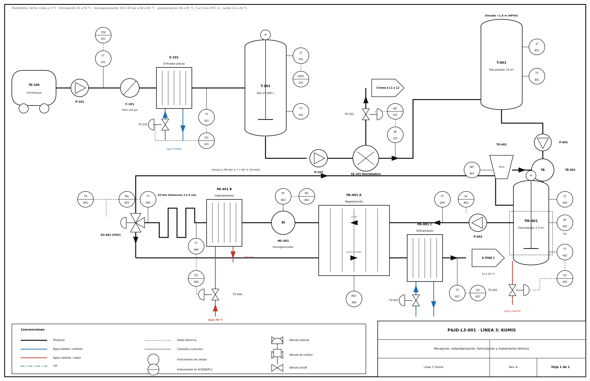
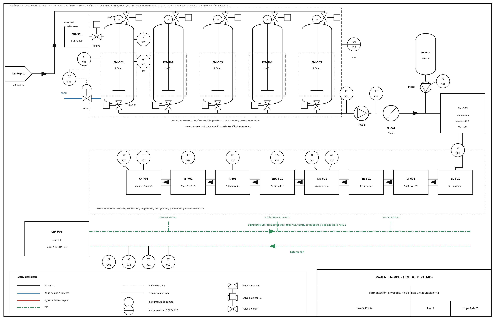

# P&ID — Línea 3: Kumis

> **Planos:** P&ID-L3-001 (hoja 1) y P&ID-L3-002 (hoja 2) · Rev. A · Norma ANSI/ISA-5.1
> **Alcance:** recepción y almacenamiento de leche (área 100, compartida), estandarización (área 150, compartida), formulación y tratamiento térmico (área 400), fermentación (área 500), envasado y fin de línea (área 600), maduración fría (área 700) y CIP (área 900). Los equipos de fin de línea son discretos y se muestran como bloques.
> **Archivos:** `PID_Kumis_Hoja1.png/.svg`, `PID_Kumis_Hoja2.png/.svg`, `PID_Kumis.pdf` (las dos hojas) y `generar_pid.py` (fuente de los planos; se regenera con `python3 generar_pid.py`).
> **Referencia de proceso:** `mapa_proceso_industrial_kumis.html` (fermentación mesófila, azúcar antes del tratamiento térmico, maduración fría después del envasado).

**Hoja 1.** Recepción, estandarización, formulación y tratamiento térmico.

**Hoja 2.** Fermentación, envasado, fin de línea y maduración fría.

---

## 1. Cambios frente al P&ID anterior (PDF) y al documento fuente

La primera versión del P&ID usaba un cultivo a 43 °C, una etapa de saborización con jarabe y fruta, y una maduración en tanque antes del envasado. Esta revisión corrige esas diferencias con el documento fuente.

| Tema | Versión anterior | Esta revisión (Rev. A) |
|---|---|---|
| Cultivo y fermentación | Inoculación a 42–43 °C | Cultivo mesófilo, inoculación a 24 °C, fermentación a 22–25 °C durante 14–18 h |
| Azúcar | Jarabe después de la fermentación (T-403, DOS-403) | Sacarosa pesada y dispersada antes del tratamiento térmico (TO-401, TB-401, TM-401) |
| Saborización | Jarabe y fruta | Solo esencia de vainilla o crema al 0,05 % a 12 °C (ES-601) |
| Rotura de coágulo | Enfriador de placas a 20 °C | En el mismo fermentador, con agitador áncora y choque frío a 10–12 °C |
| Maduración | Tanque T-402 a 4 °C antes de llenar | Cámara fría CF-701 con el producto ya envasado, 24 a 48 h |
| Pasteurizador | Regenerador, calentador y enfriador separados (HX-301/302/304) | Pasteurizador de placas PA-401 A/B/C con skid de agua a 98 °C presurizado y tubo de retención de 166 L |
| Fermentadores | 2 tanques (TF-401 A/B) | 5 tanques de 2.000 L (FM-501…505) en sala presurizada con HEPA |
| Envasado | Llenadora aséptica genérica | Envasadora en cabina ISO 5 con UV/H₂O₂ (EN-601), sellado por inducción (SL-601) |
| Numeración | Tags 1xx a 7xx del primer borrador | Áreas 100/150 compartidas con queso; 400 a 900 propias del kumis |

---

## 2. Lista de equipos

| Tag | Equipo | Área | Especificación de referencia |
|---|---|---|---|
| TK-100 | Carrotanque de leche cruda | 100 | 10.000 L, ≤ 6 °C |
| P-101 | Bomba sanitaria de recepción | 100 | Centrífuga AISI 316L, 12.000 L/h a 2,5 bar |
| F-101 | Filtro dúplex | 100 | 150 µm |
| E-101 | Enfriador de placas | 100 | Agua glicolada a 1 °C; salida 2–4 °C |
| T-101 | Silo de leche cruda (compartido) | 100 | 25.000 L, isotérmico, agitador |
| P-102 | Bomba de alimentación a tratamiento | 100 | Centrífuga |
| SE-101 | Desnatadora / estandarizadora (compartida) | 150 | 6.500–7.200 rpm; grasa 2,8–3,0 %; 10.000 L/h |
| T-401 | Silo pulmón dedicado | 400 | 10.000 L, a +1,8 m para el NPSH |
| P-401 | Bomba de alimentación del Triblender | 400 | Centrífuga, DN 65 |
| TO-401 | Tolva de pesaje de polvos | 400 | Con celdas de carga; sacarosa y LPD |
| MX-401 | Mezclador de tambor para la premezcla de pectina | 400 | Pectina + 10 kg de azúcar (no dibujado; operación manual) |
| TB-401 | Dispersor Triblender | 400 | Rodete a 3.000 rpm, cámara Venturi |
| TM-401 | Tanque de formulación encamisado | 400 | 2.500 L, agitador áncora |
| P-402 | Bomba de alimentación del pasteurizador | 400 | Centrífuga con VFD, 2.500 L/h |
| PA-401 A/B/C | Pasteurizador de placas de titanio | 400 | Regeneración, calentamiento (agua a 98 °C, 1,5–2,0 bar) y enfriamiento (agua helada) |
| HG-401 | Homogeneizador triplex | 400 | 150 + 30 bar a 60–65 °C |
| HT-401 | Tubo de retención helicoidal | 400 | 166 L; 3–5 min a 2.500 L/h |
| XV-401 | Válvula de desvío de flujo (FDV) | 400 | Retorna a TM-401 si T < 90 °C |
| CUL-501 | Cultivo DVS | 500 | 100–200 U por lote |
| VP-501 | Válvula de barrera de vapor del puerto de inoculación | 500 | Esterilización a 121 °C, 15 min |
| FM-501…505 | Fermentadores AISI 316L encamisados | 500 | 2.000 L; agitador áncora a 15 rpm; sala a +20 a +30 Pa con HEPA H14 |
| P-601 | Bomba lobular | 600 | 4.500 L/h (a confirmar) |
| FL-601 | Tamiz de micromalla | 600 | 250 µm |
| ES-601 / P-603 | Tanque y bomba dosificadora de esencia | 600 | 0,05 % |
| EN-601 | Envasadora en cabina ISO 5 | 600 | UV/H₂O₂; 8–12 °C |
| SL-601 | Selladora de inducción y taponadora | 600 | 180 °C durante 0,8 s |
| CI-601 | Codificadora CIJ o láser | 600 | Lote, hora y vencimiento |
| INS-601 | Visión artificial y checkweigher | 600 | ± 0,5 % de peso neto |
| TE-601 | Termoencogedora | 600 | 160–180 °C; 15–20 fardos/min |
| ENC-601 | Encajonadora automática | 600 | Según la referencia |
| R-601 | Robot paletizador (compartido) | 600 | 8–12 cajas/min |
| TF-701 | Túnel de enfriamiento rápido | 700 | Aire forzado a 0–2 °C |
| CF-701 | Cámara de maduración | 700 | 2–4 °C; HR 80–85 % |
| CIP-901 | Central CIP | 900 | NaOH 2 % a 80 °C, HNO₃ 1 % a 60 °C; mix-proof |

---

## 3. Índice de instrumentos

### 3.1 Hoja 1

| Tag | Descripción | Variable | Rango / punto de ajuste | Ubicación | Función |
|---|---|---|---|---|---|
| FT-101 | Caudalímetro másico (Coriolis) de recepción | Flujo | 0–12 m³/h | Campo | Medición de leche recibida |
| FQI-101 | Totalizador de leche recibida | Flujo | L por carrotanque | PLC / SCADA | Volumen por proveedor (trazabilidad) |
| TT-101 | Temperatura a la salida del enfriador | Temperatura | 0–20 °C; SP 4 °C | Campo (PT100) | Lazo TIC-101 |
| TIC-101 | Control de temperatura de enfriamiento | Temperatura | SP 4 °C | PLC | PID sobre TV-101 |
| TV-101 | Válvula de control de agua helada | — | 0–100 % | Campo | Elemento final del lazo 101 |
| LT-101 | Nivel del silo | Nivel | 0–25.000 L | Campo | Inventario |
| LAHL-101 | Alarma de nivel alto y bajo | Nivel | 95 % / 10 % | PLC / SCADA | Protege contra rebose y cavitación |
| TT-102 | Temperatura del silo | Temperatura | 0–20 °C; alarma > 6 °C | Campo (PT100) | Cadena de frío |
| AT-101 | Analizador de grasa en línea | Análisis | 0–5 % | Campo | Lazo AIC-101 |
| AIC-101 | Control de estandarización | Análisis | SP 2,8–3,0 % según la receta | PLC | Ajusta FV-101 |
| FV-101 | Válvula de control de crema | — | 0–100 % | Campo | Elemento final del lazo AIC-101 |
| LT-401 | Nivel del silo pulmón | Nivel | 0–10.000 L | Campo | Programación del lote |
| TT-401 | Temperatura del silo pulmón | Temperatura | 0–20 °C; alarma > 6 °C | Campo (PT100) | Cadena de frío |
| WT-401 | Celdas de carga de la tolva TO-401 | Peso | 0–200 kg | Campo | Masas de la receta (azúcar, LPD) |
| LT-402 | Nivel del tanque de formulación | Nivel | 0–2.500 L | Campo | Control de llenado |
| AT-402 | Refractómetro en línea | °Brix | 0–30 °Bx; 14,5–15,0 | Campo | Verifica la formulación |
| TT-402 | Temperatura del tanque de formulación | Temperatura | 0–80 °C; SP 45–50 °C | Campo (PT100) | Lazo TIC-402 |
| TIC-402 | Control de temperatura de formulación | Temperatura | SP 45–50 °C | PLC | PID sobre TV-402 |
| TV-402 | Válvula de agua caliente de la camisa | — | 0–100 % | Campo | Elemento final del lazo 402 |
| FT-404 | Caudalímetro del pasteurizador | Flujo | 0–4.000 L/h; SP 2.500 | Campo | Mantiene el tiempo de retención |
| SC-402 | Variador de la bomba P-402 | Velocidad | 0–100 % | PLC | Regula el caudal |
| PT-403 | Presión de homogeneización | Presión | 0–250 bar | Campo | Lazo PIC-403 |
| PIC-403 | Control de presión de homogeneización | Presión | 150 + 30 bar | PLC | Ajusta el homogeneizador |
| TT-404 | Temperatura a la salida del calentamiento | Temperatura | 0–110 °C; SP 92 °C | Campo (PT100) | Lazo TIC-404 |
| TIC-404 | Control de temperatura de pasteurización | Temperatura | SP 92 °C | PLC | PID sobre TV-404 |
| TV-404 | Válvula de agua calefactora a 98 °C | — | 0–100 % | Campo | Elemento final del lazo 404 |
| TT-405 | Temperatura a la salida del tubo de retención | Temperatura | 0–110 °C; SP 92 °C | Campo (PT100 doble) | **PCC-1** |
| TAL-405 | Interruptor por baja temperatura | Temperatura | < 90 °C | PLC | Activa la desviación XV-401 |
| TR-405 | Registrador de pasteurización | Temperatura | — | SCADA / historiador | Evidencia del PCC-1 |
| XV-401 | Válvula de desvío de flujo (FDV) | — | Abierta / cerrada | Campo | Devuelve la leche a TM-401 si T < 90 °C |
| PDT-406 | Presión diferencial del regenerador | Presión | 0–2 bar; alarma < 0,5 bar | Campo | Evita el cruce de leche cruda a pasteurizada |
| TT-407 | Temperatura a la salida del enfriador | Temperatura | 0–40 °C; SP 24 °C | Campo (PT100) | Lazo TIC-407 |
| TIC-407 | Control de temperatura de inoculación | Temperatura | SP 22–26 °C | PLC | PID sobre TV-407 |
| TV-407 | Válvula de agua helada del enfriador | — | 0–100 % | Campo | Elemento final del lazo 407 |

### 3.2 Hoja 2 (FM-502 a FM-505 repiten la instrumentación de FM-501)

| Tag | Descripción | Variable | Rango / punto de ajuste | Ubicación | Función |
|---|---|---|---|---|---|
| LT-501 | Nivel del fermentador | Nivel | 0–2.000 L | Campo | Control de llenado y descarga |
| AT-501 | pH del fermentador | Análisis | 3–7; corte en 4,50–4,60 | Campo | Punto final de la fermentación |
| TT-501 | Temperatura del fermentador | Temperatura | 0–40 °C; SP 22–25 °C | Campo (PT100) | Lazo TIC-501 |
| TIC-501 | Control de temperatura de la camisa | Temperatura | Perfil por fase (24 → 10–12 °C) | PLC | PID sobre TV-501 |
| TV-501 | Válvula de agua caliente o helada de la camisa | — | 0–100 % | Campo | Elemento final del lazo 501 |
| XV-502 | Válvula de entrada al fermentador | — | Abierta / cerrada | Campo | Secuencia de llenado |
| XV-503 | Válvula de descarga del fermentador | — | Abierta / cerrada | Campo | Secuencia de descarga |
| VP-501 | Válvula de barrera de vapor del puerto de inoculación | — | Abierta / cerrada | Campo | Inoculación aséptica |
| PDT-510 | Presión diferencial de la sala de fermentación | Presión | +20 a +30 Pa; alarma < +15 Pa | Campo / PLC | Barrera contra fagos |
| PT-601 | Presión de la bomba lobular | Presión | 0–2 bar; ΔP 0,5–1,0 | Campo | Evita romper el gel |
| TT-601 | Temperatura del producto al envasado | Temperatura | 0–20 °C; 8–12 °C | Campo (PT100) | Control del envasado |
| FQ-601 | Totalizador de esencia | Flujo | g por lote; 0,05 % | PLC | Dosis por receta |
| LT-601 | Nivel de la tolva de la envasadora | Nivel | 0–100 % | Campo | Alimentación |
| AT-601 | Visión de sello y tapa | Análisis | Conforme / no conforme | Campo | Rechazo automático |
| WT-601 | Checkweigher | Peso | ± 0,5 % del peso neto | Campo | Control de peso |
| ZS-601 | Sensor de presencia en la encajonadora | Presencia | Presente / ausente | Campo | Secuencia de encajonado |
| XS-601 | Cortina de luz del robot | Seguridad | Libre / invadida | Campo | Seguridad de la celda |
| TT-701 | Temperatura del túnel de enfriamiento | Temperatura | −2 a 10 °C; SP 0–2 °C | Campo | Enfriamiento rápido |
| TT-702 | Temperatura de la cámara | Temperatura | 0–10 °C; 2–4 °C | Campo | Cadena de frío |
| AT-701 | Humedad relativa de la cámara | Humedad | 80–85 % | Campo | Condiciones de maduración |
| AT-901 | Conductividad del retorno CIP | Análisis | Según el paso de lavado | Campo | Fin de ciclo CIP |
| AT-902 | Turbidez del retorno CIP | Análisis | Según el paso de lavado | Campo | Verifica la limpieza |
| TT-901 | Temperatura del CIP | Temperatura | NaOH 75–85 °C; HNO₃ 55–65 °C | Campo | Control del ciclo |
| FT-901 | Caudal del CIP | Flujo | v > 1,5 m/s | Campo | Régimen turbulento |

Total: 58 instrumentos y válvulas.

---

## 4. Lazos de control

| Lazo | Variable controlada | Variable manipulada | Tipo | Observación |
|---|---|---|---|---|
| 101 | Temperatura de la leche cruda (TT-101) | Agua helada (TV-101) | PID | Cadena de frío en la recepción |
| AIC-101 | % de grasa (AT-101) | Salida de crema (FV-101) | PID | SP 2,8–3,0 % según la receta |
| 402 | Temperatura de formulación (TT-402) | Agua caliente de la camisa (TV-402) | PID | 45–50 °C |
| PIC-403 | Presión de homogeneización (PT-403) | Válvula del homogeneizador | PID | 150 + 30 bar |
| 404 | Temperatura de pasteurización (TT-404) | Agua a 98 °C (TV-404) | PID | Skid presurizado a 1,5–2,0 bar |
| 405 | Temperatura de retención (TT-405) | Desvío XV-401 | Enclavamiento | **PCC-1**; TAL-405 desvía si T < 90 °C; registro TR-405 |
| 406 | Presión diferencial (PDT-406) | — | Alarma | ΔP > 0,5 bar hacia el lado pasteurizado |
| 407 | Temperatura de salida (TT-407) | Agua helada (TV-407) | PID | 22–26 °C |
| 501 | Temperatura del fermentador (TT-501) | Agua de la camisa (TV-501) | PID por fase | 22–25 °C; choque frío a 10–12 °C |
| AT-501 | pH del fermentador | Fin de la fermentación y rotura | Secuencial | Corte a pH 4,50–4,60 |
| PDT-510 | Presión de la sala | HVAC | PID | +20 a +30 Pa |
| 601 | Dosis de esencia (FQ-601) | Bomba P-603 | Secuencial | 0,05 % por lote |

---

## 5. Notas de diseño

- **PCC-1 (pasteurización):** el tubo de 166 L da 4 min a 2.500 L/h. Si el caudal sube, el tiempo baja; por eso FT-404 y SC-402 se vigilan junto con la temperatura.
- **Altitud:** el silo pulmón va a +1,8 m y el skid del pasteurizador trabaja a 1,5–2,0 bar porque el agua hierve a unos 91 °C a 2.600 msnm.
- **Bacteriófagos:** la sala de fermentación va aislada (PDT-510), se inocula por el puerto con barrera de vapor (VP-501) y las válvulas del CIP son mix-proof.
- **FM-502 a FM-505:** repiten la instrumentación de FM-501; el P&ID los dibuja una sola vez para no repetir 40 símbolos.
- **Elementos propuestos por este equipo:** INS-601, TF-701, ENC-601 y los sensores AT-901 y AT-902 del CIP no aparecen en el documento fuente.
