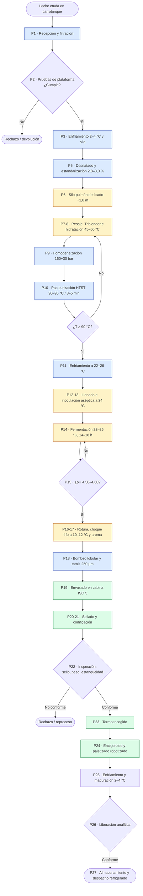
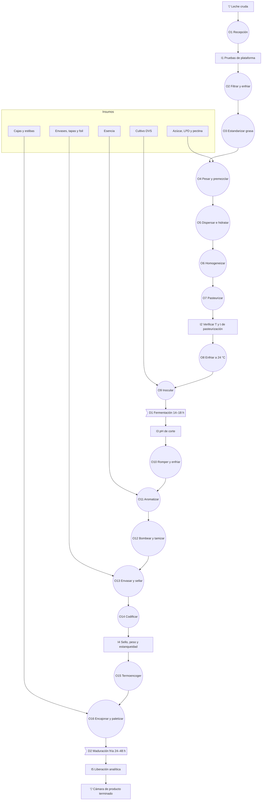

# Línea 3 – Kumis: Proceso de Producción del Kumis

**Proyecto Integrador APM 2026-2S** · Automatización de Procesos de Manufactura – UNAL
**Responsables línea 3:** Jesús A. Rivera M. · David F. Cárdenas C.
**Alcance:** elaboración de kumis (leche fermentada mesófila): materia prima e insumos, maquinaria, secuencia de operaciones y flujo del proceso, desde la recepción de la leche hasta el despacho.

> **Nota:** los parámetros de proceso provienen del documento de validación de ingeniería del kumis (`mapa_proceso_industrial_kumis.html`) y de la búsqueda y el análisis del sector lácteo. Constituyen la propuesta inicial de ingeniería y se contrastarán con la visita técnica a Alpina Sopó (27 y 28 de octubre de 2026).

---

## 1. Descripción del producto

| Atributo | Descripción |
|---|---|
| Producto | Kumis entero: leche fermentada por cultivos lácticos mesófilos, de textura cremosa, sabor ácido-dulce y nota a diacetilo |
| Clasificación | Leche fermentada viva (NTC 805), sin tratamiento térmico posterior a la fermentación |
| Grasa | 2,8–3,0 % |
| Proteína / sólidos no grasos | > 2,8 % / > 11,5 % |
| Azúcar | 8,5 % en la receta azucarada; sin azúcar adicionada en la natural |
| Acidez final | 0,75–0,80 % de ácido láctico (75–80 °Dornic); pH de equilibrio 4,45–4,55 |
| Viscosidad | 1.800–2.400 cP a 10 °C |
| Bacterias ácido-lácticas viables | ≥ 10⁷ UFC/g al final de la vida útil |
| Presentaciones | Vaso de 200 g, botella PEAD de 1 L y bolsa de 1 kg. Ver §1.1 |
| Conservación | Refrigerado a 2–4 °C |
| Vida útil | 25–35 días (en cadena de frío) |

**Marco normativo de referencia (según el documento de validación; verificar los textos vigentes):** NTC 805 (leches fermentadas), Decreto 616 de 2006 (leche), Resolución 2310 de 1986 (derivados lácteos) y Resolución 1407 de 2022.

### 1.1 Tres presentaciones de kumis

La línea elabora un solo producto base con dos recetas: la entera azucarada (KU-200 y KU-1L) y la natural (KU-NAT). Las tres referencias se diferencian en formulación, tiempo de fermentación, envasado, sellado, encajonado, maduración y vida útil.

| | **KU-200 – Vaso 200 g** | **KU-1L – Botella 1 L** | **KU-NAT – Bolsa 1 kg natural** |
|---|---|---|---|
| Canal | Retail individual | Retail familiar | Retail familiar y cocina |
| Receta | Entera azucarada | Entera azucarada | Natural sin azúcar adicionada |
| Fermentación | 16 h | 16 h | 14 h |
| Envase | Vaso de PP con foil | Botella PEAD con tapa rosca y foil de inducción | Bolsa de polietileno coextruido |
| Envasadora | Llenadora de vasos, 6.000 vasos/h | Envasadora rotativa, 4.000 bot/h | Empacadora vertical, 2.400 bolsas/h (40/min) |
| Sellado | Termosellado de foil a 170–180 °C | Inducción a 180 °C durante 0,8 s | Soldadura térmica a 130–150 °C |
| Termoencogido | Bandeja de 6 vasos | Fardo de 12 botellas | No aplica |
| Unidades por caja | 24 | 12 | 12 |
| Inspección | Visión de sello y peso | Visión de tapa y sello, peso y estanqueidad | Detector de metales, peso y fugas |
| Maduración | 26 h | 27 h | 26 h |
| Vida útil | 28 días | 30 días | 25 días |

**Recetas:** entera azucarada (leche 88,8 %, azúcar 8,5 %, LPD 2,5 %, pectina LMP 0,15 %, cultivo DVS y esencia 0,05 %) y natural (leche 96,8 %, LPD 3,0 %, pectina LMP 0,15 % y cultivo DVS).

---

## 2. Materia prima e insumos

### 2.1 Materia prima principal: leche cruda de vaca

| Parámetro de aceptación | Valor de referencia |
|---|---|
| Temperatura de recepción | ≤ 6 °C |
| Densidad a 15 °C | 1,028–1,032 g/mL |
| Acidez titulable | 14–17 °Dornic |
| Prueba de alcohol (68–75 %) | Negativa |
| Antibióticos betalactámicos | Negativo estricto |
| Adulteración con lactosuero | Negativa (Decreto 616) |
| Grasa tras la estandarización | 2,8–3,0 % |

### 2.2 Receta base (lote de 2.000 L, receta entera azucarada)

| Insumo | Función | Dosis | Cantidad por lote |
|---|---|---|---|
| Leche estandarizada | Materia prima | 88,80 % | 1.829,2 kg |
| Azúcar refinado | Dulzor y sólidos | 8,5 % | 175,1 kg |
| Leche en polvo descremada | Sólidos no grasos | 2,5 % | 51,5 kg |
| Pectina LMP | Estabilizante | 0,15 % | 3,09 kg |
| Cultivo mesófilo DVS | Fermentación | 50–100 U por 1.000 L | 100–200 U |
| Esencia de vainilla o crema | Aroma | 0,05 % | 1,03 kg |

**Balance de masa aproximado del lote:**

```
Leche ≈1.829 kg + azúcar ≈175 kg + LPD ≈52 kg + pectina ≈3 kg + esencia ≈1 kg + cultivo
        │
        └──► Kumis ≈ 2.060 kg (2.000 L)   (no hay subproducto: no se separa suero)
```

### 2.3 Materiales de empaque

- Botellas PEAD de 1 L, tapas rosca de PP y foil de aluminio termosellable (KU-1L).
- Vasos de PP de 200 g con foil o tapa (KU-200).
- Película de polietileno coextruido para bolsas de 1 kg (KU-NAT).
- Film de polietileno termoencogible para los fardos y cajas de cartón corrugado.
- Etiquetas con lote, fecha de fabricación y vencimiento (CIJ o láser).
- Estibas plásticas higiénicas y film estirable.

### 2.4 Servicios industriales (compartidos con las líneas 1 y 2)

| Servicio | Uso en la línea de kumis |
|---|---|
| Vapor de la caldera (6 bar) | Skid de agua caliente a 98 °C del pasteurizador, CIP |
| Agua helada / chiller a 1 °C | Enfriamiento en recepción, camisas de fermentadores y choque frío |
| Aire comprimido seco (−40 °C de punto de rocío) | Válvulas neumáticas; aire estéril para la cabina ISO 5 |
| Agua potable y agua blanda recuperada | Proceso y enjuagues del CIP |
| Central CIP (NaOH 2 %, HNO₃ 1 %) | Limpieza de la línea, conectada solo por válvulas mix-proof |
| Energía eléctrica | Motores, bombas, HVAC con filtros HEPA y control |

---

## 3. Maquinaria y equipos

El tag es el del P&ID (`PID_Kumis.md`). Los equipos marcados con **(P)** son propuestas de este equipo que el documento fuente no menciona.

| # | Área | Equipo | Tag | Función | Instrumentación y actuadores principales |
|---|---|---|---|---|---|
| E1 | Recepción | Bomba sanitaria centrífuga AISI 316L (12.000 L/h) | P-101 | Descarga el carrotanque a 2,5 bar | Motor con VFD, caudalímetro Coriolis |
| E2 | Recepción | Filtro dúplex de 150 µm | F-101 | Retiene partículas visibles | Presión diferencial |
| E3 | Recepción | Enfriador de placas con agua glicolada | E-101 | Enfría a 2–4 °C | PT100 y válvula de agua helada |
| E4 | Almacenamiento | Silo isotérmico con agitación (compartido) | T-101 | Almacena la leche cruda | Nivel, PT100 |
| E5 | Tratamiento | Desnatadora centrífuga autolimpiante (compartida) | SE-101 | Clarifica y estandariza la grasa a 2,8–3,0 % | Analizador de grasa, válvula de crema |
| E6 | Formulación | Silo pulmón dedicado de 10.000 L a +1,8 m | T-401 | Almacena leche estandarizada y protege el NPSH | Nivel, PT100 |
| E7 | Formulación | Tolva de pesaje y básculas; mezclador de tambor | TO-401, MX-401 | Pesa sacarosa y LPD; premezcla la pectina | Celdas de carga |
| E8 | Formulación | Dispersor Triblender (3.000 rpm) | TB-401 | Disuelve los polvos sin grumos | VFD, válvula de polvos |
| E9 | Formulación | Tanque de formulación encamisado de 2.500 L con agitador áncora | TM-401 | Hidrata y mantiene a 45–50 °C | Nivel, °Brix en línea, PT100 |
| E10 | Tratamiento | Homogeneizador triplex de pistones | HG-401 | 150 + 30 bar a 60–65 °C | Presión, VFD |
| E11 | Tratamiento | Pasteurizador de placas con skid presurizado | PA-401 A/B/C | Regeneración, calentamiento a 90–95 °C y enfriamiento a 22–26 °C | PT100, válvulas de agua |
| E12 | Tratamiento | Tubo de retención de 166 L | HT-401 | 3–5 min a 2.500 L/h | PT100 doble |
| E13 | Tratamiento | Válvula de desvío de flujo | XV-401 | Devuelve la leche si T < 90 °C | Enclavamiento por PLC |
| E14 | Fermentación | HVAC con filtros HEPA H14 | — | Sala a +20 a +30 Pa | Presión diferencial |
| E15 | Fermentación | Fermentadores AISI 316L encamisados de 2.000 L, agitador áncora (15 rpm) | FM-501…505 | Fermentan 14–18 h | pH, PT100, nivel, VFD |
| E16 | Fermentación | Puertos de inoculación aséptica con barrera de vapor | VP-501 | Siembran el cultivo DVS sin abrir el tanque | Válvulas on/off |
| E17 | Acabado | Bomba lobular sanitaria **(caudal a confirmar)** | P-601 | Transfiere sin cortar el gel | Presión |
| E18 | Acabado | Tamiz de 250 µm | FL-601 | Suaviza la textura | Presión diferencial |
| E19 | Acabado | Microdosificador volumétrico aséptico de esencia | ES-601, P-603 | Aromatiza a 12 °C | Totalizador de caudal |
| E20 | Envasado | Envasadora en cabina ISO 5 con UV/H₂O₂ | EN-601 | Llena a 8–12 °C (PCC-2) | Nivel, presión de cabina |
| E21 | Envasado | Selladora de inducción y taponadora | SL-601 | Sella a 180 °C durante 0,8 s | Temperatura de sellado |
| E22 | Envasado | Codificadora CIJ o láser | CI-601 | Imprime lote, hora y vencimiento | Lector de código |
| E23 | Inspección | Visión artificial y checkweigher **(P)** | INS-601 | Verifica sello, tapa y peso | Cámara, celda de carga |
| E24 | Empaque | Termoencogedora | TE-601 | 160–180 °C, 15–20 fardos/min | Temperatura del túnel |
| E25 | Empaque | Encajonadora automática **(P)** | ENC-601 | Arma cajas | Sensores de presencia |
| E26 | Empaque | Celda robotizada de paletizado (compartida) | R-601 | Estiba según el patrón de cada referencia | Robot, cortinas de luz |
| E27 | Frío | Túnel de enfriamiento rápido de aire forzado **(P)** | TF-701 | Lleva el núcleo a ≤ 4 °C | Temperatura |
| E28 | Frío | Cámara frigorífica de 2–4 °C | CF-701 | Maduración de 24 a 48 h | Temperatura y humedad |
| E29 | Servicios | Central CIP con mix-proof | CIP-901 | Limpieza automática | Conductividad, turbidez, temperatura, caudal |

---

## 4. Secuencia del proceso: qué va primero

Los tiempos corresponden a un lote de 2.000 L de KU-1L en la situación inicial.

| Paso | Operación | Parámetros de referencia | Tiempo | Tipo de operación | Equipo |
|---|---|---|---|---|---|
| 1 | **Recepción de la leche** (descarga y medición) | ≤ 6 °C; 2,5 bar | 30–40 min por carrotanque | Continua | E1 |
| 2 | **Pruebas de plataforma** | Acidez, alcohol, densidad, antibióticos, adulteración | 15–20 min (en paralelo) | Inspección | Laboratorio |
| 3 | **Filtración y enfriamiento** | 150 µm; 2–4 °C | En línea | Continua | E2, E3 |
| 4 | **Almacenamiento en silo** | 2–4 °C; ≤ 48 h | Variable (inventario) | Almacenamiento | E4 |
| 5 | **Clarificación y estandarización** | 45–50 °C; grasa 2,8–3,0 % | 12 min por lote | Continua | E5 |
| 6 | **Silo pulmón dedicado** | 4 °C; +1,8 m | Hasta el lote | Almacenamiento | E6 |
| 7 | **Pesaje y premezcla de polvos** | Sacarosa, LPD y pectina con 10 kg de azúcar | 15 min | Discreta | E7 |
| 8 | **Dispersión en Triblender e hidratación** | 45–50 °C; 20–25 min; 14,5–15,0 °Bx | 90 min en total | Batch | E8, E9 |
| 9 | **Homogeneización** | 150 + 30 bar; 60–65 °C | En línea | Continua | E10 |
| 10 | **Pasteurización HTST** | **90–95 °C durante 3–5 min**; ΔP > 0,5 bar | 48 min por lote (2.500 L/h) | Continua (PCC-1) | E11–E13 |
| 11 | **Enfriamiento** | 22–26 °C | Incluido en el paso 10 | Continua | E11 |
| 12 | **Llenado del fermentador** | 22–26 °C; por el fondo | Incluido en el paso 10 | Batch | E15 |
| 13 | **Inoculación aséptica** | 24 °C; 100–200 U; 5 min a 15 rpm | 20 min | Batch | E16 |
| 14 | **Fermentación** | 22–25 °C; reposo absoluto | 14–18 h | Batch | E15 |
| 15 | **Verificación del punto de corte** | pH 4,50–4,60; 75–80 °D | 15 min (muestreo manual) | Inspección | E15 |
| 16 | **Rotura de coágulo y choque frío** | 15–20 rpm; de 24 a 10–12 °C | 45 min con el enfriamiento de la camisa | Batch | E15 |
| 17 | **Aromatización** | 0,05 % de esencia a 12 °C | Incluido en el paso 16 | Batch | E19 |
| 18 | **Bombeo lobular y tamizado** | 10–12 °C; ΔP 0,5–1,0 bar; 250 µm | Simultáneo al envasado | Continua | E17, E18 |
| 19 | **Envasado** | 8–12 °C; cabina ISO 5; 4.000 bot/h | 30 min por lote | Discreta (PCC-2) | E20 |
| 20 | **Sellado y taponado** | Inducción a 180 °C, 0,8 s | En línea | Discreta | E21 |
| 21 | **Codificación** | Lote, hora y vencimiento | En línea | Discreta | E22 |
| 22 | **Inspección en línea** | Sello, tapa, peso y estanqueidad | En línea | Inspección | E23 |
| 23 | **Termoencogido** | 160–180 °C | En línea | Discreta | E24 |
| 24 | **Encajonado y paletizado** | 12 und/caja; 5 cajas/min en manual | 33 min | Discreta (robot en la propuesta) | E25, E26 |
| 25 | **Enfriamiento y maduración** | 2–4 °C; HR 80–85 % | 36 h | Demora / almacenamiento | E27, E28 |
| 26 | **Liberación analítica** | Micro y fisicoquímica | En paralelo con el paso 25 | Inspección | Laboratorio |
| 27 | **Almacenamiento y despacho** | ≤ 4 °C; FEFO | Hasta el despacho | Almacenamiento y transporte | E28 |
| ⟳ | **Limpieza CIP** de la línea | Enjuague → NaOH 1,5–2 % a 75–85 °C → enjuague → HNO₃ 0,5–1,5 % a 55–65 °C → sanitización | 60 min por fermentador | Batch (servicio) | E29 |

**Tiempo del lote en el fermentador (pasos 12 a 16):** ≈ 19,6 h con CIP (1.178 min).
**MLT aproximado, del silo pulmón a la estiba liberada:** 57,1 h en KU-1L; la maduración (paso 25) es la mayor demora.

---

## 5. Diagrama de flujo del proceso



*Colores: azul = operación continua · amarillo = operación batch · verde = operación discreta.*

---

## 6. Diagrama de operaciones de proceso (DOP)

Simbología: ○ operación, □ inspección, ⇨ transporte, D demora, ▽ almacenamiento. Las entradas laterales son los insumos que ingresan en cada operación.



**Resumen del DOP:** 16 operaciones · 5 inspecciones · 2 demoras principales (fermentación y maduración) · 2 almacenamientos.

---

## 7. Cursograma analítico (flow process chart)

| N.º | Actividad | ○ | ⇨ | D | □ | ▽ | Tiempo (min) | Observación / oportunidad de automatización |
|---|---|:-:|:-:|:-:|:-:|:-:|---:|---|
| 1 | Descarga del carrotanque | ● | | | | | 35 | Caudalímetro másico con registro automático en el MES |
| 2 | Pruebas de plataforma | | | | ● | | 20 | Resultados enviados al MES (trazabilidad del proveedor) |
| 3 | Filtración, enfriamiento y silo | | ● | | | ● | 240–1.440 | Control de nivel y temperatura por SCADA |
| 4 | Estandarización de grasa | ● | | | | | 12 | Lazo AIC-101 y válvula de crema |
| 5 | Silo pulmón dedicado | | | | | ● | Variable | Inventario por lote |
| 6 | Pesaje de polvos y premezcla | ● | | | | | 15 | **Hoy es manual** (sacos de 25 kg) |
| 7 | Dispersión e hidratación | ● | | | | | 75 | Dosificación gravimétrica automática y recetas ISA-88 |
| 8 | Homogeneización y pasteurización | ● | | | | | 48 | Lazo PID de temperatura y FDV automática (PCC-1) |
| 9 | Llenado e inoculación | | ● | | | | 68 | Puerto aséptico automatizado |
| 10 | Fermentación | | | ● | | | 960 | **Posible cuello de botella:** un lote por fermentador por día |
| 11 | Verificación del punto de corte | | | | ● | | 15 | **Hoy es manual** (muestreo y titulación); pH en línea |
| 12 | Rotura de coágulo y choque frío | ● | | | | | 45 | Receta de agitación y camisa |
| 13 | Envasado y sellado | ● | | | | | 30 | PCC-2; cabina ISO 5 |
| 14 | Inspección en línea | | | | ● | | en línea | Rechazo automático |
| 15 | Traslado y termoencogido | | ● | | | | 10 | – |
| 16 | Encajonado y paletizado | ● | | | | | 33 | **Celda robotizada** |
| 17 | Maduración fría | | | ● | | | 720–2.160 | **Mayor tiempo no productivo** del proceso |
| 18 | Liberación y almacenamiento | | | | ● | ● | Hasta el despacho | WMS / FEFO |
| | **Total de actividades** | **8** | **3** | **2** | **4** | **3** | | |

---

## 8. EDT de producción (desglose del proceso por etapas)

```
Producción de Kumis (Línea 3)
├── 1. Acondicionamiento de la leche  [parcialmente compartido L1-L2-L3]
│   ├── 1.1 Recepción e impulsión
│   ├── 1.2 Filtración y enfriamiento
│   ├── 1.3 Silo pulmón dedicado (+1,8 m)
│   └── 1.4 Clarificación y desnatado
├── 2. Formulación  [exclusivo L3]
│   ├── 2.1 Pesaje de sacarosa y LPD
│   ├── 2.2 Premezcla de pectina LMP
│   └── 2.3 Dispersión en Triblender
├── 3. Tratamiento térmico  [exclusivo L3]
│   ├── 3.1 Homogeneización
│   ├── 3.2 Pasteurización HTST (PCC-1)
│   └── 3.3 Enfriamiento a 22–26 °C
├── 4. Fermentación  [exclusivo L3, sala aislada]
│   ├── 4.1 Sala presurizada con HEPA
│   ├── 4.2 Inoculación aséptica y rotación de cepas
│   └── 4.3 Incubación y punto de corte
├── 5. Acabado y envasado  [exclusivo L3]
│   ├── 5.1 Rotura de coágulo y choque frío
│   ├── 5.2 Aromatización
│   ├── 5.3 Bombeo lobular y tamizado
│   └── 5.4 Envasado en cabina ISO 5 (PCC-2)
├── 6. Fin de línea y maduración
│   ├── 6.1 Sellado y codificación
│   ├── 6.2 Termoencogido, encajonado y paletizado robotizado
│   ├── 6.3 Maduración fría
│   └── 6.4 Liberación analítica y despacho
└── 7. Procesos de soporte
    ├── 7.1 CIP con válvulas mix-proof
    ├── 7.2 Servicios industriales
    ├── 7.3 Control PLC / SCADA
    └── 7.4 Trazabilidad del lote
```

---

## 9. Variables críticas y puntos de control

| Etapa | Variable crítica | Límite | ¿Por qué es crítica? |
|---|---|---|---|
| Recepción | Temperatura, acidez, antibióticos | ≤ 6 °C; 14–17 °D; negativo | Inocuidad y aptitud para fermentar |
| Formulación | °Brix y ausencia de grumos | 14,5–15,0 °Bx; sin *fisheyes* | Estabilidad del gel y textura |
| Homogeneización | Presión | 150 + 30 bar a 60–65 °C | Glóbulos de grasa < 1 µm |
| Pasteurización | **Temperatura y tiempo de retención** | **≥ 90 °C / ≥ 3 min**; ΔP > 0,5 bar | **PCC-1:** elimina *Salmonella* y *Listeria*; el ΔP evita el cruce de leche cruda |
| Sala de fermentación | Presión diferencial | +20 a +30 Pa | Barrera contra fagos 936, c2 y P335 |
| Inoculación | Temperatura y asepsia | 24 °C; sin abrir el tanque | Evita la infección por fagos |
| Fermentación | Temperatura, pH y acidez | 22–25 °C; pH 4,50–4,60; 75–80 °D | Sabor, diacetilo y textura |
| Choque frío | Temperatura | 10–12 °C | Detiene la post-acidificación |
| Envasado | **Aire de la cabina y sellado** | ISO 5; +20 Pa; hermético | **PCC-2:** evita hongos y levaduras |
| Maduración | Temperatura y humedad | 2–4 °C; HR 80–85 % | Estructura final y vida útil |
| Liberación | Micro | Coliformes m = 20 y M = 100 UFC/g; mohos y levaduras m = 100 y M = 500 UFC/g; BAL ≥ 10⁷ UFC/g | Identidad legal del producto vivo |

---

## 10. Recursos compartidos con las otras líneas

- **Compartidos:** bahía de recepción, filtro y enfriador de placas, silo de leche cruda, desnatadora, vapor, chiller, aire comprimido, central CIP (solo por válvulas mix-proof), celda de paletizado y despacho.
- **Exclusivos de la línea de kumis:** sala de fermentación con HEPA y presión positiva, silo pulmón a +1,8 m, tanque de formulación con Triblender, fermentadores de bajas revoluciones, línea de envasado en cabina ISO 5, túnel de enfriamiento y cámara de maduración.
- **Riesgo fágico:** el lactosuero de la quesería transporta fagos líticos (936, c2 y P335) que atacan los cultivos mesófilos del kumis. Por eso la sala de fermentación está aislada, se inocula sin abrir el tanque y se rotan las cepas.
- **Altitud (Sabana de Bogotá, 2.600 msnm, 74 kPa):** el silo pulmón va elevado para proteger el NPSH de las bombas y el skid del pasteurizador trabaja a 1,5–2,0 bar, porque el agua hierve a unos 91 °C.
- **Pasteurizador:** el documento fuente describe un skid HTST de 2.500 L/h para el kumis. El documento de queso menciona un HTST de 10.000 L/h compartido. Se asume aquí el skid dedicado de 2.500 L/h; el equipo debe confirmarlo con los responsables de queso.
- **Simulación (Tecnomatix):** los fermentadores son el candidato a cuello de botella y la maduración es la mayor demora del flujo de valor.

---

## 10.1 P&ID de la línea

Planos P&ID-L3-001 y P&ID-L3-002 (ANSI/ISA-5.1), en dos hojas: recepción, estandarización, formulación y tratamiento térmico (hoja 1); fermentación, envasado, fin de línea y maduración (hoja 2). La lista de equipos, el índice de 58 instrumentos y válvulas y los lazos de control están en [PID_Kumis.md](../diagramas-de-instrumentacion/PID_Kumis.md).


| Lazo | Variable controlada | Variable manipulada | Observación |
|---|---|---|---|
| TIC-404 | Temperatura de calentamiento | Agua a 98 °C (TV-404) | **PCC-1**; TAL-405 activa la desviación XV-401 si T < 90 °C |
| PIC-403 | Presión de homogeneización | Válvula del homogeneizador | 150 + 30 bar |
| TIC-402 | Temperatura de formulación | Agua caliente de la camisa (TV-402) | 45–50 °C |
| TIC-407 | Temperatura de salida | Agua helada (TV-407) | 22–26 °C |
| TIC-501 | Temperatura del fermentador | Agua de la camisa (TV-501) | 22–25 °C; choque frío a 10–12 °C |
| AT-501 | pH del fermentador | Fin de la fermentación | Corte a pH 4,50–4,60 |
| PDT-510 | Presión de la sala | HVAC | +20 a +30 Pa |

---

## 11. Observaciones al documento fuente y preguntas para la visita técnica (27 y 28 de octubre)

**Observaciones al documento de validación del kumis:**

- La tabla de formulación suma 99,56 %, no 100 %. Aquí la leche es el complemento.
- La bomba lobular se da a 1.500 L/h, pero la envasadora a 4.000 botellas/h; con botellas de 1 L no coinciden.
- Las restricciones normativas (almidón prohibido, límites de la Res. 1407 de 2022) están sin verificar contra el texto de la norma.
- La inspección en línea, el túnel de enfriamiento y la encajonadora automática no aparecen en el documento; son propuestas de este equipo.

**Preguntas para la visita:**

- [ ] ¿Qué presentaciones de kumis se fabrican en Sopó y a qué velocidad?
- [ ] Número y capacidad de los fermentadores, y lotes por día.
- [ ] ¿La sala de fermentación está aislada de la quesería? ¿Qué plan de rotación de cultivos usan?
- [ ] Tiempo de maduración antes de liberar el lote y condiciones de la cámara.
- [ ] ¿El pasteurizador del kumis es dedicado o compartido con yogur y queso?

---

## 12. Referencias

- Documento de validación de ingeniería `mapa_proceso_industrial_kumis.html`.
- ICONTEC NTC 805; Decreto 616 de 2006; Resolución 2310 de 1986; Resolución 1407 de 2022.
- Alpina, *Kumis Alpina* (vaso): https://www.farmatodo.com.co/producto/1004417-kumis-alpina-x200g
- Éxito, *Kumis*: https://www.exito.com/t/kumis
