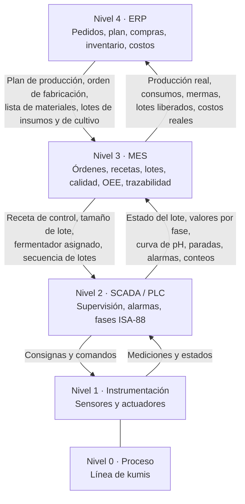

# Necesidades de Información y Relación con MES y ERP — Línea 3: Kumis

> **Alcance:** información que la línea de kumis necesita para gestionar la producción (órdenes, lotes, recetas, cantidades, calidad, paradas, trazabilidad e indicadores) y su relación conceptual con los sistemas MES y ERP según ISA-95.

> **Documentos relacionados:** `Modelo_ISA88_Kumis.md` (recetas y lotes), `PID_Kumis.md` (instrumentos) y `VSM_e_Indicadores_Kumis.md` (indicadores).

---

## 1. Ubicación de la información en los niveles ISA-95

| Nivel | Sistema | Función en la línea de kumis | Horizonte |
|---|---|---|---|
| 4 | ERP (SAP S/4HANA como referencia) | Pedidos, plan de producción, compras de leche e insumos, inventarios, costos | Días a semanas |
| 3 | MES | Órdenes de producción, recetas maestras, programación de fermentadores, trazabilidad, calidad, OEE, paradas | Turnos a horas |
| 2 | SCADA (Ignition) y PLC | Supervisión, alarmas, tendencias, ejecución de fases ISA-88 | Segundos a minutos |
| 1 | Sensores y actuadores | Medición y actuación (58 tags del P&ID) | Milisegundos a segundos |
| 0 | Proceso físico | Recepción, pasteurización, fermentación, envasado y maduración | — |



---

## 2. Información que baja (de IT a OT)

| Información | Origen | Destino | Contenido | Frecuencia |
|---|---|---|---|---|
| Plan de producción | ERP | MES | Lotes y kilogramos por presentación (KU-200, KU-1L, KU-NAT) y fecha de entrega | Diaria / semanal |
| Orden de fabricación | ERP | MES | Número de orden, presentación, cantidad, fecha | Por pedido |
| Lista de materiales (BOM) | ERP | MES | Leche, azúcar, LPD, pectina, cultivo DVS, esencia y empaque por lote | Por versión de receta |
| Disponibilidad de insumos | ERP | MES | Lotes de insumos liberados por calidad e inventario | Continua |
| Plan de rotación de cultivos | Calidad / MES | MES | Cepa DVS asignada por semana (perfil de fagorresistencia) | Semanal |
| Orden de producción y programa de fermentadores | MES | SCADA / PLC | Secuencia de lotes, fermentador asignado (FM-501…505), hora de llenado | Por turno |
| Receta de control | MES | PLC | Receta maestra con parámetros: masas, tiempo de fermentación, pH de corte, esencia, envasadora, sellado, unidades por caja, patrón de estiba, tiempo de maduración | Por lote |
| Orden de mantenimiento | ERP / MES | Operación | Equipo, tarea y ventana de parada | Programada |

## 3. Información que sube (de OT a IT)

| Información | Origen | Destino | Contenido | Frecuencia |
|---|---|---|---|---|
| Leche recibida | FT-101, FQI-101, laboratorio | MES → ERP | Litros por proveedor, resultados de plataforma, lote de leche | Por carrotanque |
| Registro del PCC-1 de pasteurización | TT-405, TR-405, XV-401 | MES | Curva de temperatura y tiempo, eventos de desvío, ΔP del regenerador | Continua |
| Registro de la fermentación | AT-501, TT-501, TIC-501 | MES | Curva de pH y temperatura, hora de inoculación, hora de corte | Continua por lote |
| Registro del lote (*batch record*) | PLC | MES | Valores reales por fase: masas pesadas, °Brix, temperaturas, tiempos, revoluciones | Por fase |
| Registro del PCC-2 de envasado | PDT-510, cabina ISO 5, AT-601, SL-601 | MES | Presión de la cabina, ciclos UV/H₂O₂, rechazos de sello | Continua |
| Cantidades producidas | WT-601, contadores, checkweigher | MES → ERP | Unidades conformes y rechazadas, kilogramos, cajas y estibas | Por lote |
| Consumos reales | WT-401, FQ-601, FT-101 | MES → ERP | Leche, azúcar, LPD, pectina, esencia, cultivo y empaque consumidos | Por lote |
| Paradas | PLC / SCADA | MES | Equipo, causa, hora de inicio y duración | Por evento |
| Alarmas | SCADA | MES | Alarma, prioridad, hora y reconocimiento | Por evento |
| Calidad | Laboratorio, visión y checkweigher | MES → ERP | pH, acidez, viscosidad, micro (coliformes, mohos y levaduras, BAL), peso; liberación del lote | Por lote |
| Cadena de frío | TT-702, AT-701 | MES | Temperatura y humedad de la cámara, tiempo de maduración | Continua |
| Estado de equipos | PLC | MES | En marcha, detenido, en CIP, en falla | Continua |

---

## 4. Modelo de datos mínimo

| Entidad | Atributos principales |
|---|---|
| Orden de producción | Número, presentación, cantidad programada (lotes, kg y unidades), fecha, estado |
| Lote | `KU-AAAAMMDD-NN`, orden, receta maestra y versión, fermentador, hora de inicio y fin, estado ISA-88 |
| Receta | Código (RM-KU-200, RM-KU-1L, RM-KU-NAT), versión, fórmula, parámetros de procedimiento |
| Lote de cultivo | Código del sobre DVS, cepa, perfil de fagorresistencia, fecha de apertura |
| Consumo de materiales | Lote, material, lote del proveedor, cantidad teórica y real |
| Registro de fase | Lote, fase, consigna, valor real, hora de inicio y fin |
| Curva de fermentación | Lote, tiempo, pH, temperatura |
| Producción | Lote, unidades conformes, unidades rechazadas y causa, kg, cajas, estibas |
| Parada | Equipo, causa (planeada o no planeada), inicio, duración |
| Resultado de calidad | Lote, variable, valor, límite, conforme o no conforme |
| Estiba | Código SSCC, lote, cajas, ubicación en cámara, fecha de vencimiento |

---

## 5. Trazabilidad

La trazabilidad es de extremo a extremo y en los dos sentidos:

```
Proveedor de leche → lote de leche cruda (silo T-101) → lote de leche estandarizada (silo pulmón T-401)
   → lote de formulación (TM-401) → lote de kumis (fermentador FM-50x, lote de cultivo)
   → lote envasado → fardos o cajas → estiba (SSCC) → cámara de maduración → despacho → cliente
```

- **Hacia atrás:** a partir del lote impreso en una unidad se obtiene el fermentador, la curva de pH y de temperatura, la curva de pasteurización (PCC-1), el cultivo DVS, los lotes de leche e insumos y los proveedores.
- **Hacia adelante:** a partir de un lote de leche, de insumo o de cultivo se obtienen todos los lotes de kumis, las estibas y los despachos afectados. Esto permite responder a un evento de fagos o a un lote de leche con antibióticos.

Cada unidad lleva el lote, la hora de producción y la fecha de vencimiento (impresas por CI-601). Cada caja y cada estiba llevan un código de barras que el MES asocia al lote.

---

## 6. Indicadores que calcula el MES

| Indicador | Datos de entrada | Fuente |
|---|---|---|
| OEE (A · PE · Q) | Tiempo planeado, paradas, lotes producidos, unidades conformes | PLC / SCADA |
| Takt time y cumplimiento del plan | Demanda (ERP) y producción real | ERP y MES |
| Throughput (kg por día) | Kilogramos conformes por día | Checkweigher |
| MLT por lote | Hora de arranque de la formulación y hora de liberación de la estiba | Registro del lote |
| Utilización de fermentadores | Horas ocupadas sobre horas disponibles | PLC |
| Lotes perdidos por fagos o acidez fuera de rango | Eventos y causa | Calidad y MES |
| Tiempo de fermentación real vs. objetivo | Curva de pH | AT-501 |
| Mermas y rechazos | Unidades rechazadas por causa | Visión, checkweigher |
| MTBF y MTTR | Eventos de falla y duración | SCADA |
| Consumo de servicios por lote | Vapor, agua helada, energía | Medidores |

---

## 7. Situación actual y propuesta

| Aspecto | Actual | Propuesto |
|---|---|---|
| Órdenes de producción | En papel, por turno | Electrónicas, del ERP al MES |
| Recetas | Hojas de proceso, ajuste manual | Recetas maestras ISA-88 descargadas al PLC |
| Dosificación de polvos | Sacos pesados a mano | Pesaje gravimétrico con registro por lote |
| Punto final de la fermentación | Muestreo y titulación manual | pH en línea y corte automático |
| Registro de lote | Manual | Automático por fase |
| Rotación de cultivos | Control en planillas | Plan semanal en el MES con trazabilidad del sobre DVS |
| Paradas | No se registran de forma sistemática | Captura automática con causa |
| Trazabilidad | Parcial, en planillas | Completa y en los dos sentidos |
| Indicadores | Calculados a fin de mes | En línea, por turno y por lote |

---

## 8. Referencias

- ANSI/ISA-95 (IEC 62264), *Enterprise-Control System Integration*.
- Material del curso APM 2026-2: *Diapositivas MES y ERP* y *Gestión de Producción Automatizada*.
- Alpina, *Alpina presenta su proyecto de Transformación Digital* (SAP S/4HANA): https://alpina.com/contenidos/post/alpina-presenta-su-proyecto-de-transformacion-digital
