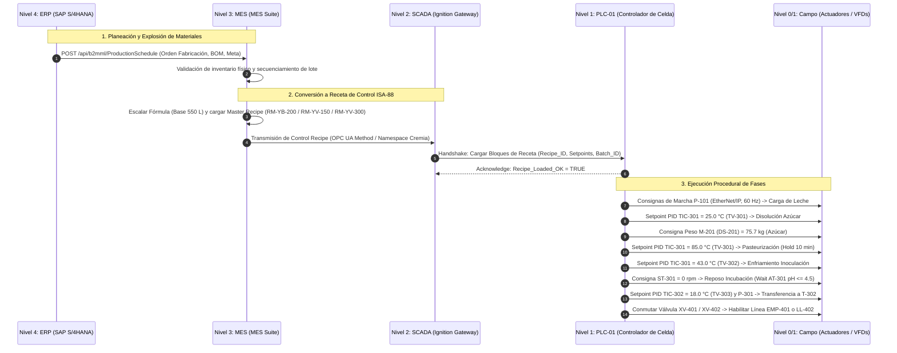
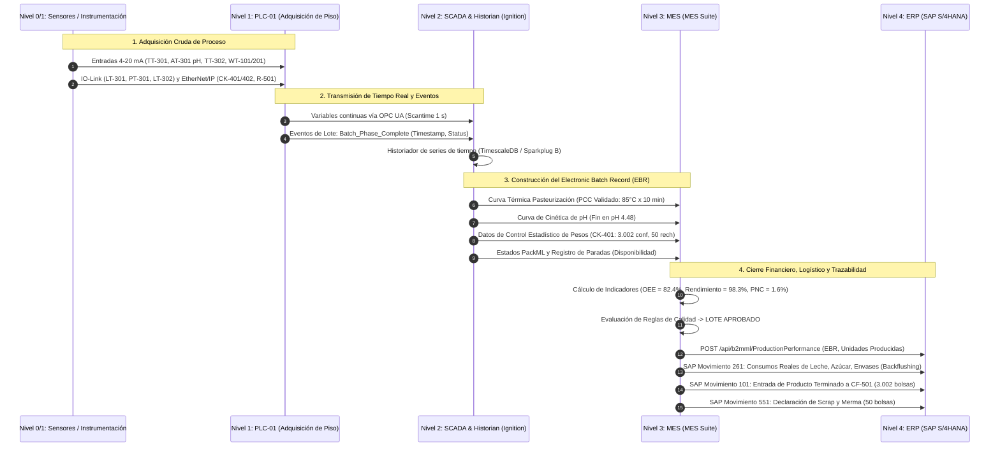
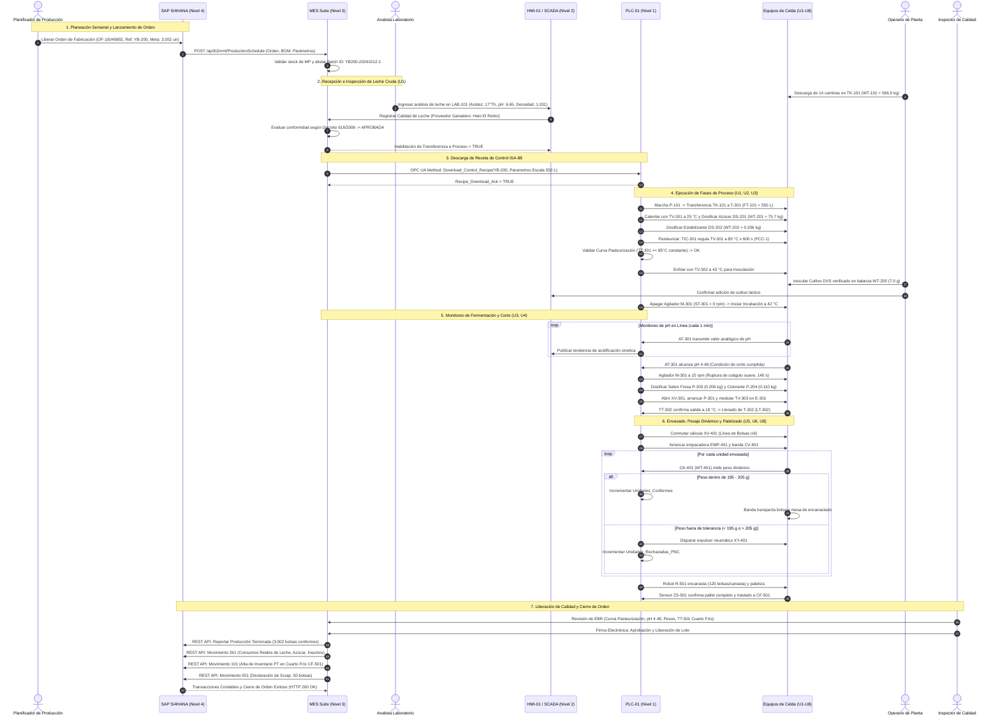
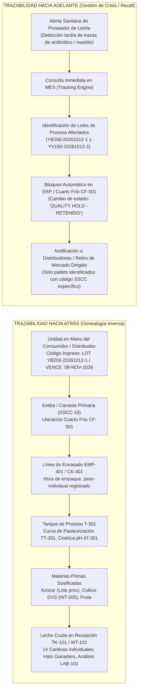

# Evidenciar Flujo de Información entre OT / IT — Línea de Yogur
## Planta La Hacienda Productos Alimenticios
### Cremia Automations — Proyecto Integrador APM 2026-2S

---

> **Documento:** Entregable Técnico de Integración y Flujo de Información OT/IT  
> **Área:** Derivados Lácteos — Línea de Fabricación y Envasado de Yogur  
> **Fecha de Emisión:** Octubre de 2026  
> **Versión:** 1.0  
> **Autoría:** Subagente Especialista en Integración OT/IT (Cremia Automations - UNAL)  
> **Normas de Referencia:** ANSI/ISA-95 (IEC 62264), ANSI/ISA-88 (IEC 61512), ANSI/ISA-5.1, IEC 62443, B2MML v0600, OMAC PackML (ISA-TR88.00.02), Decreto 616 de 2006, Res. 2310 de 1986, NTC 805, Res. 1407 de 2022.  
> **Caso Base de Estudio:** Grimaldo, G., Moreno, D. & Salamanca, M. (2015). *Medición del trabajo de una línea de producción de yogurt – Empresa La Hacienda*. Revista I3+, 2(2), 62–81.

---

## 1. Alcance y Contexto de Integración OT/IT en La Hacienda

### 1.1 Contexto Industrial y Diagnóstico Operativo Actual
La empresa **La Hacienda Productos Alimenticios**, ubicada en el altiplano cundiboyacense (Colombia), opera como una pequeña y mediana empresa (pyme) del sector lácteo industrializada de forma básica pero con una baja madurez digital. De acuerdo con el diagnóstico de ingeniería de métodos y medición del trabajo documentado por Grimaldo, Moreno & Salamanca (2015), la línea de yogur presenta las siguientes características basales:
- **Modelo de Operación por Lotes:** Procesa un único lote diario de **550 L de leche cruda** (equivalente a 566,5 kg a densidad estándar de 1,030 kg/L).
- **Dotación de Personal:** 4 operarios por turno en una jornada estándar de 8 horas (480 min, con inicio habitual a las 7:30 a. m.).
- **Tiempos de Ciclo y Cuellos de Botella:** El tiempo estándar de manufactura (*Manufacturing Lead Time*, MLT) activo es de **601 min** por lote. No obstante, el tanque encamisado de proceso actual queda bloqueado al final de la jornada debido a un proceso de enfriamiento pasivo/natural durante la noche (~1.024 min de reposo no controlado), lo cual restringe la capacidad de planta a un solo lote por día.
- **Formulación y Presentación Existente:** Un único producto comercial: yogur bebible saborizado con fresa en bolsa flexible de 200 ml (**YB-200**), rindiendo **3.052 bolsas** por lote base (610,4 L de mezcla final).
- **Calidad y Mermas:** Se registra una tasa de producto no conforme del **5,06 %** (aproximadamente 154 bolsas rechazadas por lote), atribuible a dosificaciones volumétricas manuales descalibradas, sellado térmico irregular y pesaje discontinuo de control en gramera de mesa (únicamente 1 de cada 5 bolsas inspeccionada).
- **Aislamiento de la Información (*Data Silos*):** Inexistencia de enlaces de comunicación industrial. Las órdenes de producción se imparten verbalmente; las formulaciones se transfieren en notas de papel; el control de inocuidad en pasteurización y acidificación se efectúa por muestreo esporádico (termómetro de vástago y acidímetro manual con hidróxido de sodio y fenolftaleína); los inventarios se concilian retrospectivamente a fin de mes.

```mermaid
flowchart TD
    subgraph ESTADO_ACTUAL["Estado Actual (Grimaldo et al., 2015) - Aislamiento Digital"]
        ERP_MANUAL["Gestión en Papel / Hoja de Cálculo<br/>(Sin conexión a planta)"]
        OPER_MANUAL["4 Operarios<br/>(Anotaciones manuales, pesaje en gramera)"]
        PLANTA_MANUAL["Línea de Proceso Manual<br/>(Válvulas manuales, enfriamiento nocturno pasivo 1.024 min)"]
        ERP_MANUAL -.->|Órdenes verbales| OPER_MANUAL
        OPER_MANUAL -.->|Maniobra manual| PLANTA_MANUAL
        PLANTA_MANUAL -.->|Registros en papel (post-mortem)| ERP_MANUAL
    end

    subgraph ESTADO_PROPUESTO["Solución Propuesta Cremia Automations - Ecosistema Integrado OT/IT"]
        ERP_S4["Nivel 4: ERP (SAP S/4HANA)<br/>Planeación, Compras, Finanzas, Logística"]
        MES_IGN["Nivel 3: MES (MES Suite / SQL)<br/>OEE, Recetas ISA-88, Trazabilidad, EBR"]
        SCADA_IGN["Nivel 2: SCADA (Ignition Industrial Gateway)<br/>Supervisión en Tiempo Real, HMI-01 y HMI-02, Alarmas"]
        PLC_SYS["Nivel 2: Control (PLC-01 Allen-Bradley CompactLogix 5380)<br/>Ejecución de Fases ISA-88, Lazos PID, Checkweighers"]
        FIELD_BUS["Niveles 0 y 1: Proceso, Instrumentación y Accionamientos<br/>Sensores 4-20 mA/IO-Link, Variadores EtherNet/IP, Robot R-501"]
        
        ERP_S4 <==>|B2MML REST API (HTTPS / JSON)| MES_IGN
        MES_IGN <==>|OPC UA / MQTT Sparkplug B| SCADA_IGN
        SCADA_IGN <==>|OPC UA Client-Server (IEC 62541)| PLC_SYS
        PLC_SYS <==>|EtherNet/IP / IO-Link / 4-20 mA| FIELD_BUS
    end
```

### 1.2 Alcance del Sistema Automatizado Propuesto
Para revertir las limitaciones productivas y sanitarias, el consorcio **Cremia Automations** estructuró una modernización tecnológica integral:
1. **Incremento de Capacidad (2 Lotes Diarios - 1.100 L/día de leche):**
   - Incorporación de la bomba de recepción sanitaria `P-101` de alto caudal, reduciendo el llenado de 28,4 min a 11,5 min.
   - Sustitución del enfriamiento nocturno pasivo por un **intercambiador de placas sanitario `E-301`** con suministro de agua helada en circuito cerrado (banco de hielo `CH-901`), logrando el abatimiento térmico de corte de fermentación (42 °C $\rightarrow$ 18 °C) en **25 a 30 min**. Esto desacopla el tanque de proceso `T-301`, permitiendo ejecutar el ciclo CIP sanitario `CIP-901` y preparar el segundo lote del día en paralelo con el envasado.
2. **Diversificación de Portafolio (3 Referencias Comerciales):**
   - **`YB-200`:** Yogur bebible sabor fresa en bolsa de 200 ml (3.079 bolsas/lote con la leche en polvo, máquina empacadora vertical `EMP-401`, banda `CV-401`).
   - **`YV-150`:** Yogur cuchareable con preparado de mora al 8 % en vaso rígido de 150 ml (4.369 vasos/lote, llenadora-selladora lineal `LL-402`, dosificación de fruta en línea `P-403`/`MX-403`, banda `CV-402`).
   - **`YV-300`:** Yogur con trozos de melocotón al 12 % en vaso rígido de 300 ml (2.260 vasos/lote, llenadora-selladora `LL-402`, banda `CV-402`).
3. **Automatización de Control y Empaque Secundario:**
   - Dosificación automática por peso mediante tolva `DS-201` (azúcar, celda `WT-201`), microdosificador `DS-202` (estabilizante, celda `WT-202`) y balanza digital industrial `WT-205` (cultivo liofilizado DVS).
   - Control de calidad metrológica al 100 % mediante controladoras dinámicas de peso (*checkweighers*) `CK-401` y `CK-402` con expulsión neumática (`XY-401`, `XY-402`), abatiendo el producto no conforme de 5,06 % a $\le 1,5\%$.
   - Celda de encanastado, encajonado y paletizado robotizada `R-501` con garra de vacío multizona, transfiriendo las estibas al cuarto frío de conservación `CF-501` (4 °C, monitoreado por `TT-501`).

### 1.3 Arquitectura de Integración según ANSI/ISA-95 y Ciberseguridad IEC 62443
La integración entre la tecnología de operaciones (OT) y la tecnología de la información (IT) se diseña estructurando los cinco niveles funcionales de la norma **ANSI/ISA-95 / IEC 62264**, implementando segmentación de red por zonas y conductos (*Zones and Conduits*) bajo el estándar **IEC 62443-3-3**:

```mermaid
graph TD
    subgraph NIVEL4["NIVEL 4: Red Corporativa / IT (Enterprise - ERP)"]
        ERP["Sistema ERP (SAP S/4HANA)<br/>• Gestión de Pedidos y Ventas<br/>• Planeación MRP y Compras<br/>• Costos y Contabilidad<br/>• Gestión de Inventarios y Almacenes"]
    end

    subgraph DMZ_MANUF["ZONA DESMILITARIZADA DE MANUFACTURA (IDMZ - IEC 62443)"]
        FW_IT["Firewall Perimetral IT/OT"]
        IDMZ_SRV["Servidor DMZ: Reverse Proxy REST / Broker MQTT Seguro / Servidor B2MML"]
        FW_OT["Firewall de Control Industrial"]
    end

    subgraph NIVEL3["NIVEL 3: Red de Operaciones de Manufactura (MOM / MES - OT Superior)"]
        MES["Sistema MES (MES Suite)<br/>• Gestión de Órdenes de Producción<br/>• Motor de Recetas Maestras ISA-88<br/>• Registro Electrónico de Lote (EBR)<br/>• Genealogía y Trazabilidad<br/>• Cálculo de OEE y Paradas"]
        HIST["Historiador Industrial de Planta (TimescaleDB / Process Historian)"]
    end

    subgraph NIVEL2["NIVEL 2: Supervisión de Proceso (SCADA / HMI)"]
        SCADA["Servidor SCADA (Ignition Gateway Redundante)<br/>• Servidor OPC UA Integrado (IEC 62541)<br/>• Gestión Centralizada de Alarmas ISA-18.2<br/>• Mímicos de Proceso ISA-101"]
        HMI01["Terminales HMI de Planta (HMI-01 y HMI-02 PanelView 5510)"]
    end

    subgraph NIVEL1["NIVEL 1: Red de Control en Tiempo Real (EtherNet/IP Industrial Ring DLR)"]
        PLC["Controlador Principal PLC-01 (PAC de Alta Disponibilidad)"]
        REMOTE_IO["Módulos de E/S Distribuidas e IO-Link Masters"]
        VFDs["Variadores de Frecuencia (P-101, M-201, M-202, M-301, P-301, P-403)"]
        MACH_CTRL["Controladores Esclavos: EMP-401, LL-402, CK-401, CK-402, Robot R-501"]
    end

    subgraph NIVEL0["NIVEL 0: Instrumentación de Campo y Proceso Físico"]
        SENSORS["Instrumentos de Proceso: WT-101, FT-101, TT-301, AT-301 (pH), LT-301, TT-302, PT-301"]
        ACTUATORS["Actuadores de Proceso: TV-301 (Vapor), TV-302 (Agua Fría), TV-303 (Agua Helada), XV-301"]
        PHYSICAL["Equipos Físicos: TK-101, T-301, E-301, T-302, CF-501, CIP-901"]
    end

    ERP <==>|B2MML HTTPS / TLS 1.3| FW_IT
    FW_IT <==> IDMZ_SRV
    IDMZ_SRV <==> FW_OT
    FW_OT <==> MES
    MES <==> HIST
    MES <==>|OPC UA TCP / MQTT Sparkplug B| SCADA
    SCADA <==>|OPC UA Channel (4840/tcp)| PLC
    SCADA --- HMI01
    PLC <==>|EtherNet/IP (CIP Safety / DLR)| REMOTE_IO
    PLC <==>|EtherNet/IP CIP Motion| VFDs
    PLC <==>|EtherNet/IP Industrial Bus| MACH_CTRL
    REMOTE_IO --- SENSORS
    REMOTE_IO --- ACTUATORS
    MACH_CTRL --- PHYSICAL
```

---

## 2. Matriz Maestra de Intercambio de Información OT/IT

La siguiente tabla consolida exhaustivamente todos los flujos de datos e información que interactúan entre el piso de planta y los sistemas gerenciales, cubriendo los 23 sensores y 19 actuadores del inventario y la arquitectura de integración. Los niveles siguen ANSI/ISA-95: N1 es la medición y la actuación sobre el proceso, N2 el control automático (PLC-01 y controladores de máquina) y la supervisión (SCADA), N3 el MES y N4 el ERP.

| ID Flujo | Variable / Mensaje | Tag P&ID Asociado | Nivel Origen | Nivel Destino | Protocolo | Tipo de Dato | Frecuencia / Trigger | Criticidad | Propósito Operacional |
|:---|:---|:---|:---:|:---:|:---|:---:|:---|:---:|:---|
| **FL-01** | Orden de Producción (*B2MML ProductionSchedule*) | — | N4 (ERP) | N3 (MES) | REST API / HTTPS | JSON | Evento (Plan Diario/Turno) | Alta | Transmisión de lote a fabricar, presentación, cantidad meta y fecha/hora programada. |
| **FL-02** | Lista de Materiales (*BOM*) | — | N4 (ERP) | N3 (MES) | REST API / HTTPS | JSON | Evento (Cambio de versión) | Alta | Proporciones teóricas de leche, azúcar, estabilizante, cultivo, fruta y empaque. |
| **FL-03** | Estatus de Lotes de Materia Prima Liberados | — | N4 (ERP) | N3 (MES) | REST API / HTTPS | JSON | Periódico (1 h) / Evento | Alta | Disponibilidad de inventario liberado por control de calidad para producción. |
| **FL-04** | Registro de Calidad de Plataforma de Leche Cruda | LAB-101 | N2 (HMI-01) | N3 (MES) | OPC UA / SQL | JSON / UDT | Por lote recibido (14 cantinas) | Crítica | Aprobación de densidad, acidez (°Th), pH, grasa, sólidos y ausencia de antibióticos. |
| **FL-05** | Masa Total de Leche Descargada | WT-101 | N1/N2 (PLC) | N2 (SCADA) | 4-20 mA $\rightarrow$ Eth/IP | REAL (kg) | Cíclico (100 ms) | Media | Pesaje del lote de leche cruda ingresada en TK-101 (rango 0-700 kg). |
| **FL-06** | Caudal y Volumen de Transferencia de Leche | FT-101 | N1/N2 (PLC) | N2 (SCADA) | Pulsos/4-20 mA $\rightarrow$ Eth/IP | REAL (m³/h, L) | Cíclico (100 ms) | Media | Medición de caudal electromagnético hacia T-301; detección de fin de carga. |
| **FL-07** | Estado y Velocidad de Bomba de Leche | P-101 | N2 (PLC) | N2 (SCADA) | EtherNet/IP | UDT (Bool, Real) | Por excepción / 500 ms | Media | Monitoreo de variador: marcha, falla, velocidad (Hz/rpm), corriente consumida. |
| **FL-08** | Descarga de Receta de Control (*Control Recipe*) | — | N3 (MES) | N2/N2 (PLC) | OPC UA Method Call | JSON / Struct | Evento (Inicio de Lote) | Crítica | Carga de setpoints de proceso, volúmenes escalados, tiempos y tolerancias a PLC-01. |
| **FL-09** | Peso Dosificado de Azúcar | WT-201 | N1/N2 (PLC) | N2/N3 (MES) | 4-20 mA $\rightarrow$ Eth/IP | REAL (kg) | Fin de dosificación | Alta | Medición en celdas de tolva DS-201; corte fino/grueso por sinfín M-201. |
| **FL-10** | Peso Dosificado de Estabilizante | WT-202 | N1/N2 (PLC) | N2/N3 (MES) | 4-20 mA $\rightarrow$ Eth/IP | REAL (g / kg) | Fin de dosificación | Alta | Medición en celda microdosificadora DS-202; accionamiento M-202. |
| **FL-11** | Volumen Dosificado de Saborizante y Colorante | FQ-203 / FQ-204 | N1/N2 (PLC) | N2/N3 (MES) | Pulsos 24 V DC $\rightarrow$ Eth/IP | DINT (pulsos/ml) | Fin de fase de saborizado | Alta | Conteo volumétrico de pulsos de bombas peristálticas P-203 y P-204 hacia T-301. |
| **FL-12** | Peso Verificado de Cultivo Láctico DVS | WT-205 | N1/N2 (BL-205) | N3 (MES) | Ethernet Industrial | REAL (g) | Evento (Antes de inoculación)| Crítica | Registro balanza de precisión de 7,0 g de cultivo liofilizado (validación manual/digital).|
| **FL-13** | Nivel Hidrostático de Tanque de Proceso | LT-301 | N1/N2 (PLC) | N2 (SCADA) | IO-Link $\rightarrow$ Eth/IP | REAL (L) | Cíclico (500 ms) | Alta | Monitoreo de volumen de llenado en T-301 (0-600 L) y protección contra sobrellenado.|
| **FL-14** | Temperatura de Proceso en Tanque T-301 | TT-301 | N1/N2 (PLC) | N2/N3 (Hist) | 4-20 mA $\rightarrow$ Eth/IP | REAL (°C) | Cíclico (1 s) / Sparkplug B | Crítica | Registro continuo de curva térmica (PCC Pasteurización: 85 °C / 10 min; Incubación). |
| **FL-15** | Consigna y Apertura Válvula de Vapor | TIC-301 / TV-301| N2 (PLC) | N2 (SCADA) | 4-20 mA $\rightarrow$ Eth/IP | REAL (%) | Cíclico (500 ms) | Media | Salida de control PID para precalentamiento a 25 °C y pasteurización a 85 °C. |
| **FL-16** | Consigna y Apertura Válvula de Agua Fría | TIC-301 / TV-302| N2 (PLC) | N2 (SCADA) | 4-20 mA $\rightarrow$ Eth/IP | REAL (%) | Cíclico (500 ms) | Media | Salida PID para enfriamiento inicial de 85 °C a 42-45 °C para inoculación. |
| **FL-17** | Velocidad de Agitación y Carga Mecánica | ST-301 / M-301 | N2 (PLC) | N2 (SCADA) | EtherNet/IP | REAL (rpm), REAL (A)| Cíclico (1 s) | Media | Control de velocidad: 45 rpm (mezcla/homog), 0 rpm (incubación), 15 rpm (ruptura). |
| **FL-18** | Monitoreo Cinético de pH en Línea | AT-301 | N1/N2 (PLC) | N2/N3 (MES) | 4-20 mA $\rightarrow$ Eth/IP | REAL (pH) | Cíclico (5 s) / Evento | Crítica | Monitoreo de declive de pH durante incubación; trigger de fin al alcanzar 4,4-4,6 pH. |
| **FL-19** | Comando de Apertura Válvula de Fondo T-301 | XV-301 | N2 (PLC) | N1 (Actuador) | Salida 24 V DC | BOOL | Evento de procedimiento | Alta | Apertura de válvula sanitaria de fondo para bombeo y vaciado de T-301. |
| **FL-20** | Estado y Velocidad Bomba de Transferencia | P-301 | N2 (PLC) | N2 (SCADA) | EtherNet/IP | UDT (Bool, Real) | Cíclico (500 ms) | Media | Impulsión de yogur coagulado hacia intercambiador de placas E-301 y T-302. |
| **FL-21** | Presión en Línea de Impulsión de Yogur | PT-301 | N1/N2 (PLC) | N2 (SCADA) | IO-Link $\rightarrow$ Eth/IP | REAL (bar) | Cíclico (100 ms) | Alta | Interbloqueo de seguridad (alarma a > 4,5 bar para evitar daño de línea o bomba). |
| **FL-22** | Temperatura de Yogur Enfriado en E-301 | TT-302 | N1/N2 (PLC) | N2/N3 (Hist) | 4-20 mA $\rightarrow$ Eth/IP | REAL (°C) | Cíclico (1 s) | Crítica | Verificación de corte de fermentación (salida a 15-20 °C); lazo TIC-302. |
| **FL-23** | Modulación Válvula de Agua Helada E-301 | TIC-302 / TV-303| N2 (PLC) | N2 (SCADA) | 4-20 mA $\rightarrow$ Eth/IP | REAL (%) | Cíclico (500 ms) | Media | Regulación de flujo de agua helada desde CH-901 a intercambiador de placas. |
| **FL-24** | Nivel y Temperatura de Tanque Pulmón | LT-302 / TT-303 | N1/N2 (PLC) | N2 (SCADA) | IO-Link / 4-20 mA | REAL (L), REAL (°C) | Cíclico (1 s) | Alta | Condición de habilitación de envasado (enclavamiento de nivel mínimo/máximo). |
| **FL-25** | Enrutamiento de Producto (Bolsas vs Vasos) | XV-401 / XV-402 | N2 (PLC) | N1 (Actuador) | Salida 24 V DC | BOOL | Evento de receta | Alta | Selección de ruta según orden activa: XV-401 (a U6) o XV-402 (a U7). |
| **FL-26** | Caudal y Dosificación de Preparado de Fruta | P-403 / MX-403 | N2 (PLC) | N2 (SCADA) | EtherNet/IP | REAL (kg/h, %) | Cíclico (200 ms) | Alta | Control de relación en línea: 8 % mora (YV-150) o 12 % melocotón (YV-300). |
| **FL-27** | Señales de Envasado y Sellado de Bolsas | EMP-401 | N2 (EMP) | N2 (PLC) | EtherNet/IP | UDT (Bool, DINT) | Cíclico (100 ms) | Alta | Bolsas formadas, temperatura de mordaza térmica, disparo de fotocelda ZS-401. |
| **FL-28** | Detección de Integridad y Tapa Foil en Vasos | ZS-402 | N1/N2 (PLC) | N2 (SCADA) | Digital 24 V DC | BOOL | Por unidad envasada | Alta | Verificación de foil de aluminio sellado herméticamente en llenadora LL-402. |
| **FL-29** | Pesaje Dinámico Unitario en Bolsas | CK-401 (WT-401) | N2 (CK) | N2/N3 (MES) | EtherNet/IP | REAL (g) | Por cada bolsa envasada | Crítica | Masa neta por unidad (tolerancia 195-205 g para YB-200); registro estadístico. |
| **FL-30** | Comando Expulsión de Bolsa Fuera de Peso | XY-401 | N2 (CK/PLC) | N1 (Actuador) | Salida 24 V DC | BOOL | Por unidad fuera de peso | Alta | Activación de descarte neumático hacia tolva de scrap; señal a contador de rechazo. |
| **FL-31** | Pesaje Dinámico Unitario en Vasos | CK-402 (WT-402) | N2 (CK) | N2/N3 (MES) | EtherNet/IP | REAL (g) | Por cada vaso envasado | Crítica | Masa neta por unidad (146-154 g para YV-150; 293-307 g para YV-300). |
| **FL-32** | Comando Expulsión de Vaso Fuera de Tolerancia | XY-402 | N2 (CK/PLC) | N1 (Actuador) | Salida 24 V DC | BOOL | Por defecto detectado | Alta | Descarte por desvío de peso o ausencia de sello metálico (ZS-402). |
| **FL-33** | Estado y Ciclo de Celda de Paletizado Robot | R-501 | N2 (Robot) | N2 (SCADA) | EtherNet/IP | UDT (State, DINT) | Cíclico (500 ms) | Media | Bolsas por canasta (120), vasos por caja (24/20), conteo de pallets completados. |
| **FL-34** | Temperatura Ambiental de Cuarto Frío CF-501 | TT-501 | N1/N2 (PLC) | N2/N3 (MES) | 4-20 mA $\rightarrow$ Eth/IP | REAL (°C) | Cíclico (10 s) / Alarma | Crítica | Monitoreo de cadena de frío ($4 \pm 2$ °C); disparador de retención si $T > 6$ °C. |
| **FL-35** | Conductividad de Retorno CIP y Fase Activa | CT-901 / CIP-901 | N1/N2 (PLC) | N2/N3 (MES) | 4-20 mA $\rightarrow$ Eth/IP | REAL (mS/cm), DINT | Cíclico (2 s) | Alta | Validación de ciclo higiénico (enjuague, sosa, ácido); habilitación de lote. |
| **FL-36** | Estado de Operación de Máquinas (PackML) | Toda la Celda | N2 (PLC) | N2/N3 (MES) | OPC UA / Sparkplug B | DINT (PackML State) | Por cambio de estado | Alta | Estados PackML (Idle, Running, Complete, Aborted) para cómputo de OEE. |
| **FL-37** | Registro Electrónico de Lote (*EBR Summary*) | — | N3 (MES) | N4 (ERP) | REST API / HTTPS | JSON (B2MML) | Evento (Cierre de Lote) | Crítica | Consolidado de curva PCC, pH final, balance de masa, PNC y liberación de lote. |
| **FL-38** | Declaración de Producción Terminada (Entrada) | — | N3 (MES) | N4 (ERP) | REST API (Mov 101) | JSON | Evento (Liberación Lote)| Alta | Ingreso de unidades conformes, empaques y estibas al inventario vendible en ERP. |
| **FL-39** | Consumo Real de Materiales (*Backflushing*) | — | N3 (MES) | N4 (ERP) | REST API (Mov 261) | JSON | Evento (Cierre de Lote) | Alta | Descuento exacto de inventario: leche, azúcar, fruta, estabilizante, envases consumidos.|
| **FL-40** | Reporte de Scrap y Mermas de Producción | — | N3 (MES) | N4 (ERP) | REST API (Mov 551) | JSON | Evento (Cierre de Lote) | Media | Cantidad de leche en purga, film descartado, vasos o producto rechazado por CK. |

---

## 3. Flujo Descendente (IT $\rightarrow$ OT: Nivel 4 ERP a Nivel 3 MES, MES a Nivel 2 SCADA/PLC, PLC a Campo)

El flujo descendente traslada las directrices del negocio, la programación de demanda y los parámetros de ingeniería de producto hacia el entorno físico de planta.



### 3.1 Nivel 4 ERP a Nivel 3 MES: Órdenes de Fabricación y BOM
1. **Transmisión del Plan Maestro de Producción:** El ERP (SAP S/4HANA) genera órdenes de fabricación planificadas a partir del MRP (*Material Requirements Planning*). Cuando la orden es liberada para piso, el conector B2MML del ERP ejecuta un `HTTP POST` hacia el endpoint seguro del MES: `/api/v1/b2mml/production-schedule`.
2. **Estructura del Mensaje B2MML (Ejemplo Estructurado JSON):**
```json
{
  "Header": {
    "MessageID": "MSG-20261012-001",
    "Timestamp": "2026-10-12T06:00:00Z",
    "Source": "SAP_S4HANA_PP",
    "SchemaVersion": "B2MML-V0600"
  },
  "ProductionSchedule": {
    "ScheduleID": "SCH-2026-W42-D1",
    "ProductionOrder": {
      "OrderID": "OF-10045892",
      "ProductCode": "YB-200",
      "ProductDescription": "Yogur Fresa Bebible en Bolsa 200 ml",
      "TargetBatchID": "YB200-20261012-1",
      "PlannedQuantity": 3052,
      "QuantityUnit": "UN",
      "PlannedStartTime": "2026-10-12T07:30:00Z",
      "PlannedEndTime": "2026-10-12T15:45:00Z",
      "BillOfMaterials": [
        {"MaterialID": "MP-RAW-MILK", "Description": "Leche Cruda Higienizada", "PlannedQty": 550.0, "Unit": "L", "BatchRequired": true},
        {"MaterialID": "MP-SUGAR", "Description": "Azúcar Blanca Refinada", "PlannedQty": 75.7, "Unit": "kg", "Tolerance": 0.01},
        {"MaterialID": "MP-STABILIZER", "Description": "Estabilizante Lácteo", "PlannedQty": 0.206, "Unit": "kg", "Tolerance": 0.01},
        {"MaterialID": "MP-CULTURE-DVS", "Description": "Cultivo Láctico DVS Termófilo", "PlannedQty": 0.007, "Unit": "kg", "Tolerance": 0.001},
        {"MaterialID": "MP-FLAVOR-STRAW", "Description": "Esencia de Fresa Grado Alimentario", "PlannedQty": 0.206, "Unit": "kg", "Tolerance": 0.01},
        {"MaterialID": "MP-COLOR-RED", "Description": "Colorante Natural Carmín", "PlannedQty": 0.110, "Unit": "kg", "Tolerance": 0.01},
        {"MaterialID": "PM-POUCH-FILM", "Description": "Película Coextruida PE/EVOH", "PlannedQty": 3100, "Unit": "UN", "Tolerance": 0.05}
      ]
    }
  }
}
```

### 3.2 Nivel 3 MES a Nivel 2 SCADA / PLC: Descarga de la Receta de Control ISA-88
El MES transforma la **Receta Maestra** (*Master Recipe*) en una **Receta de Control** (*Control Recipe*) parametrizada para el lote en ejecución:
- Si el volumen real ingresado en `TK-101` varía respecto a la base nominal (por ejemplo, 520 L en lugar de 550 L según disponibilidad del día), el MES recalcula dinámicamente la masa de ingredientes por balance de materia con factor de escala:
$$f_{escala} = \frac{V_{real\_leche}}{550.0\text{ L}}$$
- La receta de control se escribe en el PLC-01 utilizando el servidor OPC UA embebido en Ignition a través de un bloque de datos estructurado (UDT: `Type_ControlRecipe`).
- **Mecanismo de Handshake Seguro:**
  1. MES escribe los parámetros en las variables de interfaz de la receta.
  2. MES coloca `Recipe_Download_Req = TRUE` y `Batch_ID = "YB200-20261012-1"`.
  3. El PLC verifica límites operacionales de todas las variables. Si son válidos, transfiere los datos a los registros de ejecución activos y setea `Recipe_Download_Ack = TRUE`.
  4. MES confirma la recepción y baja `Recipe_Download_Req = FALSE`.

| Parámetro de Procedimiento | Tag PLC / SCADA | Valor Nominal YB-200 | Valor Nominal YV-150 | Valor Nominal YV-300 | Unidad | Tolerancia |
|:---|:---|:---:|:---:|:---:|:---:|:---:|
| **Volumen de Leche a Cargar** | `RECIPE.Phase1.Target_Volume` | 550,0 | 550,0 | 550,0 | L | $\pm 2,0$ L |
| **Masa Azúcar (DS-201)** | `RECIPE.Phase2.Sugar_Target_Mass` | 75,7 | 63,1 | 56,7 | kg | $\pm 1,0$ % |
| **Masa Estabilizante (DS-202)**| `RECIPE.Phase2.Stab_Target_Mass` | 0,206 | 0,412 | 0,412 | kg | $\pm 1,0$ % |
| **Temperatura Precalentamiento**| `RECIPE.Phase2.Preheat_SP` | 25,0 | 25,0 | 25,0 | °C | $\pm 1,0$ °C |
| **Temperatura Pasteurización** | `RECIPE.Phase3.Pasteur_Temp_SP` | 85,0 | 85,0 | 85,0 | °C | $-0,0 / +2,0$ °C |
| **Tiempo Retención Pasteurización**| `RECIPE.Phase3.Pasteur_Hold_Time`| 600 | 600 | 600 | s | $\ge 600$ s |
| **Temperatura Inoculación** | `RECIPE.Phase4.Inoculation_SP` | 43,0 | 43,0 | 43,0 | °C | $\pm 0,5$ °C |
| **Temperatura Incubación** | `RECIPE.Phase4.Incubation_SP` | 42,0 | 42,0 | 42,0 | °C | $\pm 0,5$ °C |
| **Corte de Incubación (pH)** | `RECIPE.Phase4.End_pH_SP` | 4,50 | 4,50 | 4,50 | pH | $\pm 0,05$ pH |
| **Temperatura Enfriamiento Corte**| `RECIPE.Phase5.Cooling_Target_SP`| 18,0 | 18,0 | 18,0 | °C | $\pm 1,0$ °C |
| **Proporción de Fruta en Línea**| `RECIPE.Phase6.Fruit_Ratio_SP` | 0,0 | 8,0 | 12,0 | % masa | $\pm 0,3$ % |
| **Ruta de Envasado Activa** | `RECIPE.Phase6.Packaging_Route` | 1 (U6 - Bolsas) | 2 (U7 - Vasos) | 2 (U7 - Vasos) | Enum | Exacto |
| **Set Point Checkweigher** | `RECIPE.Phase6.Checkweigher_Target`| 200,0 | 150,0 | 300,0 | g / ml | Según NTC |
| **Límite Inferior de Rechazo** | `RECIPE.Phase6.Checkweigher_LL` | 195,0 | 146,0 | 293,0 | g / ml | Descarte XY |
| **Límite Superior de Rechazo** | `RECIPE.Phase6.Checkweigher_UL` | 205,0 | 154,0 | 307,0 | g / ml | Descarte XY |

### 3.3 Nivel 2 a Nivel 1/0: Mapeo de Control en PLC-01 y Salidas a Campo
El PLC-01 ejecuta el procedimiento de lote implementando Add-On Instructions (AOI) bajo la arquitectura ANSI/ISA-88:
- **`Phase_Charge`:** Gobierna el variador de frecuencia de `P-101` mediante red EtherNet/IP a 60 Hz, monitoreando el caudalímetro `FT-101`. Al acumular los 550 L, aplica rampa de desaceleración y cierra la válvula de entrada.
- **`Phase_HeatTreat`:** Asigna el setpoint térmico al bloque PID `TIC-301`. Éste calcula la señal de control $u(t)$ y modula la salida analógica de 4-20 mA hacia el posicionador de la válvula de vapor saturado `TV-301`.
- **`Phase_Incubation`:** Apaga el motor del agitador `M-301` (`ST-301` = 0 rpm) para permitir la floculación y formación del coágulo sin rompimiento estructural micelar. El lazo TIC-301 con rango dividido abre vapor (TV-301) o agua fría (TV-302) en la chaqueta para sostener la temperatura en $43 \pm 0,5$ °C (rango de 41 a 45 °C). El lazo monitorea continuamente la entrada analógica del electrodo de pH `AT-301`.
- **`Phase_CoolAndTransfer`:** Al conmutar la condición de fin de incubación (pH $\le 4,50$), el PLC activa el agitador `M-301` a velocidad lenta (15 rpm) para romper el coágulo suavemente durante 140 s; simultáneamente abre la válvula de fondo `XV-301`, enciende la bomba de lóbulos `P-301` e inicializa el control PID `TIC-302` sobre la válvula de agua helada `TV-303` para alimentar el intercambiador `E-301`.

---

## 4. Flujo Ascendente (OT $\rightarrow$ IT: Campo a PLC, PLC a SCADA/MES, MES a ERP)

El flujo ascendente garantiza la veracidad de los hechos productivos, alimentando los módulos de calidad, costos, inventarios y analítica de desempeño.



### 4.1 De Campo al PLC-01 (Nivel 0/1 a 1)
- **Conversión A/D y Filtros Digitales:** Las señales analógicas se digitalizan en tarjetas de entrada diferencial de 16 bits (Point I/O 1734-IE4C). Se aplica un filtro digital paso bajo de primer orden en el PLC para eliminar ruidos electromagnéticos inducidos por los variadores de frecuencia:
$$y_k = \alpha x_k + (1-\alpha)y_{k-1}, \quad \text{con } \alpha = 0,2$$
- **Monitoreo de Integridad de Sensores:** Detección de lazo abierto o cortocircuito para señales 4-20 mA ($I < 3,8$ mA o $I > 20,5$ mA genera alarma crítica de instrumento fuera de servicio).
- **IO-Link:** Para `LT-301`, `PT-301` y `LT-302`, el maestro IO-Link transfiere diagnósticos de salud del sensor, temperatura interna y medición de proceso digital sin pérdida por conversión analógica.

### 4.2 De PLC a SCADA, Historiador y MES (Nivel 1 a 2/3)
1. **Historiador de Datos de Proceso:** Los datos de las variables críticas se transmiten mediante **OPC UA** y **MQTT Sparkplug B** hacia el servidor de base de datos de series de tiempo *TimescaleDB*. La compresión de datos utiliza el algoritmo *Boxcar / Swinging Door* con una banda muerta de $\pm 0,1$ °C para temperatura y $\pm 0,02$ para pH, optimizando el ancho de banda sin perder resolución.
2. **Validación del Punto Crítico de Control (PCC-1: Pasteurización):**
   - El PLC ejecuta un algoritmo de integración de tiempo en temperatura:
   $$\text{Si } TT\_301 \ge 85,0 \text{ °C} \implies t_{hold} = t_{hold} + \Delta t$$
   - Si durante los 600 segundos la temperatura desciende por debajo de 85,0 °C, el temporizador se aborta, se genera la alarma `ALM_PCC_PASTEUR_FAIL` y se bloquea la transición a la siguiente fase hasta que se recircule y reinicie el ciclo de sostenimiento térmico completo.
3. **Monitoreo de Cinética de Acidificación en Línea:**
   - La sonda higiénica `AT-301` registra el descenso del pH. Cuando se alcanza la cota objetivo ($4,48$ pH), el PLC congela el valor, estampa el tiempo exacto de fermentación y genera el evento `EVENT_FERMENTATION_COMPLETE`.
4. **Inspección Dinámica de Calidad y Clasificación Metrológica (Checkweighers `CK-401` y `CK-402`):**
   - Cada unidad envasada cruza la celda de pesaje dinámico. El controlador transfiere por EtherNet/IP al PLC y al MES: peso instantáneo, código de clasificación (1 = Conforme, 2 = Bajo Peso, 3 = Sobrepeso, 4 = Defecto de Sellado/Foil).
   - El MES registra en memoria la distribución normal de pesos ($X_{barra}$, $\sigma$, $Cp$, $Cpk$).
5. **Generación del Electronic Batch Record (EBR):**
   - Conforme a los requerimientos de la FDA 21 CFR Parte 11 y la norma ANSI/ISA-88, el MES estructura el EBR con firma digital de auditoría (*Audit Trail*), consolidando:
     - Identificación del lote, orden, operadores y receta activa.
     - Trazabilidad de materias primas con números de lote de proveedor.
     - Curva gráfica y vectorial de pasteurización (PCC-1).
     - Curva cinética de pH e índice de acidez final.
     - Pesos dosificados teóricos vs. reales con porcentaje de desviación.
     - Balance total de masa y rendimiento.
     - Resumen de paradas de máquina ocurridas durante el lote.

### 4.3 De MES a ERP (Nivel 3 a Nivel 4: Cierre del Lote y Conciliación Empresarial)
Una vez que el robot `R-501` paletiza la última canasta o caja y ésta ingresa al cuarto frío `CF-501` (confirmada por el sensor `ZS-501` y el escáner de código de barras de final de línea), el jefe de calidad firma digitalmente la liberación del lote en el MES. El MES dispara la sincronización transaccional con el ERP vía REST API:
1. **`B2MML ProductionPerformance`:** Mensaje de reporte global de producción enviado a SAP.
2. **Imputación de Movimientos de Materiales en SAP S/4HANA:**
   - **Movimiento 101 (Entrada de Mercancías de Producto Terminado):** Se da de alta en el almacén de producto terminado `ALM-CF01` las unidades conformes con su código de lote `YB200-20261012-1` y fecha de vencimiento calculada ($FechaFabricacion + 28 \text{ días}$).
   - **Movimiento 261 (Consumo de Materiales / *Backflushing* Real):** Se descuentan de los almacenes de materia prima las cantidades reales pesadas por los instrumentos (`WT-101`, `WT-201`, `WT-202`, etc.), eliminando las discrepancias de inventario contable.
   - **Movimiento 551 (Salida por Mermas / Scrap):** Se contabiliza el desecho de unidades rechazadas por peso o películas defectuosas para costeo de no calidad.

---

## 5. Diagrama de Secuencia Temporal del Ciclo de Vida de un Lote

El siguiente diagrama detalla la interacción cronológica y el intercambio de mensajes entre los actores humanos y los sistemas automáticos a lo largo de las fases de vida de un lote de yogur en La Hacienda.



---

## 6. Modelo de Datos Mínimo

El ecosistema de información requiere un modelo de datos normalizado (relacional / objeto-relacional) en el MES que vincule las entidades del negocio (ERP) con los eventos de piso (SCADA/PLC).

```mermaid
erDiagram
    ORDEN_PRODUCCION ||--|{ LOTE_PRODUCCION : genera
    RECETA_MAESTRA ||--o{ RECETA_CONTROL : instancia
    LOTE_PRODUCCION ||--|| RECETA_CONTROL : ejecuta
    LOTE_PRODUCCION ||--|{ CONSUMO_MATERIAL : registra
    LOTE_PRODUCCION ||--|{ REGISTRO_FASE : compone
    LOTE_PRODUCCION ||--|{ REGISTRO_CALIDAD : valida
    LOTE_PRODUCCION ||--|{ REGISTRO_PARADA : experimenta
    LOTE_PRODUCCION ||--|{ UNIDAD_EMPAQUE : consolida

    ORDEN_PRODUCCION {
        string orden_id PK "Ej: OF-10045892"
        string producto_codigo FK "YB-200, YV-150, YV-300"
        float cantidad_programada "3052 un"
        datetime fecha_programada
        string estado "Creada, Liberada, Cerrada"
    }

    LOTE_PRODUCCION {
        string lote_id PK "Ej: YB200-20261012-1"
        string orden_id FK
        datetime fecha_inicio_real
        datetime fecha_fin_real
        float volumen_leche_base "550.0 L"
        int unidades_conformes "3002"
        int unidades_rechazadas "50"
        float oee_calculado "82.4 %"
        string estado_liberacion "Cuarentena, Liberado, Retenido"
        string firma_calidad_user
    }

    RECETA_MAESTRA {
        string receta_maestra_id PK "RM-YB-200"
        string version "v2.1"
        string producto_nombre
        float tamano_base_leche "550.0 L"
        json parametros_procedimiento
    }

    RECETA_CONTROL {
        string receta_control_id PK "RC-YB200-20261012-1"
        string receta_maestra_id FK
        float factor_escala "1.000"
        float setpoint_pasteur_temp "85.0 C"
        int setpoint_pasteur_hold "600 s"
        float setpoint_ph_fin "4.50"
        float peso_consigna_envase "200.0 g"
    }

    CONSUMO_MATERIAL {
        int consumo_id PK
        string lote_id FK
        string material_codigo "MP-RAW-MILK, MP-SUGAR"
        string lote_proveedor "LOT-SUGAR-9942"
        float cantidad_teorica
        float cantidad_real_pesada
        string unidad_medida "kg, L, g"
        string tag_instrumento "WT-101, WT-201, WT-202"
    }

    REGISTRO_FASE {
        int registro_fase_id PK
        string lote_id FK
        string nombre_fase "Pasteurizacion, Incubacion, Enfriamiento"
        string unidad_isa88 "U1, U2, U3, U4, U5, U6, U7, U8"
        datetime timestamp_inicio
        datetime timestamp_fin
        string estado_ejecucion "Complete, Aborted"
    }

    REGISTRO_CALIDAD {
        int calidad_id PK
        string lote_id FK
        string variable_evaluada "PCC-1_Pasteur, pH_Final, Peso_Promedio"
        float valor_medido
        float limite_inferior
        float limite_superior
        boolean es_conforme
        string tag_sensor "TT-301, AT-301, WT-401"
    }

    REGISTRO_PARADA {
        int parada_id PK
        string lote_id FK
        string equipo_id "EMP-401, LL-402, P-101"
        datetime inicio_parada
        datetime fin_parada
        int duracion_segundos
        string clasificacion_tpm "Falla Mecanica, Falta Material, Ajuste"
        string causa_raiz
    }

    UNIDAD_EMPAQUE {
        string sscc_codigo PK "SSCC-18 (Estiba / Canasta)"
        string lote_id FK
        string tipo_empaque "Canasta 120 un, Caja 24 un, Pallet"
        int cantidad_unidades_contenidas
        datetime fecha_empaque
        datetime fecha_vencimiento
        string ubicacion_almacen "CF-501-RACK-02"
    }
```



### 6.1 Detalle de Tablas y Atributos Técnicos
1. **`ORDEN_PRODUCCION`:** Enlaza la transacción comercial originada en SAP PP con el sistema MES.
2. **`LOTE_PRODUCCION`:** Entidad central que encapsula el ciclo de vida según ANSI/ISA-88. Su identificador sigue la regla inequívoca `REF-AAAAMMDD-N` (ej. `YB200-20261012-1`).
3. **`CONSUMO_MATERIAL`:** Registra las pesadas de campo (`WT-101`, `WT-201`, `WT-202`, `WT-205`, `FQ-203/204`) permitiendo el costeo real por varianza de materiales y la conciliación contable de inventarios.
4. **`REGISTRO_FASE`:** Almacena la telemetría de ejecución de cada una de las fases procedimentales de las unidades ISA-88 (`U1` a `U8`).
5. **`REGISTRO_CALIDAD`:** Almacena los puntos críticos de control (PCC-1 Pasteurización: $85,0$ °C durante $600$ s; PCC-2 Hermeticidad y pH $4,4-4,6$; Pesaje estadístico).
6. **`REGISTRO_PARADA`:** Captura automáticamente las transiciones PackML a estados de parada (*Downtime*), categorizándolas para el cálculo automático de disponibilidad y el análisis de Pareto de pérdidas según TPM.
7. **`UNIDAD_EMPAQUE`:** Gestiona el empaque secundario y terciario asignando códigos serializados SSCC-18 (*Serial Shipping Container Code*) para expedición y logística con lectura óptica GS1-128.

---

## 7. Trazabilidad Bidireccional (Forward & Backward Track & Trace)

La integración OT/IT proporciona trazabilidad de extremo a extremo conforme a la norma **ISO 22005**, el **Decreto 616 de 2006**, la **Resolución 2310 de 1986** y la **Resolución 1407 de 2022**.



### 7.1 Trazabilidad Hacia Atrás (*Backward Tracking*)
Permite que, a partir del código alfanumérico impreso por termotransferencia en una bolsa o vaso en el mercado:
1. **De Unidad a Empaque Secundario:** El MES asocia la bolsa con la canasta plástica específica de 120 unidades y la estiba paletizada por el robot `R-501`.
2. **De Envasado a Acondicionamiento:** Se vincula la máquina `EMP-401` y el tanque pulmón `T-302` con el lote de mezcla transferido desde el intercambiador `E-301`.
3. **De Acondicionamiento a Proceso:** Se accede al *Electronic Batch Record* del tanque `T-301`:
   - Curva térmica de pasteurización (temperatura registrada segundo a segundo por `TT-301`).
   - Cinética de pH y tiempo total de incubación (`AT-301`).
   - Pesadas reales de azúcar (`WT-201`), estabilizante (`WT-202`) y cultivo (`WT-205`).
4. **De Proceso a Origen Agrícola:** Se llega al registro de plataforma `LAB-101`:
   - Identificación de las 14 cantinas recibidas.
   - Datos del hato ganadero proveedor.
   - Resultados de pruebas físico-químicas de plataforma (acidez $17$ °Th, pH $6,65$, densidad $1,031$ g/ml, prueba de alcohol negativa, prueba de azul de metileno / reductasa y prueba de inhibidores beta-lactámicos negativa).

### 7.2 Trazabilidad Hacia Adelante (*Forward Tracking & Containment*)
En caso de presentarse una alerta de inocuidad o desviación de calidad en un ingrediente (por ejemplo, reporte de un lote de cultivo láctico defectuoso o detección de materia extraña en un lote de azúcar):
1. **Búsqueda Genealógica en MES:** Con una sola consulta por ID de lote de materia prima (`LOT-SUGAR-9942`), el motor de trazabilidad del MES lista en menos de 5 segundos todos los lotes de yogur donde intervino dicho insumo.
2. **Bloqueo Electrónico Inmediato (*Electronic Quality Hold*):**
   - El MES emite una instrucción vía API a SAP S/4HANA para bloquear el estatus de los lotes afectados (`Bloqueado por Calidad`), impidiendo financieramente su facturación o despacho.
   - En planta, la celda robotizada `R-501` y los terminales HMI reciben la bandera de bloqueo, impidiendo que los pallets sean movilizados fuera del área de cuarentena en `CF-501`.
3. **Retiro Focalizado (*Targeted Recall*):** En caso de haber despachado producto terminado, el sistema genera la lista de clientes receptores con los códigos SSCC exactos, evitando retiros masivos indiscriminados y salvaguardando la reputación de la empresa.

---

## 8. Indicadores Calculados en Línea por el MES

El sistema MES procesa continuamente los datos generados por el PLC-01, las controladoras dinámicas de peso `CK-401`/`CK-402` y el ERP para calcular los indicadores clave de desempeño (KPIs) en tiempo real.

### 8.1 Eficiencia Global de los Equipos (OEE) de la Celda de Envasado
El OEE (*Overall Equipment Effectiveness*) se calcula bajo el estándar de la norma ISO 22400 y las definiciones de OMAC PackML sobre la máquina cuello de botella de envasado (`EMP-401` o `LL-402`):

$$\text{OEE} = \text{Disponibilidad} (A) \times \text{Rendimiento} (P) \times \text{Calidad} (Q)$$

1. **Disponibilidad ($A$):**
   $$A = \frac{\text{Tiempo Operativo Real}}{\text{Tiempo de Carga Planeado}} = \frac{T_{planeado} - \sum T_{paradas\_no\_programadas}}{T_{planeado}}$$
   - *Adquisición:* El PLC detecta paradas mecánicas, atascos de film o falta de producto en `T-302` (vía `LT-302`), sumando el tiempo de inactividad exacto.
2. **Rendimiento o Eficiencia de Desempeño ($P$):**
   $$P = \frac{\text{Producción Total (Conformes + Rechazos)}}{\text{Tiempo Operativo Real} \times \text{Velocidad Nominal de Diseño}}$$
   - *Parámetros:* Para `EMP-401`, la velocidad nominal es $30\text{ bolsas/min}$ ($1.800\text{ bolsas/h}$). Para `LL-402`, $45\text{ vasos/min}$ en YV-150 y $35\text{ vasos/min}$ en YV-300.
3. **Calidad ($Q$):**
   $$Q = \frac{\text{Unidades Conformes (Aprobadas por CK)}}{\text{Producción Total Envasada}} = \frac{\text{Unidades Totales} - \text{Rechazos (XY-401/402)}}{\text{Unidades Totales}}$$

#### Comparativo de OEE: Caso Base vs. Propuesta Automatizada
| Dimensión | Caso Base (Grimaldo et al., 2015) | Propuesta Cremia Automations | Mecanismo de Mejora Técnica |
|:---|:---:|:---:|:---|
| **Disponibilidad ($A$)** | 76,5 % | 89,0 % | Monitoreo automático de paradas; alimentación continua desde `T-302`. |
| **Rendimiento ($P$)** | 68,3 % | 94,0 % | Control automático de tracción y velocidad estable a 30 bolsas/min (vs 20,5 manual). |
| **Calidad ($Q$)** | 94,94 % (5,06 % PNC) | 98,50 % ($\le 1,5$ % PNC) | Dosificación neumática constante y descarte automático de unidades fuera de tolerancia. |
| **OEE Global** | **49,6 % – 65,0 %** | **$\ge 82,4$ %** | **Superación de la meta del proyecto ($\ge 80,0$ %).** |

### 8.2 Takt Time y Ritmo de Demanda
El *Takt Time* define el ritmo al cual la planta debe producir unidades para satisfacer la demanda del cliente:

$$Takt\text{ }Time = \frac{\text{Tiempo Disponible Neto de Trabajo por Turno}}{\text{Demanda Requerida por Turno}}$$

- **Situación Actual:** Un solo lote de YB-200 al día (3.052 bolsas en un turno de 480 min brutos, 420 min netos disponibles):
  $$Takt_{actual} = \frac{480 \times 60\text{ s}}{3.052\text{ unidades}} = \frac{28.800\text{ s}}{3.052} \approx 9,4\text{ s/unidad}$$
- **Situación Propuesta (2 Lotes Diarios en 2 Turnos / Jornada Optimizada):** Con la meta de 6.158 bolsas/día (dos lotes de YB-200) (o mezcla equivalente con vasos), el tiempo de ciclo de la empacadora automática ajustado a 30 bolsas/min entrega una unidad cada **2,0 segundos**, operando holgadamente por debajo del *Takt Time*, lo que garantiza capacidad de holgura para mantenimiento preventivo y paradas de lavado CIP.

### 8.3 Throughput (Tasa de Salida Efectiva)
Calculado en línea como la masa o volumen de producto terminado liberado por unidad de tiempo:

$$Throughput = \frac{\text{Volumen Conforme Producido (L)}}{\text{Tiempo Total de Proceso (h)}}$$

- **Línea Actual:** Produce 610,4 L de yogur en un ciclo de proceso extendido de más de 16 horas (debido a las ~17 horas de enfriamiento natural nocturno pasivo): $Throughput_{actual} \approx 36\text{ L/h}$.
- **Línea Propuesta con E-301:** Produce dos lotes diarios (1.220 a 1.350 L de yogur terminado) en una jornada activa con tiempo de ciclo de preparación por lote de ~493 min:
  $$Throughput_{propuesto} \approx \frac{1.250\text{ L}}{12\text{ h}} \approx 104,2\text{ L/h} \quad (\text{Incremento del } 189\text{ \%})$$

### 8.4 Manufacturing Lead Time (MLT - Tiempo de Ciclo por Lote)
Suma de los tiempos operativos de valor agregado ($VA$) y tiempos de transferencia/espera ($NVA$):

$$MLT = \sum t_{carga} + \sum t_{dosif} + \sum t_{pasteur} + \sum t_{inoc} + \sum t_{incub} + \sum t_{enfriamiento} + \sum t_{envasado}$$

| Etapa de Proceso | Tiempo Caso Base (min) | Tiempo Propuesta (min) | Justificación Técnica de la Reducción |
|:---|:---:|:---:|:---|
| **Carga de Leche Cruda** | 28,43 | 11,50 | Bomba centrífuga sanitaria `P-101` de mayor caudal ($3,0\text{ m}^3\text{/h}$). |
| **Alistamiento y Dosificación Insumos** | 10,21 | 3,50 | Dosificación automática por peso con celdas `WT-201`, `WT-202` y sinfín `M-201`. |
| **Precalentamiento y Pasteurización** | 117,55 | 65,00 | Regulación modulante con válvula de vapor `TV-301` y sostenimiento a 85 °C x 10 min. |
| **Enfriamiento a Inoculación** | 26,20 | 12,00 | Válvula de agua fría `TV-302` en chaqueta con control PID `TIC-301`. |
| **Incubación Controlada** | 240,00 | 225,00 | Corte exacto por pH en línea `AT-301` a 4,5 (evita sobre-incubación). |
| **Enfriamiento de Corte** | $\approx 1.024,00$ (Noche) | 28,00 | **Intercambiador de placas `E-301` con agua helada de `CH-901`.** |
| **Acondicionamiento y Mezcla** | 33,64 | 15,00 | Agitación mecánica controlada a 15 rpm (`M-301`) e inyección automática de sabor. |
| **Envasado y Pesaje Dinámico** | 148,93 | 102,00 | Empacadora `EMP-401` operando a 30 un/min estables (vs. 20,5 manual). |
| **Traslado a Cuarto Frío** | 2,92 | 2,50 | Transferencia continua por transportador `CV-501` y robot `R-501`. |
| **MLT Activo Total por Lote** | **601,3 min** | **≈ 493 min (~8,2 h)** | **Reducción de más de 2 horas de tiempo activo y eliminación de la noche.** |

### 8.5 Mermas y Rendimiento de Materiales
1. **Índice de Producto No Conforme (PNC):**
   $$PNC (\%) = \frac{\text{Unidades Rechazadas por CK-401 / CK-402}}{\text{Unidades Totales Llenadas}} \times 100$$
   - En el caso base, Grimaldo et al. (2015) midieron un PNC del **5,06 %**.
   - Con la integración del lazo cerrado de peso y expulsión automática calibrada, el MES mantiene el PNC en $\le \mathbf{1,5\ \%}$.
2. **Rendimiento Global de Materia Prima (*Mass Yield*):**
   $$Rendimiento (\%) = \frac{\text{Masa Total de Producto Envasado Conforme (kg)}}{\text{Masa Total de Ingredientes Alimentados (kg)}} \times 100$$
   - En el estado actual, el rendimiento medido es del **98,1 %**.
   - La meta con la reducción de purgas en tuberías, automatización de recetas y reducción de salpicaduras en boquilla es alcanzar un rendimiento $\ge \mathbf{98,5\ \%}$.

---

## 9. Referencias Verificables

1. **ANSI/ISA-95.00.01-2010 (IEC 62264-1 Mod):** *Enterprise-Control System Integration - Part 1: Models and Terminology*. Research Triangle Park, NC: International Society of Automation.
2. **ANSI/ISA-95.00.02-2018 (IEC 62264-2 Mod):** *Enterprise-Control System Integration - Part 2: Objects and Attributes for Enterprise-Control System Integration*. Research Triangle Park, NC: ISA.
3. **ANSI/ISA-88.00.01-2010 (IEC 61512-1 Mod):** *Batch Control Part 1: Models and Terminology*. Research Triangle Park, NC: International Society of Automation.
4. **ANSI/ISA-5.1-2009:** *Instrumentation Symbols and Identification*. Research Triangle Park, NC: International Society of Automation.
5. **ANSI/ISA-101.01-2015:** *Human Machine Interfaces for Process Automation Systems*. Research Triangle Park, NC: ISA.
6. **IEC 62443-3-3:2018:** *Security for industrial automation and control systems - Part 3-3: System security requirements and security levels*. International Electrotechnical Commission.
7. **OMAC PackML (ANSI/ISA-TR88.00.02-2015):** *Machine and Unit States: An implementation example of ANSI/ISA-88.00.01*. Organization for Machine Automation and Control.
8. **WBF (World Batch Forum) / MESA International:** *B2MML - Business to Manufacturing Markup Language Version 0600 (Schemas ProductionSchedule, ProductionPerformance, MaterialActual, EquipmentActual)*.
9. **Grimaldo, G., Moreno, D. & Salamanca, M. (2015):** *Medición del trabajo de una línea de producción de yogurt – Empresa La Hacienda*. Revista I3+, 2(2), págs. 62–81.
10. **Ministerio de la Protección Social de Colombia (2006):** *Decreto 616 de 2006: Reglamento técnico sobre los requisitos que debe cumplir la leche para el consumo humano*. Bogotá D.C., Colombia.
11. **Ministerio de Salud de Colombia (1986):** *Resolución 2310 de 1986: Reglamentación de procesamiento, composición, requisitos, transporte y comercialización de derivados lácteos*. Bogotá D.C., Colombia.
12. **ICONTEC (Norma Técnica Colombiana NTC 805):** *Productos Lácteos. Leches Fermentadas*. Instituto Colombiano de Normas Técnicas y Certificación, Bogotá D.C.
13. **ICONTEC (Norma Técnica Colombiana NTC 750):** *Productos Lácteos. Quesos y derivados lácteos: directrices metrológicas y fisicoquímicas*. Bogotá D.C.
14. **Ministerio de Salud y Protección Social de Colombia (2022):** *Resolución 1407 de 2022: Criterios microbiológicos para alimentos y bebidas para consumo humano*. Bogotá D.C.
15. **Tetra Pak (2015):** *Dairy Processing Handbook - Chapter 11: Fermented Milk Products*. Tetra Pak Processing Systems AB, Lund, Suecia.
16. **Project Management Institute (2021):** *A Guide to the Project Management Body of Knowledge (PMBOK Guide) – 7th Edition*. PMI, Newtown Square, PA.
