# Arquitectura de Automatización y Sistemas Industriales ISA-95
## Línea de Producción de Yogur Saborizado y con Fruta — Planta La Hacienda
### Documento Técnico de Arquitectura OT-IT, Topología de Red y Ciberseguridad Industrial

---

| Metadato de Ingeniería | Detalle de Control Documental |
| :--- | :--- |
| **Proyecto:** | Transformación Digital Industrial — Línea de Yogur |
| **Asignatura:** | Automatización de Procesos de Manufactura (APM 2026-2S) |
| **Entidad Integradora:** | **Cremia Automations** (Integración e Innovación Mecatrónica — UNAL) |
| **Cliente / Caso de Estudio:** | Productos Alimenticios La Hacienda (Grimaldo, Moreno & Salamanca, 2015) |
| **Autor Líder:** | **Jesús Alberto Rivera Molina** — Líder de Arquitectura Digital |
| **Equipo de Trabajo:** | David Santiago Cortés Ávila (Gerente de Proyecto)<br>Ana María Orozco Reyes (Líder de Simulación y Mejora)<br>David Felipe Cárdenas Cubides (Líder de Gestión de Producción)<br>Cristian Stiven Hoyos Peralta (Líder Financiero y Comercial)<br>José Andrés Zapata Piñeros (Líder de Procesos e Instrumentación) |
| **Fecha de Emisión:** | 12 de octubre de 2026 |
| **Versión:** | 1.0 (Línea Base Técnica y Arquitectura Integral de Sistemas) |
| **Clasificación:** | Documento de Diseño e Ingeniería de Detalle (Nivel OT / IT) |

---

## Resumen Ejecutivo

El presente documento constituye el diseño de ingeniería integral de la **Arquitectura de Automatización y Convergencia OT-IT** para la línea de procesamiento y envasado de yogur en la planta de **Productos Alimenticios La Hacienda**, fundamentado en la norma internacional **ANSI/ISA-95 (IEC 62264)** y en estrecha articulación con el modelo de control por lotes **ANSI/ISA-88 (IEC 61512)**.

La solución técnica diseñada por **Cremia Automations** transforma una operación tradicional de baja tecnificación —caracterizada por un ciclo por lote de 601,3 minutos, cuatro operarios manuales, registros analógicos en papel, muestreo destructivo de peso con un 5,06 % de unidades defectuosas y una capacidad restringida a un único lote diario (550 L de leche cruda)— en una celda de manufactura moderna, flexible y conectada. Mediante la incorporación de instrumentación sanitaria en línea (21 sensores y 16 actuadores catalogados bajo norma ANSI/ISA-5.1), enfriamiento rápido con intercambiador de placas sanitarias E-301 (1.500 L/h), control automático de temperatura en rango dividido (split-range), envasado dual en bolsas (YB-200) y vasos con fruta (YV-150 y YV-300), control de peso dinámico al 100 % (CK-401 y CK-402) y una celda robotizada de encanastado/paletizado (R-501), la planta alcanza una capacidad nominal de **dos lotes diarios (1.100 L/día)**, reduciendo el tiempo estándar por lote a aproximadamente **493 minutos**, mitigando el producto no conforme a menos del **1,5 %** y elevando la Eficiencia Global de los Equipos (OEE) de envasado por encima del **80 %**.

La arquitectura digital propuesta estructura rigurosamente los cinco niveles funcionales de la pirámide de automatización industrial e integra una Zona Desmilitarizada Industrial (**IDMZ - Nivel 3.5**) conforme a los estándares de ciberseguridad industrial **IEC 62443** y los lineamientos **CPwE (Converged Plantwide Ethernet)** de Cisco y Rockwell Automation. Esta disposición garantiza la trazabilidad vertical bidireccional desde la orden corporativa en el ERP (SAP S/4HANA) hasta el sensor de campo, habilitando el Registro Electrónico de Lote (**Electronic Batch Record - EBR**) y la liberación paramétrica en el MES (Sepasoft) y SCADA (Ignition 8.1), en estricto apego a los marcos normativos sanitarios de la República de Colombia (Decreto 616 de 2006, NTC 805, Resolución 2310 de 1986 y Resolución 1407 de 2022).

---

## 1. Alcance y Filosofía de Arquitectura de Transformación Digital Industrial

### 1.1 Contexto Operativo y Diagnóstico del Estado Actual (Caso de Estudio La Hacienda)

La empresa **Productos Alimenticios La Hacienda**, objeto del estudio de tiempos y movimientos desarrollado por Grimaldo, Moreno y Salamanca (2015), opera una planta láctea dedicada a la transformación de leche cruda en derivados fermentados. En su estado inicial, la línea de producción de yogur procesa un único lote diario con una carga base de **550 litros de leche cruda** (equivalente a 566,5 kg a densidad estándar de 1,030 g/ml), generando un rendimiento promedio de **3.052 bolsas de 200 ml de yogur bebible saborizado a fresa (referencia YB-200)**. La planta cuenta con cuatro operarios de producción y un inventario físico básico compuesto por:
- Una plataforma de descarga y recepción de cantinas de aluminio/acero (14 cantinas de 40 L).
- Un tanque pulmón de recepción TK-101 (600 L) con filtro de malla manual.
- Una bomba de transferencia de leche de bajo caudal.
- Un tanque de proceso T-301 (600 L) provisto de camisa para vapor y agua de pozo/red, con agitación mecánica (ajuste de ingeniería acordado por Cremia Automations para el caso base).
- Un tanque pulmón de almacenamiento intermedio T-302 (650 L).
- Una máquina empacadora vertical continua de bolsas de polietileno EMP-401.
- Un cuarto frío CF-501 para almacenamiento de producto terminado a 4 °C.

El análisis de la medición del trabajo reportado en la literatura técnica evidencia un tiempo estándar por lote de **601,3 minutos (10,02 horas)**, lo que satura la jornada laboral e impide físicamente la programación de un segundo lote diario. Las etapas críticas del proceso actual y las oportunidades de modernización identificadas se resumen en la siguiente tabla de diagnóstico de ingeniería:

| Etapa del Proceso Actual | Tiempo Estándar (min) | Limitaciones Operativas y Brechas Tecnológicas | Impacto en Calidad y Productividad |
| :--- | :---: | :--- | :--- |
| **1. Descarga y análisis de leche** | 19,6 | Descarga física cantina por cantina; análisis fisicoquímico (densidad, acidez por titulación, prueba de alcohol) registrado manualmente en cuadernos de bitácora en papel. | Aprobación lenta; falta de correlación digital entre el lote de leche recibido del proveedor y el lote final. |
| **2. Transferencia a tanque de proceso** | 28,4 | Bombeo lento a través de 12 metros de tubería con bomba centrífuga de caudal restringido (aprox. 1,2 m³/h); sin verificación de caudal ni masa en línea. | Cuello de botella en el llenado; riesgo de sobrellenado o cálculo inexacto del volumen base del lote. |
| **3. Alistamiento y pesaje de insumos** | 10,2 | Cálculo manual y pesaje en balanza de mesa analógica/digital por parte del operario para azúcar (75,7 kg), estabilizante (0,5 kg), cultivo láctico y aditivos. | Desviaciones de formulación por error humano; tiempos muertos y riesgos ergonómicos para el operario. |
| **4. Precalentamiento y adición de azúcar** | 13,9 | Apertura manual de válvulas de vapor de caldera CAL-901; agitación visual hasta 25 °C; adición de azúcar vertida manualmente por la boca superior del tanque. | Disolución heterogénea; riesgo de quemado de azúcares por sobrecalentamiento local en las paredes. |
| **5. Pasteurización (calentamiento y retención)** | 77,4 | Calentamiento hasta 85 °C y sostenimiento térmico durante 15 minutos mediante apertura y cierre empírico de válvulas manuales de vapor; medición con termómetro de aguja. | **Punto Crítico de Control (PCC)** vulnerable; ausencia de curva térmica continua obligatoria por Decreto 616 de 2006. |
| **6. Enfriamiento a inoculación** | 26,2 | Apertura manual de agua fría de red por la camisa de T-301 para descender de 85 °C a 42–45 °C. | Alto consumo de agua industrial sin recuperación; riesgo de choque térmico descontrolado y pérdida de viabilidad del cultivo. |
| **7. Inoculación e incubación** | 240,0 | Adición manual del cultivo liofilizado DVS; fermentación estática durante 4 horas a 40–45 °C; control de acidez mediante extracción manual de alícuotas con acidímetro. | Cuello de botella bioquímico obligatorio; riesgo crítico de contaminación cruzada por bacteriófagos al abrir el reactor repetidamente. |
| **8. Ruptura del coágulo y saborizado** | 10,0 | Agitación mecánica a velocidad fija; adición de colorante y saborizante líquido mediante recipientes graduados manuales. | Textura no estandarizada; incorporación involuntaria de burbujas de aire por agitación turbulenta sin regulación de velocidad. |
| **9. Enfriamiento y transferencia a pulmón** | 23,6 (+ noche) | Enfriamiento lento por camisa con agua de red; en la práctica, el enfriamiento profundo se delega a reposo natural nocturno en tanque. | Retención forzada del lote durante toda la noche, impidiendo liberar el reactor T-301 para un segundo lote productivo. |
| **10. Envasado y control de peso** | 148,9 | Envasado en bolsas de 200 ml en empacadora EMP-401 (30 bolsas/min); control de calidad destructivo pesando 1 de cada 5 bolsas en gramera (20 % muestreo). | Proceso sumamente lento; 154 bolsas defectuosas por lote (5,06 % de rechazo); paradas recurrentes por desajuste en cuchilla y sellador térmico. |
| **11. Traslado al cuarto frío** | 2,9 | Canastas plásticas de 120 bolsas trasladadas a pie por los operarios hacia el cuarto frío CF-501. | Pérdida de frío durante el traslado; fatiga ergonómica y ausencia de trazabilidad FIFO en estiba. |
| **TOTAL CICLO ACTUAL** | **601,3 min** | **Operación 100 % dependiente de mano de obra manual y registros en papel.** | **Capacidad máxima: 1 lote/día. OEE estimado: ~65 %.** |

### 1.2 Filosofía de Convergencia OT-IT (Operational Technology vs. Information Technology)

El núcleo del programa de Transformación Digital Industrial desarrollado por Cremia Automations radica en salvar la histórica brecha operativa entre el entorno de **Tecnología de Operación (OT)** y el ecosistema de **Tecnología de la Información (IT)**:

```
┌────────────────────────────────────────────────────────────────────────┐
│                   NIVEL IT (Information Technology)                    │
│  - Métrica de Éxito: Transaccionalidad, Integridad de Datos, Margen.  │
│  - Horizonte Temporal: Semanas, Días, Turnos (Lotes futuros).          │
│  - Arquitectura: Centrada en Servicios Web, SQL, APIs REST, ERP/MES.   │
└───────────────────────────────────┬────────────────────────────────────┘
                                    │ Convergencia Segura (IDMZ / ISA-95)
┌───────────────────────────────────┴────────────────────────────────────┐
│                  NIVEL OT (Operational Technology)                     │
│  - Métrica de Éxito: Determinismo, Disponibilidad 24/7, Seguridad.     │
│  - Horizonte Temporal: Segundos, Milisegundos, Sub-milisegundos.       │
│  - Arquitectura: Redes de Campo DLR, Lazos PID, Enclavamientos, PLC.   │
└────────────────────────────────────────────────────────────────────────┘
```

1. **El Entorno OT (Niveles 0, 1 y 2):** Gobierna los activos físicos de planta, la seguridad de las personas (Safety), la integridad sanitaria del producto lácteo y el control determinístico en tiempo real. En este nivel, una latencia de comunicación superior a 50 ms puede provocar un derrame en la llenadora de vasos LL-402, una falla en el corte térmico de la empacadora EMP-401 o una desviación térmica crítica en el proceso de pasteurización en T-301. La prioridad operativa es la **disponibilidad continua (99,99 %)** y la inmunidad ante fallas de red.
2. **El Entorno IT (Nivel 4):** Administra la planeación estratégica de la empresa, la relación con clientes institucionales y distribuidores retail, el aprovisionamiento de leche cruda con los ganaderos de la sabana, la contabilidad de costos y la facturación legal ante la DIAN mediante el ERP (SAP S/4HANA). La prioridad aquí es la **confidencialidad, transaccionalidad e integridad de la información contable y financiera**.
3. **El Entorno de Convergencia (Niveles 3 y 3.5 - MOM / IDMZ):** Actúa como el puente bidireccional y amortiguador de seguridad. El sistema MES (Sepasoft) traduce las órdenes de fabricación comerciales en recetas de control de piso de planta, mientras consolida los datos de telemetría de proceso generados en el SCADA (Ignition 8.1) para emitir el **Registro Electrónico de Lote (Electronic Batch Record - EBR)** y retroalimentar al ERP con consumos reales de materia prima y rendimientos en tiempo real.

### 1.3 Metas Cuantitativas y Operativas de la Arquitectura

La implementación de la arquitectura integral diseñada por Cremia Automations persigue objetivos cuantificables orientados a la rentabilidad y la excelencia operacional:

| Variable / Indicador Clave | Situación Actual (Línea Base) | Meta Propuesta (Cremia Automations) | Mecanismo Tecnológico de Consecución |
| :--- | :---: | :---: | :--- |
| **Capacidad de producción diaria** | 1 lote (550 L de leche) | **2 lotes (1.100 L de leche)** | Enfriamiento ultrarrápido con intercambiador E-301 (1.500 L/h) y banco de agua helada a 2 °C CH-901, liberando T-301 en menos de 30 min. |
| **Tiempo estándar por lote** | 601,3 minutos | **~493 minutos** | Reducción de tiempos en transferencia (P-101 a 3 m³/h), dosificación automática (DS-201/202) y envasado simultáneo/optimizado. |
| **Tasa de Producto No Conforme** | 5,06 % (154 unidades/lote) | **≤ 1,5 %** | Controladoras de peso dinámicas en línea CK-401 y CK-402 con rechazo neumático automatizado y centrado estadístico de dosificación. |
| **OEE de la celda de envasado** | ~65 % | **≥ 80 %** | Disponibilidad ≥ 90 % (reducción de paradas no programadas por TPM), Rendimiento ≥ 92 %, Calidad ≥ 97 %. |
| **Trazabilidad y registro de lote** | 100 % papel manual | **100 % digital (EBR)** | Integración SCADA Ignition + MES Sepasoft con genealogía completa (cantina → lote de insumo → parámetros de pasteurización → empaque). |
| **Rendimiento de materia prima** | 98,1 % | **≥ 98,5 %** | Control gravimétrico automatizado de azúcar e insumos con corte anticipado de vuelo de material (tolerancia ±0,5 %). |
| **Diversificación de producto** | 1 referencia (bolsa 200 ml) | **3 referencias (bolsa y vasos con fruta)** | Incorporación de llenadora rotativa de vasos LL-402, bomba de fruta P-403 y mezclador estático MX-403 para YV-150 y YV-300. |

### 1.4 Marco Normativo y Regulatorio Sanitario en Colombia

El diseño de la arquitectura de automatización y de los flujos de datos no es una decisión puramente informática, sino que está supeditado al estricto cumplimiento de la legislación sanitaria colombiana que rige la industria agroalimentaria:

- **Decreto 616 de 2006 (Ministerio de la Protección Social):** Reglamento Técnico sobre los requisitos que debe cumplir la leche para el consumo humano. Exige:
  - Verificación rigurosa de la temperatura de recepción (leche cruda transportada en frío a ≤ 4 °C o procesada de manera inmediata dentro de las dos horas siguientes al ordeño si es caliente).
  - Obligatoriedad del tratamiento térmico de pasteurización con sistemas que aseguren la retención térmica controlada e instrumentada. Exige explícitamente el uso de **termógrafos automáticos que generen registros continuos e inalterables de la curva tiempo-temperatura**, los cuales deben ser conservados como evidencia documental auditable ante el INVIMA.
  - Prohibición estricta de procesar leche con presencia de sustancias inhibidoras o residuos de antibióticos (beta-lactámicos, tetraciclinas).
- **Resolución 2310 de 1986 (Ministerio de Salud):** Reglamentación para el procesamiento, composición, requisitos higiénico-sanitarios y comercialización de derivados lácteos (leches fermentadas). Fija límites fisicoquímicos para yogur y exige prácticas asépticas de dosificación y envasado hermético.
- **Resolución 1407 de 2022 (Ministerio de Salud y Protección Social):** Criterios microbiológicos para alimentos y bebidas. Establece límites estrictos para enterobacterias totales, coliformes fecales, mohos y levaduras, y ausencia absoluta de patógenos (*Listeria monocytogenes* y *Salmonella spp.*) en derivados fermentados envasados.
- **NTC 805 (ICONTEC - Frutas y Derivados Lácteos: Yogur):** Norma Técnica Colombiana que define los parámetros de calidad del yogur:
  - Acidez titulable: Mínimo 0,6 % y máximo 1,5 % m/m expresada como ácido láctico (equivalente a 60–90 °Th en control de proceso).
  - Recuento de microorganismos benéficos viables propios del cultivo (*Lactobacillus bulgaricus* y *Streptococcus thermophilus*): Mínimo $1 	imes 10^7$ UFC/g al momento del envasado y durante toda la vida útil del producto bajo refrigeración comercial.
  - Grasas y sólidos lácteos no grasos (SLNG ≥ 8,2 % m/m).
- **NTC 750 (ICONTEC - Productos Lácteos: Quesos):** Referencia normativa sectorial aplicada en las áreas compartidas de recepción y laboratorios de la planta La Hacienda.

---

## 2. Definición Detallada de los 5 Niveles Jerárquicos Funcionales (Purdue Model / ISA-95)

La arquitectura de Cremia Automations estructura la celda productiva siguiendo rigurosamente el modelo jerárquico de referencia internacional **ANSI/ISA-95.00.01-2010 (IEC 62264-1)**, conocido como el Modelo Purdue extendido:

```
┌────────────────────────────────────────────────────────────────────────┐
│ NIVEL 4: GESTIÓN EMPRESARIAL Y LOGÍSTICA (ERP)                         │
│ Sistema: SAP S/4HANA (Módulos PP, MM, QM, SD, CO)                      │
│ Función: Plan Maestro de Producción, Aprovisionamiento, Costos, Ventas│
│ Horizonte: Semanas a Días                                             │
└───────────────────────────────────┬────────────────────────────────────┘
                                    │ Servicios Web REST / JSON B2MML
┌───────────────────────────────────┴────────────────────────────────────┐
│ NIVEL 3: GESTIÓN DE OPERACIONES DE MANUFACTURA (MES / MOM)             │
│ Sistema: Sepasoft MES Suite / Servidor SQL PostgreSQL / Historian      │
│ Función: Despacho de Lotes, Recetas ISA-88, EBR, Calidad, Paradas, OEE│
│ Horizonte: Turnos a Horas                                              │
└───────────────────────────────────┬────────────────────────────────────┘
                                    │ OPC-UA TCP (Seguro Basic256Sha256)
┌───────────────────────────────────┴────────────────────────────────────┐
│ NIVEL 2: CONTROL Y SUPERVISIÓN EN TIEMPO REAL (SCADA / HMI)            │
│ Sistema: Ignition 8.1 LTS / Terminal HMI-01 PanelView 5510             │
│ Controlador: PLC-01 Allen-Bradley ControlLogix 5580                    │
│ Función: Monitoreo ISA-101, Lazos PID, Máquina de Estados SFC, Alarmas │
│ Horizonte: Segundos a Subsegundos                                      │
└───────────────────────────────────┬────────────────────────────────────┘
                                    │ EtherNet/IP CIP (Anillo Redundante DLR)
┌───────────────────────────────────┴────────────────────────────────────┐
│ NIVEL 1: INSTRUMENTACIÓN, E/S DISTRIBUIDAS Y ACCIONAMIENTOS            │
│ Dispositivos: Point I/O 1734, PowerFlex 525, Pesaje Dinámico CK-401/402│
│ Instrumentación: 21 Sensores (HART / IO-Link) y 16 Actuadores Sanitarios│
│ Horizonte: Milisegundos (RPI = 5 - 10 ms)                              │
└───────────────────────────────────┬────────────────────────────────────┘
                                    │ Señales Físicas (4-20 mA, IO-Link, 24 VDC)
┌───────────────────────────────────┴────────────────────────────────────┐
│ NIVEL 0: PROCESO FÍSICO Y EQUIPOS DE TRANSFORMACIÓN                    │
│ Unidades ISA-88: U1 a U8 (Tanques T-301/302, Intercambiador E-301,    │
│ Empacadora EMP-401, Llenadora LL-402, Robot R-501, Servicios CAL/CH/CIP│
│ Horizonte: Continuo en Tiempo Real                                     │
└────────────────────────────────────────────────────────────────────────┘
```

---

### 2.1 Nivel 0: Proceso Físico y Equipos de Producción

El Nivel 0 engloba los activos electromecánicos, tanques sanitarios, tuberías de proceso, intercambiadores y maquinaria de envasado y fin de línea. Siguiendo el modelo físico de la norma **ANSI/ISA-88**, los equipos se agrupan en las siguientes Unidades de Proceso (U1 a U8) y Servicios Industriales (Área 900):

#### Unidad 1: Recepción de Leche Cruda (U1)
- **Plataforma de Descarga PL-101 (Existente):** Muelle sanitario para descarga y muestreo de hasta 14 cantinas de 40 L (capacidad volumétrica total: 560 L).
- **Tanque de Recepción TK-101 (Existente):** Tanque cilíndrico vertical en acero inoxidable AISI 304, capacidad nominal de 600 L, dotado de tapa basculante y canastilla filtrante de malla 100 mesh para retención de macropartículas e impurezas gruesas.
- **Bomba Sanitaria de Leche P-101 (Reemplazo Tecnológico):** Bomba centrífuga sanitaria de acero inoxidable AISI 316L, capacidad nominal de $3	ext{ m}^3/	ext{h}$ a 2,5 bar, accionada por motor trifásico de 1,5 kW. Diseñada para transferir el volumen completo del lote (550 L) a través de los 12 metros de tubería hacia el tanque de proceso T-301 en exactamente **11 minutos** (reduciendo drásticamente los 28,4 min del sistema manual anterior).
- **Laboratorio de Recepción LAB-101 (Existente):** Puesto de control analítico adyacente a la plataforma para evaluación organoléptica, densidad por termolactodensímetro, prueba de alcohol (estabilidad térmica) y ensayo inmunocromatográfico de detección rápida de antibióticos.

#### Unidad 2: Dosificación y Preparación de Insumos (U2)
- **Dosificador Gravimétrico de Azúcar DS-201 (Equipo Nuevo):** Tolva cónica de acero inoxidable AISI 304 con capacidad de 150 kg, equipada con tornillo sinfín de velocidad variable impulsado por motorreductor M-201. Permite dosificación gravimétrica en dos fases: dosificación gruesa a $10	ext{ kg/min}$ y afine a $1	ext{ kg/min}$, garantizando una precisión de pesaje superior a $\pm 0,5	ext{ \%}$ para la dosis de azúcar (75,7 kg en YB-200, 63,1 kg en YV-150 y 56,8 kg en YV-300).
- **Microdosificador de Estabilizante DS-202 (Equipo Nuevo):** Dosificador volumétrico/gravimétrico de alta precisión para aditivos secos en polvo (estabilizante pectina/almidón modificado), capacidad de tolva de 2 kg, impulsado por motor paso a paso/servocontrolador M-202 para dosificación exacta de 0,5 kg a 1,0 kg por lote.
- **Bombas Dosificadoras de Líquidos P-203 y P-204 (Equipos Nuevos):** Bombas peristálticas sanitarias con cabezal desmontable para inyección directa de saborizante (fresa) y colorante soluble, rango de caudal de $0	ext{ a }2	ext{ L/min}$, con control de dosificación por tren de pulsos o interfaz analógica.
- **Estación de Pesaje de Cultivo Láctico BL-205 (Equipo Nuevo):** Balanza digital de precisión de mesón antivibratorio (0–500 g, resolución 0,01 g) con interfaz de comunicación Ethernet/IP para validación de masa del fermento DVS (*Direct Vat Set*) antes de la inoculación en el reactor.

#### Unidad 3: Tanque de Proceso y Fermentación (U3)
- **Tanque de Proceso T-301 (Existente Optimizado):** Reactor sanitario vertical de 600 L en acero inoxidable AISI 316L (superficie interna pulida sanitariamente con acabado $Ra \le 0,8\ \mu	ext{m}$). Provisto de:
  - Chaqueta doble perimétrica y de fondo para calentamiento por vapor saturado (suministrado a 2–3 bar desde CAL-901) y enfriamiento por agua de red.
  - Aislamiento térmico exterior en lana mineral de alta densidad con revestimiento protector en chapa de acero AISI 304.
  - Cabezal de limpieza rotativo para acople CIP.
  - Válvula de fondo de tanque aséptica de asiento plano XV-301.
- **Agitador Mecánico con Variador M-301 (Existente Automatizado):** Motorreductor de 1,1 kW con eje y palas de doble flujo (impulsor tipo áncora con raspadores y flujo axial intermedio). Diseñado para operar en tres regímenes diferenciados:
  - Régimen térmico y de mezcla (pasteurización y precalentamiento): 40–60 rpm para garantizar transferencia de calor homogénea y evitar quemado perimetral.
  - Régimen de reposo absoluto (fase de incubación/fermentación): 0 rpm para permitir la formación ininterrumpida de la red de caseína del coágulo lácteo.
  - Régimen de ruptura de coágulo: Ruptura lenta y controlada a 30–40 rpm para yogur bebible (YB-200), y a 15–20 rpm para yogur en vaso (YV-150 y YV-300) con el fin de proteger la viscosidad y evitar la sinéresis (expulsión de suero).

#### Unidad 4: Enfriamiento Rápido y Transferencia (U4)
- **Intercambiador de Calor de Placas Sanitarias E-301 (Equipo Nuevo):** Intercambiador de placas corrugadas desmontables en AISI 316L y juntas de EPDM grado alimenticio con certificación 3-A y EHEDG. Capacidad nominal de diseño de **1.500 L/h**. Opera en circuito cerrado alimentado con agua helada a 2 °C proveniente del banco CH-901, logrando un choque térmico continuo que enfría el yogur fermentado de **43 °C a 15–20 °C en una sola pasada en tan solo 22 a 25 minutos**, deteniendo de forma instantánea la actividad fermentativa y fijando el pH de corte.
- **Bomba Lobular Sanitaria P-301 (Equipo Nuevo):** Bomba de desplazamiento positivo lobular en AISI 316L accionada por motor de 2,2 kW con variador de frecuencia. Diseñada específicamente para fluidos no newtonianos de alta viscosidad y tixotrópicos, proporcionando un manejo sumamente delicado a $1.500	ext{ L/h}$ con mínimo esfuerzo cortante (*low shear*), previniendo la degradación reológica del coágulo.
- **Filtro Sanitario en Línea F-301 (Existente):** Carcasa tubular con malla desmontable de 40 mesh ubicada antes del tanque pulmón para retención de eventuales grumos de cuajada.

#### Unidad 5: Tanque Pulmón de Envasado (U5)
- **Tanque Pulmón T-302 (Existente):** Tanque vertical de almacenamiento intermedio en acero inoxidable AISI 304 de 650 L, dotado de fondo cónico, chaqueta de mantenimiento de frío (15–20 °C) y venteo aséptico con filtro de membrana hidrofóbica de $0,2\ \mu	ext{m}$. Permite independizar el vaciado del reactor T-301 del ritmo de las máquinas de envasado, facilitando el lavado CIP inmediato de T-301 para el arranque del segundo lote del día.

#### Unidad 6: Envasado de Yogur Bebible en Bolsas (U6)
- **Empacadora Vertical FFS EMP-401 (Existente):** Máquina formadora, llenadora y selladora vertical de bolsas continuas de polietileno tubular coextruido. Capacidad nominal de **30 bolsas/min** para la referencia **YB-200 (bolsa de 200 ml)**.
- **Banda Transportadora de Salida CV-401 (Equipo Nuevo):** Transportador de tablillas plásticas sanitarias modulares para evacuación continua de bolsas hacia la estación de control de peso.

#### Unidad 7: Envasado de Yogur con Fruta en Vasos (U7)
- **Llenadora-Selladora Rotativa de Vasos LL-402 (Equipo Nuevo):** Máquina automática multiposición para dosificación, colocación de foil de aluminio troquelado y termosellado hermético de vasos plásticos preformados de polipropileno/poliestireno. Velocidad de producción de **45 vasos/min**. Diseñada con herramentales universales de cambio rápido para dos formatos: **vaso de 150 ml (YV-150)** y **vaso de 300 ml (YV-300)**.
- **Bomba de Preparado de Fruta P-403 y Mezclador Dinámico MX-403 (Equipos Nuevos):** Sistema de incorporación continua de preparado de fruta antes de la boquilla de llenado. P-403 es una bomba helicoidal de rotor excéntrico de $0	ext{ a }150	ext{ L/h}$ que preserva la integridad de los trozos de fruta. MX-403 es un mezclador estático higiénico que homogeniza la fruta con la corriente principal de yogur antes del envasado.
- **Banda Transportadora de Salida CV-402 (Equipo Nuevo):** Transportador sanitario con guías laterales ajustables hacia la controladora de peso de vasos.

#### Unidad 8: Encanastado, Paletizado y Cuarto Frío (U8)
- **Celda Robotizada de Paletizado R-501 (Equipo Nuevo):** Robot industrial articulado de alta velocidad (Fanuc M-20iD o ABB IRB 460) con efector final mixto (herramienta de vacío con ventosas de silicona alimentaria y pinzas mecánicas autocentrantes). Cadencia operativa de **10 ciclos/min**. Agrupa y empaca:
  - 120 bolsas de YB-200 por canasta plástica de despacho.
  - 24 vasos de YV-150 por caja corrugada.
  - 20 vasos de YV-300 por caja corrugada.
  - Paletizado automático sobre estibas estándar de madera/plástico de $1.200 	imes 1.000	ext{ mm}$.
- **Banda Transportadora Principal CV-501 (Equipo Nuevo):** Transportador de rodillos motorizados de acumulación cero que traslada las canastas y cajas paletizadas hacia la compuerta de acceso al cuarto frío.
- **Cuarto Frío CF-501 (Existente):** Cámara frigorífica aislada con paneles de poliuretano, provista de evaporadores de refrigeración forzada a $4	ext{ }^\circ	ext{C} \pm 1	ext{ }^\circ	ext{C}$ para maduración final de 24 horas y almacenamiento de inventario terminado bajo política de rotación FIFO.

#### Área 900: Servicios Industriales Compartidos
- **Caldera de Vapor Saturado CAL-901 (Existente):** Generador pirotubular a gas/combustible de vapor saturado a 4–6 bar con cabezal de distribución hacia la camisa de T-301.
- **Enfriador de Agua (Chiller) y Banco de Agua Helada CH-901 (Equipo Nuevo):** Unidad de refrigeración industrial por compresión mecánica con tanque de acumulación de agua glicolada a **2 °C**, con bomba de recirculación dedicada hacia el intercambiador de placas E-301.
- **Estación Centralizada de Limpieza CIP-901 (Equipo Nuevo):** Skid sanitario automático de lavado in-situ con tres tanques independientes (agua recuperada, solución cáustica de soda al 2 % a 70 °C, solución ácida de ácido nítrico al 1,5 % a 60 °C), bomba de impulsión de alta presión y manifold de válvulas higiénicas a prueba de mezcla (*mixproof*).

---

### 2.2 Nivel 1: Instrumentación y Control Básico

El Nivel 1 reúne los elementos de sensórica avanzada, acondicionamiento de señal, módulos de entrada/salida distribuida y actuadores mecánicos de potencia. Conforme al inventario técnico oficial elaborado por José Andrés Zapata Piñeros para Cremia Automations, el sistema incorpora **21 sensores instrumentados** y **16 actuadores principales**, codificados bajo la norma internacional **ANSI/ISA-5.1-2009**.

#### Inventario Detallado de Sensores (21 Instrumentos de Campo)

| Tag ISA-5.1 | Variable de Proceso | Principio de Medición / Tecnología | Rango Calibrado | Tipo de Señal / Bus | Ubicación Física (P&ID) | Justificación Técnica de Ingeniería |
| :--- | :--- | :--- | :---: | :---: | :--- | :--- |
| **WT-101** | Masa de leche recibida | 3 Celdas de carga shear-beam de acero inox IP68 con caja sumadora | 0–700 kg | 4–20 mA HART | Patas de apoyo de TK-101 | Medición gravimétrica real de la leche cruda para escalado de receta. |
| **FT-101** | Caudal de leche en transferencia | Caudalímetro electromagnético sanitario 3-A con revestimiento PTFE | 0–5 m³/h | 4–20 mA + Pulsos alta frec. | Tubería de salida de P-101 hacia T-301 | Totalización volumétrica y confirmación cruzada de masa con WT-101. |
| **WT-201** | Masa de azúcar dosificada | Celdas de carga de flexión IP67 en tolva gravimétrica | 0–150 kg | 4–20 mA HART | Chasis de tolva DS-201 | Control gravimétrico de corte de flujo de azúcar con precisión ±0,5 %. |
| **WT-202** | Masa de estabilizante | Celda de carga monocélula de alta resolución | 0–2 kg | 4–20 mA | Microdosificador DS-202 | Dosificación exacta de pectina/almidón sin desviación de textura. |
| **FQ-203** | Volumen de saborizante | Conteo digital de pulsos por rotación de cabezal peristáltico | 0–2 L | Pulsos 24 VDC (High-Speed) | Bomba P-203 | Dosificación micrométrica de sabor fresa según receta. |
| **FQ-204** | Volumen de colorante | Conteo digital de pulsos por rotación de cabezal peristáltico | 0–2 L | Pulsos 24 VDC (High-Speed) | Bomba P-204 | Dosificación micrométrica de colorante alimentario sin sobrepigmentación. |
| **WT-205** | Masa de cultivo láctico DVS | Balanza analítica de laboratorio con puerto Ethernet industrial | 0–500 g | Modbus TCP / EtherNet/IP | Estación de pesaje BL-205 | Verificación metrológica del inóculo antes de la adición al reactor. |
| **TT-301** | Temperatura del reactor T-301 | Sensor RTD Pt100 doble elemento dúplex en termopozo sanitario | 0–100 °C | 4–20 mA HART | Fondo lateral de T-301 | **Punto Crítico de Control (PCC)**: Sostenimiento de pasteurización e incubación. |
| **LT-301** | Nivel de producto en T-301 | Transmisor de presión hidrostática rasante de membrana cerámica | 0–600 L (0–1,5 m H₂O) | IO-Link (V1.1) | Fondo sanitario de T-301 | Monitoreo continuo de nivel para enclavamientos de agitación y vacío. |
| **AT-301** | pH de acidificación del yogur | Electrodo de pH higiénico de vidrio resistente a CIP con transmisor | 3,0–8,0 pH | 4–20 mA / IO-Link | Puerto lateral 3-A de T-301 | Determinación analítica exacta del fin de fermentación (pH 4,4–4,6). |
| **ST-301** | Velocidad del agitador | Realimentación de encoder/frecuencia del variador de frecuencia | 0–60 rpm | EtherNet/IP | Eje motorreductor M-301 | Garantiza régimen laminar o turbulento según fase procedimental ISA-88. |
| **TT-302** | Temperatura de salida en E-301 | Termorresistencia Pt100 con cabezal sanitario clamp | 0–60 °C | 4–20 mA | Tubería de salida de E-301 | Control de choque térmico para corte inmediato de fermentación a 15–20 °C. |
| **PT-301** | Presión de impulsión de yogur | Transmisor de presión relativa sanitario con membrana rasante | 0–6 bar | IO-Link (V1.1) | Descarga de bomba lobular P-301 | Detección de sobrepresión en placas de E-301 y filtro atascado F-301. |
| **LT-302** | Nivel en tanque pulmón T-302 | Transmisor de presión hidrostática de membrana enrasada | 0–650 L | IO-Link (V1.1) | Fondo cónico de T-302 | Control de llenado y permisivo de arranque de envasadoras EMP-401/LL-402. |
| **TT-303** | Temperatura en tanque T-302 | RTD Pt100 sanitaria clamp | 0–50 °C | 4–20 mA | Pared lateral de T-302 | Alarma por incremento térmico en almacenamiento intermedio (> 20 °C). |
| **WT-401** | Peso dinámico unitario (Bolsas) | Celda de carga digital EMFR de alta velocidad de muestreo | 0–500 g | EtherNet/IP CIP Sync | Controladora CK-401 en CV-401 | Pesaje en línea al 100 % de YB-200 (195–205 g) y descarte inmediato. |
| **WT-402** | Peso dinámico unitario (Vasos) | Celda de carga digital EMFR de compensación electromagnética | 0–500 g | EtherNet/IP CIP Sync | Controladora CK-402 en CV-402 | Pesaje en línea al 100 % de YV-150 y YV-300 con trazabilidad metrológica. |
| **ZS-401** | Detección de bolsa en banda | Sensor fotoeléctrico difuso con supresión de fondo IP69K | Discreto (ON/OFF) | 24 VDC PNP | Banda CV-401 previo a eyector | Gatillo de sincronismo para expulsión neumática de bolsa no conforme. |
| **ZS-402** | Detección de vaso en banda | Sensor fotoeléctrico de barrera con haz polarizado | Discreto (ON/OFF) | 24 VDC PNP | Banda CV-402 previo a eyector | Gatillo de sincronismo para expulsión neumática de vaso no conforme. |
| **ZS-403** | Detección de tapa de aluminio | Sensor de proximidad inductivo de alta frecuencia para foil | Discreto (ON/OFF) | 24 VDC PNP | Estación de salida de LL-402 | Detección de vaso sin foil sellado antes de la báscula dinámica. |
| **ZS-501** | Presencia de canasta / estiba | Sensor inductivo y óptico de posición de contenedor | Discreto (ON/OFF) | 24 VDC PNP | Mesa de indexación de R-501 | Permisivo de inicio de ciclo para agarre y paletizado robotizado. |

*Sensores de Servicios Auxiliares e Instalaciones:*
- **TT-501:** Sensor de temperatura RTD Pt100 en cuarto frío CF-501 ($-5	ext{ a }+20	ext{ }^\circ	ext{C}$, 4–20 mA). Monitoreo continuo de la cadena de frío a 4 °C.
- **TT-901:** Sensor de temperatura RTD Pt100 en banco de agua helada CH-901 ($0	ext{ a }+20	ext{ }^\circ	ext{C}$, 4–20 mA). Control de evaporador a 2 °C.
- **CT-901:** Transmisor toroidal de conductividad inductiva sanitaria en retorno de CIP-901 ($0	ext{ a }200	ext{ mS/cm}$, 4–20 mA). Discriminación entre agua de enjuague y soluciones de limpieza cáustica/ácida.

---

#### Inventario Detallado de Actuadores (16 Equipos de Control Final)

| Tag ISA-5.1 | Actuador / Elemento Final | Tipo de Accionamiento / Potencia | Tipo de Mando / Protocolo | Ubicación en Planta | Función Operativa en la Secuencia |
| :--- | :--- | :--- | :---: | :--- | :--- |
| **P-101** | Bomba centrífuga de leche | Motor trifásico 1,5 kW con VFD PowerFlex 525 | EtherNet/IP | Skid de recepción U1 | Transferencia de 550 L en 11 min con rampa de aceleración controlada. |
| **M-201** | Tornillo sinfín de azúcar | Motorreductor 0,75 kW con VFD PowerFlex 525 | EtherNet/IP | Dosificador DS-201 | Dosificación gruesa y fina de azúcar con corte anticipado de vuelo. |
| **M-202** | Tornillo de microdosificación | Servomotor / Motor de pasos industrial | Tren de pulsos / EtherNet/IP | Microdosificador DS-202 | Dosificación precisa de estabilizante en polvo (pectina). |
| **P-203** | Bomba peristáltica saborizante | Motor paso a paso con cabezal sanitario | 24 VDC / Salida digital PLC | Módulo de dosificación U2 | Inyección de dosis exacta de concentrado de fresa. |
| **P-204** | Bomba peristáltica colorante | Motor paso a paso con cabezal sanitario | 24 VDC / Salida digital PLC | Módulo de dosificación U2 | Inyección de dosis exacta de colorante hidrosoluble. |
| **TV-301** | Válvula modulante de vapor | Válvula de globo con actuador neumático y posicionador | 4–20 mA HART | Línea de vapor a camisa T-301 | Lazo de calentamiento y sostenimiento térmico en pasteurización (85 °C). |
| **TV-302** | Válvula modulante de agua fría | Válvula de asiento inclinado con posicionador | 4–20 mA HART | Línea de agua fría a camisa T-301 | Lazo de enfriamiento controlado post-pasteurización a inoculación (43 °C). |
| **M-301** | Motor agitador de reactor | Motorreductor 1,1 kW con VFD PowerFlex 525 | EtherNet/IP | Tapa superior de T-301 | Agitación térmica (50 rpm), reposo (0 rpm) y rotura de cuajada (15–40 rpm). |
| **XV-301** | Válvula de descarga de tanque | Válvula higiénica de asiento simple con cabezal | 24 VDC Solenoide / IO-Link | Fondo inferior de T-301 | Drenaje aséptico de T-301 hacia la bomba lobular P-301. |
| **P-301** | Bomba lobular de yogur | Bomba de desplazamiento positivo, 2,2 kW VFD | EtherNet/IP | Tubería de transferencia U4 | Bombeo suave de yogur ($1.500	ext{ L/h}$) a través del enfriador E-301. |
| **TV-303** | Válvula modulante de agua helada | Válvula proporcional de control de flujo | 4–20 mA HART | Entrada de agua helada a E-301 | Lazo PID secundario para fijar temperatura de salida de yogur a 15–20 °C. |
| **XV-401** | Válvula desviadora a bolsas | Válvula sanitaria de 3 vías con actuador neumático | 24 VDC Solenoide | Distribuidor de T-302 | Alinea el flujo de producto hacia la empacadora de bolsas EMP-401. |
| **XV-402** | Válvula desviadora a vasos | Válvula sanitaria de 3 vías con actuador neumático | 24 VDC Solenoide | Distribuidor de T-302 | Alinea el flujo de producto hacia la llenadora de vasos LL-402. |
| **P-403** | Bomba de preparado de fruta | Bomba helicoidal de cavidad progresiva, 1,1 kW VFD | EtherNet/IP | Línea de fruta hacia MX-403 | Dosificación proporcional de mora (8 %) o trozos de melocotón (12 %). |
| **XY-401** | Eyector neumático de bolsas | Cilindro neumático de acción ultrarrápida guiado | 24 VDC (Válvula 5/2 de 10 ms) | Controladora CK-401 | Rechazo lateral de bolsas YB-200 fuera de peso hacia tolva de reproceso. |
| **XY-402** | Eyector neumático de vasos | Cilindro neumático con almohadilla de polímero | 24 VDC (Válvula 5/2 de 10 ms) | Controladora CK-402 | Rechazo de vasos YV-150/300 no conformes hacia mesa de descarte. |

*Actuadores de Transporte y Servicios Auxiliares:*
- **M-401, M-402, M-501:** Motorreductores trifásicos (0,37 kW) gobernados por variadores PowerFlex 525 vía EtherNet/IP para tracción suave de bandas CV-401, CV-402 y CV-501.
- **R-501:** Celda robotizada integrada mediante pasarela EtherNet/IP para intercambio de banderas de ciclo, posición de estiba y paradas de emergencia.
- **XV-901...:** Bloque de electroválvulas neumáticas sobre isla modular para direccionamiento de circuitos de limpieza CIP.

---

### 2.3 Nivel 2: Control, Automatización y Supervisión en Tiempo Real

El Nivel 2 constituye el cerebro de la celda de automatización en tiempo real. Aquí convergen la lógica de enclavamiento determinístico, los algoritmos de control continuo multivariable y la visualización ergonómica de planta.

#### 1. Controlador Lógico Programable (PLC-01)
- **Plataforma de Control:** Allen-Bradley **ControlLogix 5580 (CPU 1756-L81E)** o alternativa modular **CompactLogix 5380 (5069-L320ERM)** con soporte Gigabit nativo. Durante las fases de pruebas de desarrollo, ingeniería y gemelo digital, el sistema se ejecuta de manera idéntica en el entorno virtualizado **Studio 5000 Logix Emulate v33 / FactoryTalk Logix Echo**.
- **Determinismo y Rendimiento:** Período de actualización de paquetes RPI (*Requested Packet Interval*) de **10 ms** para lazos de control PID y módulos analógicos, y de **5 ms** para módulos de pesaje dinámico y sincronismo de eyectores neumáticos.
- **Estructura de Software (Modularidad ISA-88):** Implementación de bloques de fase estructurados según la máquina de estados estandarizada (IDLE, RUNNING, HOLDING, HELD, RESTARTING, COMPLETED, ABORTED) programados en diagramas de funciones secuenciales (**SFC - Sequential Function Chart**), complementados con rutinas de enclavamiento y seguridad en lógica de escalera (**Ladder - LD**) y bloques funcionales (**FBD**).

#### 2. Algoritmos de Control Avanzado Implementados en PLC-01

```
              ┌─────────────────────────────────────────────────────────┐
              │             TIC-301: SPLIT-RANGE CONTROL                │
              │                                                         │
  Error (E)   │  0% ≤ Out ≤ 50%    ──> TV-302 (Agua Enfriamiento)       │
  SP - PV  ───┤                                                         │
              │  50% < Out ≤ 100%  ──> TV-301 (Vapor de Caldera)        │
              │                                                         │
              │  * Banda muerta central en 50% para ahorro energético.  │
              │  * Temporizador de sostenimiento de pasteurización:     │
              │    Exige 85 °C continuos x 15 min. Si T < 84 °C: RESET. │
              └─────────────────────────────────────────────────────────┘
```

- **Control de Temperatura en Reactor T-301 (Lazo TIC-301 - Rango Dividido / Split-Range):**
  Un único controlador PID gobierna tanto el calentamiento como el enfriamiento de T-301. La salida de control ($0	ext{ a }100	ext{ \%}$) se divide matemáticamente:
  - De $50	ext{ \% a }100	ext{ \%}$: Modula la válvula de vapor TV-301 (4–20 mA), activando el precalentamiento (25 °C) y la pasteurización (85–90 °C).
  - De $0	ext{ \% a }50	ext{ \%}$: Invierte la acción y modula la válvula de agua de enfriamiento TV-302 (4–20 mA), abatiendo la temperatura desde 85 °C hasta los 42–45 °C requeridos para la inoculación del cultivo láctico.
  - El algoritmo cuenta con *anti-windup* por retrocálculo dinámico y una banda muerta del 2 % en torno al 50 % de salida para evitar el solapamiento o consumo inútil simultáneo de vapor y agua.
  - **Lógica de Seguridad Sanitaria (PCC Pasteurización):** El PLC inicia el temporizador de 15 minutos solo cuando TT-301 alcanza los 85,0 °C. Si durante este lapso la temperatura desciende por debajo de 84,0 °C (límite crítico del Decreto 616 de 2006), el temporizador se detiene, se genera una alarma de desviación térmica crítica y el ciclo de retención térmica se reinicia desde cero tras recuperar la temperatura.
- **Control de Choque Térmico en Intercambiador E-301 (Lazo TIC-302 - PID Feedforward):**
  Regula la temperatura de salida del yogur ($15	ext{ a }20	ext{ }^\circ	ext{C}$) mediante la modulación de la válvula de agua helada TV-303. Para anular las oscilaciones de temperatura debidas a variaciones en la viscosidad o fluctuaciones de caudal en la bomba P-301, el lazo incorpora una acción de prealimentación (*feedforward*) calculada a partir del tacómetro de P-301 y la temperatura de entrada, ajustando proactivamente la posición de TV-303 antes de que el sensor TT-302 detecte un error.
- **Control Gravimétrico Predictivo con Compensación de Vuelo (DS-201 y DS-202):**
  Para la dosificación de sólidos en polvo, el PLC ejecuta un algoritmo de corte anticipado en dos velocidades. El tornillo M-201 opera a máxima velocidad hasta alcanzar el 90 % del peso programado; a partir de allí, conmuta a velocidad de afine fino y calcula continuamente la masa de azúcar en caída libre ("material en vuelo") según la ecuación:
  $$P_{	ext{corte}} = P_{	ext{receta}} - (\dot{m} \cdot \Delta t_{	ext{caída}})$$
  garantizando que el peso final depositado en el tanque coincida con la receta dentro de una tolerancia de $\pm 0,5	ext{ \%}$.
- **Control de Relación (Ratio Control) para Incorporación de Fruta en Línea (U7):**
  Para asegurar la homogeneidad y el cumplimiento de la formulación en las referencias YV-150 y YV-300, el PLC sincroniza en tiempo real el caudal de la bomba dosificadora de preparado de fruta P-403 con respecto a la velocidad volumétrica de la bomba de yogur P-301:
  $$\dot{V}_{	ext{fruta}} = K_{	ext{referencia}} \cdot \dot{V}_{	ext{yogur}}$$
  donde $K = 0,08$ (8 % m/m para mora en YV-150) o $K = 0,12$ (12 % m/m para trozos de melocotón en YV-300). Cualquier perturbación en la velocidad de la llenadora LL-402 repercute de forma instantánea y proporcional en ambas bombas, impidiendo variaciones organolépticas en los vasos envasados.

#### 3. Interfaz Hombre-Máquina en Planta (HMI-01 bajo ANSI/ISA-101.01-2015)
- **Terminal Físico:** Panel táctil industrial gráfico **Allen-Bradley PanelView 5510** de 12 pulgadas, instalado en pedestal de acero inoxidable AISI 304 con protección ambiental **NEMA 4X / IP66** para lavado con agua a presión (*washdown*).
- **Filosofía de HMI de Alto Rendimiento (High-Performance HMI):** Diseñada bajo los estrictos principios ergonómicos de la norma ANSI/ISA-101.01-2015 para mitigar la fatiga visual del operario y maximizar la conciencia situacional:
  - Uso predominante de paleta en escala de grises neutros para fondos, tanques y tuberías normales.
  - Eliminación total de gráficos tridimensionales pseudo-realistas, animaciones innecesarias de bombas girando o colores saturados distractores.
  - Empleo de indicadores analógicos de perfil con indicación explícita del rango operativo deseado (banda gris/azul), límites de alarma alta/baja y tendencia en tiempo real.
  - Codificación cromática normalizada según severidad de alarma (ANSI/ISA-18.2):
    * **Rojo parpadeante / sólido:** Alarma de Prioridad Crítica (Peligro de inocuidad o parada de emergencia).
    * **Amarillo:** Alarma de Prioridad Media (Desviación operativa, advertencia de temperatura o nivel).
    * **Azul claro:** Notificación operativa (Solicitud de confirmación de lote o fin de fase).
    * **Gris / Apagado:** Condición normal de reposo o marcha nominal.
  - **Jerarquía de Navegación de 4 Niveles:**
    * **Nivel 1 (Visión Panorámica):** Estado global de la celda de yogur, indicador de fase ISA-88 activa, progreso del lote actual y métrica OEE instantánea.
    * **Nivel 2 (Nivel de Unidad):** Vistas dedicadas para cada Unidad (U1 a U8), mostrando todos los instrumentos, actuadores y lazos PID asociados.
    * **Nivel 3 (Detalle de Módulo / Faceplate):** Ventanas emergentes de control para cada equipo (faceplate de variador PowerFlex con mando manual/auto, ajuste de velocidad, diagnóstico; faceplate de lazo PID con sintonización de parámetros P, I, D y límites).
    * **Nivel 4 (Diagnóstico y Calibración):** Pantallas protegidas para mantenimiento e instrumentistas: calibración de celdas de carga, diagnóstico de topología de red DLR y estado de módulos Point I/O.

#### 4. Sistema SCADA Central de Planta (Ignition 8.1 LTS)
- **Plataforma:** **Ignition 8.1 LTS** de Inductive Automation, montada sobre servidor industrial en arquitectura cliente-servidor basada en estándares web abiertos (HTML5 / CSS3).
- **Conectividad:** Cliente nativo **OPC-UA (IEC 62541)** comunicándose por canal cifrado y autenticado con el servidor OPC-UA del procesador ControlLogix 5580.
- **Módulos y Funcionalidades Clave:**
  - **Ignition Perspective:** Permite visualización remota responsiva y segura desde terminales de supervisión en sala de control y tablets industriales de supervisores.
  - **SQL Bridge Module (Transaction Manager):** Gestión de transacciones bidireccionales de alta velocidad entre el PLC y bases de datos relacionales para registrar inicios y fines de fase, eventos de dosificación y consumo de insumos.
  - **Ignition Tag Historian:** Motor de series temporales conectado a un clúster de base de datos **PostgreSQL / TimescaleDB**, configurado para almacenar las variables de proceso con compresión algorítmica sin pérdida y retención garantizada de hasta 5 años para las curvas térmicas de pasteurización (TT-301) y perfiles de acidificación (AT-301), satisfaciendo los requisitos de auditoría de entidades regulatorias (INVIMA).
  - **Alarm Notification System:** Despliegue, registro y escalamiento automatizado de eventos y alarmas con registro inmutable de reconocimientos (*Acknowledge*) con firma de operario.

---

### 2.4 Nivel 3: Gestión de Operaciones de Manufactura (MES / MOM)

El Nivel 3 gobierna la optimización de las operaciones de fabricación dentro del piso de planta. En la arquitectura de Cremia Automations, este nivel está soportado por la suite **Sepasoft MES Suite** (plataforma modular que opera de forma nativa embebida en Ignition) y una base de datos relacional robusta en PostgreSQL.

Las funciones implementadas cubren con exactitud las áreas de actividad definidas en la norma **ANSI/ISA-95.00.03-2013**:

```
┌────────────────────────────────────────────────────────────────────────┐
│                   SEPASOFT MES / MOM (ANSI/ISA-95 P3)                  │
├────────────────────────────────────────────────────────────────────────┤
│ 1. GESTIÓN DE RECETAS ISA-88: Escalado dinámico al volumen de leche.   │
│ 2. DESPACHO Y SECUENCIAMIENTO: Optimización de los 2 lotes diarios.    │
│ 3. REGISTRO ELECTRÓNICO DE LOTE (EBR): Genealogía e inmutabilidad.     │
│ 4. ASEGURAMIENTO DE CALIDAD / LIMS: Quality Gates y liberación param. │
│ 5. GESTIÓN DE PARADAS Y OEE: Disponibilidad, Rendimiento y Calidad.    │
│ 6. MANTENIMIENTO OPERACIONAL / TPM: Conteo de horas y ciclos de bomba. │
└────────────────────────────────────────────────────────────────────────┘
```

#### 1. Gestión de Recetas según ANSI/ISA-88
- El MES almacena las **Recetas Maestras (Master Recipes)** de las tres referencias de producción autorizadas por el área técnica de La Hacienda:
  - **YB-200:** Yogur bebible sabor fresa, envasado en bolsa de 200 ml, sin preparado de fruta, agitación media.
  - **YV-150:** Yogur batido con preparado de mora al 8 %, envasado en vaso de 150 ml, agitación suave.
  - **YV-300:** Yogur con trozos de melocotón al 12 %, envasado en vaso de 300 ml, agitación mínima para preservación de viscosidad.
- **Generación de la Receta de Control (Control Recipe):** Al momento de arrancar la jornada, una vez el operario confirma la recepción de leche y el peso neto indicado por WT-101 en el tanque TK-101 (ejemplo: 545 kg reales), el motor de recetas del MES calcula el factor de escala:
  $$F_{	ext{escala}} = rac{M_{	ext{leche\_real}}}{566,5	ext{ kg}}$$
  y escala matemáticamente todas las consignas de los ingredientes de la receta (azúcar, estabilizante, colorante, cultivo y fruta) para garantizar que la concentración porcentual sea exacta entre lotes. Esta Receta de Control es validada y transferida electrónicamente al PLC-01 a través del SCADA, eliminando por completo la posibilidad de que un operario digite manualmente consignas en el controlador.

#### 2. Programación y Secuenciamiento Detallado de la Producción
- El MES desagrega el plan de producción semanal emitido por el ERP en un plan de secuenciamiento diario detallado de dos lotes de 550 L:
  - *Secuencia Típica del Día:*
    * **Turno Mañana (Lote 1):** Producción de yogur de mora YV-150 (Vaso 150 ml).
    * **Interlote (Mediodía):** Ejecución automática de secuencia de lavado sanitario CIP-901 (40 min) para sanitización de tanques y líneas, evitando contaminación cruzada de saborizantes y fruta.
    * **Turno Tarde (Lote 2):** Producción de yogur bebible de fresa YB-200 (Bolsa 200 ml) o yogur de melocotón YV-300 (Vaso 300 ml).
- El sistema verifica en tiempo real la disponibilidad de insumos en bodega antes de autorizar el arranque del lote.

#### 3. Registro Electrónico de Lote (Electronic Batch Record - EBR) y Genealogía de Producto
- Cada lote de yogur genera un expediente digital inmutable que consolida:
  - Identificador único de lote (ejemplo: `LOT-YOG-20261012-01`).
  - Identificación del lote de leche cruda recibido y número de cantinas asociadas de los proveedores ganaderos.
  - Número de lote y proveedor de cada ingrediente añadido (azúcar, cultivo liofilizado, estabilizante, pulpa de fruta, bobina de plástico de bolsas, vasos y tapas).
  - Trazabilidad continua de variables críticas: curva térmica de pasteurización validada, perfil de temperatura durante incubación, curva de pH hasta el corte, tiempo y temperatura de enfriamiento en placas.
  - Firmas electrónicas del operador que ejecutó cada fase y del supervisor que liberó el proceso.
  - Histograma de pesaje de la controladora de peso dinámica CK-401/402 (unidades conformes, unidades rechazadas, desviación estándar de llenado).
- Este registro cumple plenamente con los lineamientos internacionales de integridad de datos (ALCOA+) y la normativa **FDA 21 CFR Part 11**.

#### 4. Control de Calidad y LIMS Integrado (Quality Gates y Liberación Paramétrica)
- El MES integra un submódulo LIMS (*Laboratory Information Management System*) que digitaliza el registro de resultados analíticos del laboratorio de recepción LAB-101: acidez Dornic, densidad lactométrica, prueba de alcohol al 75 % y ensayo de residuos de antibióticos.
- **Mecanismo de Puertas de Calidad (Quality Gates):**
  El sistema establece compuertas lógicas automatizadas que condicionan el avance del lote:
  - *Compuerta 1 (Recepción):* La bomba de transferencia P-101 solo puede arrancar si el analista de calidad ingresa el resultado "NEGATIVO" en la prueba de antibióticos para las cantinas del lote en LAB-101.
  - *Compuerta 2 (Pasteurización):* La válvula de descarga XV-301 solo se habilita si el registro térmico de TT-301 certifica al menos 15 minutos continuos a $\ge 85	ext{ }^\circ	ext{C}$.
  - *Compuerta 3 (Fin de Fermentación):* El arranque de la bomba lobular P-301 y la apertura de TV-303 (enfriamiento en E-301) exige que el sensor AT-301 registre un pH $\le 4,6$.
  - *Compuerta 4 (Liberación de Producto Terminado):* Al finalizar el paletizado en U8, si todos los parámetros del EBR cumplen la especificación, el MES ejecuta la **Liberación Paramétrica Automática**, cambia el estado del lote a "LIBERADO" y emite el certificado digital de calidad. Si existió alguna anomalía no justificada, el lote pasa automáticamente a estado "RETENIDO" (*HOLD*), bloqueando su despacho en el sistema de inventarios y notificando al Director de Aseguramiento de Calidad.

#### 5. Gestión del Desempeño, Paradas y OEE (Overall Equipment Effectiveness)
- El módulo de OEE de Sepasoft calcula en tiempo real los indicadores de eficiencia de la línea de envasado conforme a la formulación internacional:
  $$	ext{OEE} = 	ext{Disponibilidad} 	imes 	ext{Rendimiento} 	imes 	ext{Calidad}$$
  - **Disponibilidad ($D$):** Captura automáticamente el tiempo real de marcha de las envasadoras EMP-401 y LL-402 frente al tiempo planificado. Cualquier detención superior a 60 segundos exige al operario en la HMI-01 seleccionar la causa raíz categorizada bajo el marco de **Mantenimiento Productivo Total (TPM)**: atascamiento de película plástica, desajuste de fotocelda, descalibración de mordaza de sellado térmico, falta de vasos, o falla de suministro de aire comprimido.
  - **Rendimiento ($R$):** Compara la velocidad real de envasado frente a la velocidad de diseño (30 bolsas/min en EMP-401; 45 vasos/min en LL-402).
  - **Calidad ($C$):** Calculada automáticamente a partir del balance de unidades registradas por las básculas dinámicas CK-401/402:
    $$C = rac{	ext{Unidades Totales Envasadas} - 	ext{Unidades Rechazadas}}{	ext{Unidades Totales Envasadas}}$$
  - **Meta Estratégica:** Incrementar el OEE de la celda de envasado desde el ~65 % actual hasta un nivel superior al **80 %** (Disponibilidad $\ge 90	ext{ \%}$, Rendimiento $\ge 92	ext{ \%}$, Calidad $\ge 97	ext{ \%}$).

#### 6. Mantenimiento Autónomo y Preventivo (TPM)
- El MES lleva el cómputo continuo de horas de marcha y ciclos de operación de los activos críticos (bombas centrífuga y lobular, compresores de frío, variadores PowerFlex, cabezales de llenado y mordazas de termosellado).
- Dispara automáticamente alertas preventivas para reemplazo de sellos mecánicos sanitarios, cambio de juntas de placas en E-301 y calibración metrológica de celdas de carga y sensores de pH, sincronizándose con las órdenes de trabajo del área de mantenimiento.

---

### 2.5 Nivel 4: Gestión Empresarial y Logística (ERP)

El Nivel 4 gobierna la estrategia corporativa, la administración financiera, la cadena de suministro y la relación con los clientes. Para Productos Alimenticios La Hacienda se define la interacción con la plataforma empresarial **SAP S/4HANA** (o ERP de manufactura equivalente), cubriendo los siguientes módulos funcionales:

#### 1. Planificación de la Producción (SAP PP - Production Planning)
- Con base en las previsiones de ventas del mercado y los pedidos en firme de las cadenas comerciales, el módulo PP ejecuta semanalmente el algoritmo **MRP II (Material Requirements Planning)**.
- Genera el **Plan Maestro de Producción (MPS)** semanal y libera las **Órdenes de Fabricación (OF)** hacia el piso de planta con el detalle de referencia a producir (YB-200, YV-150, YV-300), tamaño de lote estándar (550 L de leche base) y fecha límite de entrega a cliente.

#### 2. Gestión de Materiales y Aprovisionamiento (SAP MM - Materials Management)
- Administra las compras programadas de materias primas con proveedores calificados: órdenes de compra de leche cruda con las fincas ganaderas de la región, azúcar industrial, estabilizantes, cultivos lácticos importados de casas especializadas (Chr. Hansen / Danisco), preparados de mora y melocotón, bobinas de polietileno tubular para bolsas, y vasos preformados con tapas de foil de aluminio.
- Gestiona el inventario valorado en almacenes y bodegas de insumos bajo la política de rotación **FIFO (First In, First Out)** y control estricto de fechas de caducidad.

#### 3. Gestión de Calidad Corporativa (SAP QM - Quality Management)
- Define las especificaciones maestras de calidad de las referencias corporativas, homologa los planes de inspección y recibe desde el MES los certificados de liberación electrónica de cada lote para su almacenamiento centralizado y trazabilidad legal ante auditorías sanitarias.

#### 4. Contabilidad de Costos y Rentabilidad (SAP CO - Controlling)
- Realiza el cálculo del **costo real de fabricación por lote y por unidad (costeo estándar vs. costeo real)**.
- Recibe del MES el consumo real exacto de cada insumo (leche cruda, azúcar, fruta, empaques) y lo contrasta con la lista de materiales teórica (BOM).
- Imputa la mano de obra directa (MOD de los cuatro operarios asignados) y los costos indirectos de fabricación (CIF: consumo de vapor de la caldera CAL-901, consumo energético de variadores y chiller CH-901, y agua desmineralizada para CIP).
- Determina con exactitud el margen bruto de contribución para cada presentación de yogur, suministrando información clave para la fijación estratégica de precios de venta al público y canales de distribución.

#### 5. Ventas y Distribución (SAP SD - Sales and Distribution)
- Captura las órdenes de pedido comerciales emitidas por clientes de canal tradicional, minimercados y almacenes de cadena.
- Consulta en tiempo real las existencias de producto terminado disponible y liberado en el cuarto frío CF-501.
- Programa las rutas logísticas de transporte refrigerado, emite las listas de empaque (*picking* por estibas) y genera la facturación electrónica legal ante la autoridad tributaria.

---

### 2.6 Resumen del Flujo de Intercambio de Información OT-IT

La articulación entre el mundo corporativo y el piso productivo se consolida mediante un esquema bidireccional estructurado según la norma **ANSI/ISA-95 Parte 2 (Modelos de Atributos de Objeto)**:

```
┌────────────────────────────────────────────────────────────────────────┐
│ FLUJO DESCENDENTE (IT ──> OT: Planificación hacia la Planta)          │
├───────────────────┬──────────────┬──────────────┬──────────────────────┤
│ Mensaje / Objeto  │ Origen (IT)  │ Destino (OT) │ Frecuencia / Momento │
├───────────────────┼──────────────┼──────────────┼──────────────────────┤
│ Plan de Producción│ ERP (PP)     │ MES          │ Semanal / Por ajuste │
│ Disp. Materiales  │ ERP (MM)     │ MES          │ Diaria (inicio turno)│
│ Definición BOM    │ ERP (PP/QM)  │ MES          │ Al cambiar receta    │
│ Orden de Fab. (OF)│ MES          │ SCADA / HMI  │ Al programar el lote │
│ Receta de Control │ MES          │ PLC-01       │ Al liberar el lote   │
│ Consignas / Mandos│ HMI / SCADA  │ PLC-01       │ Durante la ejecución │
└───────────────────┴──────────────┴──────────────┴──────────────────────┘

┌────────────────────────────────────────────────────────────────────────┐
│ FLUJO ASCENDENTE (OT ──> IT: Planta hacia la Planificación)            │
├───────────────────┬──────────────┬──────────────┬──────────────────────┤
│ Mensaje / Objeto  │ Origen (OT)  │ Destino (IT) │ Frecuencia / Momento │
├───────────────────┼──────────────┼──────────────┼──────────────────────┤
│ Telemetría / Lazos│ Sensores/E/S │ PLC / SCADA  │ Continuo (10–100 ms) │
│ Eventos / Fases   │ PLC-01 (SFC) │ SCADA / MES  │ Por transición estado│
│ Consumo Real Insum│ Sensores WT  │ MES          │ Fin de dosificación  │
│ Curva Térmica PCC │ TT-301       │ Historian/MES│ Continuo (1 s)       │
│ Unidades y Pesaje │ CK-401 / 402 │ MES          │ Por pieza / Resumen  │
│ Estado de Paradas │ EMP / LL-402 │ MES          │ Al ocurrir parada    │
│ Reporte Producción│ MES (EBR)    │ ERP (PP/MM)  │ Al cerrar el lote    │
│ Consumo Materiales│ MES          │ ERP (CO/MM)  │ Al cerrar el lote    │
│ Estado de la Orden│ MES          │ ERP (PP)     │ En cambio de estado  │
└───────────────────┴──────────────┴──────────────┴──────────────────────┘
```

---

## 3. Diagrama Visual Integral de Arquitectura ISA-95 en Mermaid

El siguiente diagrama visualiza de manera exhaustiva la arquitectura integral de cinco niveles más la Zona Desmilitarizada Industrial (**IDMZ - Nivel 3.5**), especificando los nodos físicos de hardware, las bases de datos, los controladores, los accionamientos, la instrumentación de campo y los protocolos de comunicación industriales utilizados:

```mermaid
flowchart TB
%% =========================================================================
%% CREMIA AUTOMATIONS - ARQUITECTURA ISA-95 INTEGRAL (LÍNEA DE YOGUR)
%% =========================================================================

    subgraph L4 ["Nivel 4: Gestión Empresarial y Logística (Red IT Corporativa)"]
        direction TB
        ERP_APP["Servidor Central ERP<br/><b>SAP S/4HANA</b><br/>(Módulos PP, MM, QM, CO, SD)"]
        ERP_DB[("Base de Datos ERP<br/><b>SAP HANA DB</b><br/>(Almacén Central)")]
        WS_CORP["Estaciones de Trabajo IT<br/>(Planeación, Compras, Finanzas)"]
        ERP_APP <-->|"SQL / JDBC"| ERP_DB
        WS_CORP <-->|"HTTPS (Web GUI)"| ERP_APP
    end

    subgraph L35 ["Nivel 3.5: Zona Desmilitarizada Industrial (IDMZ)"]
        direction TB
        FW_IT["Cortafuegos Perimetral IT (Superior)<br/><b>Firewall SPI / IPS (IT)</b>"]
        
        subgraph IDMZ_SERVERS ["Servicios Desmilitarizados de Aislamiento"]
            REV_PROXY["Servidor Proxy Inverso / WAF<br/><b>Nginx / Traefik</b><br/>(Terminación TLS 1.3)"]
            B2MML_GW["Pasarela de Integración B2MML<br/><b>REST API / JSON ISA-95 P2</b><br/>(Recepción OF / Envío EBR)"]
            DB_REPLICA[("Servidor Réplica BD / Historiador<br/><b>PostgreSQL Read-Replica</b><br/>(Consultas Gerenciales Seguras)")]
            BASTION["Servidor Bastión / Jump Host<br/><b>Acceso Remoto Seguro (MFA)</b><br/>(Telediagnóstico Cremia)"]
        end
        
        FW_OT["Cortafuegos Perimetral OT (Inferior)<br/><b>Firewall Industrial SPI (OT)</b>"]
        
        FW_IT <-->|"HTTPS (mTLS)"| B2MML_GW
        FW_IT <-->|"HTTPS Seguro"| REV_PROXY
        FW_IT <-->|"SSH / RDP con MFA"| BASTION
        B2MML_GW <-->|"Replicación Asíncrona"| DB_REPLICA
    end

    subgraph L3 ["Nivel 3: Gestión de Operaciones de Manufactura (MES / MOM)"]
        direction TB
        MES_SRV["Servidor de Manufactura MES<br/><b>Sepasoft MES Suite</b><br/>(Recetas ISA-88, EBR, OEE, TPM)"]
        HIST_DB[("Base de Datos Industrial & Historian<br/><b>PostgreSQL / TimescaleDB</b><br/>(Audit Trail inmutable, Series de Tiempo)")]
        WS_LIMS["Estación de Calidad / LIMS<br/><b>LAB-101 Recepción</b><br/>(Aprobación de Cantinas & Quality Gates)"]
        
        MES_SRV <-->|"Transacciones SQL / TLS"| HIST_DB
        WS_LIMS <-->|"HTTPS (Cliente MES)"| MES_SRV
    end

    subgraph L2 ["Nivel 2: Supervisión y Control en Tiempo Real (SCADA / HMI)"]
        direction TB
        SW_DIST["Conmutador Central de Distribución<br/><b>Allen-Bradley Stratix 5400</b><br/>(Troncal Fibra Óptica OM3 Gigabit)"]
        SCADA_SRV["Servidor SCADA Central Gateway<br/><b>Ignition 8.1 LTS</b><br/>(Tag Historian, Perspective, Alarmas)"]
        WS_OP["Estación de Operación & Supervisión<br/>(Cliente Ignition Perspective)"]
        HMI_01["Terminal HMI-01 de Proceso<br/><b>PanelView 5510 (12 pulg)</b><br/>(Norma ANSI/ISA-101.01-2015)"]
        PLC_01["Controlador Lógico Programable<br/><b>PLC-01 ControlLogix 5580</b><br/>(CPU 1756-L81E / Emulate v33)"]
        
        SCADA_SRV <-->|"Ethernet Gigabit"| SW_DIST
        WS_OP <-->|"HTTPS"| SCADA_SRV
        SW_DIST <-->|"EtherNet/IP CIP"| HMI_01
        SW_DIST <-->|"OPC-UA Cifrado (TCP 4840)"| PLC_01
    end

    subgraph L1 ["Nivel 1: Instrumentación, E/S Distribuidas y Accionamientos"]
        direction TB
        SW_CELL["Conmutador Gestionable de Celda<br/><b>Allen-Bradley Stratix 5700</b><br/>(Supervisor Anillo DLR / VLANs)"]
        
        subgraph DLR_RING ["Red EtherNet/IP en Anillo Redundante a Nivel de Dispositivo (DLR)"]
            COMM_PLC["1756-EN2TR (PLC-01 Ring Node)"]
            POINT_IO["Isla E/S Point I/O (1734-AENTR)<br/>(Módulos HART, AI, DI, DO)"]
            IOL_MASTER["Maestro IO-Link (1734-4IOL)<br/>(Sensores Inteligentes IEC 61131-9)"]
            VFD_P101["VFD PowerFlex 525 (P-101)<br/>(Bomba Leche Recepción 1,5 kW)"]
            VFD_M301["VFD PowerFlex 525 (M-301)<br/>(Agitador Reactor T-301 1,1 kW)"]
            VFD_P301["VFD PowerFlex 525 (P-301)<br/>(Bomba Lobular Yogur 2,2 kW)"]
            VFD_M201["VFD PowerFlex 525 (M-201)<br/>(Dosificador Azúcar DS-201)"]
            VFD_P403["VFD PowerFlex 525 (P-403)<br/>(Bomba Fruta en Línea 1,1 kW)"]
            CK_401["Controladora de Peso CK-401<br/>(Pesaje Dinámico Bolsas EMFR)"]
            CK_402["Controladora de Peso CK-402<br/>(Pesaje Dinámico Vasos EMFR)"]
            ROBOT_C["Controlador Celda R-501<br/>(Robot Paletizado Fanuc/ABB)"]
        end
        
        SW_CELL --- COMM_PLC
        COMM_PLC --- POINT_IO
        POINT_IO --- IOL_MASTER
        IOL_MASTER --- VFD_P101
        VFD_P101 --- VFD_M301
        VFD_M301 --- VFD_P301
        VFD_P301 --- VFD_M201
        VFD_M201 --- VFD_P403
        VFD_P403 --- CK_401
        CK_401 --- CK_402
        CK_402 --- ROBOT_C
        ROBOT_C --- SW_CELL
    end

    subgraph L0 ["Nivel 0: Proceso Físico y Equipos de Producción"]
        direction TB
        subgraph SENSORS ["21 Sensores de Campo (ISA-5.1)"]
            S_HART["HART / 4-20 mA:<br/>WT-101, FT-101, WT-201, WT-202,<br/>TT-301 (PCC), TT-302, TT-303, TT-501"]
            S_IOL["IO-Link Digital:<br/>LT-301, AT-301 (pH), PT-301, LT-302"]
            S_DISC["Digitales 24 VDC / Pulsos:<br/>FQ-203, FQ-204, WT-205 (Eth),<br/>ZS-401, ZS-402, ZS-403, ZS-501"]
        end
        
        subgraph ACTUATORS ["16 Actuadores Finales de Control"]
            ACT_MOD["Modulantes 4-20 mA HART:<br/>TV-301 (Vapor), TV-302 (Agua Fría),<br/>TV-303 (Agua Helada E-301)"]
            ACT_VFD["Motores con Variador (DLR):<br/>P-101, M-201, M-202, M-301, P-301, P-403,<br/>M-401, M-402, M-501"]
            ACT_PNEU["Neumáticos / Solenoide 24 VDC:<br/>XV-301, XV-401, XV-402, P-203/204,<br/>XY-401 (Eyector Bolsas), XY-402 (Eyector Vasos)"]
        end

        subgraph UNITS ["Unidades de Proceso (ANSI/ISA-88)"]
            U1_NODE["U1: Recepción Leche<br/>(PL-101, TK-101, P-101, LAB-101)"]
            U2_NODE["U2: Dosificación Insumos<br/>(DS-201, DS-202, P-203/204, BL-205)"]
            U3_NODE["U3: Tanque Reactor T-301<br/>(Chaqueta Vapor/Agua, M-301, 600 L)"]
            U4_NODE["U4: Enfriamiento Placas<br/>(E-301 1.500 L/h, Bomba Lobular P-301)"]
            U5_NODE["U5: Tanque Pulmón T-302<br/>(Almacenamiento 15-20°C, 650 L)"]
            U6_NODE["U6: Envasado de Bolsas<br/>(EMP-401 30 bpm, Banda CV-401)"]
            U7_NODE["U7: Envasado de Vasos<br/>(LL-402 45 bpm, Mezclador Fruta MX-403)"]
            U8_NODE["U8: Celda Paletizado<br/>(Robot R-501, CV-501, Cuarto CF-501)"]
            SERV_NODE["Área 900: Servicios<br/>(Caldera CAL-901, Chiller CH-901, Skid CIP-901)"]
        end
    end

    %% =========================================================================
    %% CONEXIONES INTER-NIVEL Y PROTOCOLOS
    %% =========================================================================
    ERP_APP <==>|"HTTPS / B2MML (Órdenes / Despacho)"| FW_IT
    FW_OT <==>|"mTLS / JSON B2MML"| MES_SRV
    FW_OT <==>|"PostgreSQL Streaming Replication"| HIST_DB
    REV_PROXY <==>|"HTTPS (Perspective Gateway)"| SCADA_SRV
    BASTION <==>|"SSH Cifrado / Bastion Protocol"| SW_DIST

    MES_SRV <==>|"OPC-UA Cifrado / SQL Bridge"| SCADA_SRV
    SW_DIST <==>|"Troncal Fibra Óptica OM3 (VLAN Trunk)"| SW_CELL
    
    POINT_IO -->|"Par Trenzado Apantallado (HART)"| S_HART
    IOL_MASTER -->|"Cable M12 Estándar (IO-Link)"| S_IOL
    POINT_IO -->|"Bornas 24 VDC / Conteo Rápido"| S_DISC
    
    POINT_IO -->|"Salidas Analógicas 4-20 mA"| ACT_MOD
    POINT_IO -->|"Salidas Digitales 24 VDC"| ACT_PNEU
    
    SENSORS -.->|"Variables de Proceso"| UNITS
    ACTUATORS -.->|"Acción Mecánica / Control"| UNITS

    %% =========================================================================
    %% ESTILOS VISUALES POR NIVEL (PALETA DE INGENIERÍA CREMIA AUTOMATIONS)
    %% =========================================================================
    classDef cL4 fill:#EEF2FF,stroke:#4F46E5,stroke-width:2px,color:#1E1B4B;
    classDef cL35 fill:#FFF7ED,stroke:#EA580C,stroke-width:2px,color:#7C2D12;
    classDef cL3 fill:#F0F9FF,stroke:#0284C7,stroke-width:2px,color:#082F49;
    classDef cL2 fill:#F0FDFA,stroke:#0D9488,stroke-width:2px,color:#134E4A;
    classDef cL1 fill:#F8FAFC,stroke:#475569,stroke-width:2px,color:#0F172A;
    classDef cL0 fill:#FEFCE8,stroke:#CA8A04,stroke-width:2px,color:#713F12;

    class ERP_APP,ERP_DB,WS_CORP cL4;
    class FW_IT,FW_OT,REV_PROXY,B2MML_GW,DB_REPLICA,BASTION cL35;
    class MES_SRV,HIST_DB,WS_LIMS cL3;
    class SW_DIST,SCADA_SRV,WS_OP,HMI_01,PLC_01 cL2;
    class SW_CELL,COMM_PLC,POINT_IO,IOL_MASTER,VFD_P101,VFD_M301,VFD_P301,VFD_M201,VFD_P403,CK_401,CK_402,ROBOT_C cL1;
    class S_HART,S_IOL,S_DISC,ACT_MOD,ACT_VFD,ACT_PNEU,U1_NODE,U2_NODE,U3_NODE,U4_NODE,U5_NODE,U6_NODE,U7_NODE,U8_NODE,SERV_NODE cL0;
```



---

## 4. Topología de Red y Segmentación de Comunicaciones

La infraestructura de comunicaciones industriales de Cremia Automations ha sido diseñada bajo las mejores prácticas internacionales de la arquitectura **CPwE (Converged Plantwide Ethernet)** desarrollada por Cisco Systems y Rockwell Automation, garantizando determinismo temporal en la capa de control, aislamiento estricto contra ciberataques y alta disponibilidad operativa sin puntos únicos de fallo (*No Single Point of Failure*).

```
  NIVEL 4: RED CORPORATIVA (IT)
  ═════════════════════════════════════════════════════════════════════════════
         ▲
         │ HTTPS / B2MML
         ▼
  ┌───────────────────────────────────────────────────────────────────────────┐
  │ CORTAFUEGOS IT (Superior)                                                 │
  └─────────────────────────────────────┬─────────────────────────────────────┘
                                        │
  NIVEL 3.5: ZONA DESMILITARIZADA INDUSTRIAL (IDMZ)
  ┌─────────────────────────────────────┴─────────────────────────────────────┐
  │  [Proxy Inverso WAF]  [Pasarela B2MML]  [BD Réplica]  [Jump Host MFA]     │
  └─────────────────────────────────────┬─────────────────────────────────────┘
                                        │
  ┌─────────────────────────────────────┴─────────────────────────────────────┐
  │ CORTAFUEGOS OT (Inferior)                                                 │
  └─────────────────────────────────────┬─────────────────────────────────────┘
         ▲
         │ mTLS / OPC-UA Seguro
         ▼
  NIVEL 3: GESTIÓN DE MANUFACTURA (MES / SQL HISTORIAN)
  ═════════════════════════════════════════════════════════════════════════════
         ▲
         │ Enlace Redundante Gigabit
         ▼
  NIVEL 2: SUPERVISIÓN Y CONTROL (SCADA IGNITION / PLC CONTROLLOGIX)
  Stratix 5400 ──(Troncal Fibra OM3)──> Stratix 5700 (Switch Celda)
  ═════════════════════════════════════════════════════════════════════════════
         ▲
         │ EtherNet/IP (Anillo DLR redundante < 3 ms de recuperación)
         ▼
  NIVEL 1: ANILLO DLR (VFDs PowerFlex, Point I/O, Células de Pesaje, Robot)
  ═════════════════════════════════════════════════════════════════════════════
         ▲
         │ 4–20 mA HART / IO-Link V1.1 / 24 VDC Discreto
         ▼
  NIVEL 0: PROCESO FÍSICO (Sensores, Actuadores, Válvulas y Máquinas U1 a U8)
```

---

### 4.1 Capa de Campo (Nivel 0 – Nivel 1): Buses Sanitarios e Instrumentación

La instrumentación de piso de planta utiliza tres medios físicos estandarizados según la criticidad de la señal y la inteligencia del instrumento:

1. **Bucles Analógicos 4–20 mA con Modulación Digital HART (Highway Addressable Remote Transducer):**
   - **Aplicación:** Transmisor de temperatura crítico de pasteurización TT-301, transmisores TT-302, TT-303, TT-501, caudalímetro electromagnético FT-101, celdas de pesaje WT-101, WT-201, WT-202, y válvulas modulantes TV-301 (vapor), TV-302 (agua fría) y TV-303 (agua helada).
   - **Medio Físico:** Cable de par trenzado blindado de cobre calibre 18 AWG (**Belden 8760 / 3084A**), con apantallamiento en cinta de aluminio-poliéster y conductor de drenaje puesto a tierra en un único extremo (tablero de control, sobre barra de tierra de instrumentos aislada *Clean Earth*).
   - **Ventajas:** Compatibilidad industrial absoluta, inmunidad a ruido electromagnético inducido por motores, y canal secundario digital FSK (Bell 202 a 1.200 bps) para configuración remota de ceros/span y telediagnóstico de fallas en termopozos o posicionadores de válvulas.

2. **Red Digital de Sensores Inteligentes IO-Link (Norma Internacional IEC 61131-9):**
   - **Aplicación:** Transmisores de nivel hidrostático rasante LT-301 y LT-302, transmisor de presión PT-301 y electrodo analítico sanitario de pH AT-301.
   - **Arquitectura:** Conexión punto a punto mediante cables estándares de 3 hilos no apantallados terminados en conectores industriales roscados M12 con estanqueidad IP69K, enlazados directamente al módulo maestro **Point I/O 1734-4IOL** de Allen-Bradley.
   - **Beneficios Operativos:** 
     - Transmisión digital libre de errores de conversión analógica-digital.
     - Diagnósticos predictivos avanzados transmitidos en cíclico: el electrodo de pH AT-301 transmite no solo el valor instantáneo de pH, sino la resistencia de la membrana de vidrio y la advertencia preventiva de ensuciamiento o desgaste del electrolito.
     - Función de *Parameter Server* / Sustitución Plug-and-Play: si un operador reemplaza un transmisor dañado, el maestro IO-Link reconoce el dispositivo nuevo y le descarga de forma automática la parametrización previa sin requerir computadores de ingeniería en planta.

3. **Señales Discretas de 24 VDC y Mandos Neumáticos:**
   - **Aplicación:** Sensores fotoeléctricos e inductivos ZS-401, ZS-402, ZS-403, ZS-501, electroválvulas neumáticas de simple asiento XV-301, válvulas de tres vías XV-401 y XV-402, e islas de eyectores ultrarrápidos XY-401 y XY-402.
   - **Infraestructura Eléctrica:** Fuentes de alimentación conmutadas industriales en riel DIN de 24 VDC / 20 A configuradas en **redundancia en paralelo** mediante módulo de desacoplo de diodos activos. Cada canal de salida cuenta con protección electrónica inteligente multicanal (ej. Murrelektronik MICO), garantizando el disparo selectivo ante cortocircuitos sin caída del bus común de 24 V.

---

### 4.2 Capa de Control (Nivel 1 – Nivel 2): Red EtherNet/IP en Anillo Redundante DLR

Para interconectar el procesador de control con sus actuadores, accionamientos y módulos de entrada/salida distribuidos, se implementa una red **EtherNet/IP** con topología de **Anillo a Nivel de Dispositivo (DLR - Device Level Ring)** conforme a las especificaciones de la **ODVA** y la norma **IEC 62439-3**:

#### Principio de Operación del Anillo DLR
- A diferencia de las topologías en estrella tradicionales —donde el corte de un cable de red aísla de inmediato a la máquina—, el protocolo DLR supervisa activamente la integridad del anillo físico mediante el envío continuo de tramas de prueba (*Beacon frames*) cada 400 microsegundos.
- En caso de rotura de una canalización, corte de cable o daño mecánico de un conector, el nodo **Ring Supervisor** detecta la interrupción en menos de **3 milisegundos**, conmuta el estado de su puerto alterno de bloqueo a reenvío, y restaura la comunicación bidireccional instantáneamente sin que el PLC pierda la conexión determinística con los variadores de frecuencia ni se genere un paro no programado en la planta.

#### Nodos Integrados en el Anillo DLR
1. **Supervisor de Anillo (Ring Supervisor):** Tarjeta de comunicaciones de doble puerto Ethernet Gigabit **1756-EN2TR** instalada en el rack del controlador ControlLogix 5580.
2. **Nodos de Anillo (Ring Nodes):**
   - Módulo adaptador de comunicación Point I/O **1734-AENTR** (entradas/salidas distribuidas de la celda de preparación).
   - 6 Variadores de frecuencia Allen-Bradley **PowerFlex 525** equipados con tarjeta de comunicación embebida de doble puerto RJ45 (P-101, M-201, M-301, P-301, P-403 y motores de tracción).
   - Módulos de pesaje dinámico de alta velocidad de las controladoras CK-401 y CK-402.
   - Pasarela de comunicación del controlador de la celda robotizada de paletizado R-501.
3. **Conmutador Industrial de Celda Gestionable:** Conmutador **Allen-Bradley Stratix 5700 (10 puertos gestionables)** configurado como nodo activo del anillo, proveyendo diagnóstico SNMP y conectividad hacia la estación HMI-01.

#### Configuración de VLANs y Calidad de Servicio (QoS)
Para prevenir tormentas de difusión (*broadcast storms*) y asegurar la prioridad estricta del tráfico de control, el switch Stratix 5700 implementa segmentación virtual mediante el estándar **IEEE 802.1Q**:

| VLAN ID | Nombre de la VLAN | Tipo de Tráfico de Red | Mecanismo de Priorización (QoS / DSCP) | Dispositivos Conectados |
| :---: | :--- | :--- | :--- | :--- |
| **VLAN 10** | **Control_IO** | Tráfico CIP Implícito I/O en tiempo real (paquetes UDP cíclicos RPI = 5–10 ms). | Máxima Prioridad: CoS 6 / DSCP 47 (Expedited Forwarding). IGMP Snooping habilitado. | PLC-01, Point I/O, VFDs PowerFlex, CK-401/402, Robot R-501. |
| **VLAN 20** | **HMI_Supervision** | Tráfico CIP Explícito, mensajes de pantalla HMI y alarmas hacia SCADA. | Prioridad Media: CoS 3 / DSCP 26 (Assured Forwarding). | Terminal HMI-01 PanelView 5510, Enlaces SCADA Ignition. |
| **VLAN 30** | **Management_Diag** | Gestión SNMPv3, sincronización horaria PTP (IEEE 1588), registro Syslog. | Prioridad Estándar: Best Effort (CoS 0 / DSCP 0). | Puertos de servicio de switches Stratix, diagnósticos IT/OT. |

---

### 4.3 Capa de Supervisión y Operación (Nivel 2): Fibra Óptica y Enlaces OPC UA

- **Troncal de Fibra Óptica OM3:** La conexión entre el switch de celda Stratix 5700 (ubicado en el tablero de control de proceso) y el switch central de distribución **Stratix 5400** (ubicado en la sala técnica de servidores) se realiza a través de un enlace de fibra óptica multimodo **OM3 dúplex de 10 Gbps (1000Base-SX, conectores LC)**. Este canal proporciona inmunidad total ante transitorios de tensión, descargas atmosféricas y el fuerte ruido electromagnético inducido por los arranques de la caldera CAL-901 y los compresores del chiller CH-901.
- **Protocolo de Enlace SCADA – Control:** La comunicación entre el servidor SCADA Ignition 8.1 y el PLC-01 ControlLogix se basa exclusivamente en **OPC UA (IEC 62541)** binario sobre TCP/IP (puerto TCP 4840). Se configura el perfil de seguridad criptográfico más robusto:
  - **Perfil de Seguridad:** `Basic256Sha256`.
  - **Modo de Seguridad:** `SignAndEncrypt` (Firma y cifrado simétrico de datos en tránsito con certificados digitales X.509 de 2.048 bits).

---

### 4.4 Capa DMZ Industrial (IDMZ - Nivel 3.5): Aislamiento y Servicios Compartidos

La Zona Desmilitarizada Industrial (**IDMZ**) es el pilar arquitectónico que materializa la convergencia segura OT-IT bajo el modelo Purdue. Su premisa de seguridad innegociable es:
> **"Ningún paquete IP corporativo o externo tiene permitido cruzar de forma directa desde la red IT hacia la red de control OT sin terminar formalmente su sesión en un servicio intermedio ubicado en la IDMZ."**

#### Arquitectura de Cortafuegos Duales (Dual Firewall Architecture)
Se implementa una topología con dos firewalls perimetrales de tecnologías disímiles o políticas de administración completamente desacopladas:
1. **Firewall Perimetral IT (Superior):** Filtra y restringe el tráfico entre la red corporativa Nivel 4 y la IDMZ. Administrado bajo las políticas de ciberseguridad corporativas.
2. **Firewall Perimetral OT (Inferior):** Filtra y gobierna el tráfico entre la IDMZ y la red de operaciones Nivel 3 / Nivel 2. Administrado estrictamente por el equipo de ingeniería de automatización (Cremia Automations).
3. **Justificación:** Si un atacante o código malicioso logra vulnerar el firewall superior de IT, queda atrapado y aislado en la IDMZ sin acceso a las credenciales o interfaces del firewall industrial inferior, previniendo la toma de control de los activos físicos de planta.

#### Catálogo de Servicios Desplegados en la IDMZ
1. **Servidor Proxy Inverso y Balanceador WAF (Nginx / Traefik):**
   - Recibe las peticiones HTTPS de los clientes web corporativos (gerencia general, planeación y jefatura de aseguramiento de calidad) que desean visualizar tableros de mando en Ignition Perspective.
   - Termina la sesión criptográfica TLS 1.3 en la IDMZ, valida las cabeceras HTTP y actúa como proxy interno hacia el servidor SCADA de Nivel 2 a través del firewall inferior, ocultando la dirección IP real de la planta.
2. **Servidor de Base de Datos Réplica (Read-Replica SQL):**
   - Base de datos PostgreSQL configurada en modo réplica de solo lectura (*read-only*), sincronizada de manera unidireccional y asíncrona desde el servidor de base de datos de Nivel 3.
   - Las consultas masivas del ERP SAP S/4HANA, reportes de BI y minería de datos se ejecutan contra esta réplica, evitando que consultas pesadas de finanzas o compras degraden la memoria o congelen el servidor SQL del piso de producción.
3. **Pasarela de Integración B2MML / API REST (Manufacturing Integration Gateway):**
   - Servidor web de aplicaciones que expone una interfaz API REST segura (puerto TCP 443) protegida por autenticación mutua de certificados (**mTLS**) y tokens **OAuth 2.0 / JWT**.
   - Procesa los mensajes estructurados XML/JSON bajo el estándar internacional **B2MML (Business to Manufacturing Markup Language - ANSI/ISA-95 Parte 2)**:
     * El ERP deposita las órdenes de producción (`ProductionSchedule.xml`).
     * El MES publica los cierres de lote, consumos reales y calidad (`ProductionPerformance.xml`).
4. **Servidor Bastión de Acceso Remoto Seguro (Jump Host / Bastion Host):**
   - Es el **único vector autorizado de acceso remoto** para labores de soporte técnico, teleingeniería y diagnóstico por parte de los ingenieros de **Cremia Automations**.
   - No se permiten túneles VPN directos a la subred del PLC o HMI. El ingeniero remoto establece una sesión VPN cifrada con autenticación multifactor (**MFA/2FA** basado en token OTP) hasta el servidor Bastión en la IDMZ. Desde allí, utiliza una sesión RDP/SSH supervisada y grabada para acceder a las herramientas de ingeniería de Studio 5000 o Ignition Designer.

---

### 4.5 Capa Corporativa (Nivel 4): Red Administrativa y Terminales IT

- **Red de Datos Empresarial:** Conmutadores Gigabit Ethernet de alta densidad categoría 6A blindados (SF/UTP) para la conexión cableada de estaciones de trabajo, impresoras de códigos de barra para logística e infraestructura de servidores ERP.
- **Red Inalámbrica WLAN Corporativa:** Puntos de acceso WiFi 6 (802.11ax) configurados bajo autenticación corporativa **WPA3-Enterprise con 802.1X (RADIUS / Active Directory)**. Se implementa aislamiento estricto de clientes (*Client Isolation*) y una VLAN dedicada para invitados, segregada por completo de los recursos operativos de manufactura.

---

## 5. Estrategia de Ciberseguridad Industrial según IEC 62443

El diseño de seguridad de Cremia Automations aplica un enfoque integral de **Defensa en Profundidad (*Defense in Depth*)**, alineado con la serie de normas internacionales **IEC 62443 (Security for Industrial Automation and Control Systems)** y los lineamientos de buenas prácticas del **NIST SP 800-82**.

---

### 5.1 Modelo de Zonas y Conductos (Zones and Conduits - IEC 62443-3-2)

Conforme a la norma IEC 62443-3-2, los activos de la celda de yogur se dividen en **Zonas de Seguridad Lógicas**, asignando a cada una un **Nivel de Seguridad Objetivo (SL-T - Security Level Target)** según el impacto operacional ante una pérdida de disponibilidad, integridad o confidencialidad:

```
┌────────────────────────────────────────────────────────────────────────┐
│  ZONA 4: RED CORPORATIVA IT (SL-T: 1)                                  │
│  - Activos: Servidor SAP S/4HANA, Workstations administrativas.        │
│  - Vector de Riesgo: Malware ofimático, navegación web, phishing.      │
└───────────────────────────────────┬────────────────────────────────────┘
                                    │ Conducto C-4 (HTTPS / mTLS / VPN MFA)
┌───────────────────────────────────┴────────────────────────────────────┐
│  ZONA 3.5: IDMZ INDUSTRIAL (SL-T: 3)                                   │
│  - Activos: Proxy Inverso, Gateway B2MML, BD Réplica, Jump Host.      │
│  - Vector de Riesgo: Exposición perimetral, ataques de fuerza bruta.   │
└───────────────────────────────────┬────────────────────────────────────┘
                                    │ Conducto C-3 (mTLS REST / SQL Repl.)
┌───────────────────────────────────┴────────────────────────────────────┐
│  ZONA 3: OPERACIONES MES / MOM (SL-T: 2 / SL-T: 3)                     │
│  - Activos: Servidor Sepasoft MES, PostgreSQL Historian, Terminal LAB. │
│  - Vector de Riesgo: Corrupción de recetas maestras, alteración EBR.   │
└───────────────────────────────────┬────────────────────────────────────┘
                                    │ Conducto C-2 (OPC-UA Cifrado / HTTPS)
┌───────────────────────────────────┴────────────────────────────────────┐
│  ZONA 2: SUPERVISIÓN Y CONTROL (SL-T: 2)                               │
│  - Activos: SCADA Ignition Gateway, PanelView 5510, PLC ControlLogix.  │
│  - Vector de Riesgo: Inyección de consignas falsas, spoofing CIP.      │
└───────────────────────────────────┬────────────────────────────────────┘
                                    │ Conducto C-1 (EtherNet/IP DLR Nativo)
┌───────────────────────────────────┴────────────────────────────────────┐
│  ZONA 0/1: CAMPO, INSTRUMENTACIÓN Y ACCIONAMIENTOS (SL-T: 1)           │
│  - Activos: VFDs PowerFlex, Point I/O, Sensores HART / IO-Link, Robot. │
│  - Vector de Riesgo: Manipulación física en planta, descalibración.    │
└────────────────────────────────────────────────────────────────────────┘
```

#### Niveles de Seguridad Definidos (IEC 62443-3-3):
- **SL-T 1:** Protección contra violaciones de seguridad casuales o no intencionales (errores humanos, caídas de red accidentales).
- **SL-T 2:** Protección contra violaciones intencionales mediante medios simples, recursos limitados y baja motivación (amenazas internas, intrusos no calificados).
- **SL-T 3:** Protección contra ataques intencionales sofisticados con herramientas avanzadas y conocimiento específico de sistemas SCADA/PLC.

#### Matriz de Conductos y Reglas Estrictas de Tráfico de Cortafuegos

Los **Conductos (*Conduits*)** representan los canales autorizados para la comunicación entre zonas. Todo flujo no explícitamente permitido está bloqueado por defecto (*Default Deny*):

| Conducto ID | Zona Origen | Zona Destino | Protocolo / Servicio | Puerto de Red | Función Operativa Justificada | Mecanismo de Seguridad y Cifrado |
| :---: | :---: | :---: | :---: | :---: | :--- | :--- |
| **C-4a** | Zona 4 (IT) | Zona 3.5 (IDMZ) | HTTPS (mTLS) | TCP 443 | Transferencia de planes de producción y recepción de reportes B2MML. | TLS 1.3 con certificados de cliente mTLS; tokens JWT. |
| **C-4b** | Zona 4 (IT) | Zona 3.5 (IDMZ) | HTTPS Seguro | TCP 8443 | Consulta de tableros web de Ignition Perspective por gerencia. | Cifrado TLS 1.3; autenticación LDAP corporativa. |
| **C-4c** | Remoto (Ext) | Zona 3.5 (IDMZ) | OpenVPN / IPsec | UDP 1194 | Acceso de telemantenimiento de ingeniería Cremia Automations. | Cúmulo de claves RSA 4096-bit + MFA con token temporal OTP. |
| **C-3a** | Zona 3.5 (IDMZ)| Zona 3 (MES) | HTTPS REST | TCP 8443 | Entrega de órdenes de fabricación desde la pasarela B2MML al MES. | Canal autenticado por certificado interno X.509 de 2048 bits. |
| **C-3b** | Zona 3 (MES) | Zona 3.5 (IDMZ) | PostgreSQL Repl | TCP 5432 | Replicación unidireccional de series de tiempo hacia la BD Réplica. | Cifrado SSL nativo de PostgreSQL; usuario de réplica sin permisos DML. |
| **C-2a** | Zona 3 (MES) | Zona 2 (SCADA) | OPC UA TCP | TCP 4840 | Lectura de telemetría de fases ISA-88 y descarga de recetas de control. | Seguridad `Basic256Sha256`, modo `SignAndEncrypt`. |
| **C-2b** | Zona 2 (SCADA) | Zona 3 (MES) | SQL JDBC / TLS | TCP 5432 | Almacenamiento de eventos de lote y datos históricos en PostgreSQL. | Sesión JDBC protegida por SSL/TLS con usuario de servicio parametrizado. |
| **C-1a** | Zona 2 (SCADA) | Zona 2 (PLC-01)| OPC UA / CIP | TCP 4840 / 44818| Intercambio cíclico de tags de control, mandos y alarmas. | Filtrado de direcciones MAC en switch Stratix; inspección SPI. |
| **C-1b** | Zona 2 (PLC-01)| Zona 1 (DLR) | EtherNet/IP CIP | UDP 2222 / TCP 44818| Control determinístico de E/S Point I/O, VFDs y Básculas dinámicas. | Tráfico confinado en VLAN 10; prioridad QoS CoS 6; IGMP Snooping. |

---

### 5.2 Políticas de Control de Acceso Basado en Roles (RBAC)

El acceso a los sistemas SCADA (Ignition), MES (Sepasoft) y terminales HMI-01 se gestiona mediante un esquema centralizado de **Control de Acceso Basado en Roles (RBAC - Role-Based Access Control)** integrado con el servicio de directorio de la empresa (**LDAP / Microsoft Active Directory**).

Se aplican políticas de endurecimiento (*hardening*):
- Complejidad obligatoria de contraseñas (mínimo 10 caracteres alfanuméricos con caracteres especiales).
- Bloqueo preventivo de cuenta tras 3 intentos fallidos consecutivos de autenticación.
- Cierre automático de sesión (*Auto-logout*) por inactividad tras **10 minutos** en terminales HMI de planta y tras **15 minutos** en estaciones de ingeniería.

#### Matriz de Privilegios Operativos de Planta

| Acción Operativa / Privilegio | Operador de Planta | Supervisor de Turno | Analista de Calidad | Técnico de Mantenimiento | Administrador (Cremia) |
| :--- | :---: | :---: | :---: | :---: | :---: |
| **Visualización de Pantallas (Nivel 1 y 2)** | Sí | Sí | Sí | Sí | Sí |
| **Reconocimiento de Alarmas Operativas** | Sí | Sí | No | Sí | Sí |
| **Arranque / Pausa de Lote en Ejecución** | Sí | Sí | No | No | Sí |
| **Ajuste de Consignas PID (Temperaturas / Flujo)** | **NO** | **NO** | **NO** | **Autorizado** (Modo Mto) | Sí |
| **Modificación de Receta Maestra (BOM / Tiempos)**| **NO** | **NO** | **NO** | **NO** | **Autorizado** (Firma dual) |
| **Descarga de Receta de Control al PLC** | No (Auto) | Sí | No | No | Sí |
| **Aprobación de Calidad / Liberación de Lote** | **NO** | **NO** | **AUTORIZADO** | **NO** | **NO** |
| **Bloqueo / Retención de Lote (HOLD)** | No | Sí | **AUTORIZADO** | No | Sí |
| **Forzado Manual de Salidas (Válvulas / Bombas)**| **NO** | **NO** | **NO** | **Autorizado** (LOTO) | Sí |
| **Modificación de Lógica de Control (PLC)** | **NO** | **NO** | **NO** | **NO** | **AUTORIZADO** |
| **Gestión de Cuentas de Usuario y Seguridad** | **NO** | **NO** | **NO** | **NO** | **AUTORIZADO** |

---

### 5.3 Registro de Auditoría Inmutable (*Audit Trail*) y Cumplimiento Normativo

En cumplimiento de las buenas prácticas de manufactura automatizada (**GAMP 5**), los requisitos de trazabilidad del Decreto 616 de 2006 y el estándar internacional **FDA 21 CFR Part 11 (Registros y Firmas Electrónicas)**, la plataforma Ignition/MES incorpora un subsistema de **Registro de Auditoría Inmutable (*Audit Trail*)**:

```
ESTRUCTURA DE CADA REGISTRO DE AUDITORÍA CRIPTOGRÁFICO:
┌────────────────────────────────────────────────────────────────────────┐
│ Marca de Tiempo UTC: 2026-10-12T14:35:12.450Z (NTP Sincronizado)       │
│ Identificador de Usuario: "jzapata" (José Andrés Zapata)              │
│ Rol / Nivel: "SUPERVISOR_PROCESO"                                      │
│ Estación / IP Origen: "HMI-01-TERMINAL" (192.168.20.15)                │
│ Objeto / Tag Modificado: "TIC301_SP_Pasteurizacion"                   │
│ Valor Precedente: "85.0 °C"                                            │
│ Valor Nuevo Aplicado: "86.5 °C"                                        │
│ Justificación Obligatoria: "Ajuste por compensación de viscosidad"     │
│ Firma Digital: HMAC-SHA256 (Criptográficamente Validada)               │
└────────────────────────────────────────────────────────────────────────┘
```

#### Características del Audit Trail:
1. **Disparadores de Auditoría Obligatoria:**
   - Cualquier modificación manual de consignas térmicas en TIC-301 o TIC-302.
   - Ajuste de límites de peso o tolerancias en controladoras CK-401 o CK-402.
   - Forzado manual de válvulas asépticas o bombas durante el mantenimiento.
   - Anulación manual (*Bypass*) de enclavamientos de seguridad o sanitarios.
   - Liberación o retención manual de un lote de producto en el sistema MES.
2. **Exigencia de Diálogo Modal con Firma:** Toda alteración de una variable crítica abre de inmediato una ventana modal en la HMI-01 exigiendo al usuario reingresar su contraseña y seleccionar una causa justificada de un catálogo predeterminado o ingresar texto libre explicativo.
3. **Inmutabilidad en Base de Datos:** Los registros de auditoría se escriben en tablas dedicadas de PostgreSQL configuradas con privilegios estrictos de **solo inserción (`INSERT-only`)**. Se revocan los privilegios de actualización (`UPDATE`) o eliminación (`DELETE`), garantizando que ni siquiera los administradores del sistema puedan borrar o alterar registros históricos.

---

### 5.4 Respaldo Automático y Recuperación ante Desastres (Disaster Recovery)

Para garantizar la continuidad operativa de la planta La Hacienda frente a fallas catastróficas de hardware, ciberataques de ransomware o corrupción de datos, se establece una política estricta de respaldo basada en la regla dorada **3-2-1**:
- **3 Copias:** Se mantienen tres copias de los datos críticos (copia primaria de producción, réplica local y respaldo consolidado).
- **2 Medios Diferentes:** Almacenamiento en disco de estado sólido NVMe local de los servidores y respaldo en un dispositivo de almacenamiento masivo en red **NAS industrial (Synology/QNAP en RAID 1)** ubicado en un gabinete ignífugo en otra zona de la planta.
- **1 Copia Fuera de Sitio (*Offsite*):** Sincronización diaria nocturna y cifrada de las imágenes de respaldo hacia la nube corporativa segura de La Hacienda.

#### Frecuencia y Alcance de los Respaldos Automáticos

| Activo Tecnológico | Formato del Respaldo | Frecuencia de Ejecución | Herramienta de Respaldo | Tiempo Máx. Pérdida (RPO) |
| :--- | :--- | :--- | :--- | :---: |
| **Lógica del PLC-01** | Archivo `.ACD` de Studio 5000 | Automático ante cualquier cambio detectado / Semanal. | FactoryTalk AssetCentre / Repositorio Git. | 0 horas (inmediato). |
| **Proyecto SCADA Ignition** | Archivo Gateway `.gwbk` | Diario (programado a las 02:00 a. m.). | Ignition Gateway Backup Scheduler. | $\le 24$ horas. |
| **Base de Datos PostgreSQL** | Volcado binario `.dump` / WAL Logs | Completo semanal; Transaccional incremental cada **1 hora**. | `pg_dump` y Continuous Archiving (WAL). | $\le 1$ hora. |
| **Configuraciones de VFDs** | Archivos de parámetros `.dcf` | Semestral / Post-mantenimiento. | Connected Components Workbench (CCW). | Por cambio. |
| **Programa Celda Robot R-501**| Imagen de memoria de controlador | Mensual / Post-calibración. | Herramienta propietaria Fanuc / ABB. | Por cambio. |

#### Métricas de Recuperación Operativa:
- **RPO (*Recovery Point Objective*): $\le 1	ext{ hora}$.** En el peor escenario de falla total de hardware, la planta no pierde más de una hora de telemetría histórica de proceso.
- **RTO (*Recovery Time Objective*): $\le 2	ext{ horas}$.** Tiempo máximo requerido por el equipo de Cremia Automations para restaurar los servidores virtuales de SCADA y MES a partir de las imágenes de respaldo en caliente y poner nuevamente en marcha la celda productiva.

---

## 6. Especificaciones para Representación Gráfica (Draw.io / SVG Vectorial)

Con el fin de asegurar que la arquitectura técnica diseñada por Cremia Automations sea presentada de manera profesional y homogénea en el repositorio del proyecto, el Google Drive compartido y las diapositivas ejecutivas para los directivos de La Hacienda, se establecen las siguientes directrices de diseño gráfico vectorial.

---

### 6.1 Instrucciones para Exportación y Reproducción en Draw.io (diagrams.net)

1. **Configuración del Entorno de Trabajo:**
   - Crear un lienzo nuevo en **Draw.io** con orientación horizontal (*Landscape*), cuadrícula habilitada con tamaño de paso de **10 px**, y ajuste a cuadrícula (*Snap to Grid*) activado.
   - Definir un tamaño de página de alta definición (**1920 × 1080 px** o relación de aspecto 16:9), facilitando su inserción en diapositivas corporativas de Google Slides o PowerPoint sin pérdida de nitidez.
2. **Estructuración en Contenedores (Swimlanes / Subgrafos):**
   - Dibujar seis bandas horizontales o rectángulos contenedores (*Pools / Containers*), correspondientes de arriba hacia abajo a:
     * Nivel 4: Gestión Empresarial y Logística (ERP).
     * Nivel 3.5: Zona Desmilitarizada Industrial (IDMZ).
     * Nivel 3: Gestión de Operaciones de Manufactura (MES / MOM).
     * Nivel 2: Supervisión y Control en Tiempo Real (SCADA / HMI).
     * Nivel 1: Instrumentación, E/S Distribuidas y Accionamientos.
     * Nivel 0: Proceso Físico y Maquinaria de Transformación.
3. **Trazado de Conectores y Enlaces:**
   - Emplear exclusivamente **conectores ortogonales (*Orthogonal Connectors*)** con esquinas redondeadas (*Rounded = 5 px*).
   - *Convención de Trazos de Comunicación:*
     * **Línea sólida continua azul oscuro (2 px):** Redes Ethernet corporativas y supervisión TCP/IP (HTTPS, SQL, OPC-UA).
     * **Línea doble continua azul cian (2.5 px):** Red de control de misión crítica EtherNet/IP en anillo DLR.
     * **Línea de trazo discontinuo gris pizarra (1.5 px - dashed):** Bucles analógicos de campo 4–20 mA con modulación HART.
     * **Línea de puntos verde oliva (1.5 px - dotted):** Enlaces digitales punto a punto de sensores IO-Link.
     * **Línea continua delgada negra (1 px):** Enlaces discretos de 24 VDC y pilotaje neumático.
4. **Procedimiento de Exportación:**
   - Para documentación y visualizadores web: Exportar en formato **SVG (Scalable Vector Graphics)** con la opción *"Incluir copia del diagrama"* y *"Incrustar fuentes"* habilitadas.
   - Para presentaciones ejecutivas: Exportar en formato **PNG en alta resolución** aplicando un factor de escalado de **300 % (DPI 300)** con fondo transparente.

---

### 6.2 Paleta Cromática Institucional de Cremia Automations

La identidad gráfica sigue la paleta cromática técnica aprobada por el equipo de Cremia Automations, garantizando contraste accesible y estética industrial moderna:

| Nivel Jerárquico / Elemento | Color de Fondo (Hex) | Color de Borde (Hex) | Color de Texto (Hex) | Significado Técnico / Asociación |
| :--- | :---: | :---: | :---: | :--- |
| **Identidad Corporativa Cremia**| `#0A2540` | `#00D4B2` | `#FFFFFF` | Azul Profundo & Turquesa Tecnológico. |
| **Nivel 4 (ERP IT)** | `#EEF2FF` | `#4F46E5` | `#1E1B4B` | Púrpura / Índigo: Gestión empresarial y finanzas. |
| **Nivel 3.5 (IDMZ)** | `#FFF7ED` | `#EA580C` | `#7C2D12` | Naranja Seguridad: Zona desmilitarizada y cortafuegos. |
| **Nivel 3 (MES / MOM)** | `#F0F9FF` | `#0284C7` | `#082F49` | Azul Océano: Gestión de manufactura y calidad. |
| **Nivel 2 (SCADA / Control)** | `#F0FDFA` | `#0D9488` | `#134E4A` | Verde Azulado: Control en tiempo real y supervisión. |
| **Nivel 1 (Instrumentación)**| `#F8FAFC` | `#475569` | `#0F172A` | Gris Pizarra: Accionamientos, variadores y E/S. |
| **Nivel 0 (Proceso Físico)** | `#FEFCE8` | `#CA8A04` | `#713F12` | Ámbar / Dorado Lácteo: Transformación agroalimentaria. |

---

### 6.3 Simbología Técnica y Convenciones Gráficas

- **Instrumentación de Campo:** Burbujas circulares de 35 px de diámetro divididas por una línea horizontal simple conforme a **ANSI/ISA-5.1-2009** (indicando instrumento montado en campo accesible por el operador).
- **Lazos de Control:** Identificación en dos letras mayúsculas con subíndice (ej. $	ext{TT-301}$ para sensor de temperatura; $	ext{TIC-301}$ para el bloque de control PID en el PLC).
- **Equipos Mecánicos:** Siluetas normalizadas según simbología gráfica de ingeniería química/mecánica para tanques cilíndricos con chaqueta (T-301), intercambiadores de placas corrugadas (E-301) y bombas lobulares sanitarias (P-301).
- **Tipografía Estandarizada:** Utilizar exclusivamente la familia tipográfica **Inter**, **Roboto** o en su defecto **Segoe UI**, con un tamaño base de 11 pt para descripciones y 13 pt en negrita para encabezados de bloque.

---

## 7. Referencias Técnicas y Normativas Verificables

1. **American National Standards Institute & International Society of Automation.** (2010). *Enterprise-Control System Integration — Part 1: Models and Terminology* (ANSI/ISA-95.00.01-2010 / IEC 62264-1:2013). Research Triangle Park, NC: ISA.
2. **American National Standards Institute & International Society of Automation.** (2010). *Enterprise-Control System Integration — Part 2: Object Model Attributes* (ANSI/ISA-95.00.02-2010 / IEC 62264-2:2015). Research Triangle Park, NC: ISA.
3. **American National Standards Institute & International Society of Automation.** (2013). *Enterprise-Control System Integration — Part 3: Activity Models of Manufacturing Operations Management* (ANSI/ISA-95.00.03-2013 / IEC 62264-3:2016). Research Triangle Park, NC: ISA.
4. **American National Standards Institute & International Society of Automation.** (2010). *Batch Control — Part 1: Models and Terminology* (ANSI/ISA-88.00.01-2010 / IEC 61512-1). Research Triangle Park, NC: ISA.
5. **American National Standards Institute & International Society of Automation.** (2015). *Human Machine Interfaces for Process Automation Systems* (ANSI/ISA-101.01-2015). Research Triangle Park, NC: ISA.
6. **American National Standards Institute & International Society of Automation.** (2009). *Instrumentation Symbols and Identification* (ANSI/ISA-5.1-2009). Research Triangle Park, NC: ISA.
7. **International Electrotechnical Commission.** (2018). *Security for industrial automation and control systems — Part 3-2: Security risk assessment and system design* (IEC 62443-3-2:2020). Ginebra: IEC.
8. **International Electrotechnical Commission.** (2013). *Security for industrial automation and control systems — Part 3-3: System security requirements and security levels* (IEC 62443-3-3:2013). Ginebra: IEC.
9. **Ministerio de la Protección Social de Colombia.** (2006). *Decreto 616 de 2006: Por el cual se expide el Reglamento Técnico sobre los requisitos que debe cumplir la leche para el consumo humano obtenida en las especies bovina, bufalina y caprina*. Diario Oficial N.º 46.196. Bogotá, D.C.
10. **Ministerio de Salud de Colombia.** (1986). *Resolución 2310 de 1986: Por la cual se reglamenta parcialmente el Título V de la Ley 09 de 1979, en lo referente a procesamiento, composición, requisitos, transporte y comercialización de los derivados lácteos*. Bogotá, D.C.
11. **Ministerio de Salud y Protección Social de Colombia.** (2022). *Resolución 1407 de 2022: Por la cual se establecen los criterios microbiológicos que deben cumplir los alimentos y bebidas destinados para el consumo humano*. Bogotá, D.C.
12. **Instituto Colombiano de Normas Técnicas y Certificación (ICONTEC).** (2005). *NTC 805: Productos lácteos. Leches fermentadas (Yogur y Kumis)*. Bogotá, D.C.: ICONTEC.
13. **Instituto Colombiano de Normas Técnicas y Certificación (ICONTEC).** (2000). *NTC 750: Productos lácteos. Queso*. Bogotá, D.C.: ICONTEC.
14. **Grimaldo, G., Moreno, D., & Salamanca, M.** (2015). Medición del trabajo de una línea de producción de yogurt – Empresa La Hacienda Productos Alimenticios. *Revista I3+*, 2(2), 62–81.
15. **Rockwell Automation & Cisco Systems.** (2020). *Converged Plantwide Ethernet (CPwE) Design and Implementation Guide*. Milwaukee, WI & San Jose, CA: Rockwell Automation / Cisco.
16. **Tetra Pak Processing Systems.** (2015). *Dairy Processing Handbook* (Capítulo 11: Fermented Milk Products). Lund, Suecia: Tetra Pak Processing Systems AB.
17. **Inductive Automation.** (2023). *Ignition 8.1 User Manual: High-Performance Architecture, Tag Historian and OPC UA Integration*. Folsom, CA: Inductive Automation.
18. **Sepasoft Inc.** (2023). *Sepasoft MES Suite Documentation: Batch Procedure Management, OEE Downtime and Track & Trace Modules*. El Dorado Hills, CA: Sepasoft.

---

> **Aprobación de Ingeniería:**
> **Jesús Alberto Rivera Molina** — Líder de Arquitectura Digital, Cremia Automations.
> Entregable técnico del Módulo 1 y 2 para el Proyecto Integrador APM 2026-2S.
