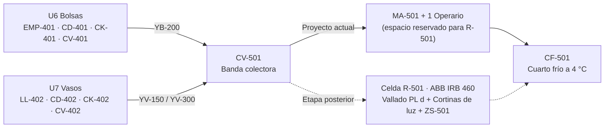

# Justificación técnica y económica de la celda robotizada R-501

**Diseño completo, integración OT, análisis financiero y criterio de implementación diferida**

**Proyecto:** Transformación Digital Industrial de la planta La Hacienda Productos Alimenticios (Guasca, Cundinamarca · 2.600 msnm)  
**Módulo:** Módulo 4 · Celdas de Manufactura Robotizada (en articulación con Módulos 1, 2 y 3)  
**Versión vigente:** Noviembre de 2026  

---

## 1. Resumen ejecutivo de la decisión

La celda robotizada de encanastado, encajonado y paletizado **`R-501`** (robot industrial de 4 ejes **`ABB IRB 460`**) **se diseña completamente dentro del alcance del proyecto**, con su espacio físico reservado al final de la banda **`CV-501`**, su análisis de riesgos normativo (paquete **`1.3.4`**, 60 h), su simulación cinemática y de flujo en **ABB RobotStudio** y **Tecnomatix Plant Simulation** (paquete **`1.7.2`**, 60 h) y sus interfaces de control reservadas en el **`PLC-01`** (`1` nodo EtherNet/IP de los `20` de diseño completo y `3` entradas digitales de las `68` señales de diseño completo). Sin embargo, **su compra e instalación se difieren a una etapa posterior** fuera de la inversión inicial de **`COP 1.495,5 millones`**.

La decisión obedece a tres razones de ingeniería y evaluación financiera verificadas en el modelo vigente (`herramientas/modelo.py`):

1. **No existe cuello de botella ni justificación técnica en ninguna unidad (U1 a U8) a 2 lotes/día.** Entre **U1 y U7**, los procesos son recepción variable en cantinas (`U1`), dosificación gravimétrica/volumétrica dedicada (`U2`), fluidos en tubería sanitaria cerrada (`U3–U5`) o envasado automático dedicado de alta velocidad (`U6–U7`). En **`U8`**, la cadencia máxima efectiva de empaque secundario es de apenas **`0,21 canastas/min`** en bolsas (`YB-200`) y **`1,55 cajas/min`** en vasos (`YV-150`, una caja cada `39 s`), ocupando en promedio **`225 min/día`** (**`54 %`** del turno de `420 min` del operador de empaque y cuarto frío). La mesa acumuladora **`MA-501`** (`COP 6,0 millones`) más el operario absorben esta carga sin restringir el flujo; el cuello de botella real de la planta es el tanque de proceso **`T-301`** (ocupado las `24 h` con los dos lotes).
2. **Incluir `R-501` en la fase inicial destruye la viabilidad financiera del proyecto.** Sumar **`COP 180,0 millones`** en equipos de celda, más el **`8 %`** de montaje (`COP 14,4 millones`) y el **`8 %`** de contingencia (`COP 15,6 millones`), agrega **`COP 210,0 millones`** al CAPEX (llevando la inversión total de **`COP 1.495,5 millones`** a **`COP 1.705,4 millones`**), además de un mantenimiento anual mínimo del **`3 %`** (**`COP 5,4 millones/año`**), sin eliminar al operador de empaque y cuarto frío (`ahorro de nómina = COP 0/año`). Como resultado, el **VPN al 15 % después de impuestos** cae un **`76,5 %`** (de **`COP 189,4 millones`** a **`COP 44,5 millones`**), el equilibrio global sube del **`91,5 %`** al **`98,0 %`** de la capacidad máxima de `2 lotes/día`, y en el umbral contractual de las cartas de intención (**`90 %`** del volumen de vasos) el VPN se vuelve **negativo (`−COP 101,2 millones`, TIR `13,1 %`)**. Al sumar la ingeniería de integración en sitio, adecuaciones neumáticas/civiles o evaluar sin valor residual en libros, el VPN es **negativo incluso al `100 %`** del volumen planeado.
3. **Dejar el diseño y las reservas listas protege la escalabilidad futura.** Reservar hoy la huella física, las `3` señales discretas y el nodo EtherNet/IP en `PLC-01` evita rediseños, sobrecostos de obra y paradas prolongadas cuando el crecimiento de la demanda (`≥ 3–4 lotes/día` o un segundo turno de empaque) active el criterio objetivo de compra de `R-501`.

| Criterio | Solución en el proyecto (`MA-501` + 1 operario) | Celda `R-501` (`ABB IRB 460`, etapa posterior) |
| --- | --- | --- |
| **Estado en el alcance vigente** | Compra, montaje y puesta en marcha (fase 2) | Diseño completo (`1.3.4`), simulación (`1.7.2`) y reservas OT/layout; compra diferida |
| **Inversión directa en equipos** | `COP 6,0 millones` (mesa acumuladora `MA-501`) | `≈ COP 180,0 millones` (`≈ COP 210,0 millones` con montaje `8 %` y contingencia `8 %`) |
| **Capacidad de empaque (U8)** | Hasta `~2,0 cajas/min` con búfer de `2 min` en `MA-501` | Hasta **`10 ciclos/min`** (factor de utilización `< 20 %` con 2 lotes/día) |
| **Requerimiento de personal en U8** | `1` operario de empaque y cuarto frío (`5` operarios en línea) | Mantiene el mismo `1` operario para armado de cajas, muestreo de bolsas y `CF-501` |
| **Efecto sobre VPN base (15 % d/i)** | **`COP 189,4 millones`** (`TIR 18,9 %`, `3,9 años`) | Cae a **`COP 44,5 millones`** (y **`−COP 101,2 millones`** al `90 %` de vasos) |
| **Equilibrio global / vasos** | **`91,5 %`** global / **`87,0 %`** vasos | **`98,0 %`** global / **`96,9 %`** vasos (por encima del umbral de `90 %`) |

---

## 2. Evaluación etapa por etapa del proceso (U1 a U8)

De acuerdo con el modelo físico y procedimental **ANSI/ISA-88** (`Modelo_ISA88_Linea_Yogur.md`), la línea se estructura en ocho unidades (`U1` a `U8`). A continuación se demuestra por qué la robótica industrial no aplica ni aporta valor en ninguna de las siete primeras unidades y por qué resulta económicamente prematura en `U8` bajo el régimen de `2 lotes/día` (`600 lotes/año`, `6.505 unidades conformes/día` en promedio).

### 2.1 Análisis por unidad de proceso

- **U1 · Recepción de leche cruda (`PL-101`, `TK-101`, `TK-102`, `P-101`, `LAB-101`):**  
  La planta recibe **`28 cantinas/día`** de `40 L` (`14` para el lote 1 hacia `TK-101` y `14` para el lote 2 hacia `TK-102` a `4 °C`), en envases heterogéneos de aluminio y plástico procedentes de ganaderos locales. Según el **Decreto 616 de 2006**, cada cantina exige inspección sensorial, toma de muestra y análisis individual en `LAB-101` (acidez, pH, densidad, prueba de alcohol, temperatura y antibióticos) antes de autorizar su mezcla y pesaje (`WT-101`). Un brazo robótico no puede sustituir la evaluación fisicoquímica por cantina ni operar con ventaja sobre recipientes deformables de geometría y tapas no estandarizadas; la mejora real proviene de la bomba sanitaria **`P-101`** (`3 m³/h`, reduciendo la carga de `28,4 min` a `12 min`), **`TK-102`** y el registro digital por cantina en `HMI-01`.

- **U2 · Dosificación de insumos (`DS-201`, `DS-202`, `DS-206`, `P-203/P-204`, `BL-205`):**  
  Los sólidos mayoritarios y minoritarios (`75,7 kg` de azúcar en `YB-200`, `0,206–0,412 kg` de estabilizante, `5,7–7,1 kg` de leche en polvo) se dosifican automáticamente por pérdida/ganancia de peso (`WT-201`, `WT-202`, `WT-206`) con tornillos sinfín con variador y corte grueso/afine (`± 1 %`), mientras los líquidos (`P-203/P-204`) operan por conteo de pulsos. La única operación manual es el pesaje de **`7 g`** de cultivo láctico DVS liofilizado en la balanza Ethernet **`BL-205`** (`WT-205`). La automatización fija dedicada en tolvas cerradas de acero inoxidable **AISI 316L** es higiénicamente superior, más precisa, limpiable y sustancialmente más económica que cualquier manipulador robótico de sacos o microingredientes.

- **U3 a U5 · Tanque de proceso, homogeneización, enfriamiento y transferencia (`T-301`, `H-301`, `E-301`, `P-301`, `T-302`):**  
  Entre `U3` y `U5` el producto es un fluido lácteo en transformación (leche estandarizada, mezcla pasteurizada a `85–90 °C`, gel fermentado y yogur batido enfriado a `15–20 °C`). Todo el transporte ocurre en circuito cerrado por tubería sanitaria AISI 316L (rugosidad `Ra ≤ 0,8 µm`, pendiente `≥ 1 %`), impulsado por bombas centrífugas/lóbulos (`P-101`, `P-301`, `H-301` a `150–200 bar`) y direccionado por válvulas sanitarias de asiento y doble asiento (`XV-101/102`, `XV-301/302`, `XV-401/402`) bajo limpieza **`CIP-901`** automática. La manipulación robótica discreta es físicamente inaplicable en un proceso cerrado de fluidos.

- **U6 y U7 · Envasado de bolsas y vasos (`EMP-401`, `LL-402`, `P-403/MX-403`, `CK-401/402`, `CD-401/402`):**  
  El envasado primario se resuelve con máquinas dedicadas de automatización fija: `EMP-401` (formado, llenado y sellado vertical de `YB-200` a **`30 bolsas/min`** nominales), `LL-402` (llenadora-selladora lineal de dos carriles para `YV-150` a **`45 vasos/min`** y `YV-300` a **`35 vasos/min`** con dosificación de fruta en línea `P-403/MX-403`), verificación de tapa `ZS-403`, codificado automático (`CD-401/402`) y control de peso dinámico del **`100 %`** con rechazo neumático (`CK-401/402`). En el rango de `30–45 uds/min` sobre un envase blando (bolsa) o termosellado abierto antes de tapa, las máquinas lineales/verticales dedicadas superan en higiene, repetibilidad y costo a la robótica *pick-and-place* (como robots delta).

- **U8 · Encanastado, encajonado y paletizado (`MA-501`, `CV-501`, `CF-501`):**  
  Es la única unidad donde la robótica es técnicamente factible, pero **operativamente innecesaria** al volumen de `2 lotes/día`. Con la meta de OEE de envasado (disponibilidad `92 %` × rendimiento `90 %` = **`82,8 %`** de velocidad efectiva sobre el tiempo de corrida), las cadencias reales hacia `U8` son:
  - **Bolsas `YB-200` (canastas de `120` unidades):** `30 bolsas/min` nominales ÷ `120` = **`0,25 canastas/min`** (una canasta cada `4,0 min`); a ritmo efectivo (`24,84 bolsas/min`) = **`0,21 canastas/min`** (una canasta cada **`4,8 min`**; `26 canastas` por lote en `124 min`).
  - **Vasos `YV-150` (cajas de `24` unidades):** `45 vasos/min` nominales × `0,828` = **`37,3 vasos/min`** efectivos ÷ `24` = **`1,55 cajas/min`**, es decir, **una caja cada `39 s`** (`183 cajas` por lote en `117 min`).
  - **Vasos `YV-300` (cajas de `20` unidades):** `35 vasos/min` nominales × `0,828` = **`29,0 vasos/min`** efectivos ÷ `20` = **`1,45 cajas/min`**, es decir, **una caja cada `41 s`** (`113 cajas` por lote en `78 min`).

  En el ciclo de `10 lotes` (`5` días: `5 YB-200`, `3 YV-150`, `2 YV-300`), el envasado y empaque activo promedian apenas **`225 min/día`** (**`54 %`** del turno de `420 min` del operador de empaque y cuarto frío, de `10:30` a `17:30`). El takt global del envasado (`3,9 s/unidad`) supera con holgura al tiempo de ciclo (`1,6–2,4 s/unidad`). La mesa acumuladora **`MA-501`** (`2 min` de acumulación, `~75–90 vasos`) amortigua pausas breves para cerrar o relevar cajas prearmadas antes del turno, y **`CV-501`** traslada el producto hasta el cuarto frío **`CF-501`** sin cuellos de botella.

### 2.2 Síntesis de aplicabilidad robótica (U1–U8)

| Unidad ISA-88 | Naturaleza de la operación | Tecnología óptima seleccionada | ¿Aporta valor un robot en el proyecto? |
| --- | --- | --- | --- |
| **U1 Recepción** | Manipulación de 28 cantinas/día variables y análisis individual | `TK-101`, `TK-102`, `P-101`, `WT-101`, `LAB-101` | **No.** Geometría no estandarizada e inspección fisicoquímica manual obligatoria |
| **U2 Dosificación** | Adición de sólidos (`0,2–75,7 kg`), líquidos y `7 g` de cultivo | Tolvas gravimétricas `DS-201/202/206`, `P-203/204`, `BL-205` | **No.** Automatización fija higiénica más precisa (`± 1 %`) y económica |
| **U3–U5 Proceso térmico y fluidos** | Reacción biológica, transferencia de calor y bombeo cerrado | `T-301`, `H-301`, `E-301`, `P-301`, `T-302`, válvulas sanitarias | **No.** Proceso continuo/lotes de fluidos en tubería cerrada AISI 316L |
| **U6–U7 Envasado** | Formado/llenado/sellado y control de peso a `30–45 uds/min` | `EMP-401`, `LL-402`, `CK-401/402`, `CD-401/402` | **No.** Maquinaria dedicada de mayor velocidad y sello sanitario |
| **U8 Empaque y frío** | Encanastado (`0,21/min`) y encajonado (`1,45–1,55 cajas/min`) | `MA-501` + `CV-501` + 1 operario (`R-501` diferida) | **Técnicamente sí, económicamente no** a `2 lotes/día` (ver sección 3) |

---

## 3. Análisis económico cuantitativo (cifras vigentes)

La evaluación económica vigente de la propuesta (`Propuesta_Economica_y_Comercial.md` y `herramientas/resultados.md`, calculada con `herramientas/modelo.py` en pesos de 2026 sin IVA, tasa de descuento del **`15 %`**, impuesto de renta del **`35 %`** y horizonte de `5` años) establece la siguiente línea base en **20 rubros**:

- **Inversión total (20 rubros):** **`COP 1.495,5 millones`** (equipos y software `COP 975,7 M`, ingeniería de Cremia `COP 333,7 M` en `4.780 h`, montaje `8 %` `COP 75,3 M`, contingencia `8 %` `COP 110,8 M`). Desembolso del año 0 incluyendo `5` días de parada (`COP 7,3 M`): **`COP 1.502,8 millones`**.
- **Costos anuales de operación adicionales (OPEX):** **`COP 135,8 millones/año`** (incluye el quinto operario `COP 33,6 M/año`, turno dominical `COP 12,1 M/año`, mantenimiento `COP 24,8 M/año`, plan de servicio Cremia `COP 36,0 M/año`, mantenimiento de Studio 5000 `COP 8,2 M/año`, conectividad `COP 4,0 M/año`, horas extra `COP 5,0 M/año` y laboratorio externo `COP 12,0 M/año`).
- **Beneficio operativo anual a plena producción (antes de impuestos):** **`COP 711,1 millones/año`** (`COP 846,9 millones/año` de margen de contribución adicional para `6.505 uds conformes/día`, menos `COP 135,8 M/año` de OPEX).
- **Indicadores financieros principales (después de impuestos):** **VPN al 15 % = `COP 189,4 millones`**, **TIR = `18,9 %`**, **recuperación = `3,9 años`**, **relación B/C = `1,13`**.
- **Puntos de equilibrio y condición comercial:** volumen de equilibrio global = **`91,5 %`** del plan; equilibrio en vasos (con bolsas al `100 %`) = **`87,0 %`** del plan. Por ello, la oferta exige **cartas de intención por al menos el `90 %` del volumen de vasos**, escenario en el cual el proyecto mantiene un **VPN positivo de `COP 43,7 millones`** (`TIR 15,9 %`).

### 3.1 Impacto contrafactual de incorporar la celda `R-501` en la fase inicial

El costo de referencia en equipos de la celda **`R-501`** (robot `ABB IRB 460`, herramienta de vacío multifunción, transportadores de indexado, alimentador de estibas y vallado de seguridad) es de **`COP 180,0 millones`**. Al aplicar la estructura de costos del proyecto sobre los rubros físicos:

$$\Delta\text{CAPEX}_{\text{mínimo}} = 180,0 + \underbrace{0,08 \times 180,0}_{\text{Montaje } (14,4)} + \underbrace{0,08 \times (180,0 + 14,4)}_{\text{Contingencia } (15,6)} = \mathbf{COP\ 210,0\ millones}$$

Esto eleva la inversión total de **`COP 1.495,5 millones`** a **`COP 1.705,4 millones`** (`COP 1.698,4 millones` si se descuenta la mesa acumuladora `MA-501` de `COP 6,0 M` + montaje/contingencia) e incrementa el OPEX en **`COP 5,4 millones/año`** (`3 %` de mantenimiento preventivo base sobre `COP 180 M`, llegando a **`COP 141,2 millones/año`**), sin contabilizar aún la ingeniería adicional de programación en sitio (RAPID/seguridad PL d/SAT) ni adecuaciones neumáticas o de piso.

El punto crítico del análisis marginal es que **`R-501` aporta `COP 0/año` de ahorro laboral**: el operador de empaque y cuarto frío (turno `10:30–17:30`) permanece indispensable en planta para el armado de cajas de cartón, la inspección por muestreo del sellado de bolsas en `HMI-02`, el manejo de inventarios/estibas dentro de **`CF-501`** y la atención de despachos, ocupando hoy solo el `54 %` de su turno en empaque.

Al ejecutar el flujo de caja exacto con `herramientas/modelo.py` bajo este escenario contrafactual:

| Escenario evaluado (después de impuestos, tasa `15 %`) | Inversión total (M COP) | OPEX adicional (M COP/año) | VPN al 15 % (M COP) | TIR | Recuperación | Equilibrio global (VPN = 0) | Equilibrio vasos (bolsas 100 %) |
| --- | --- | --- | --- | --- | --- | --- | --- |
| **Caso base vigente (sin `R-501`)** | **1.495,5** | **135,8** | **+189,4** | **18,9 %** | **3,9 años** | **91,5 %** | **87,0 %** |
| **Base al umbral de cartas de intención (`90 %` vasos)** | 1.495,5 | 135,8 | +43,7 | 15,9 % | 4,1 años | — | — |
| **Con `R-501` (`+210,0 M`, sin ing. extra, con valor residual `50 %`)** | 1.705,4 | 141,2 | +44,5 | 15,8 % | 4,1 años | **98,0 %** | **96,9 %** |
| **Con `R-501` al umbral contractual (`90 %` vasos)** | 1.705,4 | 141,2 | **−101,2** | **13,1 %** | > 5 años | — | — |
| **Con `R-501` + integración en sitio (`+35 M` base → `+40,8 M` c/montaje/cont.)** | 1.746,2 | 141,2 | +16,3 | 15,3 % | 4,2 años | **99,3 %** | **98,9 %** |
| **Con `R-501` y sensibilidad `+10 %` en CAPEX** | 1.875,9 | 141,2 | **−66,3** | **13,9 %** | > 5 años | > 100 % | > 100 % |
| **Con `R-501` sin valor residual en libros** | 1.705,4 | 141,2 | **−328,8** | **7,8 %** | > 5 años | > 100 % | > 100 % |

**Lectura financiera concluyente:**

- **Destrucción de valor incremental:** Incluso bajo el supuesto más favorable (`COP 0` de ingeniería robótica adicional, `COP 0` en adecuación de aire comprimido/piso y recuperando el `50 %` del valor en libros al año 5), `R-501` destruye **`COP 144,9 millones`** de VPN y empuja el punto de equilibrio global al **`98,0 %`** del plan (`96,9 %` en vasos), dejando un margen operativo de apenas `2,0 %` por debajo del tope físico de `2 lotes/día` (`600 lotes/año`).
- **Inviabilidad bajo el umbral comercial pactado:** En el escenario de respaldo contractual (`90 %` de vasos cubiertos por cartas de intención), mientras el proyecto base crea **`COP 43,7 millones`** de valor, la inclusión de `R-501` arroja un **VPN negativo de `−COP 101,2 millones`** (`TIR 13,1 % < 15 %`).
- **Riesgo de equilibrio por encima de la capacidad instalada:** Cualquier desviación realista de integración, consumibles de vacío/mantenimiento especializado ABB, sobrecosto del `10 %` (`VPN = −COP 66,3 millones`) o evaluación sin valor residual (`VPN = −COP 328,8 millones`) lleva el **VPN a terreno negativo** y sitúa el punto de equilibrio **por encima del `100 %` de la capacidad máxima de dos lotes diarios**.

---

## 4. Diseño completo y ubicación hipotética en etapa posterior

Diferir la compra no equivale a omitir el diseño. En ingeniería de automatización, diseñar la celda hoy evita quedar encerrado arquitectónica y espacialmente mañana.

### 4.1 Ubicación física en planta (`U8`)

La celda `R-501` se ubica en la unidad **`U8`**, inmediatamente **al final de la banda transportadora `CV-501`** (en el espacio hoy ocupado de forma transitoria por el puesto manual alrededor de la mesa acumuladora **`MA-501`**), antes del ingreso al cuarto frío **`CF-501`**. Durante la etapa de proyecto, el paquete **`1.3.5`** (*Distribución en planta*, `50 h`) reserva una huella libre aproximada de **`3,8 m × 3,4 m`** (con altura libre `≥ 3,2 m` para el brazo a máxima extensión vertical sobre estiba de `1,6 m`), garantizando pasillo de circulación perimetral y acceso directo con estibador manual hacia la puerta de `CF-501`.

### 4.2 Especificación técnica de la celda y herramienta de fin de brazo (EOAT)

- **Manipulador principal:** Robot industrial de paletizado de **4 ejes `ABB IRB 460`** (capacidad de carga útil nominal de hasta `110 kg`, alcance horizontal de `2,40 m`, repetibilidad de posición `0,2 mm` y protección industrial apta para zona de empaque lácteo). Su arquitectura cinemática de 4 ejes (3 grados de libertad posicionales + 1 rotación de muñeca vertical) es el estándar óptimo para encajonado/paletizado por su alta rigidez, huella compacta de base y menor costo frente a un robot antropomórfico de 6 ejes.
- **Capacidad nominal vs. demanda:** **`10 ciclos/min`** (ciclo completo *pick-and-place* `≤ 6,0 s`), con capacidad para manejar capas parciales o cajas/canastas individuales, dejando una reserva superior a `5×` frente al pico actual de `YV-150` (`1,55 cajas/min` efectivas; `1,88 cajas/min` nominales) y `40×` frente a `YB-200` (`0,25 canastas/min`).
- **Herramienta de fin de brazo (EOAT) multifunción:** Cabezal de vacío higiénico en aluminio anodizado/acero inoxidable con ventosas de silicona grado alimentario (libres de BPA/aptas para contacto indirecto con alimentos) y circuito dual de vacío regulado para los tres formatos sin cambio manual de herramienta:
  1. **Canastas plásticas de `120` bolsas (`YB-200`):** agarre mecánico-neumático auxiliar o placa de sujeción lateral/superior por asas de canasta (`~26,8 kg` llena), apiladas en columnas estables.
  2. **Cajas de `24` vasos (`YV-150`, Patrón A de estiba):** ventosas de fuelle de gran caudal para cartón corrugado (`~4,0 kg` por caja cerrada o toma por camada/caja según configuración de *case packer* previa).
  3. **Cajas de `20` vasos (`YV-300`, Patrón B de estiba):** mismo cabezal mediante selección de zonas de vacío por electroválvula (`~6,2 kg` por caja).
- **Periféricos de celda:** Transportador de indexado con tope neumático y sensor `ZS-501`, puesto de formación/posicionamiento de estiba (estiba estándar `1,00 m × 1,20 m`) con guías mecánicas de centrado y rodillos de salida por gravedad hacia `CF-501`.
- **Consideración altitudinal (Guasca, 2.600 msnm, `~74 kPa`):** Al operar a presión atmosférica `27 %` menor que a nivel del mar, la depresión máxima alcanzable por vacío se reduce proporcionalmente (`ΔP_máx` práctico `~50–55 kPa` frente a `~70–75 kPa` al nivel del mar). Por ello, la especificación del paquete `1.3.4` sobredimensiona en **`+35 %`** el área efectiva de las ventosas y el caudal de los eyectores/bomba de vacío para garantizar un factor de seguridad de agarre `≥ 2,5` a `2.600 msnm`.

### 4.3 Integración OT, red EtherNet/IP y señales en `PLC-01`

La arquitectura de control (`Equipos_Sensores_Actuadores_Variables_Comunicaciones.md` y `2_Arquitectura_ISA95.md`) ya contempla las reservas exactas de la celda `R-501` dentro del diseño completo:

| Recurso OT / Control | Diseño completo | Conectado en el proyecto | Reserva dedicada para `R-501` | Función de la interfaz |
| --- | --- | --- | --- | --- |
| **Nodos EtherNet/IP** | `20` nodos | `19` nodos | **`1` nodo (nodo #20)** | Controlador ABB (EtherNet/IP Adapter) conectado al conmutador administrable `Stratix 5700` en red de control con anillo DLR hacia `PLC-01` (`CompactLogix 5380`) |
| **Entradas digitales (DI) en `PLC-01`** | `23` DI (`68` señales totales; `83` con `20 %` reserva) | `20` DI (`65` señales totales) | **`3` DI dedicadas** | 1) `ZS-501` (presencia de canasta/caja en posición); 2) Interruptor de puerta de vallado abierta; 3) Paro de emergencia de la celda |
| **Integración ISA-88 / ISA-95** | Unidad `U8` (`PU6`) | Encanastado manual + registro en `HMI-02` | Módulo de equipo `R-501` | Recibe desde la receta de control el patrón de estiba (`Canastas`, `Patrón A`, `Patrón B`) y reporta al MES conteo de estibas completadas, fallas y OEE de celda |

### 4.4 Seguridad normativa (ISO 10218-1/-2 e ISO 13849-1)

La celda se diseña bajo los requisitos de seguridad de robots industriales en celda cerrada (**ISO 10218-1**, **ISO 10218-2** e **ISO 13849-1**), descartando operación colaborativa abierta debido a la masa de las canastas (`~27 kg`) y al ambiente húmedo de empaque lácteo:

- **Nivel de desempeño requerido:** **PL d** (categoría 3 de arquitectura redundante de doble canal según **ISO 13849-1**) para todas las funciones de seguridad: parada de emergencia, enclavamiento de puertas y detección de acceso por cortinas de luz.
- **Resguardos perimetrales:** Vallado rígido perimetral en acero inoxidable **AISI 304/316** con paneles de policarbonato transparente resistentes a agentes de limpieza, sin puntos de atrapamiento ni alcance por encima/debajo (distancias de seguridad según **ISO 13857**).
- **Acceso de mantenimiento/operación:** Puerta abisagrada con interruptor de seguridad codificado con bloqueo mecánico (`DI` cableada a `PLC-01` y circuito de seguridad del robot), que impide la apertura hasta confirmar velocidad cero y ejecuta parada segura (**STO / SS1**) si se abre.
- **Cortinas de luz con *muting*:** Cortinas optoelectrónicas en el túnel de entrada de cajas/canastas desde `CV-501` y en la salida de estibas completas hacia `CF-501`, configuradas con sensores de *muting* cruzado para permitir el paso exclusivamente de la carga y disparar parada segura ante el ingreso de una extremidad o persona.

### 4.5 Simulación, análisis de riesgos y trazabilidad en la EDT

La ingeniería de la celda se ejecuta dentro de dos paquetes formales de la EDT del proyecto (`4_EDT_Proyecto_TDI_Yogur.md`):

- **Paquete `1.3.4` — Estación de encanastado y análisis de riesgos (`Semanas 3–9`, `60 h`, líder Ana María Orozco):** Entrega el diseño detallado de la estación `U8` (operación actual con `MA-501` y reserva física/servicios para `R-501`), la distribución de resguardos, las hojas de datos de interfaces y la matriz de riesgos conforme a **ISO 12100** e **ISO 10218-2**.
- **Paquete `1.7.2` — Simulación del envasado y el encanastado (`Semanas 9–16`, `60 h`, líder Ana María Orozco):** Ejecuta dos modelos complementarios:
  1. **Simulación de flujo discreto en Tecnomatix Plant Simulation:** verifica la interacción entre `EMP-401`, `LL-402`, `CK-401/402`, la mesa acumuladora `MA-501` (`2 min`) y el operario de empaque para los tres formatos, demostrando ausencia de bloqueos y colas a `2 lotes/día`.
  2. **Simulación cinemática 3D en ABB RobotStudio:** valida el montaje hipotético de `R-501`, verificando el alcance del `IRB 460` (`2,40 m`) sobre todas las esquinas de la estiba sin singularidades ni colisiones contra el vallado o la banda `CV-501`, midiendo tiempos de ciclo por capa (`≤ 6 s/ciclo`, `10 ciclos/min`) y validando las rutinas **RAPID** para los tres patrones (`Canastas YB-200`, `Patrón A` de `YV-150` y `Patrón B` de `YV-300`).

### 4.6 Criterio objetivo de disparo para la compra en etapa posterior

La adquisición e instalación de `R-501` se justifica y activa únicamente cuando la planta cumpla al menos uno de los siguientes criterios medidos en la plataforma Cremia MES/ERP:

1. **Escalamiento de capacidad a `≥ 3–4 lotes/día` (`≥ 1.650–2.200 L/día` de leche):** requiere previamente incorporar un segundo tanque de proceso paralelo a `T-301` (o pasteurización continua HTST), elevando el volumen de empaque a `> 10.000–13.000 unidades/día` y la ocupación de `U8` por encima de un turno continuo (`> 450 min/día`).
2. **Habilitación de un segundo turno completo o consolidación multiproducto:** integración de otra línea de la planta (por ejemplo, queso campesino o kumis) al final de línea compartido, sosteniendo una cadencia combinada **`> 3,5–4,0 cajas/min`** (`> 210 cajas/h`) o generando una carga acumulada de estibado manual superior a la capacidad ergonómica y de tiempo de un solo operario.

## Referencias

- **Documentación del repositorio Cremia Automations (versión vigente, noviembre de 2026):**
  - [`Equipos_Sensores_Actuadores_Variables_Comunicaciones.md`](Equipos_Sensores_Actuadores_Variables_Comunicaciones.md)
  - [`Modelo_ISA88_Linea_Yogur.md`](Modelo_ISA88_Linea_Yogur.md)
  - [`Recetas_y_Lotes_ISA88.md`](Recetas_y_Lotes_ISA88.md)
  - [`2_Arquitectura_ISA95.md`](2_Arquitectura_ISA95.md)
  - [`VSM del estado propuesto e indicadores - Línea de yogur.md`](../2-gestion-y-evaluacion-de-la-produccion/VSM%20del%20estado%20propuesto%20e%20indicadores%20-%20L%C3%ADnea%20de%20yogur.md)
  - [`Propuesta_Economica_y_Comercial.md`](../3-planeacion-y-evaluacion-del-proyecto/Propuesta_Economica_y_Comercial.md)
  - [`Cronograma_Proyecto_TDI_Yogur.md`](../3-planeacion-y-evaluacion-del-proyecto/Cronograma_Proyecto_TDI_Yogur.md)
  - [`4_EDT_Proyecto_TDI_Yogur.md`](../3-planeacion-y-evaluacion-del-proyecto/EDTs/Proyecto/4_EDT_Proyecto_TDI_Yogur.md)
  - [`herramientas/resultados.md`](../herramientas/resultados.md) y [`herramientas/modelo.py`](../herramientas/modelo.py)
- **Normas técnicas y sanitarias:**
  - ISO 10218-1:2011 / ISO 10218-2:2011. *Robots and robotic devices — Safety requirements for industrial robots*.
  - ISO 13849-1:2015. *Safety of machinery — Safety-related parts of control systems*.
  - ISO/TS 15066:2016. *Robots and robotic devices — Collaborative robots*.
  - ISO 12100:2010 / ISO 13857. *Safety of machinery — Risk assessment and safety distances*.
  - ANSI/ISA-88.00.01 / ANSI/ISA-95.00.01 / ANSI/ISA-18.2.
  - Decreto 616 de 2006 y Resolución 2674 de 2013 (Ministerio de Salud y Protección Social, Colombia).
