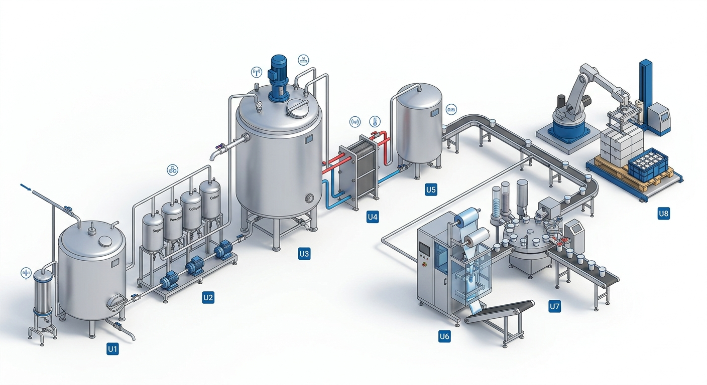
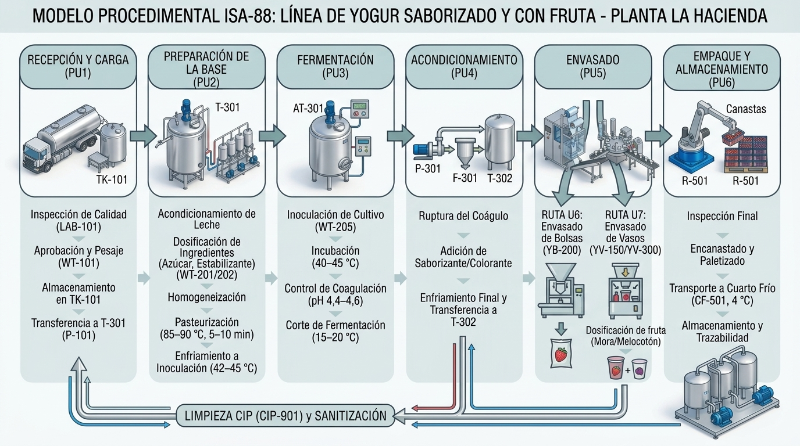

# Modelos físico y procedimental ISA-88
## Línea de yogur saborizado con fruta - Planta La Hacienda

> **Propósito:** Integrar la estructura del proceso productivo de la solución propuesta para la nueva línea de yogur con el modelo físico y el modelo procedimental de ANSI/ISA-88.

---

## 1. Alcance y criterios de modelado

El modelo cubre la fabricación por lotes de tres referencias que comparten la base de yogur y los equipos de preparación:

| Referencia | Producto | Presentación | Fruta o sabor | Ruta de envasado |
|---|---|---|---|---|
| YB-200 | Yogur saborizado bebible | Bolsa de 200 ml | Fresa, sin preparado de fruta | U6 - bolsas |
| YV-150 | Yogur con fruta | Vaso de 150 ml | Preparado de mora al 8 % | U7 - vasos |
| YV-300 | Yogur con trozos de fruta | Vaso de 300 ml | Trozos de melocotón al 12 % | U7 - vasos |

La capacidad de referencia es un lote de 550 L de leche cruda, sujeto a la capacidad efectiva y a la validación de las pruebas de puesta en marcha. La receta determina las cantidades de ingredientes, los parámetros de proceso, la ruta de envasado y el empaque secundario.

### 1.1 Correspondencia de niveles ISA-88

| Nivel ISA-88 | Aplicación en esta línea |
|---|---|
| Empresa | Productos Alimenticios La Hacienda |
| Sitio | Planta La Hacienda |
| Área | Derivados lácteos |
| Célula de proceso | Celda de proceso de derivados fermentados - línea de yogur |
| Unidad | U1 a U8, cada una con una función operacional y equipos asociados |
| Módulo de equipo | Tanques, bombas, intercambiadores, dosificadores, máquinas de empaque y celda de paletizado |
| Módulo de control | Sensores, válvulas, variadores, motores, controladores de peso, PLC y señales de mando |

El lote es la unidad de ejecución y trazabilidad. Una orden de producción selecciona una receta maestra, genera una receta de control para la referencia y registra los datos reales de cada fase.

---

## 2. Modelo físico



### 2.1 Jerarquía física de la línea

```text
Empresa: Productos Alimenticios La Hacienda
└── Sitio: Planta La Hacienda
    └── Área: Derivados lácteos
        └── Célula: Línea de yogur
            ├── U1 Recepción
            ├── U2 Dosificación de insumos
            ├── U3 Tanque de proceso
            ├── U4 Enfriamiento y transferencia
            ├── U5 Tanque pulmón de envasado
            ├── U6 Envasado de bolsas
            ├── U7 Envasado de vasos
            └── U8 Encanastado y paletizado
```

### 2.2 Unidades, módulos de equipo y módulos de control

| Unidad | Función | Módulos de equipo principales | Módulos de control y señales |
|---|---|---|---|
| **U1 Recepción** | Recibir, analizar, pesar y transferir leche aprobada | PL-101 plataforma de recepción; TK-101 tanque de recepción con filtro; P-101 bomba sanitaria | WT-101 peso; FT-101 caudal; motor y variador de P-101; registro manual de laboratorio LAB-101 |
| **U2 Dosificación de insumos** | Alistar y dosificar ingredientes de la receta | DS-201 dosificador de azúcar; DS-202 microdosificador de estabilizante; P-203/P-204 bombas de saborizante y colorante; BL-205 estación de pesaje de cultivo; DS-206 dosificador de leche en polvo | WT-201, WT-202, WT-205 y WT-206 peso; FQ-203/FQ-204 dosificación por pulsos; M-201/M-202 motores |
| **U3 Tanque de proceso** | Mezclar, estandarizar, homogeneizar, pasteurizar, inocular, fermentar y acondicionar | T-301 tanque de proceso de 600 L con chaqueta, agitador y descarga; M-301 agitador; H-301 homogeneizador en recirculación | TT-301 temperatura; TIC-301 control de temperatura; TV-301/TV-302 válvulas; LT-301 nivel; AT-301 pH; ST-301 velocidad; PT-302 presión de homogeneización; XV-302 recirculación; XV-301 descarga |
| **U4 Enfriamiento y transferencia** | Enfriar, filtrar y transferir el yogur al tanque pulmón | E-301 intercambiador de placas; P-301 bomba de lóbulos; F-301 filtro en línea | TT-302 temperatura; TIC-302; TV-303; PT-301 presión; variador de P-301 |
| **U5 Tanque pulmón de envasado** | Almacenar temporalmente y habilitar la alimentación a la ruta de envasado | T-302 tanque pulmón de 650 L; derivaciones hacia bolsas o vasos | LT-302 nivel; TT-303 temperatura; XV-401 ruta a U6; XV-402 ruta a U7 |
| **U6 Envasado de bolsas** | Formar, llenar, sellar, pesar y rechazar bolsas YB-200 | EMP-401 empacadora; CD-401 codificador; CK-401 controladora de peso; CV-401 banda | WT-401 peso; XY-401 expulsor de rechazo; ZS-401 presencia de producto; M-401 accionamiento |
| **U7 Envasado de vasos** | Dosificar fruta, llenar, sellar, pesar y rechazar vasos YV-150/YV-300 | P-403 bomba de preparado; MX-403 mezclador o dosificador de fruta; LL-402 llenadora-selladora; CD-402 codificador; CK-402; CV-402 | WT-402 peso; XY-402 expulsor de rechazo; ZS-402 presencia de producto; ZS-403 tapa sellada; M-402 accionamiento |
| **U8 Encanastado y paletizado** | Agrupar, encajonar o encanastar, paletizar y transportar a frío | Estación de encanastado manual y CV-501 banda hacia CF-501; la celda robotizada R-501 se agrega en una etapa posterior | ZS-501 estado; M-501 accionamiento; TT-501 temperatura del cuarto frío |

### 2.3 Recursos compartidos

Los siguientes recursos no son unidades de la secuencia principal, pero prestan servicio a la célula:

| Recurso | Función |
|---|---|
| CAL-901 | Suministro de vapor y servicios térmicos para el tanque de proceso |
| CH-901 | Suministro de agua fría para enfriamiento |
| CIP-901 | Limpieza de tanques y tuberías entre lotes o cambios de sabor |
| LAB-101 | Análisis de recepción y verificaciones de calidad |
| PLC-01 / HMI-01 y HMI-02 | Ejecución, operación y visualización de la receta de control |
| SCADA, MES y ERP | Supervisión, registro del lote, órdenes, recetas, trazabilidad e indicadores |

La recepción y el análisis por cantina se mantienen como actividad manual asistida por registro digital: cada cantina debe aprobarse antes de mezclarla.

---

## 3. Modelo procedimental



### 3.1 Nivel de procedimiento de lote

El procedimiento de lote común a las tres referencias se organiza en seis procedimientos de unidad.

| Procedimiento de unidad | Propósito | Unidades ISA-88 involucradas |
|---|---|---|
| **PU1 Recepción y carga** | Recibir, aprobar, almacenar y cargar la leche | U1, U3 |
| **PU2 Preparación de la base** | Acondicionar la leche, dosificar la formulación, homogeneizar, pasteurizar y enfriar a inoculación | U2, U3 |
| **PU3 Fermentación** | Inocular, incubar, controlar la coagulación y cortar por enfriamiento | U2, U3 |
| **PU4 Acondicionamiento** | Romper el coágulo, incorporar saborizante/colorante y transferir el producto enfriado | U2, U3, U4, U5 |
| **PU5 Envasado** | Seleccionar ruta, dosificar fruta cuando aplique, llenar, sellar, pesar y codificar | U5, U6 o U7 |
| **PU6 Empaque y almacenamiento** | Inspeccionar, agrupar, paletizar y llevar el lote a refrigeración | U8 |
| **Procedimiento transversal de gestión y saneamiento** | Ejecutar CIP y completar documentación, registros y trazabilidad | CIP-901, PLC/SCADA/MES |

### 3.2 Operaciones y fases

#### PU1 - Recepción y carga

| Operación | Fases | Unidad | Condición de fin |
|---|---|---|---|
| **1.1 Recibir y aprobar la leche** | Registrar análisis por cantina; verificar temperatura, pH, acidez, densidad, grasa, proteína, sólidos y antibióticos; pesar | U1 | Leche aprobada por calidad, peso registrado y cantinas identificadas |
| **1.2 Almacenar leche** | Transferir a TK-101; controlar temperatura y rotación FIFO | U1 | Leche disponible dentro de la condición de almacenamiento |
| **1.3 Cargar el tanque de proceso** | Transferir desde TK-101 a T-301 con P-101 y registrar el volumen de receta | U1/U3 | Volumen del lote cargado en T-301 |

#### PU2 - Preparación de la base

| Operación | Fases | Unidad | Condición de fin |
|---|---|---|---|
| **2.1 Acondicionar la leche** | Estandarizar materia grasa; normalizar sólidos totales y SNG; precalentar con agitación | U3 | Mezcla dentro de la especificación de la receta |
| **2.2 Dosificar la formulación** | Dosificar leche en polvo, azúcar y estabilizante; preparar saborizante, colorante y cultivo según receta; registrar pesos | U2/U3 | Dosis completas, con desviación objetivo máxima de ±1 % en dosificación automática |
| **2.3 Homogeneizar** | Homogeneizar la mezcla acondicionada antes del tratamiento térmico | U3 | Mezcla uniforme, sin separación visible y parámetros de homogeneización registrados |
| **2.4 Pasteurizar** | Calentar con la chaqueta; sostener a 85–90 °C durante 5–10 min, sujeto a validación; registrar la curva | U3 | Tiempo de sostenimiento cumplido y tratamiento registrado |
| **2.5 Enfriar a inoculación** | Enfriar mediante el sistema disponible hasta 42–45 °C ±0,5 °C | U3 | Temperatura estable y autorización para inocular |

#### PU3 - Fermentación

| Operación | Fases | Unidad | Condición de fin |
|---|---|---|---|
| **3.1 Inocular** | Adicionar cultivo DVS según la receta; agitar aproximadamente 5 min; detener el agitador | U2/U3 | Cultivo adicionado, lote registrado y mezcla uniforme |
| **3.2 Fermentar** | Incubar a 40–45 °C sin agitación; vigilar pH y tiempo | U3 | pH 4,4–4,6 y acidez de 80–90 °Th |
| **3.3 Controlar coagulación** | Verificar pH, acidez, firmeza, textura y ausencia de sinéresis excesiva | U3 | Lote conforme o desviación documentada antes del corte |
| **3.4 Cortar fermentación** | Enfriar rápidamente a 15–20 °C para detener la actividad | U3/U4 | Temperatura de salida alcanzada y fermentación detenida |

#### PU4 - Acondicionamiento

| Operación | Fases | Unidad | Condición de fin |
|---|---|---|---|
| **4.1 Romper el coágulo** | Agitar a la velocidad de la receta hasta obtener textura homogénea | U3 | Coágulo roto sin deterioro no previsto de la textura |
| **4.2 Saborizar** | Dosificar saborizante y colorante; para YV-150/YV-300 preparar la incorporación de fruta en la ruta de vasos | U2/U3 | Dosis completa y mezcla homogénea |
| **4.3 Enfriar y transferir** | Bombear con P-301 por E-301; filtrar con F-301; llenar T-302 | U4/U5 | T-301 vacío y producto en T-302 a 15–20 °C, con nivel habilitante para envasar |

#### PU5 - Envasado

Cada lote usa una sola ruta de envasado, determinada por su referencia.

| Ruta | Operación | Fases | Condición de fin |
|---|---|---|---|
| **U6 - YB-200** | Envasar en bolsa | Alinear ruta; formar, llenar y sellar; pesar; rechazar no conformes; etiquetar y codificar | Bolsas de 200 ml dentro de peso/volumen y sellado conforme |
| **U7 - YV-150** | Envasar en vaso con preparado de mora | Alinear ruta; dosificar 8 % de preparado; llenar y sellar; verificar tapa; pesar; rechazar; etiquetar y codificar | Vasos de 150 ml conformes, con fruta, tapa y código correctos |
| **U7 - YV-300** | Envasar en vaso con trozos de melocotón | Alinear ruta; dosificar 12 % de trozos; llenar y sellar; verificar tapa; pesar; rechazar; etiquetar y codificar | Vasos de 300 ml conformes, con trozos, tapa y código correctos |

Los rangos de control de peso/volumen de referencia son 195–205 ml para YB-200, 146–154 ml para YV-150 y 293–307 ml para YV-300. Estos valores deben conservarse como límites de control de la receta de envasado y validarse contra la especificación legal y metrológica aplicable.

#### PU6 - Empaque y almacenamiento

| Operación | Fases | Unidad | Condición de fin |
|---|---|---|---|
| **6.1 Inspeccionar producto** | Verificar peso, volumen, apariencia, sellado, tapa, código y segregación de rechazos | U6/U7 | Muestras conformes y producto no conforme identificado |
| **6.2 Encanastar o encajonar** | Agrupar 120 bolsas por canasta, 24 vasos YV-150 por caja o 20 vasos YV-300 por caja | U8 | Empaque secundario completo e identificado |
| **6.3 Paletizar y transportar** | Paletizar; transportar por CV-501 al cuarto frío CF-501; controlar temperatura | U8 | Lote completo en refrigeración a 4 °C, con ubicación y registro |

### 3.3 Procedimiento transversal de gestión y saneamiento

#### 3.3.1 CIP entre lotes

El CIP es una operación transversal que deja disponibles T-301, tuberías y equipos para el lote siguiente.

| Operación | Fases | Equipo | Condición de fin |
|---|---|---|---|
| Enjuague | Enjuagar con agua T-301 y la línea | CIP-901 | Retorno dentro del criterio de enjuague |
| Limpieza CIP | Preenjuague; lavado alcalino; enjuague; lavado ácido; enjuague final | CIP-901 | Conductividad verificada con CT-901 y ciclo registrado |
| Liberación sanitaria | Verificar resultado y habilitar el siguiente lote | CIP-901 / Calidad | Equipo liberado para producción |

El ciclo se ejecuta entre lotes de la misma referencia y, de forma obligatoria, en cada cambio de sabor o producto según el procedimiento sanitario validado.

#### 3.3.2 Documentación y trazabilidad

Registra como mínimo:

- Orden de producción, referencia y código de lote;
- Receta maestra y receta de control utilizada;
- Materias primas, lotes, cantidades reales y resultados de recepción;
- Parámetros reales de temperatura, tiempo, pH, acidez, nivel, presión y velocidad;
- Estados de equipos, alarmas, paradas, rechazos y ajustes;
- Resultados de inspección, empaque secundario, ubicación en cuarto frío y liberación;
- Ciclo CIP ejecutado y su verificación.

---

## 4. Recetas, parámetros y gestión del lote

### 4.1 Datos comunes de receta

| Elemento | Valor o regla |
|---|---|
| Tamaño nominal | 550 L de leche cruda por lote |
| Base | Leche estandarizada y normalizada, con homogeneización antes de pasteurizar |
| Pasteurización | 85–90 °C durante 5–10 min, con validación de tiempo final |
| Enfriamiento para inoculación | 42–45 °C ±0,5 °C |
| Incubación | 40–45 °C hasta pH 4,4–4,6 y acidez 80–90 °Th |
| Corte de fermentación | 15–20 °C para detener la actividad |
| Envasado y fruta | YB-200 sin preparado de fruta; YV-150 con 8 % de mora; YV-300 con 12 % de melocotón |
| Refrigeración | 4 °C en CF-501 |

Las cantidades exactas de azúcar, estabilizante, saborizante, colorante y cultivo se toman de la receta correspondiente; este documento define su ubicación procedimental y no reemplaza la tabla de formulación.

### 4.2 Estados mínimos del lote

```text
Creado
  -> Ingredientes verificados
  -> Leche aprobada
  -> Base preparada
  -> Pasteurizado y enfriado
  -> Inoculado
  -> Fermentado conforme
  -> Acondicionado
  -> Envasado
  -> Inspeccionado
  -> Empacado y refrigerado
  -> Cerrado y trazable
```

Una desviación de parámetro no se resuelve cambiando silenciosamente el estado: debe generar alarma, registro de causa, decisión de calidad y, si corresponde, segregación o reproceso autorizado.

### 4.3 Secuencia, rutas y paralelismo

- PU1 a PU4 se ejecutan en serie sobre T-301 para cada lote.
- U6 y U7 son rutas alternativas: un lote utiliza U6 para YB-200 o U7 para YV-150/YV-300.
- Después de transferir el lote, T-301 queda libre. El CIP y la carga del siguiente lote pueden ejecutarse en paralelo con el envasado y empaque del lote anterior.
- Este paralelismo soporta el objetivo operativo de dos lotes diarios, sujeto a capacidad, tiempos validados y disponibilidad de equipos.
- La secuencia no permite iniciar una fase si no se cumple la condición de fin de la fase anterior y la unidad requerida está disponible.

---

## 5. Instrumentación, control y comunicaciones

### 5.1 Variables de control del proceso

| Variable | Instrumentos principales | Uso ISA-88 |
|---|---|---|
| Peso de leche recibida | WT-101 | Aceptación y carga del lote |
| Caudal de leche | FT-101 | Control de transferencia |
| Peso de azúcar y estabilizante | WT-201, WT-202 | Dosificación de receta |
| Peso de cultivo | WT-205 | Verificación de inoculación |
| Temperatura de T-301 | TT-301/TIC-301 | Precalentamiento, pasteurización e incubación |
| Nivel de T-301/T-302 | LT-301, LT-302 | Habilitación de transferencia y envasado |
| pH del producto | AT-301 | Fin de fermentación |
| Velocidad de agitación | ST-301 | Mezcla, inoculación y ruptura del coágulo |
| Temperatura de transferencia | TT-302/TIC-302 | Corte y acondicionamiento |
| Presión de transferencia | PT-301 | Protección de la línea |
| Fruta | P-403, MX-403 | Relación de 8 % o 12 % según receta |
| Peso de envase | WT-401, WT-402 | Aceptación y rechazo automático |
| Rechazo y tapa | XY-401, XY-402, ZS-403 | Retiro de unidades fuera de peso y verificación de tapa |
| Cuarto frío | TT-501 | Cadena de frío a 4 °C |

### 5.2 Arquitectura de información

| Nivel | Componentes | Información |
|---|---|---|
| 0-1 Proceso, medición y actuación | Sensores, válvulas, motores, variadores, módulos de E/S | Mediciones, estados y mandos |
| 2 Control | PLC-01 (CompactLogix 5380) y controladores de máquina: controladoras de peso, empacadora y llenadora (robot en la etapa posterior) | Consignas, estados, conteos, pesos y alarmas |
| 2 Supervisión | SCADA Ignition, HMI-01 en preparación y HMI-02 en envasado | Variables, alarmas, tendencias, receta activa y estado del lote |
| 3 Gestión de operaciones | MES, base de datos SQL | Órdenes, recetas de control, registro de lote, paradas e indicadores |
| 4 Gestión empresarial | ERP | Órdenes, inventario, consumos y resultados mediante servicios web/API |

Las señales de campo usan 4–20 mA, IO-Link y 24 VDC según el instrumento. La integración de control se realiza por Ethernet industrial/EtherNet/IP; la supervisión usa OPC UA y la conexión con MES puede usar OPC UA o MQTT, con persistencia en SQL.

---

## 6. Reglas de consistencia y aceptación del modelo

1. Cada fase del procedimiento debe estar asignada a una unidad, módulo de equipo y módulos de control disponibles.
2. No se agregan unidades productivas fuera de U1-U8; el CIP, laboratorio, caldera y enfriador son recursos compartidos.
3. La referencia del lote determina la formulación y la ruta U6/U7, pero no cambia la secuencia común de preparación y fermentación.
4. Las condiciones de fin son verificables mediante medición, inspección o registro de estado.
5. Los valores de receta y los límites críticos deben validarse durante las pruebas de puesta en marcha antes de convertirse en parámetros de producción liberados.

---

## 7. Referencias de contexto

- [EDT de Proceso - Línea de Yogur](../3-planeacion-y-evaluacion-del-proyecto/EDTs/Proceso/EDT_Proceso_Yogur.md), especialmente la sección 3, Árbol de la EDT.
- *Recetas y lotes - Línea de yogur*, estructura de referencias, formulaciones, parámetros y trazabilidad.
- *Equipos, sensores, actuadores, variables y comunicaciones - Línea de yogur*, inventario de equipos, instrumentos, control y comunicaciones.
- ANSI/ISA-88, como marco para separar modelo físico, procedimientos, recetas y ejecución por lotes.

*Documento de integración conceptual. Las capacidades, límites críticos, tiempos y fórmulas deben validarse en las pruebas de aceptación y puesta en marcha de la línea.*
