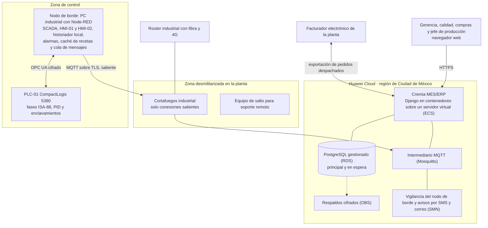

# Plataforma Cremia MES/ERP y SCADA en Node-RED

**Diseño, despliegue, alcance y costo del software de supervisión y gestión de la producción**

**Proyecto:** Transformación Digital Industrial de la planta La Hacienda  
**Módulo:** Módulo 1 · Transformación Digital Industrial

## 1. Alcance

Este documento define el software que Cremia Automations desarrolla para la línea de yogur: el SCADA en Node-RED que corre en la planta y la plataforma Cremia MES/ERP que corre en Huawei Cloud. Explica por qué se desarrolla en lugar de licenciar plataformas comerciales, qué funciones cubre, cómo se despliega, cómo sigue operando la planta si se cae internet, cuántas horas cuesta desarrollarlo y cuánto cuesta mantenerlo. Las necesidades de información que atiende están en el documento de necesidades de información del módulo 2; la arquitectura por niveles, en el documento de arquitectura ISA-95.

La plataforma atiende las necesidades básicas de una planta pequeña: recetas, órdenes, registro de lote, trazabilidad, calidad, OEE, inventario, compras, pedidos, despacho y costo por lote. No incluye contabilidad ni facturación electrónica: la planta ya factura de forma electrónica, como exige la DIAN, y la plataforma le exporta los pedidos despachados a su facturador.

## 2. Por qué software propio

Con la propuesta, La Hacienda procesa 1.100 L de leche por día en una sola línea. Para una planta de ese tamaño, una plataforma comercial de MES con su ERP cuesta más de lo que la planta necesita: solo los tres módulos MES que se habían seleccionado en la versión de octubre de 2026 (Sepasoft OEE Downtime, Track & Trace y Settings & Changeover) cuestan USD 54.500 en la lista de precios publicada por el fabricante, unos COP 223 millones, sin el servidor SCADA ni la suscripción del ERP. Esa alternativa fue descartada.

| Alternativa | Inversión inicial (millones de COP) | Costo anual (millones de COP) | Ajuste a la planta | Decisión |
| --- | --- | --- | --- | --- |
| Plataformas licenciadas (SCADA, MES y ERP comerciales) | Más de 270 en licencias y servidores | Más de 60: soporte anual de cerca del 20 % de las licencias y suscripción del ERP | Funciones de sobra para una línea; licencias por servidor y por usuario | Descartada por costo |
| Adaptar un ERP de código abierto de propósito general | Unas 1.200 h de adaptación | Mantenimiento de un sistema grande | Modelo de datos genérico, sin recetas ISA-88 ni registro de lote | Descartada por complejidad de mantenimiento |
| **Desarrollo propio: SCADA en Node-RED y plataforma Cremia MES/ERP** | **123,9 de desarrollo, 30,0 de hardware de borde y 6,0 de nube** | **40,0** (nube, soporte, evolución y conectividad) | Hecho a la medida de la línea, con el modelo de ISA-88 e ISA-95 | **Seleccionada** |

El desarrollo propio también es un producto para Cremia: la plataforma se reutiliza en otras plantas lácteas del segmento, lo que reduce su costo para los clientes siguientes.

**Riesgo de dependencia y cómo se mitiga.** Un software a la medida deja a la planta dependiendo de quien lo programó. Para reducir ese riesgo:

- **Licencia perpetua y depósito del código.** Cremia conserva la propiedad intelectual de la plataforma, pero La Hacienda recibe una licencia de uso perpetua para su sitio. El código fuente, los scripts de despliegue y la documentación se depositan con un tercero (depósito de código fuente, *escrow*) y se entregan al cliente si Cremia deja de prestar el servicio.
- **Tecnologías abiertas y comunes.** Python con Django, PostgreSQL, MQTT, OPC UA y Node-RED, todas de código abierto con licencias permisivas y con una comunidad amplia de desarrolladores en Colombia.
- **Datos del cliente.** La base de datos es de La Hacienda: puede exportarse completa en cualquier momento (SQL y CSV), y el modelo de datos sigue los objetos de ISA-95 parte 2 (material, equipo, personal, segmento de proceso y respuesta de producción), de modo que otro integrador puede entenderlo.
- **Programas de control.** El programa del PLC y los flujos de Node-RED son del cliente y se entregan con su documentación. Para que la planta pueda abrir y diagnosticar el programa del PLC, la inversión incluye una licencia perpetua de Studio 5000 Logix Designer a su nombre (rubro 20 de la propuesta económica); los flujos de Node-RED se abren con cualquier navegador, sin licencia.

## 3. Arquitectura

| Capa | Dónde corre | Qué hace | Tecnología |
| --- | --- | --- | --- |
| Control | PLC-01, en la planta | Fases ISA-88, lazos PID, enclavamientos y alarmas de proceso. Opera solo, sin depender de la red | Studio 5000 Logix Designer, PhaseManager |
| Supervisión (SCADA) | Nodo de borde, en la planta | Pantallas de HMI-01 y HMI-02, alarmas, tendencias, historiador local, usuarios del piso de planta, descarga de recetas al PLC | Node-RED con su tablero web, InfluxDB como historiador local, cliente OPC UA |
| Gestión de operaciones (MES) | Huawei Cloud | Recetas maestras y versiones, órdenes, receta de control, registro electrónico de lote, genealogía, liberación, OEE y paradas | Plataforma Cremia MES/ERP (Python, Django, PostgreSQL) |
| Gestión empresarial (ERP ligero) | Huawei Cloud | Pedidos, plan semanal, requerimiento de materiales, compras, inventario por lote y vencimiento, despacho y costo por lote | Misma plataforma y misma base de datos |
| Integración | Nodo de borde y nube | Mensajes entre la planta y la nube, con almacenamiento y reenvío | MQTT sobre TLS (Mosquitto en la nube) |

Como el MES y el ERP son una sola aplicación con una sola base de datos, no hay interfaz entre ellos que mantener: una orden, su lote, sus consumos y su costo son registros de la misma base.

## 4. Continuidad: qué pasa cuando algo falla

El objetivo del despliegue en la nube es que la gestión de la producción siga disponible aunque falle la planta, y que la planta siga produciendo aunque falle internet.

| Falla | Qué sigue funcionando | Cómo se recupera |
| --- | --- | --- |
| Se cae internet | El PLC ejecuta el lote; el nodo de borde muestra las HMI, registra el lote y las alarmas y guarda los mensajes en su cola local, con capacidad para 72 h. Las recetas de control de las órdenes de las 48 h siguientes y las recetas maestras liberadas están en la caché del nodo | Al volver la conexión, el nodo reenvía los mensajes en orden; la plataforma los recibe una sola vez porque cada mensaje lleva un identificador único |
| Se cae la fibra | El router pasa a 4G en segundos | Automático |
| Falla el PC industrial del nodo de borde | El PLC sigue ejecutando la fase en curso y sus enclavamientos | Se cambia por el PC de repuesto, que tiene la misma imagen del sistema, en menos de 1 h |
| Corte de energía en la planta | La UPS mantiene el PLC, el nodo de borde y el router unos 30 min; la nube detecta la pérdida y avisa | La nube sigue disponible para ventas, inventario, despacho y consulta de trazabilidad |
| Falla la planta durante el lote 2 nocturno | La nube deja de recibir la señal de vida del nodo de borde (cada minuto) y a los 5 min envía SMS y correo al jefe de producción | El jefe de producción revisa el estado desde su teléfono o va a la planta |
| Falla el servidor en la nube | La base de datos tiene una réplica en espera en otra zona de disponibilidad | Recuperación en menos de 4 h; pérdida de datos de la nube menor de 5 min (los datos de la planta siguen en la cola del nodo) |

Metas de servicio de la plataforma: disponibilidad mensual de 99,5 %, punto de recuperación de 5 min y tiempo de recuperación de 4 h. Los respaldos de la base de datos son diarios, cifrados y se conservan 30 días, con una prueba de restauración cada semestre.

**Región y datos personales.** La plataforma guarda datos de proveedores de leche y de clientes, así que está sujeta a la Ley 1581 de 2012. Se despliega en la región de Huawei Cloud en Ciudad de México, porque México está en la lista de países con nivel adecuado de protección de datos de la Superintendencia de Industria y Comercio (Circular Externa 005 de 2017). La región y la latencia se confirman en la ingeniería básica (paquete 1.2.3).

## 5. Ciberseguridad

- **Zonas y conductos según IEC 62443:** zona de control (PLC, E/S, variadores y nodo de borde), zona desmilitarizada (cortafuegos y equipo de salto) y zona de nube.
- **Solo conexiones salientes:** el nodo de borde abre la conexión MQTT sobre TLS hacia la nube; la planta no expone ningún puerto a internet.
- **Certificados por dispositivo:** el nodo de borde se autentica ante el intermediario MQTT con su propio certificado.
- **Usuarios y roles:** operador, supervisor, calidad, compras, mantenimiento, gerencia y administrador, con doble factor para los roles que aprueban recetas o liberan lotes.
- **Auditoría:** cada cambio de receta, consigna, estado de lote o inventario guarda el usuario, la fecha, el valor anterior y el motivo, como exige el control de registros de la Resolución 2674 de 2013.
- **Validación de mensajes en la frontera:** la API rechaza órdenes de más de 550 L de leche, referencias que no existen, mensajes duplicados y mensajes sin firma del nodo autorizado.
- **Soporte remoto:** el equipo de salto abre una VPN saliente hacia Cremia solo cuando el jefe de producción la autoriza; nunca hay acceso directo a la red de control.

## 6. Funciones y entregas

La plataforma se entrega en dos versiones. La versión 1 sale con la SAT y el arranque (semanas 20 a 22) y cubre todo lo que el piso de planta necesita para producir, liberar y despachar lotes. La versión 2 sale durante la estabilización (semanas 20 a 26) y completa la gestión: OEE, compras, costos y tablero. Desde el arranque, el SCADA ya guarda los estados y las paradas de las máquinas en su historiador, de modo que el módulo de OEE de la versión 2 procesa también los datos de las primeras semanas. Si el desarrollo se demora, se corren funciones de la versión 2, no el arranque.

| Paquete de la EDT | Funciones | Versión | Horas |
| --- | --- | --- | --- |
| 1.6.1 Infraestructura en Huawei Cloud | Servidor virtual, base de datos principal y en espera, intermediario MQTT, respaldos, monitoreo, despliegue continuo y entornos de desarrollo, pruebas y producción | 1 | 120 |
| 1.6.2 Núcleo | Datos maestros (materiales, equipos, proveedores, clientes), usuarios y roles, auditoría y API | 1 | 180 |
| 1.6.3 Recetas y órdenes | Recetas maestras con versiones y aprobación (sección 6.4 del documento de recetas), plan semanal, órdenes, receta de control escalada y secuencia de los dos lotes diarios | 1 | 200 |
| 1.6.4 Registro de lote y genealogía | Expediente electrónico de lote con fases, consumos, curvas de los puntos críticos, alarmas y paradas; genealogía desde la cantina hasta la estiba | 1 | 140 |
| 1.6.5 Calidad y liberación | Análisis por cantina, acidez de confirmación, criterios de liberación, retención, calibraciones vigentes y resultados del laboratorio externo | 1 | 100 |
| 1.6.6 OEE y paradas | OEE por turno y por máquina, paradas por causa y horas de trabajo de los equipos para el mantenimiento preventivo | 2 | 120 |
| 1.6.7 Integración borde–nube | Mensajes MQTT, cola de almacenamiento y reenvío, caché de recetas en el nodo de borde y señal de vida | 1 | 100 |
| 1.6.8 ERP ligero I | Inventario por lote y vencimiento de insumos y producto terminado, pedidos de clientes y despacho | 1 | 160 |
| 1.6.9 ERP ligero II | Compras, requerimiento de materiales a partir del plan, costo real por lote y margen por referencia, exportación de pedidos al facturador | 2 | 140 |
| 1.6.10 Tablero y reportes | Tablero gerencial diario y reportes de lote, de producción y de calidad | 2 | 80 |
| 1.6.11 Pruebas y documentación | Pruebas unitarias, de integración, de carga y de seguridad; manuales de usuario y de administración | 1 y 2 | 160 |
| **Total de la plataforma Cremia MES/ERP** | | | **1.500** |

| Paquete de la EDT | Funciones del SCADA en Node-RED | Horas |
| --- | --- | --- |
| 1.5.3 Guía de estilo y pantallas | Guía de estilo según ISA-101 (gris de fondo, color solo para condiciones anormales) y pantallas de HMI-01 (recepción, preparación y CIP) y HMI-02 (envasado) | 90 |
| 1.5.4 Alarmas e historiador | Alarmas con prioridad, reconocimiento, supresión y registro según ISA-18.2; historiador local con 90 días de datos; tendencias | 140 |
| 1.5.5 Nodo de borde | Usuarios del piso de planta, caché de recetas, descarga de la receta de control al PLC, operación sin conexión y copia de la imagen al PC de repuesto | 100 |
| **Total del SCADA** | | **330** |

El SCADA no compra licencias: Node-RED, su tablero web, InfluxDB y el cliente OPC UA son de código abierto. El PLC CompactLogix 5380 ofrece el servidor OPC UA desde su firmware.

## 7. Costo

### 7.1 Desarrollo

El equipo de Cremia es junior (un año de experiencia). Por eso la estimación usa tecnologías que reducen trabajo repetitivo (Django trae administración, autenticación y acceso a datos; Node-RED trae el tablero web), deja fuera la contabilidad y la facturación electrónica, y divide el alcance en dos versiones.

| Concepto | Valor |
| --- | --- |
| Horas de desarrollo: 1.500 de la plataforma y 330 del SCADA | 1.830 h |
| Costo interno de Cremia (1.830 h a unos 36.200 COP/h, el costo promedio ponderado del equipo) | ≈ COP 66,2 millones |
| Precio al cliente, dentro de la ingeniería del proyecto (tarifas de la EDT) | COP 123,9 millones |
| Hardware de borde (rubro 11): PC industrial principal y de repuesto, dos paneles táctiles de 15" IP65, UPS, router industrial con 4G y equipo de salto | COP 30,0 millones |
| Nube durante el proyecto (rubro 12): entornos de desarrollo y pruebas desde la semana 6 y de producción desde la semana 16 | COP 6,0 millones |
| **Inversión del cliente en supervisión y gestión de la producción** | **COP 159,9 millones** |

Con un sobrecosto de 30 % en las horas de software, el VPN del proyecto después de impuestos baja de COP 189,4 a 158,7 millones (sección 10 de la propuesta económica).

### 7.2 Operación

| Costo anual | Millones de COP |
| --- | --- |
| Nube Huawei: servidor virtual, base de datos principal y en espera, almacenamiento de respaldos, IP pública y mensajes de aviso (unos USD 300 al mes) | 15,0 |
| Soporte y evolución: soporte de segundo nivel del PLC, el SCADA y la plataforma, actualizaciones de seguridad, ajustes de recetas y reportes, y revisión trimestral de indicadores (unas 0,2 personas de tiempo completo) | 21,0 |
| **Plan de servicio Cremia** | **36,0** |
| Conectividad doble de la planta: fibra y respaldo 4G | 4,0 |
| **Total anual del software de supervisión y gestión** | **40,0** |

Los precios de la nube son estimaciones de orden de magnitud con una tasa de USD 1 = COP 4.100 y se confirman con la calculadora oficial de Huawei Cloud en la ingeniería básica.

El software de control no está en estas cifras: la licencia de Studio 5000 de la planta (COP 28,7 millones) y su mantenimiento anual (COP 8,2 millones) se presentan en las secciones 6.1 y 7 de la propuesta económica.

## 8. Requisitos no funcionales

| Requisito | Meta |
| --- | --- |
| Usuarios concurrentes | 15 |
| Tiempo de respuesta de las pantallas de la plataforma | Menos de 2 s |
| Actualización de las HMI | 1 s |
| Autonomía del nodo de borde sin internet | 72 h de mensajes y 48 h de órdenes en caché |
| Conservación de los registros de lote | Vida útil del producto más 2 años, como mínimo |
| Disponibilidad de la plataforma | 99,5 % mensual |
| Idioma | Español |

## Referencias

- ANSI/ISA-88.00.01-2010 y ANSI/ISA-88.00.02-2001. Batch Control, partes 1 y 2.
- ANSI/ISA-95.00.01-2010 y ANSI/ISA-95.00.02. Enterprise-Control System Integration, partes 1 y 2.
- ANSI/ISA-101.01-2015. Human Machine Interfaces for Process Automation Systems.
- ANSI/ISA-18.2-2016. Management of Alarm Systems for the Process Industries.
- IEC 62443. Security for industrial automation and control systems.
- Ley 1581 de 2012 y Superintendencia de Industria y Comercio, Circular Externa 005 de 2017 (transferencia internacional de datos personales).
- Resolución 2674 de 2013. Requisitos sanitarios para fabricar, procesar, envasar y comercializar alimentos.
- Sepasoft. Lista de precios de los módulos MES (alternativa descartada), consultada en noviembre de 2026: https://www.sepasoft.com/pricing/
