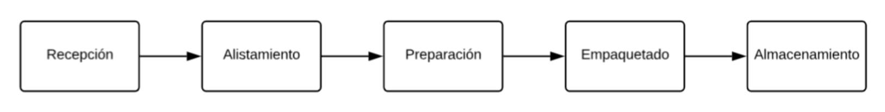
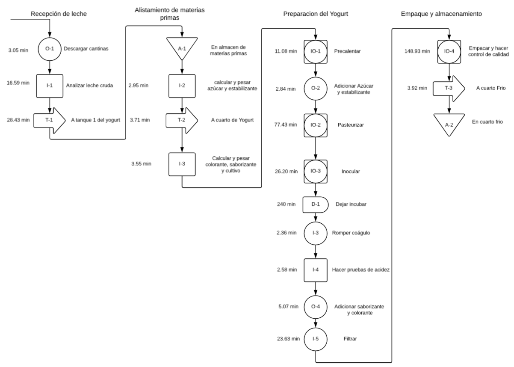
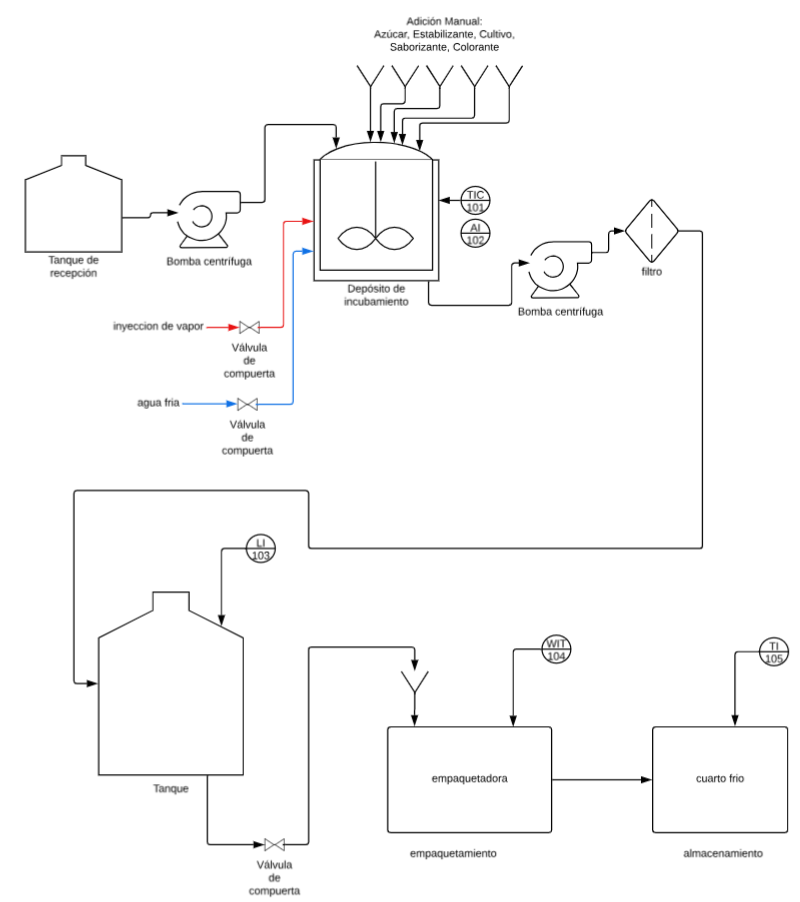

## **CREMIA AUTOMATIONS** 

# **Diagramas de Producción, Tiempos y Capacidades** 

**Proyecto:** Transformación Digital Industrial de la planta La Hacienda **Módulo:** Módulo 2 · Gestión y Evaluación de la Producción 

### **Introducción** 

El presente apartado documenta el análisis de operaciones, tiempos estándar y capacidades productivas de la línea de yogur en la planta La Hacienda. Este estudio constituye la base técnica para evaluar el rendimiento de la instalación y sirve como punto de partida para el proyecto de transformación digital industrial de la compañía. 

La comprensión detallada de los tiempos de ciclo y el flujo de los materiales es fundamental para visualizar la interacción entre las distintas etapas del proceso, desde la recepción de la materia prima hasta el empaque y almacenamiento. Contar con estos indicadores permite medir de manera objetiva la eficiencia de los recursos (humanos y técnicos) y fundamentar estratégicamente la incorporación de nuevas tecnologías. 

### **1. Diagnóstico del estado actual** 

para la determinación del estado actual de la línea de producción se identificó cada uno de los procesos necesarios para la fabricación de yogurt incluyendo desde la recepción de la materia prima hasta el empaquetado del producto 

#### **Diagrama de bloques del proceso** 

se tomó de forma más específica los procesos necesarios para la creación del yogurt obteniendo el siguiente diagrama de flujo: 

#### **Diagrama de flujo** 

se tomó los tiempos que toma cada uno de los procesos actuales de producción para la preparación de un lote obteniendo: 

#### **diagrama de operación de proceso** 

##### organizando mejor esta información se llegó a: 

|**Tarea**|**Elemento**|**Tiempo estándar** **(min/lote)**|**Tipo**|
|---|---|---|---|
|Recepción de la leche cruda|Descargar cantinas|3,05|Operación|
||Analizar la leche cruda|16,59|Inspección|
||Transportar la leche al tanque 1|28,43|Transporte|
|Alistamiento de materias primas|Calcular y pesar azúcar y estabilizante|2,95|Operación e inspección|
||Transportar materias primas al cuarto del yogur|3,71|Transporte|

||Calcular y pesar colorante, saborizante y cultivo|3,55|Operación e inspección|
|---|---|---|---|
|Preparación del yogur|Precalentar|11,08|Operación|
||Adicionar azúcar y estabilizante|2,84|Operación|
||Pasteurizar|77,43|Operación|
||Inocular|26,20|Operación|
||Dejar incubar|240,00|Demora (tiempo fijo)|
||Romper el coágulo|2,36|Operación|
||Hacer la prueba de acidez|2,58|Inspección|
||Adicionar saborizante y colorante|5,07|Operación|
||Filtrar el yogur|23,63|Operación|
|Empaque y|Empacar y hacer|148,93|Operación e|
|almacenamiento|control de calidad||inspección|
||Trasladar las bolsas al cuarto frío|2,92|Transporte|

en donde las tareas actualmente se organizan en primero se realizar primero la parte posterior a la incubación y su reposo del yogurt que inició su fabricación el dia anterior  el empaquetamiento y después iniciar la producción del lote de ese dia con el objetivo de al terminar su fermentación dejarlo enfriar durante la noche teniendo un tiempo de las principales tareas(sin contar el tiempo de enfriamiento durante la noche) de: 

|**Tarea**|**Tiempo estándar (min)**|**Participación**|
|---|---|---|
|Recepción de la leche cruda|48,07|8,0 %|
|Alistamiento de materias|10,21|1,7 %|
|primas|||

|**Preparación del yogur**|**391,19**|**65,1 %**|
|---|---|---|
|**(cuello de botella)**|||
|Empaque y almacenamiento|151,85|25,3 %|
|**Total**|**601,32 (10 h 2 min)**|100 %|

adicionalmente a esto se creó el P&ID de lo que actualmente tiene la línea de yogures 

#### **P&ID** 

### **2. Indicadores del estado actual** 

ya con lo anterior tenemos que durante el proceso se puede ver: 

#### **tiempo de ciclo(Tc)** 

<u>tiempo de ciclo por cada etapa del proceso:</u> 

|**Estación**|**Tc por lote** **(min)**|**Tc por bolsa** **(s)**|**% del total**|
|---|---|---|---|
|Recepción de leche|48,07|0.95|8.0%|
|Alistamiento|10,21|0.20|1.7%|
|Preparación (cuello)|391,19|7.69|65.1%|
|Empaque y almacenamiento|151,85|2.99|25.3%|
|Total|601,32|11,82|100%|

#### **Takt Time** 

El Takt Time indica cada cuánto tiempo debe salir una bolsa de producto para satisfacer la demanda (Tiempo disponible / Demanda). 

|**Métrica**|**Situación Actual**|
|---|---|
|**Demanda diaria del cliente**|**3.052 bolsas (610 L de yogur)**|
|**Tasa de producción (Salida)**|**468 bolsas/hora**|
||**9,4 s por bolsa (480 min × 60 /**|
|**Takt Time (Requerido)**|**3.052)**|
|**Ritmo real (Actual vs Proyectado)**|**2,9 s por bolsa en el empaque**|

|**Indicador**|**Valor**|**Cálculo**|
|---|---|---|
|Tamaño de lote|550 L de leche 610,4 L →|Dato del caso|
||de yogur||
|Producción por lote|3.052 bolsas conformes|Dato del caso|

|Lotes por día|1|El enfriamiento ocurre durante la noche|
|---|---|---|
|Tiempo total de fabricación (MLT)|601,3 min, más el enfriamiento nocturno|Suma de tiempos estándar (sin contar enfriamiento nocturno)|
|Índice de procesamiento|468 bolsas/h|3.052 / (391,19 / 60)|
|Ritmo de empaque|20,5 bolsas/min|3.052 / 148,93|
|Producto no conforme|5,06 %|Dato del caso|
|Tasa de calidad|94,9 %|100 % 5,06 % −|
|Eficiencia de materiales|98,1 %|630,5 kg de producto / 642,7 kg de insumos|
|Tiempo fijo de incubación|240 min: 39,9 % del total y 61,4 % de la preparación|240 / 601,32 y 240 / 391,19|
|Operarios|4|Dato del caso|

### **3. Estimación preliminar del estado propuesto** 

para la propuesta de mejor se espera comenzar a crear un mayor flujo en la línea de producción no sólo comenzando a usar cosas como la caldera en los tiempos muertos que tiene al no estarse usando continuamente sino también dotando de una nueva forma de empaquetamiento incluyendo envasado para proceder a producir no sólo presentacion de yogurt en bolsa de distintos sabores sino también dos tamaños diferentes de vaso(150ml y 300ml) dividiendo el tiempo 

|**Hora**|**Lote 1**|**Lote 2**|
|---|---|---|
|7:30|Transferencia y envasado del lote 2 del día anterior (hasta las 9:15)||
|8:00–8:40|Limpieza CIP del tanque de proceso||
|8:40–10:40|Carga, pasteurización e inoculación||
|10:40–14:40|Incubación||
|14:40–15:05|Enfriamiento en placas y transferencia al tanque pulmón||

|15:05–16:50|Envasado||Limpieza CIP y carga del tanque de proceso (15:05– 16:15)|
|---|---|---|---|
|16:15–18:15|||Pasteurización e inoculación|
|18:15–22:15|||Incubación sin operario, con control automático y alarmas remotas|
|22:15–7:30 |||Enfriamiento natural en el tanque, como hoy |
|además de mejorar ciertas tr|ansiciones dura|nte el proceso|en las que se encuentra:|
|**Etapa**|**Actual** **(min)**|**Propuesto** **(min)**|**Cambio que lo explica**|
|Descarga y análisis de la leche|19,6|19,6|Sin cambio: el análisis por cantina sigue siendo manual|
|Transporte de la leche al tanque de proceso|28,4|12|Bomba de mayor caudal (3 m³/h)|
|Alistamiento y pesaje de insumos|10,2|2|Dosificación automática por peso|
|Precalentamiento y adición de azúcar|13,9|12|Dosificación automática|
|Pasteurización|77,4|60|Control automático de temperatura y sostenimiento de 5 a 10 min|
|Enfriamiento e inoculación|26,2|15|Control automático de la válvula de agua fría|
|Incubación|240|240|Tiempo fijo del proceso|
|Ruptura del coágulo, acidez y saborizado|10,0|5|Agitador con variador, pH en línea y dosificación automática|
|Enfriamiento, filtrado y transferencia|23,6 (más la noche)|25|Intercambiador de placas a 1.500 L/h, con agitación simultánea|
|Empaque y control de peso|148,9|102|Control de peso en línea: 30 bolsas/min|
|Traslado al cuarto frío|2,9|0|Banda transportadora, en paralelo con el|

||||empaque|
|---|---|---|---|
|**Total por lote**|**601,3**|**493** **≈**|**18 %** **−**|

### **4. Capacidad comparada** 

se espera llegar a casi duplicar o duplicar la producción actual aumentando la jornada pero <u>maximizando más las ganancias</u> 

|**Indicador**|**Actual**|**Propuesto (estimado)**|
|---|---|---|
|Lotes por día|1|2|
|Yogur por día|610 L|1.230 a 1.360 L, según la referencia|
|Unidades por día (solo bolsas de 200 ml)|3.052|6.158|
|Tiempo estándar por lote|601 min|493 min ≈|
|Ritmo de empaque de bolsas|20,5 bolsas/min|30 bolsas/min|
|Producto no conforme|5,06 %|Meta: 1,5 % o menos|

