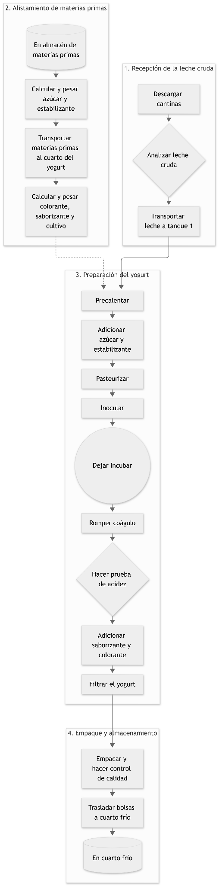
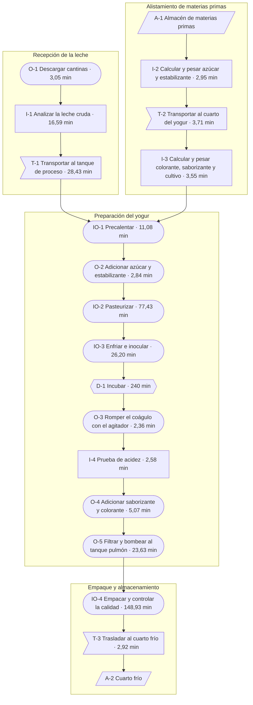
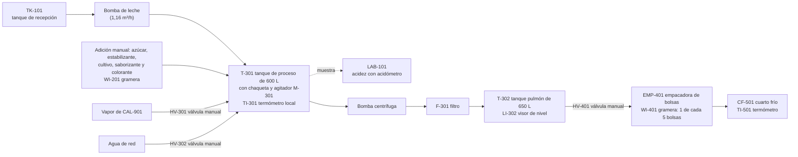

# Diagramas de producción, tiempos y capacidades

**Línea de yogur de la planta La Hacienda**

**Proyecto:** Transformación Digital Industrial de la planta La Hacienda  
**Módulo:** Módulo 2 · Gestión y Evaluación de la Producción

## Introducción

Este documento analiza las operaciones, los tiempos estándar y la capacidad de la línea de yogur de la planta La Hacienda, en el estado actual y en el estado propuesto. Es la base para medir el rendimiento de la línea y para dimensionar la propuesta de transformación digital. Los indicadores del VSM están en los documentos de VSM del estado actual y del estado propuesto.

## 1. Diagnóstico del estado actual

Para el estado actual se identificaron todas las operaciones de la fabricación del yogur, desde la recepción de la materia prima hasta el almacenamiento del producto.

### Diagrama de bloques del proceso

### Diagrama de flujo

### Cursograma analítico del estado actual

| Tarea | Elemento | Tiempo estándar (min/lote) | Tipo |
| --- | --- | --- | --- |
| Recepción de la leche cruda | Descargar cantinas | 3,05 | Operación |
| | Analizar la leche cruda | 16,59 | Inspección |
| | Transportar la leche al tanque de proceso | 28,43 | Transporte |
| Alistamiento de materias primas | Calcular y pesar azúcar y estabilizante | 2,95 | Operación e inspección |
| | Transportar materias primas al cuarto del yogur | 3,71 | Transporte |
| | Calcular y pesar colorante, saborizante y cultivo | 3,55 | Operación e inspección |
| Preparación del yogur | Precalentar | 11,08 | Operación |
| | Adicionar azúcar y estabilizante | 2,84 | Operación |
| | Pasteurizar | 77,43 | Operación |
| | Enfriar e inocular | 26,20 | Operación |
| | Dejar incubar | 240,00 | Demora (tiempo fijo) |
| | Romper el coágulo con el agitador | 2,36 | Operación |
| | Hacer la prueba de acidez | 2,58 | Inspección |
| | Adicionar saborizante y colorante | 5,07 | Operación |
| | Filtrar el yogur | 23,63 | Operación |
| Empaque y almacenamiento | Empacar y hacer control de calidad | 148,93 | Operación e inspección |
| | Trasladar las bolsas al cuarto frío | 2,92 | Transporte |

Hoy la jornada empieza con la parte final del lote del día anterior: se rompe el coágulo, se saboriza, se filtra y se empaca el yogur que se enfrió durante la noche. Después se prepara el lote del día, que termina la incubación hacia las 2:26 p. m. y se deja enfriar en el tanque hasta la mañana siguiente. Sin contar el enfriamiento nocturno, las tareas suman:

| Tarea | Tiempo estándar (min) | Participación |
| --- | --- | --- |
| Recepción de la leche cruda | 48,07 | 8,0 % |
| Alistamiento de materias primas | 10,21 | 1,7 % |
| **Preparación del yogur (cuello de botella)** | **391,19** | **65,1 %** |
| Empaque y almacenamiento | 151,85 | 25,3 % |
| **Total** | **601,32 (10 h 2 min)** | **100 %** |

### P&ID del estado actual

El estado actual no tiene instrumentación conectada: todos los instrumentos son locales o de laboratorio, y las válvulas de la chaqueta son manuales. Las etiquetas siguen ANSI/ISA-5.1 con la numeración por áreas del proyecto (100 recepción, 300 preparación, 400 envasado y 500 producto terminado).

## 2. Indicadores del estado actual

### Tiempo de ciclo

| Estación | Tc por lote (min) | Tc por bolsa llenada (s) | % del total |
| --- | --- | --- | --- |
| Recepción de leche | 48,07 | 0,95 | 8,0 % |
| Alistamiento | 10,21 | 0,20 | 1,7 % |
| Preparación (cuello de botella) | 391,19 | 7,69 | 65,1 % |
| Empaque y almacenamiento | 151,85 | 2,99 | 25,3 % |
| Total | 601,32 | 11,82 | 100 % |

### Takt time

El takt time indica cada cuánto debe salir una unidad conforme para atender la demanda (tiempo disponible ÷ demanda).

| Métrica | Situación actual |
| --- | --- |
| Demanda diaria atendida | 2.898 bolsas conformes (3.052 llenadas, 610 L de yogur) |
| Índice de procesamiento del cuello de botella | 468 bolsas llenadas por hora |
| Takt time | 9,9 s por bolsa conforme (480 min × 60 ÷ 2.898) |
| Tiempo de ciclo del empaque | 2,9 s por bolsa llenada |

| Indicador | Valor | Cálculo |
| --- | --- | --- |
| Tamaño de lote | 550 L de leche → 610,4 L de yogur | Dato del caso |
| Producción por lote | 3.052 bolsas llenadas; 2.898 conformes | Dato del caso y 5,06 % no conforme |
| Lotes por día | 1 | El enfriamiento ocurre durante la noche |
| Tiempo total de fabricación (MLT) | 601,3 min, más el enfriamiento nocturno | Suma de tiempos estándar |
| Índice de procesamiento | 468 bolsas llenadas por hora | 3.052 ÷ (391,19 ÷ 60) |
| Ritmo de empaque | 20,5 bolsas llenadas por minuto | 3.052 ÷ 148,93 |
| Producto no conforme | 5,06 % | Dato del caso |
| Tasa de calidad | 94,9 % | 100 % − 5,06 % |
| OEE de la empacadora | ≈ 65 % | Documento de VSM del estado actual, sección 6 |
| Eficiencia de materiales | 98,1 % | 630,5 kg de producto ÷ 642,7 kg de insumos |
| Tiempo fijo de incubación | 240 min: 39,9 % del total y 61,4 % de la preparación | 240 ÷ 601,32 y 240 ÷ 391,19 |
| Operarios | 4 | Dato del caso |

## 3. Estado propuesto

La propuesta crea un segundo lote diario con el mismo tanque de proceso y agrega dos presentaciones en vaso (150 y 300 ml) a la bolsa de 200 ml. El lote 1 se enfría en un intercambiador de placas y libera el tanque a las 15:05; el lote 2 incuba de noche sin operario y se enfría en la chaqueta con agua helada. La leche del lote 2 espera a 4 °C en un tanque refrigerado nuevo (TK-102). El programa diario completo, verificado con `herramientas/programa.py`, está en la sección 7.4 del documento de recetas y lotes; este es su resumen, con las horas redondeadas a 5 min:

| Hora | Lote 1 | Lote 2 y lote 2 del día anterior |
| --- | --- | --- |
| 7:00–7:45 | Recepción de 28 cantinas: 14 a TK-101 y 14 a TK-102 | Acidez y transferencia del lote 2 anterior a T-302 (7:00–7:25) |
| 7:25–8:05 | CIP de T-301 | — |
| 8:05–10:35 | Carga, dosificación, homogeneización, pasteurización e inoculación | — |
| 10:35–14:35 | Incubación | Envasado del lote 2 anterior (10:30–12:35) y CIP de T-302 |
| 14:35–15:05 | Ruptura, saborizado, enfriamiento en placas y transferencia | — |
| 15:05–17:10 | Envasado | CIP de T-301, carga desde TK-102, homogeneización y pasteurización (15:05–17:50) |
| 17:10–17:50 | CIP de fin de día de T-302 y de la línea de envasado | Pasteurización |
| 17:50–18:20 | — | Enfriamiento a 43 °C e inoculación |
| 18:20–22:20 | — | Incubación sin operario, con alarmas remotas |
| 22:20–7:00 | — | Ruptura y saborizado automáticos; agua helada en la chaqueta hasta 15 °C y mantenimiento a 12–15 °C |

Las transiciones del proceso cambian así:

| Etapa | Actual (min) | Propuesto (min) | Cambio que lo explica |
| --- | --- | --- | --- |
| Descarga y análisis de la leche | 19,6 | 19,6 | Sin cambio: el análisis por cantina sigue siendo manual |
| Transporte de la leche al tanque de proceso | 28,4 | 12 | Bomba de mayor caudal (3 m³/h) |
| Alistamiento y pesaje de insumos | 10,2 | En paralelo | Dosificación automática por peso durante el precalentamiento |
| Precalentamiento y adición de azúcar | 13,9 | 12 | Dosificación automática (18 min en el lote 2, que parte de leche a 4 °C) |
| Homogeneización y pasteurización | 77,4 | 95 | Se agrega la homogeneización (45 min); el sostenimiento baja de 15 a 7 min con control automático |
| Enfriamiento e inoculación | 26,2 | 30 | 25 min de enfriamiento con control automático de la válvula de agua y 5 min de inoculación |
| Incubación | 240 | 240 | Tiempo fijo del proceso |
| Ruptura del coágulo, acidez y saborizado | 10,0 | 5 | Agitador con variador, pH en línea y dosificación automática |
| Enfriamiento, filtrado y transferencia | 23,6 (más la noche) | 25 | Intercambiador de placas a 1.500 L/h en el lote 1 |
| Empaque y control de peso | 148,9 | 124 | Controladora de peso en línea: 30 bolsas/min nominales con la meta de OEE de 82 % |
| Traslado al cuarto frío | 2,9 | En paralelo | Banda transportadora |
| **Total por lote (YB-200)** | **601,3** | **≈ 563** | **−6 %** |

El tiempo por lote baja poco porque se agrega la homogeneización y la incubación no cambia. Lo que cambia la capacidad es que el tanque queda libre a las 15:05 y no al día siguiente.

## 4. Capacidad comparada

| Indicador | Actual | Propuesto |
| --- | --- | --- |
| Lotes por día | 1 | 2 |
| Leche por día | 550 L | 1.100 L |
| Yogur por día | 610 L | 1.230 a 1.360 L, según la referencia |
| Unidades conformes por día | 2.898 bolsas | 6.505 unidades en promedio con la mezcla de referencias; 6.066 si los dos lotes fueran de bolsas |
| Tiempo estándar por lote | 601 min | ≈ 563 min |
| Ritmo de empaque de bolsas | 20,5 bolsas llenadas/min | 24,8 bolsas/min (30 nominales con disponibilidad de 92 % y rendimiento de 90 %) |
| OEE de la empacadora | ≈ 65 % | 82 % |
| Producto no conforme | 5,06 % | Meta: 1,5 % o menos |
| Jornada | Un turno de 8 h | De 7:00 a 19:00 en turnos escalonados de 7 h, de lunes a sábado, y un turno corto el domingo |
| Operarios | 4 | 5 |

## Referencias

- Grimaldo, G., Moreno, D. y Salamanca, M. (2015). Medición del trabajo de una línea de producción de yogurt – Empresa La Hacienda. Revista I3+, 2(2), 62–81.
- Organización Internacional del Trabajo (2005). Introducción al estudio del trabajo (4.ª ed. revisada). México: Limusa.
