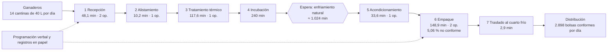

# VSM del estado actual e indicadores productivos

**Línea de yogur de la planta La Hacienda**

**Proyecto:** Transformación Digital Industrial de la planta La Hacienda  
**Módulo:** Módulo 2 · Gestión y Evaluación de la Producción

## 1. Alcance

Este documento contiene los datos del mapa de flujo de valor (VSM) del estado actual de la línea de yogur, los indicadores productivos calculados a partir de ellos y los datos de entrada para el modelo de simulación. La fuente de los tiempos es el estudio de La Hacienda (Grimaldo, Moreno y Salamanca, 2015) para un lote de 550 L de leche. El VSM del estado propuesto está en un documento aparte.

**Bolsas llenadas y bolsas conformes.** El caso reporta 3.052 bolsas por lote y 5,06 % de producto no conforme. Las 3.052 son las bolsas llenadas: su masa (3.052 × 200 ml × 1,033 kg/L ≈ 630,5 kg) coincide con la masa de producto del balance, frente a 642,7 kg de insumos. Si 3.052 fueran las conformes, se habrían llenado más de 3.200 bolsas, unos 664 kg, más de lo que entra al tanque. Por eso este documento usa 3.052 bolsas llenadas, 154 no conformes y 2.898 conformes por lote.

## 2. Datos generales del flujo

| Dato | Valor |
| --- | --- |
| Producto | Yogur saborizado en bolsa de 200 ml |
| Demanda atendida | 2.898 bolsas conformes por día (3.052 llenadas, un lote diario) |
| Proveedor | Ganaderos de la zona: 14 cantinas de 40 L, entrega diaria |
| Cliente | Distribución desde el cuarto frío, en canastas |
| Operarios | 4 |
| Jornada | Un turno de 8 h (480 min); inicio a las 7:30 a. m. |
| Flujo de información | Programación verbal y registros en papel; no hay sistema de información |

## 3. Cajas de proceso

| N.º | Proceso | Tiempo de ciclo (min/lote) | Operarios | Valor agregado (min) | Sin valor agregado (min) | Observaciones |
| --- | --- | --- | --- | --- | --- | --- |
| 1 | Recepción de la leche cruda | 48,07 | 2 | 0 | 48,07 | Descarga 3,05; análisis 16,59; transporte por tubería 28,43 |
| 2 | Alistamiento de materias primas | 10,21 | 1 | 0 | 10,21 | Cálculo y pesaje manual 6,50; transporte entre cuartos 3,71 |
| 3 | Tratamiento térmico | 117,55 | 1 | 117,55 | 0 | Precalentar 11,08; adicionar 2,84; pasteurizar 77,43; enfriar e inocular 26,20. Válvulas manuales |
| 4 | Incubación | 240,00 | 0 | 240,00 | 0 | Tiempo fijo; el tanque queda ocupado |
| — | Espera: enfriamiento natural | ≈ 1.024 | 0 | 0 | ≈ 1.024 | Desde el fin de la incubación (cerca de las 2:26 p. m.) hasta las 7:30 a. m. del día siguiente |
| 5 | Acondicionamiento | 33,64 | 1 | 31,06 | 2,58 | Romper el coágulo con el agitador 2,36; prueba de acidez 2,58; saborizar 5,07; filtrar 23,63 |
| 6 | Empaque y control de calidad | 148,93 | 2 | 148,93 | 0 | 20,5 bolsas llenadas/min; pesaje de una de cada cinco bolsas; 5,06 % no conforme |
| 7 | Traslado al cuarto frío | 2,92 | 1 | 0 | 2,92 | Canastas llevadas a mano |
| | **Total** | **601,32 de proceso y ≈ 1.024 de espera** | | **537,54** | **63,78 de proceso y ≈ 1.024 de espera** | |

La asignación de operarios por proceso es una estimación a partir de la descripción del caso. La incubación se cuenta como valor agregado porque transforma el producto. Como caso base, el tanque de proceso tiene un agitador mecánico con el que se rompe el coágulo.

## 4. Línea de tiempo

| Concepto | Valor | Cálculo |
| --- | --- | --- |
| Tiempo de proceso (suma de tiempos estándar) | 601,3 min (10,0 h) | Dato del caso |
| Espera por enfriamiento nocturno | ≈ 1.024 min (17,1 h) | De las 2:26 p. m. a las 7:30 a. m. |
| Tiempo de entrega (lead time) | **≈ 1.625 min (27,1 h)** | 601,3 + 1.024 |
| Tiempo con valor agregado | 537,5 min | Operaciones de transformación y empaque |
| Relación de valor agregado | **33 %** | 537,5 / 1.625 |

## 5. Indicadores

| Indicador | Valor | Cálculo |
| --- | --- | --- |
| Takt time | **9,9 s por bolsa conforme** | 480 min × 60 / 2.898 bolsas conformes |
| Tiempo de ciclo del empaque | 2,9 s por bolsa llenada | 148,93 min × 60 / 3.052 |
| Throughput | **2.898 bolsas conformes por día** (3.052 llenadas, 610 L de yogur) | Un lote diario |
| Índice de procesamiento del cuello de botella | 468 bolsas llenadas por hora | 3.052 / (391,19 / 60) |
| Tiempo total de fabricación (MLT) | 601,3 min de proceso; 27,1 h con la espera | Sección 4 |
| Cuello de botella | Preparación del yogur: 391,19 min (65 % del tiempo) | La incubación de 240 min es el 61 % de la preparación |
| Calidad | 94,9 % | 100 % − 5,06 % de producto no conforme (2.898 de 3.052 bolsas) |
| Velocidad real frente a la nominal | 68,3 % | 20,5 bolsas llenadas/min frente a 30 bolsas/min nominales |
| **OEE de la empacadora** | **≈ 65 %** | Disponibilidad 90 % × rendimiento 76 % × calidad 94,9 % (sección 6) |
| Eficiencia de materiales | 98,1 % | 630,5 kg de producto / 642,7 kg de insumos |
| Productividad de la mano de obra | 724 bolsas conformes por operario y día | 2.898 / 4 |
| Utilización del tanque de proceso | Un lote por día | El enfriamiento nocturno impide una segunda carga |

La velocidad nominal de la empacadora (30 bolsas/min) es un valor de referencia para máquinas de este tipo; el caso no reporta el tiempo de paradas por separado, de modo que la división del OEE entre disponibilidad y rendimiento es una aproximación.

**Lectura.** El takt time (9,9 s) es mayor que el tiempo de ciclo del empaque (2,9 s): la empacadora tiene capacidad de sobra. Lo que limita la producción es el tanque de proceso, que queda ocupado desde la carga hasta la mañana siguiente. Solo un tercio del tiempo de entrega agrega valor; el resto es, sobre todo, la espera del enfriamiento.

## 6. Estimación del OEE del proceso manual

El OEE (eficiencia general de los equipos) mide qué parte del tiempo planeado se convierte en producto bueno a la velocidad nominal: OEE = disponibilidad × rendimiento × calidad. Se estima para la empacadora EMP-401, la única máquina de la línea con una velocidad nominal de referencia (30 bolsas/min).

| Factor | Cálculo | Valor |
| --- | --- | --- |
| Tiempo planeado | Duración del empaque por lote | 148,9 min |
| Paradas por desajuste del corte de la bolsa | Supuesto: unos 15 min por lote | 15,0 min |
| Disponibilidad | (148,9 − 15,0) ÷ 148,9 | 90 % |
| Rendimiento | 3.052 bolsas llenadas ÷ (30 bolsas/min × 133,9 min) | 76 % |
| Calidad | 100 % − 5,06 % de producto no conforme (dato del caso) | 94,9 % |
| **OEE** | 0,90 × 0,76 × 0,949 | **65 %** |

Comprobación sin el supuesto de paradas: 2.898 bolsas conformes ÷ (30 bolsas/min × 148,9 min) = 64,9 %. El supuesto de paradas solo cambia cómo se reparte la pérdida entre disponibilidad y rendimiento, no el OEE total.

**Análisis.** La mayor pérdida está en el rendimiento (24 %): la empacadora trabaja más despacio que su velocidad nominal porque el operario pesa una de cada cinco bolsas y ajusta la máquina a mano. Le siguen las paradas por el corte de la bolsa (10 %) y las bolsas no conformes (5 %). Un OEE cercano a 65 % es normal en plantas pequeñas manuales, que suelen estar entre 55 y 70 %; la referencia de clase mundial es 85 %. Aun así, la empacadora no es el cuello de botella: lo es el tanque de proceso, ocupado hasta el día siguiente por el enfriamiento.

| Factor | Hoy | Meta con la propuesta | Qué lo mejora |
| --- | --- | --- | --- |
| Disponibilidad | 90 % | 92 % | Registro automático de paradas y causas, mantenimiento autónomo |
| Rendimiento | 76 % | 90 % | Controladora de peso en línea en lugar del pesaje manual |
| Calidad | 94,9 % | 98,5 % | Peso del 100 % con rechazo automático y dosificación por receta |
| **OEE** | **65 %** | **82 %** | La plataforma Cremia MES/ERP lo calcula por turno |

## 7. Desperdicios identificados

| Desperdicio | Dónde ocurre | Magnitud |
| --- | --- | --- |
| Espera | Enfriamiento natural en el tanque de proceso | ≈ 17 h por lote |
| Transporte | Leche por 12 m de tubería; insumos entre cuartos; canastas a mano | 35,1 min por lote |
| Sobreprocesamiento | Sostenimiento de 15 min en la pasteurización y control manual de válvulas | 77,4 min de pasteurización |
| Defectos | Bolsas con peso o sellado no conforme | 5,06 %: 154 bolsas por lote |
| Movimientos e inspección manual | Pesaje de insumos, prueba de acidez y pesaje de una de cada cinco bolsas | Parte de los 148,9 min de empaque |
| Paradas | Desajuste de la medida de corte de la bolsa | No medidas; unos 15 min por lote según el supuesto del OEE |

## 8. Datos de entrada para la simulación

| Elemento del modelo | Tipo | Parámetro |
| --- | --- | --- |
| Fuente | Llegada de leche | Un lote de 550 L por día a las 7:30 a. m. |
| Recepción | Estación | 48,07 min por lote |
| Alistamiento | Estación en paralelo con la recepción | 10,21 min por lote |
| Tanque de proceso | Estación de capacidad 1 lote | 117,55 min de tratamiento térmico, 240 min de incubación y enfriamiento hasta el día siguiente |
| Acondicionamiento | Estación | 33,64 min por lote |
| Tanque pulmón | Almacén intermedio | Capacidad de 650 L |
| Empacadora | Estación de desensamble: 1 lote en 3.052 bolsas llenadas | 2,9 s por bolsa; 5,06 % de rechazo (2.898 conformes) |
| Cuarto frío | Sumidero | Canastas de 120 bolsas |
| Recursos | Operarios | 4, en un turno de 8 h |

## Referencias

- Grimaldo, G., Moreno, D. y Salamanca, M. (2015). Medición del trabajo de una línea de producción de yogurt – Empresa La Hacienda. Revista I3+, 2(2), 62–81.
- Rother, M. y Shook, J. (2003). Learning to See: Value Stream Mapping to Add Value and Eliminate Muda. Lean Enterprise Institute.
