# VSM del estado propuesto e indicadores productivos

**Línea de yogur de la planta La Hacienda**

**Proyecto:** Transformación Digital Industrial de la planta La Hacienda  
**Módulo:** Módulo 2 · Gestión y Evaluación de la Producción

## 1. Alcance

Este documento presenta el mapa de flujo de valor (VSM) del estado propuesto de la línea de yogur y lo compara con el estado actual. Los tiempos salen del documento de parámetros de proceso y del programa diario de la sección 7.4 del documento de recetas y lotes, verificado con `herramientas/programa.py`. Son estimaciones de diseño: la simulación del estado propuesto en Tecnomatix (paquete 1.2.2 de la EDT del proyecto) y el arranque con producto las confirman.

## 2. Datos generales del flujo

| Dato | Estado actual | Estado propuesto |
| --- | --- | --- |
| Productos | Bolsa de 200 ml | Bolsa de 200 ml y vasos de 150 y 300 ml con fruta |
| Lotes por día | 1 | 2, de lunes a sábado |
| Demanda atendida | 2.898 bolsas conformes por día | 6.505 unidades conformes por día en promedio (ciclo de 10 lotes: 5 de bolsas, 3 de vasos de 150 ml y 2 de vasos de 300 ml) |
| Proveedor | 14 cantinas por día | 28 cantinas por día: 14 a TK-101 y 14 a TK-102 |
| Operarios | 4, un turno de 8 h | 5, turnos escalonados de 7 h entre las 7:00 y las 19:00, y un turno corto el domingo |
| Flujo de información | Verbal y en papel | Plan semanal y órdenes en la plataforma Cremia MES/ERP; registro electrónico de cada lote; tablero diario |

## 3. Mapa del estado propuesto

```mermaid
flowchart LR
    PROV["Ganaderos<br/>28 cantinas por día"] --> R["Recepción<br/>19,6 min por lote · manual"]
    R -->|lote 1| TK1["TK-101"]
    R -->|lote 2| TK2["TK-102 a 4 °C<br/>espera ≈ 8 h"]
    TK1 --> T["Preparación en T-301<br/>carga, dosificación, homogeneización,<br/>pasteurización e inoculación · 149 min"]
    TK2 --> T
    T --> I["Incubación<br/>240 min · sin operario"]
    I -->|lote 1| PL["Enfriamiento en placas<br/>30 min"]
    I -->|lote 2| CH{{"Enfriamiento en la chaqueta<br/>y espera hasta las 7:00 ≈ 8,6 h"}}
    CH --> PL2["Transferencia por E-301<br/>25 min"]
    PL --> TP["T-302 tanque pulmón"]
    PL2 --> TP2{{"Espera en T-302<br/>≈ 3 h a 12–15 °C"}} --> TP
    TP --> ENV["Envasado y peso del 100 %<br/>124 · 117 · 78 min<br/>OEE meta 82 %"]
    ENV --> CF["Encanastado o encajonado<br/>y cuarto frío"]
    CF --> CLI["Distribución<br/>6.505 unidades conformes por día"]
    MES["Plataforma Cremia MES/ERP<br/>plan semanal, órdenes, recetas y registro de lote"] -.-> T
    MES -.-> ENV
    T -.->|eventos y consumos| MES
```

## 4. Línea de tiempo por lote

| Concepto | Lote 1 | Lote 2 | Estado actual |
| --- | --- | --- | --- |
| Inicio (recepción de la leche) | 7:05 | 7:25 | 7:30 |
| Fin (lote envasado) | 17:10 del mismo día | 12:35 del día siguiente | Mañana del día siguiente |
| Tiempo de entrega | ≈ 605 min (10,1 h) | ≈ 1.750 min (29,2 h) | ≈ 1.625 min (27,1 h) |
| Tiempo con valor agregado (YB-200) | 531 min | 537 min | 537,5 min |
| Relación de valor agregado | 88 % | 31 % | 33 % |

El tiempo con valor agregado de la propuesta suma el tratamiento térmico (12 de precalentamiento en el lote 1 y 18 en el lote 2, que parte de leche a 4 °C; 95 de homogeneización y pasteurización, 25 de enfriamiento y 5 de inoculación), la incubación (240), el acondicionamiento (5 de ruptura y saborizado y 25 de enfriamiento y transferencia) y el envasado (124). El lote 2 tiene más espera que el actual porque su leche espera en TK-102 hasta las 15:45 y porque el yogur espera en el tanque y en el tanque pulmón hasta el envasado de la mañana. Esa espera es el precio de producir dos lotes con un solo tanque: en promedio, el tiempo de entrega baja de 27,1 h a unas 19,6 h y la relación de valor agregado sube de 33 % a 45 % (1.068 min de valor agregado en 2.355 min de los dos lotes).

## 5. Indicadores

| Indicador | Estado actual | Estado propuesto | Cálculo |
| --- | --- | --- | --- |
| Throughput | 2.898 bolsas conformes por día | 6.505 unidades conformes por día | Ciclo de 10 lotes con 1,5 % no conforme |
| Tiempo estándar por lote (YB-200) | 601 min | ≈ 563 min | Documento de parámetros de proceso |
| Cuello de botella | Tanque de proceso: un lote por día | Tanque de proceso: ocupado 24 h con dos lotes | El lote 2 se enfría en el tanque |
| Ocupación del envasado | 149 min por día | ≈ 225 min por día en promedio | (5 × 124 + 3 × 117 + 2 × 78) ÷ 5 días; 54 % del turno de envasado |
| Takt del envasado | 9,9 s por bolsa conforme | 3,9 s por unidad conforme | 420 min del turno de envasado × 60 ÷ 6.505 |
| Tiempo de ciclo del envasado | 2,9 s por bolsa | 2,4 s por bolsa; 1,6 y 2,1 s por vaso | Velocidad nominal con disponibilidad de 92 % y rendimiento de 90 % |
| OEE de la máquina de envasado | ≈ 65 % | 82 % (meta) | 92 % × 90 % × 98,5 % |
| Producto no conforme | 5,06 % | 1,5 % o menos | Controladoras de peso del 100 % |
| Productividad de la mano de obra | 724 unidades conformes por operario al día | 1.301 (+80 %) | 6.505 ÷ 5 |
| Tiempo de entrega promedio | 27,1 h | ≈ 19,6 h | Sección 4 |

**Lectura.** El takt del envasado (3,9 s) sigue siendo mayor que su tiempo de ciclo (1,6 a 2,4 s): el envasado tiene holgura y usa cerca de la mitad del turno. La restricción es el tanque de proceso, que con dos lotes queda ocupado las 24 h. Un tercer lote diario exigiría un segundo tanque de proceso; no está en el alcance.

## 6. Desperdicios que elimina la propuesta y los que quedan

| Desperdicio | Estado actual | Estado propuesto |
| --- | --- | --- |
| Espera del tanque | ≈ 17 h de enfriamiento natural por lote | El lote 1 no espera; el lote 2 usa la noche para enfriarse en el tanque |
| Transporte | 35,1 min por lote | 12 min de carga y bandas al cuarto frío |
| Sobreprocesamiento | 15 min de sostenimiento y válvulas manuales | 7 min de sostenimiento con control automático |
| Defectos | 5,06 % | 1,5 % o menos |
| Inspección manual | Pesaje de una de cada cinco bolsas y acidez como único criterio de fin | Peso del 100 % en línea; pH en línea y acidez solo de confirmación |
| Espera que queda | — | Leche del lote 2 en TK-102 (≈ 8 h, a 4 °C) y yogur del lote 2 en T-302 (≈ 3 h, a 12–15 °C) |

## 7. Datos de entrada para la simulación del estado propuesto

| Elemento del modelo | Tipo | Parámetro |
| --- | --- | --- |
| Fuente | Llegada de leche | Dos lotes de 550 L por día a las 7:05 y a las 7:25 |
| Recepción | Estación | 19,6 min por lote |
| TK-102 | Almacén intermedio | 1 lote, a 4 °C, hasta las 15:45 |
| Tanque de proceso | Estación de capacidad 1 lote | 149 min de preparación (155 en el lote 2), 240 min de incubación (máximo 300), 5 min de ruptura; lote 1: 25 min de transferencia por E-301; lote 2: permanece hasta las 7:00 |
| CIP | Recurso compartido | 40 min por ciclo, con un solo circuito a la vez |
| Tanque pulmón | Almacén intermedio | Capacidad de 650 L; máximo 6 h |
| Empacadora y llenadora | Estaciones de desensamble | 30, 45 y 35 unidades/min nominales; disponibilidad 92 %, rendimiento 90 %; 1,5 % de rechazo |
| Encanastado y encajonado | Estación manual con mesa acumuladora | 1,55 cajas/min en vasos de 150 ml |
| Recursos | Operarios | 5, con los turnos de la sección 7.4 del documento de recetas y lotes |

## Referencias

- Grimaldo, G., Moreno, D. y Salamanca, M. (2015). Medición del trabajo de una línea de producción de yogurt – Empresa La Hacienda. Revista I3+, 2(2), 62–81.
- Rother, M. y Shook, J. (2003). Learning to See: Value Stream Mapping to Add Value and Eliminate Muda. Lean Enterprise Institute.
