# EDT de proceso: producción de yogur en la línea de La Hacienda

**Proyecto:** Transformación Digital Industrial de la planta La Hacienda  
**Módulo:** Módulo 3 · Planeación y Evaluación del Proyecto

> **Alcance:** proceso productivo de la línea de yogur con la propuesta implementada, para las tres referencias: YB-200 (bolsa de 200 ml), YV-150 (vaso de 150 ml con preparado de fruta al 8 %) y YV-300 (vaso de 300 ml con trozos de fruta al 12 %). Lote de 550 L de leche cruda y dos lotes por día. Los equipos, las etiquetas y las unidades U1 a U8 son las del modelo físico ISA-88 y del inventario de equipos; las cantidades y los parámetros son los del documento de recetas y lotes.

Esta EDT descompone el **producto** (el yogur que sale de la línea), no el proyecto. La EDT del proyecto, con las horas de ingeniería y el cronograma, está en [`EDTs/Proyecto`](../Proyecto/4_EDT_Proyecto_TDI_Yogur.md).

---

## 1. Resumen de la EDT

| Código | Entregable | Unidades ISA-88 | Paquetes |
|---|---|---|---|
| 1.1 | Leche e insumos recibidos y cargados | U1, U2 | 4 |
| 1.2 | Mezcla estandarizada, homogeneizada y formulada | U2, U3 | 4 |
| 1.3 | Mezcla pasteurizada y lista para inocular | U3 | 2 |
| 1.4 | Yogur fermentado, roto y saborizado | U2, U3 | 4 |
| 1.5 | Yogur enfriado y envasado según la referencia | U4, U5, U6, U7 | 3 |
| 1.6 | Lote liberado, empacado y almacenado en frío | U8 | 3 |
| 1.7 | Limpieza y registro del lote | Recursos compartidos | 2 |
| | **Total** | | **22** |

---

## 2. Diagrama de la EDT

Los paquetes marcados con ◆ cambian según la referencia; el resto es común a las tres.

```mermaid
flowchart TD
    R["1.0 Yogur de la línea de La Hacienda<br/>lote de 550 L · 2 lotes por día"]
    R --> A["1.1 Leche e insumos<br/>recibidos y cargados"]
    R --> B["1.2 Mezcla estandarizada,<br/>homogeneizada y formulada"]
    R --> C["1.3 Mezcla pasteurizada<br/>y lista para inocular"]
    R --> D["1.4 Yogur fermentado,<br/>roto y saborizado"]
    R --> E["1.5 Yogur enfriado<br/>y envasado"]
    R --> F["1.6 Lote liberado,<br/>empacado y en frío"]
    R --> G["1.7 Limpieza y<br/>registro del lote"]
    A --> A1["1.1.1 Recepción y análisis<br/>por cantina"]
    A --> A2["1.1.2 Carga del tanque<br/>de proceso"]
    A --> A3["1.1.3 Recepción de insumos<br/>y envases"]
    A --> A4["1.1.4 Almacenamiento y<br/>alistamiento de insumos"]
    B --> B1["1.2.1 Precalentamiento<br/>y disolución"]
    B --> B2["1.2.2 Estandarización de<br/>sólidos con leche en polvo ◆"]
    B --> B3["1.2.3 Homogeneización"]
    B --> B4["1.2.4 Dosificación de azúcar<br/>y estabilizante ◆"]
    C --> C1["1.3.1 Pasteurización"]
    C --> C2["1.3.2 Enfriamiento<br/>a inoculación"]
    D --> D1["1.4.1 Inoculación"]
    D --> D2["1.4.2 Fermentación"]
    D --> D3["1.4.3 Fin de la incubación"]
    D --> D4["1.4.4 Ruptura del coágulo<br/>y saborizado ◆"]
    E --> E1["1.5.1 Enfriamiento en placas<br/>y transferencia"]
    E --> E2["1.5.2 Dosificación de fruta ◆<br/>(solo vasos)"]
    E --> E3["1.5.3 Envasado, codificado<br/>y control de peso ◆"]
    F --> F1["1.6.1 Liberación del lote"]
    F --> F2["1.6.2 Encanastado<br/>y encajonado ◆"]
    F --> F3["1.6.3 Almacenamiento<br/>en cuarto frío"]
    G --> G1["1.7.1 Limpieza CIP"]
    G --> G2["1.7.2 Registro electrónico<br/>y trazabilidad"]
```

---

## 3. Árbol de la EDT

**1.1 Leche e insumos recibidos y cargados**
- 1.1.1 Recepción y análisis de la leche por cantina
- 1.1.2 Carga del tanque de proceso
- 1.1.3 Recepción de insumos y material de envase
- 1.1.4 Almacenamiento y alistamiento de insumos

**1.2 Mezcla estandarizada, homogeneizada y formulada**
- 1.2.1 Precalentamiento y disolución
- 1.2.2 Estandarización de sólidos con leche en polvo
- 1.2.3 Homogeneización
- 1.2.4 Dosificación de azúcar y estabilizante

**1.3 Mezcla pasteurizada y lista para inocular**
- 1.3.1 Pasteurización
- 1.3.2 Enfriamiento a la temperatura de inoculación

**1.4 Yogur fermentado, roto y saborizado**
- 1.4.1 Inoculación
- 1.4.2 Fermentación
- 1.4.3 Fin de la incubación
- 1.4.4 Ruptura del coágulo y saborizado

**1.5 Yogur enfriado y envasado según la referencia**
- 1.5.1 Enfriamiento en placas y transferencia al tanque pulmón
- 1.5.2 Dosificación de fruta (solo vasos)
- 1.5.3 Envasado, codificado y control de peso

**1.6 Lote liberado, empacado y almacenado en frío**
- 1.6.1 Liberación del lote
- 1.6.2 Encanastado y encajonado
- 1.6.3 Almacenamiento en cuarto frío

**1.7 Limpieza y registro del lote**
- 1.7.1 Limpieza CIP entre lotes
- 1.7.2 Registro electrónico y trazabilidad del lote

---

## 4. Diccionario de la EDT

Cada paquete indica qué incluye y qué no, con qué equipos se hace, cómo se sabe que está terminado, quién responde (roles de la sección 3.2 de la propuesta de valor y gestión del cambio) y de qué depende.

| Código | Paquete | Incluye / no incluye | Equipos | Criterio de aceptación | Responsable | Depende de |
|---|---|---|---|---|---|---|
| 1.1.1 | Recepción y análisis de la leche por cantina | **Incluye:** descarga de las 14 cantinas de 40 L, análisis de acidez, pH, densidad y sólidos por cantina y registro del resultado en HMI-01. **No incluye:** pago al proveedor. | PL-101, LAB-101, HMI-01 | Leche aceptada con acidez de 0,13–0,17 % de ácido láctico, pH 6,6–6,8 y densidad 1,028–1,034; resultado de cada cantina registrado en el MES. La leche se procesa el mismo día; la planta no la almacena. | Operador de recepción y laboratorio | — |
| 1.1.2 | Carga del tanque de proceso | **Incluye:** pesaje en TK-101 y transferencia de 550 L a T-301 a 3 m³/h. **No incluye:** filtración de producto terminado. | TK-101, WT-101, P-101, FT-101, LT-301 | Volumen de la receta en T-301 (FT-101 y LT-301 concuerdan) en unos 12 min. | Operador de recepción y laboratorio | 1.1.1 |
| 1.1.3 | Recepción de insumos y material de envase | **Incluye:** azúcar, leche en polvo, estabilizante, cultivo, saborizantes, colorantes, preparado de fruta, película para bolsas, vasos y tapas; lote del proveedor y certificado. **No incluye:** leche cruda. | Bodega de insumos, ERP | Insumos con lote registrado y conformes al certificado. | Calidad | — |
| 1.1.4 | Almacenamiento y alistamiento de insumos | **Incluye:** almacenamiento seco de azúcar, leche en polvo y estabilizante; refrigerado de cultivo y fruta; carga de las tolvas DS-201, DS-202 y DS-206. **No incluye:** dosificación. | Bodega, cuarto frío CF-501, DS-201, DS-202, DS-206 | Tolvas con insumo suficiente para el lote, verificado por el MES contra la receta. | Operador de preparación | 1.1.3 |
| 1.2.1 | Precalentamiento y disolución | **Incluye:** calentamiento a 25 °C con agitación de 40–60 rpm para disolver los sólidos. **No incluye:** pasteurización. | T-301, M-301, TIC-301, TV-301 | 25 °C alcanzados y azúcar disuelto en unos 12 min. | Operador de preparación | 1.1.2 |
| 1.2.2 | Estandarización de sólidos con leche en polvo ◆ | **Incluye:** dosificación por peso de leche en polvo descremada: 5,7 kg (1 %) en YB-200 y 7,1 kg (1,25 %) en YV-150 y YV-300. **No incluye:** ajuste de grasa: el producto es entero. | DS-206, M-206, WT-206 | Dosis dentro de ± 1 %; sólidos no grasos de la fracción láctea ≥ 9,2 % (bolsa) o ≥ 9,4 % (vasos). | Operador de preparación | 1.2.1 |
| 1.2.3 | Homogeneización | **Incluye:** recirculación por H-301 a 150–200 bar mientras la mezcla está entre 60 y 65 °C, dos pasos del volumen del lote. **No incluye:** pasteurización. | H-301, M-302, PT-302, PIC-302, XV-302 | Presión en rango durante los dos pasos (unos 48 min, dentro del calentamiento); producto sin separación de grasa. | Operador de preparación | 1.2.2 |
| 1.2.4 | Dosificación de azúcar y estabilizante ◆ | **Incluye:** azúcar 75,7 kg (YB-200), 63,1 kg (YV-150) o 56,7 kg (YV-300); estabilizante 0,206 kg (bolsa) o 0,412 kg (vasos). **No incluye:** saborizante y colorante (1.4.4). | DS-201, M-201, WT-201, DS-202, M-202, WT-202 | Pesos dentro de ± 1 % de la receta de control, registrados en el MES. | Operador de preparación | 1.2.1 |
| 1.3.1 | Pasteurización | **Incluye:** calentamiento con vapor en la chaqueta y sostenimiento a 85–90 °C durante 5 a 10 min; es el punto crítico de control 1. **No incluye:** esterilización UHT. | T-301, TT-301 doble, TIC-301, TV-301 | TT-301 ≥ 85 °C durante todo el sostenimiento; si baja, el temporizador se reinicia y el lote no avanza. Curva guardada en el historiador. | Operador de preparación | 1.2.3, 1.2.4 |
| 1.3.2 | Enfriamiento a la temperatura de inoculación | **Incluye:** enfriamiento con agua fría en la chaqueta hasta 43 °C (42–45 °C). **No incluye:** adición del cultivo. | T-301, TIC-301, TV-302 | Temperatura estable durante 2 min, en unos 15 min. | Operador de preparación | 1.3.1 |
| 1.4.1 | Inoculación | **Incluye:** pesaje y adición de 7 g de cultivo DVS (*S. thermophilus* y *L. delbrueckii* subsp. *bulgaricus*), agitación de 5 min y parada del agitador. **No incluye:** propagación de cultivo madre. | BL-205, WT-205, M-301 | Lote del cultivo leído y peso verificado en BL-205. | Operador de preparación | 1.3.2 |
| 1.4.2 | Fermentación | **Incluye:** incubación sin agitación a 43 °C (41–45 °C), con pH en línea. **No incluye:** enfriamiento. | T-301, TIC-301, AT-301 | Unos 240 min hasta pH 4,4–4,6; alarma si pasan 300 min. | Operador de preparación; en el lote 2, alarmas remotas al jefe de producción | 1.4.1 |
| 1.4.3 | Fin de la incubación | **Incluye:** detención de la incubación al llegar a pH 4,4–4,6 y confirmación de la acidez en laboratorio. En el lote 2, que termina a las 22:15, el agua fría de la chaqueta baja el producto a 15–20 °C durante la noche. **No incluye:** cambios a la fórmula. | AT-301, LAB-101, TIC-301, TV-302 | pH en rango y acidez de 80–90 °Th (0,72–0,81 % de ácido láctico) registrados. | Calidad | 1.4.2 |
| 1.4.4 | Ruptura del coágulo y saborizado ◆ | **Incluye:** agitación a 30–40 rpm (YB-200, bebible) o 15–20 rpm (vasos, de cuchara); dosificación de 0,206 kg de saborizante y de colorante (0,110, 0,090 o 0,060 kg). **No incluye:** fruta (1.5.2). | M-301, ST-301, P-203, P-204 | Textura homogénea y dosis completas en unos 5 min. | Operador de preparación | 1.4.3 |
| 1.5.1 | Enfriamiento en placas y transferencia al tanque pulmón | **Incluye:** bombeo a 1.500 L/h por el filtro y el intercambiador de placas con agua helada hasta 15–20 °C. **No incluye:** envasado. | P-301, F-301, E-301, TIC-302, TV-303, T-302, LT-302 | T-301 vacío (LT-301) y producto en T-302 a 15–20 °C en unos 25 min; el tanque de proceso queda libre para el siguiente lote. | Operador de preparación | 1.4.4 |
| 1.5.2 | Dosificación de fruta (solo vasos) ◆ | **Incluye:** preparado de mora al 8 % (YV-150) o trozos de melocotón al 12 % (YV-300), dosificados en proporción a la velocidad de la llenadora y mezclados en línea. **No aplica** a YB-200. | P-403, MX-403 (mezclador estático), FFC-403 | Proporción de fruta de la receta (8 % o 12 %) cumplida y registrada en el lote. | Operador de envasado | 1.5.1 |
| 1.5.3 | Envasado, codificado y control de peso ◆ | **Incluye:** YB-200 por XV-401 a la empacadora (30 bolsas/min, 195–205 ml); YV-150 y YV-300 por XV-402 a la llenadora (45 o 35 vasos/min; 146–154 ml o 293–307 ml) con verificación de tapa; código de lote y vencimiento; peso del 100 % con rechazo automático. **No incluye:** diseño de la etiqueta. | EMP-401, CD-401, CK-401, XY-401 · LL-402, ZS-403, CD-402, CK-402, XY-402 | Lote envasado en 102 min (YB-200), 97 min (YV-150) o 65 min (YV-300); producto no conforme ≤ 1,5 %. | Operador de envasado | 1.5.1, 1.5.2 |
| 1.6.1 | Liberación del lote | **Incluye:** revisión en el MES de la curva de pasteurización, el pH final, los pesos, las dosis y la calibración vigente de los instrumentos críticos. **No incluye:** análisis microbiológico de vida útil. | MES, historiador | Lote liberado o retenido con su justificación; el MES no deja liberar un lote con un punto crítico fuera de límite. | Calidad | 1.5.3 |
| 1.6.2 | Encanastado y encajonado ◆ | **Incluye:** 120 bolsas por canasta (26 canastas), 24 vasos de 150 ml por caja (183 cajas) o 20 vasos de 300 ml por caja (113 cajas); estiba manual hasta que se compre la celda R-501. **No incluye:** despacho. | CV-401, CV-402, CV-501 | Empaques identificados con el lote y estibados según el patrón de la referencia. | Operador de empaque y cuarto frío | 1.5.3 |
| 1.6.3 | Almacenamiento en cuarto frío | **Incluye:** ingreso al cuarto frío a 4 °C (2–6 °C) y rotación por fecha de vencimiento (21 días). **No incluye:** transporte al cliente. | CF-501, TT-501, ERP | Producto a 4 °C registrado en el inventario del ERP. | Operador de empaque y cuarto frío | 1.6.1, 1.6.2 |
| 1.7.1 | Limpieza CIP entre lotes | **Incluye:** enjuague de 15 min entre lotes de la misma referencia; ciclo completo de 40 min (lavado alcalino y ácido) al cambiar de sabor y al final del día. **No incluye:** limpieza de áreas. | CIP-901, CT-901, válvulas XV-901 | Conductividad del enjuague final verificada con CT-901 antes de cargar el siguiente lote. | Operador de preparación | 1.5.1 |
| 1.7.2 | Registro electrónico y trazabilidad del lote | **Incluye:** código REF-AAAAMMDD-N, receta de control, fases con inicio y fin, consumos reales, alarmas, paradas y genealogía desde la cantina hasta la estiba. **No incluye:** contabilidad de costos (ERP). | MES, SCADA, historiador | Expediente de lote completo y cerrado; el MES reporta al ERP la producción y los consumos. | Jefe de producción | 1.6.1 |

---

## 5. Parámetros clave del proceso

| Etapa | Parámetro | YB-200 | YV-150 | YV-300 |
|---|---|---|---|---|
| Recepción | Acidez / pH / densidad | 0,13–0,17 % de ácido láctico / 6,6–6,8 / 1,028–1,034 | igual | igual |
| Estandarización | Leche en polvo | 5,7 kg (1 %) | 7,1 kg (1,25 %) | 7,1 kg (1,25 %) |
| Formulación | Azúcar / estabilizante | 75,7 kg / 0,206 kg | 63,1 kg / 0,412 kg | 56,7 kg / 0,412 kg |
| Homogeneización | Presión / temperatura | 150–200 bar / 60–65 °C | igual | igual |
| Pasteurización | Temperatura / sostenimiento | 85–90 °C / 5–10 min | igual | igual |
| Inoculación | Temperatura / cultivo | 43 °C (42–45 °C) / 7 g DVS | igual | igual |
| Fermentación | Temperatura / pH final / acidez | 43 °C (41–45 °C) / 4,4–4,6 / 80–90 °Th | igual | igual |
| Ruptura del coágulo | Velocidad del agitador | 30–40 rpm | 15–20 rpm | 15–20 rpm |
| Enfriamiento | Salida de E-301 | 15–20 °C | igual | igual |
| Fruta | Proporción | No aplica | 8 % (mora) | 12 % (trozos de melocotón) |
| Envasado | Volumen / velocidad | 200 ml / 30 bolsas/min | 150 ml / 45 vasos/min | 300 ml / 35 vasos/min |
| Empaque | Unidades por empaque | 120 por canasta | 24 por caja | 20 por caja |
| Almacenamiento | Temperatura / vida útil | 4 °C (2–6 °C) / 21 días | igual | igual |

---

## 6. Referencias

- Grimaldo, G., Moreno, D. y Salamanca, M. (2015). Medición del trabajo de una línea de producción de yogurt – Empresa La Hacienda. *Revista I3+*, 2(2), 62–81.
- Project Management Institute (2021). *Guía de los fundamentos para la dirección de proyectos (Guía del PMBOK)*, 7.ª ed. (EDT, regla del 100 % y diccionario de la EDT).
- ICONTEC. NTC 805: Leches fermentadas.
- Ministerio de la Protección Social (2006). Decreto 616 de 2006, requisitos de la leche para consumo humano.
- FAO/OMS. *Codex Alimentarius*: Norma para leches fermentadas (CXS 243-2003) y principios de HACCP.
- Tetra Pak (2015). *Dairy Processing Handbook*, capítulo 11: Fermented milk products.
