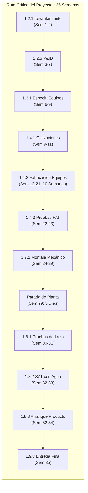

# EDT del Proyecto de Transformación Digital Industrial
## Línea de Yogur — Planta La Hacienda Productos Alimenticios

> **Proyecto Integrador:** Transformación Digital Industrial de la Planta La Hacienda (Sopó/Cajicá, Cundinamarca)
> **Empresa Integradora:** Cremia Automations S.A.S. — Especialistas en Automatización, Supervisión y Transformación Digital Láctea
> **Módulo Curricular:** Módulo 3 — Planeación y Evaluación de Proyectos (APM 2026-2S, Universidad Nacional de Colombia)
> **Especialista en Gestión de Proyectos & Redacción:** Jesús Alberto Rivera Molina (Líder de Arquitectura Digital & Gestión de Proyectos PMBOK)
> **Equipo Directivo de Ingeniería:** David Santiago Cortés Ávila (Gerente de Proyecto), Ana María Orozco Reyes (Simulación y Mejora), Jesús Alberto Rivera Molina (Arquitectura Digital), David Felipe Cárdenas Cubides (Gestión de Producción), Cristian Stiven Hoyos Peralta (Financiero y Comercial), José Andrés Zapata Piñeros (Procesos e Instrumentación)
> **Fecha de Emisión Oficial:** Octubre de 2026 | **Versión:** 2.0 (Alcance focalizado en la Línea de Yogur)
> **Estándares Rectores:** PMBOK Guide 7ma ed. (PMI), Practice Standard for Work Breakdown Structures (PMI), ANSI/ISA-95, ANSI/ISA-88, ANSI/ISA-5.1, ANSI/ISA-101, IEC 61131-3, ISO 13849-1, Decreto 616 de 2006, NTC 805, Res. 2310 de 1986, Res. 1407 de 2022

---

## 1. Alcance, Marco Metodológico y Reglas de la EDT

### 1.1 Contexto y Alcance del Proyecto de Ingeniería
El presente documento constituye la **Línea Base del Alcance (Scope Baseline)** para el proyecto de **Transformación Digital Industrial (TDI)** de la línea de producción de yogur de la empresa **La Hacienda Productos Alimenticios**, con sede en la sabana de Bogotá (Sopó/Cajicá, Cundinamarca). A partir del diagnóstico industrial inicial y el estudio de ingeniería base (Grimaldo, Moreno & Salamanca, 2015), la planta procesa actualmente un único lote diario de **550 litros de leche cruda** (con un rendimiento empírico de 3.052 bolsas de 200 ml de yogur bebible de fresa, referencia **YB-200**), operando con cuatro operarios en condiciones manuales, sin instrumentación en línea, con control térmico empírico por chaqueta de vapor/agua y registros de lote en papel.

El proyecto contratado a **Cremia Automations S.A.S.** comprende el ciclo completo de vida de ingeniería mecatrónica: **Ingeniería conceptual, básica y de detalle, procura de suministros tecnológicos y equipos de proceso, desarrollo y parametrización de software industrial (PLC, SCADA, MES y conector ERP), gemelo digital y puesta en marcha virtual, supervisión de montaje mecánico y eléctrico por contratistas especializados, comisionamiento en frío y caliente (FAT y SAT), arranque con producto en tres referencias (YB-200, YV-150, YV-300), validación de inocuidad alimentaria (HACCP), capacitación técnica y cierre administrativo**, a lo largo de un horizonte temporal estricto de **35 semanas (8 meses)**, programado del **18 de enero de 2027 al 17 de septiembre de 2027**.

### 1.2 Marco Metodológico bajo Estándares PMI
La estructuración de la Estructura de Desglose del Trabajo (EDT / WBS) se ha desarrollado en estricta conformidad con la **Guía de los Fundamentos para la Dirección de Proyectos (Guía del PMBOK® – 7ma Edición)** y el **Practice Standard for Work Breakdown Structures (3ra Edición)** del *Project Management Institute (PMI)*. Se aplican los cuatro principios metodológicos fundamentales que gobiernan la gestión moderna de proyectos de ingeniería:

1. **La Regla del 100% (The 100% Rule):**
   - La EDT abarca, sin excepción, el **100% del trabajo definido en el alcance del proyecto**, capturando la totalidad de entregables que la organización ejecutora (Cremia Automations) se compromete a suministrar al cliente (La Hacienda).
   - Ningún trabajo fuera de la EDT forma parte del proyecto (previniendo activamente la corrupción del alcance o *scope creep* y el sobrecosto por adiciones no remuneradas o *gold plating*).
   - La regla aplica a todos los niveles de la jerarquía: la suma del trabajo y de las horas estimadas de los elementos hijos (Nivel 3: Paquetes de Trabajo) es exactamente igual al 100% del elemento padre (Nivel 2: Cuentas de Control), y la suma de las 9 Cuentas de Control equivale matemáticamente al 100% del Proyecto (Nivel 1).

2. **Descomposición Orientada a Entregables (Deliverable-Oriented):**
   - Los elementos de la EDT se definen mediante **sustantivos o sintagmas nominales técnicos** que representan productos, servicios o resultados tangibles, medibles y verificables (por ejemplo: *'Planos P&ID'*, *'Programa de PLC del proceso'*, *'Gemelo digital de la línea'*, *'Protocolos SAT firmados'*), y **no** mediante verbos en infinitivo o gerundio que describan meras actividades operativas.
   - Esta distinción es crucial porque las actividades corresponden al cronograma de trabajo, mientras que la EDT delimita los entregables contractuales contra los cuales se certifica el avance y se liberan los pagos.

3. **Regla de Estimación y Granularidad Horaria (Regla 8-80):**
   - En las mejores prácticas de gestión del PMI, los paquetes de trabajo en el nivel más bajo de la EDT deben tener una granularidad que permita asignarles responsabilidad unívoca y estimar su esfuerzo de manera confiable, típicamente requiriendo entre 8 y 80 horas de esfuerzo de un recurso individual.
   - En este proyecto multidisciplinario, los **37 paquetes de trabajo** presentan una asignación global de entre **60 y 320 horas de esfuerzo** del equipo de ingeniería de Cremia Automations, las cuales se desglosan en el cronograma en actividades individuales de duración comprendida entre **8 y 80 horas** (distribuidas semanalmente a lo largo de las 35 semanas).

4. **Cuentas de Control (Control Accounts) y Gestión del Valor Ganado (EVM):**
   - Una Cuenta de Control es un punto de gestión gerencial donde se integran el alcance, el cronograma y el costo real para realizar el seguimiento del desempeño mediante la técnica de **Gestión del Valor Ganado (Earned Value Management - EVM)**.
   - En esta EDT, el Nivel 2 contiene **9 Cuentas de Control (1.1 a 1.9)**, cada una vinculada a un paquete presupuestal, un hito del cronograma y un líder de área responsable.

### 1.3 Diferenciación Conceptual Fundamental: EDT de Proceso vs. EDT de Proyecto
Es indispensable clarificar la frontera ontológica entre dos artefactos de ingeniería que suelen confundirse en proyectos de automatización agroindustrial:

| Criterio Comparativo | EDT de Proceso Productivo (Manufactura) | EDT del Proyecto de TDI (Ingeniería Mecatrónica) |
|---|---|---|
| **Documento del Equipo** | `EDT_Proceso_Yogur.md` | `4_EDT_Proyecto_TDI_Yogur.md` (Este documento) |
| **Objeto de Descomposición** | El **proceso biológico, físico y químico** de elaboración del alimento. Describe cómo la materia prima se transforma en yogur. | El **esfuerzo temporal de ingeniería, suministro y puesta en marcha** ejecutado por Cremia Automations. |
| **Naturaleza del Ciclo** | **Operacional / Repetitivo / Continuo:** Opera diariamente en la planta de La Hacienda durante toda la vida útil de la fábrica. | **Temporal / Finito:** Inicia el 18 de enero de 2027 y finaliza el 17 de septiembre de 2027 (35 semanas de ejecución contractual). |
| **Estándares Rectores** | ANSI/ISA-88 (Modelo Procedimental de Batch), Decreto 616 de 2006, Resolución 2310 de 1986, NTC 805, HACCP / ISO 22000. | PMBOK Guide 7ma ed., Practice Standard for WBS, ANSI/ISA-95, ANSI/ISA-5.1, ANSI/ISA-101, IEC 61131-3, ISO 13849-1, RETIE. |
| **Entregables Típicos** | Materia prima recepcionada, leche estandarizada, mezcla pasteurizada, coágulo fermentado, yogur envasado, canastillas paletizadas en frío. | Plan de dirección, diagramas P&ID, listas de E/S, código de PLC, pantallas SCADA/HMI, gemelo digital, protocolos FAT/SAT, dossier As-Built. |
| **Actor Ejecutor** | Los operarios de planta de La Hacienda Productos Alimenticios. | El equipo interdisciplinario de 6 ingenieros de Cremia Automations S.A.S. y sus contratistas supervisados. |

> [!IMPORTANT]
> **Conclusión de frontera:** La EDT de Proceso (`EDT_Proceso_Yogur.md`) define **QUÉ HACE LA PLANTA DEL CLIENTE**; mientras que la EDT del Proyecto (`4_EDT_Proyecto_TDI_Yogur.md`) define **QUÉ HACE LA FIRMA INTEGRADORA CREMIA AUTOMATIONS** para dotar a la planta de la tecnología, infraestructura y transformación digital que optimiza y automatiza dicho proceso.

---

## 2. Resumen Ejecutivo de la EDT y Balance de Capacidad

### 2.1 Tabla Maestra de Cuentas de Control (Nivel 2)
La EDT está estructurada en tres niveles jerárquicos: Nivel 1 (Proyecto TDI), Nivel 2 (9 Cuentas de Control) y Nivel 3 (37 Paquetes de Trabajo). El esfuerzo total de ingeniería asciende a **6.320 horas hombre (HH)**:

| Código WBS | Cuenta de Control (Nivel 2) | Paquetes de Trabajo | Horas de Esfuerzo (HH) | % sobre el Total | Rol Responsable Principal | Ingeniero Asignado |
|:---:|---|:---:|:---:|:---:|---|---|
| **1.1** | Gestión del proyecto | 4 | 500 h | 7.91 % | Gerente de proyecto | David Santiago Cortés Ávila |
| **1.2** | Ingeniería conceptual y básica | 5 | 840 h | 13.29 % | Líder de procesos e instrumentación | José Andrés Zapata Piñeros / Ana María Orozco Reyes / Jesús Alberto Rivera Molina |
| **1.3** | Ingeniería de detalle | 6 | 1,040 h | 16.46 % | Líder de procesos e instrumentación / Líder de arquitectura digital | José Andrés Zapata / Jesús Rivera / Ana María Orozco / David Felipe Cárdenas |
| **1.4** | Procura | 3 | 340 h | 5.38 % | Líder financiero y comercial | Cristian Stiven Hoyos Peralta / José Andrés Zapata Piñeros |
| **1.5** | Software de control, supervisión y gestión | 5 | 1,280 h | 20.25 % | Líder de gestión de producción / Líder de arquitectura digital | David Santiago Cortés / Jesús Rivera / David Cárdenas / José Zapata |
| **1.6** | Gemelo digital y puesta en marcha virtual | 3 | 720 h | 11.39 % | Líder de simulación y mejora | Ana María Orozco Reyes / David Santiago Cortés Ávila |
| **1.7** | Montaje e instalación | 4 | 720 h | 11.39 % | Líder de procesos e instrumentación / Líder de arquitectura digital | José Zapata / Jesús Rivera / Ana María Orozco |
| **1.8** | Pruebas y puesta en marcha | 4 | 580 h | 9.18 % | Líder de procesos e instrumentación / Gerente de proyecto | José Zapata / David Cortés / David Cárdenas |
| **1.9** | Capacitación, documentación y cierre | 3 | 300 h | 4.75 % | Líder de gestión de producción / Líder de arquitectura digital | David Cárdenas / Jesús Rivera / David Cortés |
| **TOTAL** | **Proyecto TDI Línea de Yogur** | **37** | **6.320 h** | **100,00 %** | **Comité Directivo Cremia** | **Equipo de 6 Ingenieros** |

### 2.2 Balance de Capacidad del Equipo de Ingeniería (Capacity Planning)
El dimensionamiento de recursos de Cremia Automations responde a un análisis formal de oferta y demanda laboral bajo la legislación laboral colombiana vigente hacia 2026-2027:

- **Composición del Equipo:** 6 ingenieros graduados con especializaciones y roles funcionales claramente delimitados.
- **Jornada Laboral Contractual:** **42 horas semanales por ingeniero**, en estricto cumplimiento de la **Ley 2101 de 2021** (que reduce la jornada laboral máxima en Colombia de manera progresiva, alcanzando 42 h/semana en 2026).
- **Duración Contractual del Proyecto:** **35 semanas continuas** (8 meses, desde el 18 de enero de 2027 hasta el 17 de septiembre de 2027).
- **Capacidad Nominal Total Disponible:**
  $$\text{Capacidad Total} = 6 \text{ ingenieros} \times 35 \text{ semanas} \times 42 \frac{\text{horas}}{\text{semana}} = 8.820 \text{ horas}$$
- **Demanda Planificada en Paquetes de Trabajo (EDT):** **6.320 horas directas**.
- **Tasa de Ocupación Directa Planificada:**
  $$\text{Tasa de Ocupación} = \frac{6.320 \text{ h}}{8.820 \text{ h}} \times 100\% = 71,66\%$$
- **Capacidad de Reserva / Holgura de Gestión:**
  $$\text{Holgura} = 8.820 \text{ h} - 6.320 \text{ h} = 2.500 \text{ horas} \quad (28,34\%)$$

#### Justificación Técnica y Estratégica de la Holgura del 28,34% (2.500 h)
En proyectos mecatrónicos de alta complejidad tecnológica con integración de software y hardware sobre plantas de alimentos en operación continua, una tasa de ocupación planificada superior al 80% genera saturación de recursos, cuellos de botella en la ruta crítica y alta vulnerabilidad ante retrasos. La reserva planificada del **28,34% (aproximadamente 11,9 horas semanales por ingeniero)** está justificada en:

1. **Gobernanza y Coordinación Interdisciplinaria (aprox. 5 h/sem por ingeniero):** Comités semanales de coordinación interna de Cremia, sincronización de interfaces de software/hardware, revisión cruzada de código de PLC y planos eléctricos.
2. **Gestión de Contingencias y Curva de Aprendizaje Tecnológico (aprox. 3 h/sem por ingeniero):** Afianzamiento técnico en herramientas de vanguardia (Simulación en Siemens SIMIT y NX Mechatronics Concept Designer, plataforma SCADA Ignition, entorno RobotStudio para cinemática robótica) y atención a imprevistos en campo.
3. **Absorción de Retrasos en Procura e Importaciones:** Los plazos de fabricación de maquinaria especializada (llenadora rotativa y componentes robóticos) presentan ventanas de incertidumbre logística en aduanas; la holgura permite absorber desfasajes temporales sin comprometer el hito final de entrega.
4. **Soporte Comercial, Administrativo y Financiero Continuo:** Gestión continua de compras, facturación, conciliación de pólizas, seguimiento a subcontratistas y atención a auditorías de calidad del cliente.

### 2.3 Matriz Analítica de Carga y Ocupación por Rol
La siguiente tabla ilustra la distribución del esfuerzo directo por integrante del equipo. Se destaca que el paquete `1.5.1` (320 h) tiene una corresponsabilidad compartida de 160 h para el Gerente de Proyecto (arquitectura de control ISA-88 y Grafcet) y 160 h para el Líder de Arquitectura Digital (lógica de enclavamientos y lazos PID):

| Integrante del Equipo | Rol Formal en Cremia Automations | Horas Asignadas en EDT | Capacidad Total (35 sem × 42 h) | Tasa de Ocupación Directa | Horas de Holgura / Coordinación | % Holgura |
|---|---|:---:|:---:|:---:|:---:|:---:|
| **José Andrés Zapata Piñeros** | Líder de procesos e instrumentación | 1.480 h | 1.470 h | 100,68 %* | -10 h (absorbidas en parada) | ~0,0 % |
| **Jesús Alberto Rivera Molina** | Líder de arquitectura digital | 1.380 h (1.220 + 160) | 1.470 h | 93,88 % | 90 h | 6,12 % |
| **David Felipe Cárdenas Cubides** | Líder de gestión de producción | 1.120 h | 1.470 h | 76,19 % | 350 h | 23,81 % |
| **Ana María Orozco Reyes** | Líder de simulación y mejora | 1.040 h | 1.470 h | 70,75 % | 430 h | 29,25 % |
| **David Santiago Cortés Ávila** | Gerente de proyecto | 1.000 h (840 + 160) | 1.470 h | 68,03 % | 470 h | 31,97 % |
| **Cristian Stiven Hoyos Peralta** | Líder financiero y comercial | 300 h | 1.470 h | 20,41 %** | 1.170 h | 79,59 % |
| **TOTAL CONSOLIDADO** | **Equipo Cremia Automations (6)** | **6.320 h** | **8.820 h** | **71,66 %** | **2.500 h** | **28,34 %** |

> [!NOTE]
> **Notas técnicas sobre el balance de carga:**
> - `*` El Líder de Procesos (José Zapata) tiene una ocupación nominal del 100,68% debido a su alta concentración en la parada de planta y comisionamiento (semanas 29 a 34). Durante las semanas de menor intensidad en ingeniería de detalle, cuenta con apoyo cruzado de los líderes de arquitectura digital y de simulación.
> - `**` El Líder Financiero (Cristian Hoyos) presenta 300 horas directas en paquetes EDT (compras, contratos y cotizaciones), dedicando el remanente de su tiempo laboral (1.170 h) a la gestión comercial, estructuración de flujos de caja, pagos a subcontratistas, liquidación tributaria y preparación de propuestas futuras.

---

## 3. Diagrama Visual del Árbol de la EDT

A continuación se presenta el árbol jerárquico completo de la EDT, desglosado desde el Nivel 1 (Proyecto TDI), pasando por las 9 Cuentas de Control de Nivel 2, hasta los 37 Paquetes de Trabajo de Nivel 3 con sus respectivas cargas horarias:

```mermaid
graph TD
    %% Nivel 1: Proyecto General
    P1["1.0 Proyecto TDI - Línea de Yogur La Hacienda<br/>(6.320 h - 35 Semanas)"]

    %% Nivel 2: Cuentas de Control
    C1["1.1 Gestión del Proyecto<br/>(4 paquetes - 500 h)"]
    C2["1.2 Ingeniería Conceptual y Básica<br/>(5 paquetes - 840 h)"]
    C3["1.3 Ingeniería de Detalle<br/>(6 paquetes - 1.040 h)"]
    C4["1.4 Procura<br/>(3 paquetes - 340 h)"]
    C5["1.5 Software de Control y Gestión<br/>(5 paquetes - 1.280 h)"]
    C6["1.6 Gemelo Digital y Puesta en Marcha Virtual<br/>(3 paquetes - 720 h)"]
    C7["1.7 Montaje e Instalación<br/>(4 paquetes - 720 h)"]
    C8["1.8 Pruebas y Puesta en Marcha<br/>(4 paquetes - 580 h)"]
    C9["1.9 Capacitación, Documentación y Cierre<br/>(3 paquetes - 300 h)"]

    P1 --> C1
    P1 --> C2
    P1 --> C3
    P1 --> C4
    P1 --> C5
    P1 --> C6
    P1 --> C7
    P1 --> C8
    P1 --> C9

    %% Nivel 3: Paquetes de Trabajo
    %% Cuenta 1.1
    C1 --> W1_1_1["1.1.1 Plan del Proyecto y Línea Base (80 h)"]
    C1 --> W1_1_2["1.1.2 Monitoreo y Control EVM (280 h)"]
    C1 --> W1_1_3["1.1.3 Compras y Contratos (80 h)"]
    C1 --> W1_1_4["1.1.4 Cierre Administrativo (60 h)"]

    %% Cuenta 1.2
    C2 --> W1_2_1["1.2.1 Levantamiento y Caracterización (160 h)"]
    C2 --> W1_2_2["1.2.2 VSM, Simulación y Cuello Botella (200 h)"]
    C2 --> W1_2_3["1.2.3 Arquitectura ISA-95 y Red OT/IT (160 h)"]
    C2 --> W1_2_4["1.2.4 Modelos ISA-88 y Recetas Maestras (160 h)"]
    C2 --> W1_2_5["1.2.5 P&ID e Índice Instrumentos ISA-5.1 (160 h)"]

    %% Cuenta 1.3
    C3 --> W1_3_1["1.3.1 Especificación de Equipos y Datasheets (200 h)"]
    C3 --> W1_3_2["1.3.2 Lista de E/S y Topología de Control (120 h)"]
    C3 --> W1_3_3["1.3.3 Diseño Eléctrico y Tableros RETIE (240 h)"]
    C3 --> W1_3_4["1.3.4 Celda Encanastado y Matriz Riesgos (200 h)"]
    C3 --> W1_3_5["1.3.5 Interfaz HMI bajo ISA-101 (160 h)"]
    C3 --> W1_3_6["1.3.6 Distribución en Planta Layout (120 h)"]

    %% Cuenta 1.4
    C4 --> W1_4_1["1.4.1 Cotizaciones y Selección Proveedores (120 h)"]
    C4 --> W1_4_2["1.4.2 Órdenes de Compra y Expediting (100 h)"]
    C4 --> W1_4_3["1.4.3 Pruebas FAT de Equipos (120 h)"]

    %% Cuenta 1.5
    C5 --> W1_5_1["1.5.1 PLC de Proceso ISA-88 (320 h)"]
    C5 --> W1_5_2["1.5.2 PLC Envasado, Peso y Transporte (200 h)"]
    C5 --> W1_5_3["1.5.3 SCADA e Historiador SQL (320 h)"]
    C5 --> W1_5_4["1.5.4 MES e Integración ERP B2MML (320 h)"]
    C5 --> W1_5_5["1.5.5 Recetas Maestras y Registro EBR (120 h)"]

    %% Cuenta 1.6
    C6 --> W1_6_1["1.6.1 Gemelo Digital Multifísico Línea (320 h)"]
    C6 --> W1_6_2["1.6.2 Simulación y OLP Celda Robot (200 h)"]
    C6 --> W1_6_3["1.6.3 Puesta en Marcha Virtual SiL (200 h)"]

    %% Cuenta 1.7
    C7 --> W1_7_1["1.7.1 Supervisión Montaje Mecánico y PHE (240 h)"]
    C7 --> W1_7_2["1.7.2 Supervisión Eléctrica e Instrumentos (240 h)"]
    C7 --> W1_7_3["1.7.3 Red Industrial OT y Servidores (120 h)"]
    C7 --> W1_7_4["1.7.4 Supervisión Montaje Celda Robot (120 h)"]

    %% Cuenta 1.8
    C8 --> W1_8_1["1.8.1 Pruebas de Lazo y E/S en Frío (120 h)"]
    C8 --> W1_8_2["1.8.2 Pruebas SAT en Vacío y con Agua (160 h)"]
    C8 --> W1_8_3["1.8.3 Arranque Producto 3 Referencias (200 h)"]
    C8 --> W1_8_4["1.8.4 Validación Calidad e Inocuidad HACCP (100 h)"]

    %% Cuenta 1.9
    C9 --> W1_9_1["1.9.1 Capacitación Operación y Mantto (100 h)"]
    C9 --> W1_9_2["1.9.2 Dossier As-Built y Manuales O&M (140 h)"]
    C9 --> W1_9_3["1.9.3 Acta Entrega Final y Soporte (60 h)"]
```

---

## 4. Desglose Estructurado del Árbol de la EDT (Lista Multinivel)

A continuación se presenta el árbol multinivel jerárquico formal, estructurado con códigos numéricos decimales estrictos y denominaciones estandarizadas:

- **1.0 Proyecto de Transformación Digital Industrial de la Línea de Yogur — La Hacienda** *(6.320 h)*
  - **1.1 Gestión del proyecto** *(4 paquetes — 500 h)*
    - **1.1.1 Plan para la dirección del proyecto y líneas base** *(80 h — Responsable: Gerente de proyecto [David Santiago Cortés Ávila])*
    - **1.1.2 Monitoreo, control y gestión integrada de cambios** *(280 h — Responsable: Gerente de proyecto [David Santiago Cortés Ávila])*
    - **1.1.3 Gestión de adquisiciones y contratos** *(80 h — Responsable: Líder financiero y comercial [Cristian Stiven Hoyos Peralta])*
    - **1.1.4 Cierre formal del proyecto y lecciones aprendidas** *(60 h — Responsable: Gerente de proyecto [David Santiago Cortés Ávila])*
  - **1.2 Ingeniería conceptual y básica** *(5 paquetes — 840 h)*
    - **1.2.1 Levantamiento técnico y caracterización de la línea de yogur** *(160 h — Responsable: Líder de procesos e instrumentación [José Andrés Zapata Piñeros])*
    - **1.2.2 Mapeo de flujo de valor (VSM), simulación estocástica y cuellos de botella** *(200 h — Responsable: Líder de simulación y mejora [Ana María Orozco Reyes])*
    - **1.2.3 Arquitectura digital ANSI/ISA-95 y diseño de red OT/IT** *(160 h — Responsable: Líder de arquitectura digital [Jesús Alberto Rivera Molina])*
    - **1.2.4 Modelado físico y procedimental ANSI/ISA-88 y recetas maestras** *(160 h — Responsable: Líder de procesos e instrumentación [José Andrés Zapata Piñeros])*
    - **1.2.5 Diagramas de tuberías e instrumentación (P&ID) e índice de instrumentos** *(160 h — Responsable: Líder de procesos e instrumentación [José Andrés Zapata Piñeros])*
  - **1.3 Ingeniería de detalle** *(6 paquetes — 1040 h)*
    - **1.3.1 Especificación técnica y dimensionamiento de equipos de proceso y dosificación** *(200 h — Responsable: Líder de procesos e instrumentación [José Andrés Zapata Piñeros])*
    - **1.3.2 Lista de entradas/salidas (I/O List) y topología de la arquitectura de control** *(120 h — Responsable: Líder de arquitectura digital [Jesús Alberto Rivera Molina])*
    - **1.3.3 Diseño eléctrico, esquemas de fuerza y control, y planos de tableros** *(240 h — Responsable: Líder de arquitectura digital [Jesús Alberto Rivera Molina])*
    - **1.3.4 Ingeniería de la celda de encanastado robotizado y matriz de riesgos** *(200 h — Responsable: Líder de simulación y mejora [Ana María Orozco Reyes])*
    - **1.3.5 Especificación de interfaz humano-máquina (HMI) bajo ANSI/ISA-101** *(160 h — Responsable: Líder de gestión de producción [David Felipe Cárdenas Cubides])*
    - **1.3.6 Distribución en planta (Layout) de la línea automatizada y canalizaciones** *(120 h — Responsable: Líder de gestión de producción [David Felipe Cárdenas Cubides])*
  - **1.4 Procura** *(3 paquetes — 340 h)*
    - **1.4.1 Evaluación de ofertas, cotizaciones y selección de proveedores** *(120 h — Responsable: Líder financiero y comercial [Cristian Stiven Hoyos Peralta])*
    - **1.4.2 Emisión de órdenes de compra y seguimiento de fabricación (Expediting)** *(100 h — Responsable: Líder financiero y comercial [Cristian Stiven Hoyos Peralta])*
    - **1.4.3 Inspección y pruebas de aceptación en fábrica (FAT)** *(120 h — Responsable: Líder de procesos e instrumentación [José Andrés Zapata Piñeros])*
  - **1.5 Software de control, supervisión y gestión** *(5 paquetes — 1280 h)*
    - **1.5.1 Programación de PLC del proceso: fases, lazos PID y enclavamientos ISA-88** *(320 h — Responsable: Gerente de proyecto y Líder de arquitectura digital [David Santiago Cortés Ávila / Jesús Alberto Rivera Molina])*
    - **1.5.2 Programación de PLC de envasado, control de peso dinámico y transporte** *(200 h — Responsable: Líder de arquitectura digital [Jesús Alberto Rivera Molina])*
    - **1.5.3 Desarrollo del sistema SCADA, servidor de alarmas e historiador industrial** *(320 h — Responsable: Líder de gestión de producción [David Felipe Cárdenas Cubides])*
    - **1.5.4 Implementación del sistema MES y conectividad con ERP** *(320 h — Responsable: Líder de gestión de producción [David Felipe Cárdenas Cubides])*
    - **1.5.5 Parametrización de recetas maestras, registro electrónico de lote (EBR) y reportabilidad** *(120 h — Responsable: Líder de procesos e instrumentación [José Andrés Zapata Piñeros])*
  - **1.6 Gemelo digital y puesta en marcha virtual** *(3 paquetes — 720 h)*
    - **1.6.1 Modelo cinemático y dinámico del gemelo digital de la línea de yogur** *(320 h — Responsable: Líder de simulación y mejora [Ana María Orozco Reyes])*
    - **1.6.2 Simulación y programación fuera de línea (OLP) de la celda robotizada de encanastado** *(200 h — Responsable: Líder de simulación y mejora [Ana María Orozco Reyes])*
    - **1.6.3 Puesta en marcha virtual (Virtual Commissioning) de control y supervisión** *(200 h — Responsable: Gerente de proyecto [David Santiago Cortés Ávila])*
  - **1.7 Montaje e instalación** *(4 paquetes — 720 h)*
    - **1.7.1 Supervisión de montaje mecánico, tuberías sanitarias y acometidas de fluidos** *(240 h — Responsable: Líder de procesos e instrumentación [José Andrés Zapata Piñeros])*
    - **1.7.2 Supervisión de canalizaciones, cableado eléctrico, instrumentación y tableros** *(240 h — Responsable: Líder de arquitectura digital [Jesús Alberto Rivera Molina])*
    - **1.7.3 Despliegue de infraestructura de red industrial, servidores y estaciones** *(120 h — Responsable: Líder de arquitectura digital [Jesús Alberto Rivera Molina])*
    - **1.7.4 Supervisión de montaje mecánico, anclaje y cerramientos de la celda robotizada** *(120 h — Responsable: Líder de simulación y mejora [Ana María Orozco Reyes])*
  - **1.8 Pruebas y puesta en marcha** *(4 paquetes — 580 h)*
    - **1.8.1 Pruebas de lazo de control, verificación de E/S y comisionamiento en frío** *(120 h — Responsable: Líder de procesos e instrumentación [José Andrés Zapata Piñeros])*
    - **1.8.2 Protocolos y ejecución de pruebas de aceptación en sitio (SAT) en vacío y con agua** *(160 h — Responsable: Gerente de proyecto [David Santiago Cortés Ávila])*
    - **1.8.3 Arranque y comisionamiento con producto en las tres referencias** *(200 h — Responsable: Líder de procesos e instrumentación [José Andrés Zapata Piñeros])*
    - **1.8.4 Validación de calidad, inocuidad y puntos críticos de control (HACCP)** *(100 h — Responsable: Líder de gestión de producción [David Felipe Cárdenas Cubides])*
  - **1.9 Capacitación, documentación y cierre** *(3 paquetes — 300 h)*
    - **1.9.1 Capacitación teórico-práctica a operadores y personal de mantenimiento** *(100 h — Responsable: Líder de gestión de producción [David Felipe Cárdenas Cubides])*
    - **1.9.2 Dossier técnico final, manuales de operación y mantenimiento, y planos As-Built** *(140 h — Responsable: Líder de arquitectura digital [Jesús Alberto Rivera Molina])*
    - **1.9.3 Firma de acta de entrega formal, recepción a satisfacción y soporte en estabilización** *(60 h — Responsable: Gerente de proyecto [David Santiago Cortés Ávila])*

---

## 5. Diccionario Exhaustivo de la EDT (WBS Dictionary)

El Diccionario de la EDT es el documento formal que complementa el árbol jerárquico, proveyendo la descripción técnica detallada, delimitaciones contractuales estrictas (*'Incluye'* y *'No incluye'*), entregables verificables, criterios cuantitativos de aceptación, asignación de responsabilidades, esfuerzo horaria y dependencias técnicas para cada uno de los 37 paquetes de trabajo.

### 5.1 Tabla Consolidada Maestra de los 37 Paquetes de Trabajo

| Código WBS | Paquete de Trabajo | Descripción Detallada (Límites de Alcance) | Entregable Verificable (Tangible de Ingeniería) | Criterio de Aceptación Cuantitativo / Técnico | Rol Responsable | Horas PMBOK | Dependencias Técnicas (Predecesoras) |
|:---:|---|---|---|---|---|:---:|:---:|
| **1.1.1** | **Plan para la dirección del proyecto y líneas base** | **Incluye:** Elaboración del Plan Integral de Dirección del Proyecto bajo PMBOK 7ma ed. Integración de las tres líneas base formales: Línea Base de Alcance (EDT y Diccionario de 37 paquetes), Línea Base de Cronograma (red de actividades CPM de 35 semanas, inicio 18 de enero de 2027 a 17 de septiembre de 2027) y Línea Base de Costos (presupuesto de COP 1.648,7M desembolso Año 0 y curva S de flujo de caja). Definición de planes subsidiarios: plan de gestión de riesgos mecatrónicos y sanitarios, plan de comunicaciones, matriz RACI del equipo de Cremia y protocolos de gobernanza del proyecto.  **No incluye:** Ejecución de actividades técnicas de diseño de ingeniería básica o de detalle; desarrollo de software de PLC o SCADA; compras de suministros de instrumentación o maquinaria. | Documento formal consolidado del Plan para la Dirección del Proyecto con sus tres líneas base aprobadas y firmadas por la gerencia de La Hacienda Productos Alimenticios. | Aprobación formal mediante acta firmada por el sponsor de La Hacienda; cumplimiento estricto del 100% de los lineamientos del Practice Standard for WBS y PMBOK 7ma ed.; varianza cero en la congelación inicial de las líneas base; definición de umbrales de control SPI >= 0.95 y CPI >= 0.95. | Gerente de proyecto *(David Santiago Cortés Ávila)* | **80 h** | Acta de Constitución / Orden de inicio |
| **1.1.2** | **Monitoreo, control y gestión integrada de cambios** | **Incluye:** Seguimiento semanal del avance físico y financiero durante las 35 semanas de ejecución. Aplicación de la técnica de Gestión del Valor Ganado (EVM), monitoreando semanalmente PV, EV, AC, CV, SV, CPI y SPI. Liderazgo de comités técnicos semanales con la contraparte técnica de La Hacienda. Administración del Registro de Riesgos y actualización de planes de contingencia. Tramitación formal de Solicitudes de Cambio (CR) a través del Comité de Control de Cambios (CCB), evaluando impacto en costo, plazo y calidad.  **No incluye:** Aprobación unilateral de adiciones de alcance no presupuestadas; inspección física de campo diaria de montajes (responsabilidad de supervisión en 1.7); programación de código en planta. | 33 Informes Semanales de Estado del Proyecto (Weekly Status Reports), minutas de comités técnicos firmadas, registro actualizado de riesgos y solicitudes de cambio aprobadas por el CCB. | Emisión puntual de informes semanales los días viernes antes de las 17:00 h; mantenimiento de indicadores de desempeño en rangos tolerables (SPI entre 0.95 y 1.05; CPI entre 0.95 y 1.05); resolución de solicitudes de cambio en plazo <= 5 días hábiles; actualización del 100% de los riesgos críticos identificados. | Gerente de proyecto *(David Santiago Cortés Ávila)* | **280 h** | 1.1.1 |
| **1.1.3** | **Gestión de adquisiciones y contratos** | **Incluye:** Estructuración jurídica y comercial de los pliegos de compra para los 14 rubros de equipos y software (COP 1.000M) y subcontratos de montaje mecánico y eléctrico (COP 80M). Redacción, negociación y perfeccionamiento de contratos de suministro bajo legislación mercantil colombiana. Exigencia y validación de pólizas de seguros (cumplimiento, buen manejo del anticipo, calidad y salarios). Gestión, control y certificación de hitos de facturación y pagos (30% anticipo, 30% FAT, 30% SAT, 10% entrega).  **No incluye:** Especificación técnica y dimensionamiento de ingeniería de los equipos (cubierto en 1.3.1); selección técnica multicriterio de proveedores (cubierto en 1.4.1); inspección de fabricación en talleres de proveedores (cubierto en 1.4.3). | Dossier de contratos comerciales firmados con proveedores y subcontratistas, pólizas de seguros legalmente aprobadas, actas de validación de hitos de pago comercial y facturas radicadas. | Contratos formalizados con sujeción a la legislación colombiana (Código de Comercio); 100% de contratos con cláusulas de penalización por mora en entrega (mínimo 1% por semana de retraso); constitución de pólizas de cumplimiento por el 20% del valor contractual con vigencia extendida a 1 año pos-entrega. | Líder financiero y comercial *(Cristian Stiven Hoyos Peralta)* | **80 h** | 1.3.1 |
| **1.1.4** | **Cierre formal del proyecto y lecciones aprendidas** | **Incluye:** Liquidación contractual y financiera formal del proyecto tanto con proveedores/subcontratistas como con La Hacienda. Elaboración del informe de balance financiero final (costos reales vs. presupuesto de COP 1.648,7M). Conducción de la sesión de retrospectiva de cierre y documentación del repositorio de lecciones aprendidas. Liberación de garantías y pólizas de cumplimiento. Archivo formal del repositorio documental del proyecto y desmovilización oficial del equipo de ingeniería de Cremia Automations.  **No incluye:** Prestación de servicios de soporte posgarantía y mantenimiento preventivo anual pos-proyecto (sujeto a contrato de servicios recurrente independiente); operación continua de la planta. | Acta de Liquidación y Cierre Formal del Contrato suscrita por los representantes legales de La Hacienda y Cremia Automations, Informe Final de Proyecto, Balance Económico Consolidado y Repositorio de Lecciones Aprendidas. | Firma sin salvedades del Acta de Cierre por la Gerencia General de La Hacienda; conciliación contable con balance cuadrado al 100% (varianza 0 COP); archivo digital del 100% de los documentos contractuales y técnicos en el repositorio institucional de Cremia. | Gerente de proyecto *(David Santiago Cortés Ávila)* | **60 h** | 1.9.3 |
| **1.2.1** | **Levantamiento técnico y caracterización de la línea de yogur** | **Incluye:** Relevamiento técnico in situ de las instalaciones de la planta La Hacienda en el área de derivados lácteos. Levantamiento dimensional y arquitectónico de la sala de proceso y envasado. Inventario y evaluación técnica de los activos existentes: tanque de proceso de 550 L (chaqueta de vapor y agua), tanque pulmón, envasadora de bolsa actual, cuarto frío y caldera de vapor. Medición de trayectorias de tuberías sanitarias, acometidas de vapor, agua helada, aire comprimido y drenajes. Caracterización de parámetros operativos reales: tiempos de ciclo manuales, perfiles térmicos de calentamiento y enfriamiento, variabilidad en adición de azúcar/cultivo y mermas.  **No incluye:** Modificaciones físicas, desmontaje de equipos existentes o intervención en sistemas eléctricos/sanitarios durante el levantamiento. | Informe Técnico de Levantamiento de Planta, plano arquitectónico actual en CAD 2D acotado e inventario detallado de activos existentes con condición operativa y capacidades. | Tolerancia dimensional en planos CAD <= +-15 mm en cotas críticas de implantación; caracterización completa de servicios industriales disponibles (vapor 2-3 bar, aire comprimido 6 bar, energía trifásica 220 VAC/60 Hz, agua de pozo/red); registro de tiempos de ciclo actuales con error estadístico < 5%. | Líder de procesos e instrumentación *(José Andrés Zapata Piñeros)* | **160 h** | 1.1.1 |
| **1.2.2** | **Mapeo de flujo de valor (VSM), simulación estocástica y cuellos de botella** | **Incluye:** Elaboración del mapa de flujo de valor del estado actual (Current State VSM) para el lote base de 550 L (tiempo de ciclo ~8.5 h, tiempos de valor agregado vs. no valor agregado). Identificación del cuello de botella principal (fermentación en batch de 4 a 6 horas y enfriamiento lento por chaqueta manual). Construcción del modelo estocástico de simulación de eventos discretos (Tecnomatix Plant Simulation) con variabilidad en etapas térmicas y envasado. Diseño del mapa de flujo de valor del estado futuro (Future State VSM) proyectando doble lote diario (1.100 L/día) con intercambiador de placas PHE, dosificación automática y llenadora de vasos. Cálculo de indicadores productivos (OEE inicial 52% vs. proyectado > 82%, productividad por operario).  **No incluye:** Simulación cinemática tridimensional de detalle de la celda robótica (cubierto en 1.6.2); desarrollo del gemelo digital multifísico (cubierto en 1.6.1); configuración de software MES (cubierto en 1.5.4). | Mapas VSM actual y futuro en formato digital de alta resolución, modelo computacional de simulación de eventos discretos (.spp / archivo ejecutable) e informe técnico de balance de línea y eliminación de cuellos de botella. | Validación estadística del modelo actual contra datos de producción real con nivel de significancia p > 0.05 (prueba t de Student); demostración cuantitativa de reducción del tiempo de ciclo total para procesar 2 lotes de 550 L en un turno de 10-12 h o dos turnos de 8 h; incremento del OEE proyectado a mínimo 82%. | Líder de simulación y mejora *(Ana María Orozco Reyes)* | **200 h** | 1.2.1 |
| **1.2.3** | **Arquitectura digital ANSI/ISA-95 y diseño de red OT/IT** | **Incluye:** Estructuración conceptual y funcional de los 5 niveles del modelo jerárquico ANSI/ISA-95 (Nivel 0: Proceso físico; Nivel 1: Instrumentación y actuadores; Nivel 2: PLC y SCADA; Nivel 3: MES/MOM; Nivel 4: ERP empresarial). Definición de la matriz de intercambio de datos bidireccional entre la planta (OT) y los sistemas corporativos (IT) basada en el estándar B2MML. Diseño de la topología de red industrial convergente (EtherNet/IP, PROFINET, Modbus TCP, OPC UA). Especificación de segmentación de red en VLANs y perímetro de ciberseguridad industrial con zona desmilitarizada (DMZ) bajo lineamientos IEC 62443.  **No incluye:** Configuración física de switches y routers en campo (cubierto en 1.7.3); programación de conectores de software MES-ERP (cubierto en 1.5.4); compra de licencias de software (cubierto en 1.4). | Documento de Especificación de Arquitectura Digital ANSI/ISA-95, plano topológico de red OT/IT, matriz de intercambio de datos B2MML y especificación de zonas y conductos de ciberseguridad IEC 62443. | Cumplimiento estricto de las especificaciones ANSI/ISA-95 partes 1 a 3; segmentación rigurosa de redes OT e IT con aislamiento por firewall industrial/DMZ; latencia de red proyectada < 10 ms en capa de control y < 100 ms en supervisión; compatibilidad nativa con OPC UA e interfaces SQL. | Líder de arquitectura digital *(Jesús Alberto Rivera Molina)* | **160 h** | 1.2.1 |
| **1.2.4** | **Modelado físico y procedimental ANSI/ISA-88 y recetas maestras** | **Incluye:** Definición del Modelo Físico ANSI/ISA-88 (Empresa: La Hacienda -> Sitio: Planta Sopó/Cajicá -> Área: Derivados Lácteos -> Célula de Proceso: Célula de Yogur -> Unidades: Dosificación/Mezcla, Pasteurización/Fermentación TK-301, Enfriamiento PHE-301, Envasado PK-401/PK-402, Celda Robotizada RC-501). Estructuración del Modelo Procedimental (Procedimiento de Lote -> Procedimientos de Unidad -> Operaciones de carga, calentamiento, pasteurización, inoculación, fermentación, corte, enfriamiento, envasado, CIP -> Fases de Control). Definición formal de las 3 Recetas Maestras según ISA-88 Parte 1 y 3 (YB-200 Fresa en bolsa, YV-150 Mora en vaso, YV-300 Melocotón en vaso) con fórmulas exactas, requisitos de equipo y parámetros térmicos/químicos.  **No incluye:** Programación de bloques lógicos Ladder/SFC en el software del PLC (cubierto en 1.5.1); parametrización de bases de datos en MES (cubierto en 1.5.5). | Documento de Especificación ANSI/ISA-88 con modelos físico y procedimental detallados, cartas funcionales Estado-Transición de operaciones y fases, y especificación de las 3 Recetas Maestras normalizadas. | Conformidad del 100% con la taxonomía y definiciones ANSI/ISA-88.01; desacoplamiento estricto entre el procedimiento de la receta y la lógica de control del equipo; balance de masa y formulación química exacta para 550 L de leche por referencia cumpliendo NTC 805 (grasa, sólidos no grasos >= 8.2%, azúcar 8-10%, cultivo láctico). | Líder de procesos e instrumentación *(José Andrés Zapata Piñeros)* | **160 h** | 1.2.1 |
| **1.2.5** | **Diagramas de tuberías e instrumentación (P&ID) e índice de instrumentos** | **Incluye:** Elaboración de planos de tuberías e instrumentación P&ID en formato CAD conforme a la norma ANSI/ISA-5.1. Representación exhaustiva de líneas de leche cruda, mezcla láctea, vapor saturado, condensado, agua helada (circuito cerrado), aire comprimido y soluciones de limpieza CIP (impulsión y retorno). Asignación sistemática de tags alfanuméricos a la totalidad de instrumentos y válvulas (TT-301, PT-301, LT-301, pHIT-301, FT-301, TCV-301, XV-301, P-301, AG-301). Elaboración del Índice Maestro de Instrumentos y Señales con rangos, unidades de ingeniería, tipo de señal (4-20 mA HART, IO-Link, digital 24VDC), localización física y plano de referencia.  **No incluye:** Isométricos constructivos de tuberías mecánicas; cableado eléctrico de tableros de control (cubierto en 1.3.3); compra de instrumentos físicos (cubierto en 1.4). | Juego completo de planos P&ID aprobados (formato DWG y PDF vectorial) e Índice Maestro de Instrumentos y Válvulas en formato normalizado. | 100% de lazos de control y enclavamientos de seguridad representados según simbología ANSI/ISA-5.1; consistencia absoluta de tags entre P&ID, lista de E/S y modelo ISA-88; identificación de Puntos Críticos de Control (PCC) para monitoreo de inocuidad según Decreto 616 de 2006. | Líder de procesos e instrumentación *(José Andrés Zapata Piñeros)* | **160 h** | 1.2.1 |
| **1.3.1** | **Especificación técnica y dimensionamiento de equipos de proceso y dosificación** | **Incluye:** Dimensionamiento termodinámico, reológico e hidráulico y elaboración de Hojas de Datos Técnicas (Datasheets) para los equipos principales: intercambiador de calor de placas sanitarias (PHE) para enfriamiento de yogur coagulado de 43°C a 15-18°C a 1.200 L/h con agua helada a 2°C; bomba lobular sanitaria de desplazamiento positivo para bombeo de baja cizalladura; skid de dosificación automática de sólidos (azúcar y pectina/estabilizante) mediante tolva de tornillo sinfín con celdas de carga; sistema dosificador de fruta en línea con mezclador estático para vasos; llenadora-selladora rotativa de vasos (150 y 300 ml) con termosellado de foil de aluminio y sobretapa; chiller y banco de agua helada; válvulas de mariposa sanitarias con cabezal de control inteligente.  **No incluye:** Negociación comercial o compra de equipos (cubierto en 1.4.1/1.4.2); fabricación mecánica en taller de proveedores. | Paquete de Hojas de Datos Técnicas (Datasheets) de equipos mecánicos, térmicos e hidráulicos, memorias de cálculo termodinámico/hidráulico y especificaciones técnicas de compra. | Dimensionamiento que garantice procesar 550 L/batch en tiempos objetivo (enfriamiento < 30 min, llenado de vasos >= 35 und/min); materiales en contacto con producto en acero inoxidable AISI 316L con rugosidad superficial Ra <= 0.8 um; certificaciones sanitarias 3-A / EHEDG y aptitud para limpieza CIP. | Líder de procesos e instrumentación *(José Andrés Zapata Piñeros)* | **200 h** | 1.2.5 |
| **1.3.2** | **Lista de entradas/salidas (I/O List) y topología de la arquitectura de control** | **Incluye:** Consolidación de la Lista Maestra de Entradas y Salidas (I/O List) clasificada por tipo de señal: Entradas Digitales (DI 24VDC), Salidas Digitales (DO 24VDC), Entradas Analógicas (AI 4-20 mA / RTD Pt100), Salidas Analógicas (AO 4-20 mA) y buses de campo (IO-Link, Modbus RTU/TCP, PROFINET/EtherNet/IP). Cálculo y reserva de margen de expansión (mínimo 20% de canales de reserva libres en cada bastidor). Diseño de la topología física de control interconectando el PLC principal (PLC-01), bastidores de E/S remotas distribuidas (RIO-01 en preparación, RIO-02 en envasado), variadores de frecuencia (VFD) y celda robótica.  **No incluye:** Desarrollo de lógica de software de control (cubierto en 1.5.1); cableado físico de bornes en tablero (cubierto en 1.7.2). | Matriz de Entradas y Salidas (I/O List) en formato Excel/PDF con mapeo de tags, tipos de señal, rangos, direcciones lógicas y canales físicos; plano de arquitectura y topología de control. | Cobertura del 100% de instrumentos, actuadores y variadores identificados en el P&ID; margen de expansión libre >= 20% en cada bastidor de E/S; direccionamiento inequívoco de variables en formatos normalizados IEC 61131-3. | Líder de arquitectura digital *(Jesús Alberto Rivera Molina)* | **120 h** | 1.2.5 |
| **1.3.3** | **Diseño eléctrico, esquemas de fuerza y control, y planos de tableros** | **Incluye:** Desarrollo de la ingeniería eléctrica de detalle en software CAD eléctrico (EPLAN / AutoCAD Electrical). Diseño de diagramas unifilares y trifásicos de distribución de potencia en 220 VAC / 60 Hz. Diagramas de control en 24 VDC. Cálculo y selección de protecciones termo-magnéticas, guardamotores, contactores y fuentes conmutadas redundantes. Diseño del circuito de parada de emergencia con relés de seguridad según ISO 13849-1. Diseño constructivo de gabinetes de control (dimensionamiento térmico, disipación de calor, grado de protección NEMA 4X / IP66 en acero inoxidable AISI 304). Planos de borneras y listas de cableado (From-To).  **No incluye:** Ensamble físico y alambrado de tableros (realizado por subcontratista bajo supervisión en 1.7.2); acometida eléctrica principal de media tensión de la empresa de energía. | Libro de planos eléctricos de ingeniería de detalle (Diagramas unifilares, esquemas de fuerza 220 VAC, esquemas de control 24 VDC, layouts de tableros y borneras) y memoria de cálculo eléctrico y térmico. | Cumplimiento estricto del Reglamento Técnico de Instalaciones Eléctricas (RETIE) y norma NTC 2050 (Código Eléctrico Colombiano); caída de tensión máxima en alimentadores <= 3%; temperatura interior del gabinete <= 35°C con ambiente exterior de 28°C; certificación de seguridad categoría 3 / PL d en circuito de emergencia. | Líder de arquitectura digital *(Jesús Alberto Rivera Molina)* | **240 h** | 1.3.2 |
| **1.3.4** | **Ingeniería de la celda de encanastado robotizado y matriz de riesgos** | **Incluye:** Diseño mecatrónico y espacial de la celda automatizada de encanastado de bolsas y vasos en canastillas plásticas de distribución (capacidad 30 bolsas de 200 ml o 24/32 vasos). Selección cinemática del robot industrial (brazo articulado de 4 a 6 ejes tipo ABB IRB 460 / FANUC M-710iC o cinemática Delta según cadencia y carga útil de 15-20 kg). Diseño del efector final neumático (garra por vacío mediante ventosas sanitarias para empaques flexibles y vasos). Diseño del sistema de alimentación de canastillas vacías y evacuación de canastillas llenas por transportador. Evaluación de riesgos de maquinaria bajo ISO 12100 e ISO 10218-1/2. Especificación de cerramientos perimetrales, cortinas ópticas de seguridad Tipo 4 e interlocks con nivel de desempeño PL d / PL e.  **No incluye:** Fabricación mecánica de la garra o robot (procura en 1.4); montaje físico en piso de planta (cubierto en 1.7.4). | Modelo 3D CAD de la celda de encanastado, planos mecánicos de implantación, especificación técnica del efector final y Matriz de Evaluación de Riesgos y Seguridad Funcional (ISO 12100 / ISO 13849-1). | Capacidad cinemática para absorber el flujo nominal de envasado (mínimo 40 unidades/minuto continuo); factor de seguridad de carga en efector final >= 1.5; circuito de seguridad clasificado en Categoría 3, Performance Level d (PL d) según ISO 13849-1. | Líder de simulación y mejora *(Ana María Orozco Reyes)* | **200 h** | 1.2.1 |
| **1.3.5** | **Especificación de interfaz humano-máquina (HMI) bajo ANSI/ISA-101** | **Incluye:** Definición de la Guía de Estilo HMI (HMI Philosophy and Style Guide) para pantallas de operación en planta (HMI-01 en sala de proceso y HMI-02 en zona de envasado) basada en ANSI/ISA-101. Jerarquización de pantallas en 4 niveles (Nivel 1: Visión panorámica general de la línea y KPI; Nivel 2: Pantallas de unidad de proceso con control operativo; Nivel 3: Diagnóstico de equipos e instrumentos individuales; Nivel 4: Configuración y calibración de parámetros). Diseño de paleta de colores de alto contraste con fondo gris neutro (Grayscale High-Performance HMI). Especificación de elementos de conciencia situacional, tendencias analógicas embebidas y gestión visual de alarmas de 4 prioridades.  **No incluye:** Codificación y configuración de la aplicación de software en la plataforma SCADA/HMI (cubierto en 1.5.3); licenciamiento de software comercial (cubierto en 1.4). | Manual de Guía de Estilo HMI de Cremia Automations, mockups navegables de alta fidelidad de todas las pantallas de proceso y matriz de navegación operativa. | Cumplimiento del 100% de directrices de ergonomía cognitiva y conciencia situacional ANSI/ISA-101; reserva exclusiva del color para condiciones anormales y alarmas; tiempo de acceso a cualquier comando operativo crítico <= 2 toques/clics desde la pantalla de unidad. | Líder de gestión de producción *(David Felipe Cárdenas Cubides)* | **160 h** | 1.2.4 |
| **1.3.6** | **Distribución en planta (Layout) de la línea automatizada y canalizaciones** | **Incluye:** Elaboración del plano de Layout general en 2D y 3D acotado de la sala de derivados lácteos de La Hacienda incorporando todos los equipos nuevos (tolva de dosificación, intercambiador PHE, bombas, llenadora rotativa de vasos, transportadores de banda modulares plásticos, controladoras de peso, celda robótica). Definición de pasillos de circulación de personal, rutas de evacuación, radios de giro de transpaletas y áreas de mantenimiento perimetrales. Diseño de trayectorias de bandejas portacables tipo rejilla sanitarias suspendidas y tuberías de servicios. Zonificación higiénica (separación física de zona húmeda de proceso y zona seca de envasado y embalaje secundario).  **No incluye:** Obras civiles mayores de modificación de muros estructurales; instalación física de canaletas en planta (cubierto en 1.7.2). | Plano arquitectónico de distribución de planta (Layout) en formato DWG y PDF vectorial, modelo tridimensional integrado en CAD/BIM y memoria técnica de flujos logísticos y zonificación sanitaria. | Espacios mínimos de mantenimiento >= 800 mm alrededor de todos los accionamientos; cumplimiento de Buenas Prácticas de Manufactura (BPM - Decreto 616 de 2006) en cuanto a flujos lineales unidireccionales sin riesgo de contaminación cruzada; no interferencia con estructuras existentes. | Líder de gestión de producción *(David Felipe Cárdenas Cubides)* | **120 h** | 1.3.1 |
| **1.4.1** | **Evaluación de ofertas, cotizaciones y selección de proveedores** | **Incluye:** Emisión de solicitudes de cotización formales (RFQ) con las especificaciones técnicas elaboradas a un mínimo de 3 proveedores calificados por cada rubro de equipos mayores (llenadora de vasos, PHE, bombas, celda robótica, variadores, PLC, SCADA). Estructuración de matrices de decisión multicriterio ponderadas (evaluación técnica 60%: cumplimiento de datasheets, materiales sanitarios, garantías, servicio posventa local en Colombia; evaluación económica 40%: precio, condiciones de pago, plazo de entrega). Homologación comercial y selección final de proveedores adjudicatarios.  **No incluye:** Negociación de contratos corporativos generales de La Hacienda ajenos a la línea de yogur; adquisición de consumibles de ferretería menor. | Cuadros comparativos técnico-económicos con matrices de decisión ponderadas firmadas por el comité de compras para los 14 rubros del presupuesto de equipos. | Mínimo 3 ofertas válidas comparadas por cada equipo crítico; alineación del costo total cotizado dentro del presupuesto meta de COP 1.000M (+-5% con contingencia); plazos de entrega garantizados compatibles con la ventana de fabricación de 10 semanas (semanas 12 a 21). | Líder financiero y comercial *(Cristian Stiven Hoyos Peralta)* | **120 h** | 1.3.1 |
| **1.4.2** | **Emisión de órdenes de compra y seguimiento de fabricación (Expediting)** | **Incluye:** Expedición formal de órdenes de compra (PO) a los proveedores seleccionados. Seguimiento semanal del avance de fabricación en talleres de proveedores nacionales e internacionales (expediting durante las 10 semanas de fabricación, semanas 12 a 21). Control de hitos de entrega de planos de fabricación de proveedores. Supervisión de cronogramas de despacho, logística aduanera de componentes importados (PLC, instrumentación especializada y robot) y transporte terrestre hasta talleres para FAT o hasta planta La Hacienda.  **No incluye:** Costos de aranceles o nacionalización directa pagados por Cremia (asumidos por importadores/distribuidores en precio cotizado); transporte de obras civiles ajenas. | Órdenes de compra formalizadas, bitácora de seguimiento de procura (Expediting Log) con reporte semanal de avance de fabricación de proveedores. | Cumplimiento del 100% de fechas límite de entrega en fábrica; cero desviaciones no autorizadas en especificaciones de componentes; disponibilidad de equipos para inicio puntual de pruebas FAT en semana 22. | Líder financiero y comercial *(Cristian Stiven Hoyos Peralta)* | **100 h** | 1.4.1 |
| **1.4.3** | **Inspección y pruebas de aceptación en fábrica (FAT)** | **Incluye:** Elaboración de protocolos de pruebas FAT (Factory Acceptance Test) para equipos mayores (llenadora-selladora de vasos, celda robótica, skid de dosificación, tableros eléctricos y PLC). Desplazamiento a talleres de fabricantes para presenciar y ejecutar pruebas de funcionamiento en vacío y con producto sustituto (agua/solución espesada). Verificación dimensional, estanqueidad, cableado eléctrico, accionamiento de motores, seguridades y paradas de emergencia. Levantamiento y seguimiento de lista de pendientes (Punch List FAT).  **No incluye:** Montaje definitivo en planta La Hacienda (cubierto en 1.7); pruebas de integración global con red y servidores de la planta (cubierto en 1.8). | Protocolos de Pruebas FAT diligenciados y firmados a satisfacción por el fabricante y Cremia Automations, registro fotográfico/video y acta de cierre de lista de pendientes FAT. | 100% de enclavamientos de seguridad operativos sin fallas; cumplimiento de velocidad nominal de llenado de vasos (>= 35 und/min sin derrames ni sellados defectuosos); autorización formal de despacho hacia planta solo tras firma de conformidad FAT. | Líder de procesos e instrumentación *(José Andrés Zapata Piñeros)* | **120 h** | 1.4.2 |
| **1.5.1** | **Programación de PLC del proceso: fases, lazos PID y enclavamientos ISA-88** | **Incluye:** Desarrollo de la lógica de control del PLC principal (PLC-01) en lenguaje IEC 61131-3 (Diagrama Funcional Secuencial SFC/Grafcet y Diagrama de Contactos Ladder). Implementación de los módulos procedimentales ISA-88 para el tanque de proceso TK-301: fases de llenado de leche, dosificación de sólidos, calentamiento controlado a 85°C con modulación de vapor, pasteurización (retención térmica 15-30 min), enfriamiento a 42-43°C con agua helada, inoculación, fermentación estática con monitoreo continuo de pH, corte de coágulo por agitación suave y transferencia hacia enfriador de placas. Programación de lazos PID con auto-tuning para control térmico. Lógica de alarmas y enclavamientos de seguridad intrínseca.  **No incluye:** Control interno de la máquina llenadora que cuenta con controlador OEM autónomo (integrado por señales discretas/bus en 1.5.2); desarrollo de la aplicación SCADA (cubierto en 1.5.3). | Código fuente del PLC completamente documentado con comentarios técnicos de ingeniería, archivo de proyecto descargable, y tabla de tags y variables normalizadas. | Ejecución correcta de secuencias de estados según ISA-88; tiempo de escaneo de ciclo del PLC <= 20 ms; precisión en control de temperatura de fermentación de +-0.5 °C en lazo PID; parada segura instantánea ante apertura de circuitos de emergencia. | Gerente de proyecto y Líder de arquitectura digital *(David Santiago Cortés Ávila / Jesús Alberto Rivera Molina)* | **320 h** | 1.3.2, 1.2.4 |
| **1.5.2** | **Programación de PLC de envasado, control de peso dinámico y transporte** | **Incluye:** Desarrollo de la lógica de coordinación en PLC para la zona de envasado secundario y transporte. Control de velocidad y sincronización de bandas transportadoras modulares con variadores de frecuencia (VFD) vía bus industrial. Interfaz de comunicación con las controladoras dinámicas de peso CK-401 (bolsa) y CK-402 (vaso) para lectura de pesos en tiempo real y activación de pistón neumático de rechazo de unidades fuera de tolerancia. Lógica de coordinación (Handshake / Ready-to-Send / Buffer Full) con la llenadora de vasos y la celda robotizada de encanastado. Algoritmos de acumulación y descongestión de línea.  **No incluye:** Programación cinemática interna del controlador del robot industrial (cubierto en 1.6.2); diseño mecánico de transportadores (cubierto en 1.3.1). | Módulo de software de PLC para la zona de envasado/transporte documentado y respaldado en repositorio Git, con tablas de señales de comunicación industrial. | Detección y rechazo del 100% de empaques con desviación de peso superior a +-2% del peso neto nominal; transporte continuo sin atascos de bandas a flujo nominal de 40 und/min; latencia de sincronización de señales de handshake < 50 ms. | Líder de arquitectura digital *(Jesús Alberto Rivera Molina)* | **200 h** | 1.3.2 |
| **1.5.3** | **Desarrollo del sistema SCADA, servidor de alarmas e historiador industrial** | **Incluye:** Configuración y programación de la aplicación SCADA en plataforma industrial (Ignition / WinCC). Desarrollo de los sinópticos gráficos basados estrictamente en la Guía de Estilo ISA-101 (paleta de grises, alto contraste). Configuración de drivers de comunicación OPC UA con PLC-01. Implementación del servidor de alarmas y eventos según ISA-18.2 con categorización por severidad, reconocimiento, filtrado e inhibición. Configuración del motor de tendencias en tiempo real e historiador de base de datos SQL para registro de variables críticas (temperatura, pH, nivel, peso, estado de motores). Módulo de gestión de usuarios con perfiles de acceso (Operador, Mantenimiento, Calidad, Administrador) y auditoría electrónica (Audit Trail).  **No incluye:** Módulos avanzados de analítica predictiva o inteligencia artificial en la nube; enlace contable transaccional con ERP (cubierto en 1.5.4). | Proyecto de software SCADA completamente configurado, base de datos histórica SQL estructurada, pantallas de monitoreo y manual de usuario SCADA. | Tasa de refresco en pantalla de variables críticas <= 1.0 s; frecuencia de registro y archivo en base de datos <= 1.0 s para variables continuas; cumplimiento de ISA-18.2 con tasa de alarmas en régimen continuo < 1 alarma cada 10 min; registro inviolable de auditoría (Audit Trail) para cambios de setpoint. | Líder de gestión de producción *(David Felipe Cárdenas Cubides)* | **320 h** | 1.3.5 |
| **1.5.4** | **Implementación del sistema MES y conectividad con ERP** | **Incluye:** Parametrización y despliegue de módulos funcionales MES basados en ANSI/ISA-95 Nivel 3: módulo de despacho y ejecución de Órdenes de Producción (PO); módulo de cálculo automático de Eficiencia General de los Equipos (OEE) discriminado en Disponibilidad, Desempeño y Calidad; módulo de categorización de paradas de línea y árbol de pérdidas; trazabilidad bidireccional y genealogía de lote (asociación de materias primas recibidas, lotes de leche de cantina, azúcar, cultivo, fruta, con el lote final de producto envasado); desarrollo del conector de integración transaccional con el ERP empresarial (intercambio de consumos reales, cierre de órdenes de fabricación, altas de producto terminado en inventario vía API / tablas puente / B2MML).  **No incluye:** Parametrización de módulos financieros o contables internos del ERP (contabilidad general, facturación externa de La Hacienda). | Aplicación MES funcional instalada en servidor local, conector de sincronización MES-ERP probado y tableros de control de indicadores OEE en tiempo real. | Cálculo de OEE automatizado en tiempo real sin intervención manual con actualización por turno; trazabilidad hacia adelante y hacia atrás de cualquier lote en tiempo < 1 minuto; sincronización bidireccional de órdenes y consumos con el ERP sin discrepancias de inventario. | Líder de gestión de producción *(David Felipe Cárdenas Cubides)* | **320 h** | 1.2.3, 1.2.4 |
| **1.5.5** | **Parametrización de recetas maestras, registro electrónico de lote (EBR) y reportabilidad** | **Incluye:** Carga y parametrización en el sistema MES/SCADA de las 3 Recetas Maestras normalizadas (YB-200, YV-150, YV-300). Generación de la Receta de Control específica para cada orden de producción con escalamiento automático de cantidades según volumen real de leche cargado en cantinas. Implementación del módulo de Registro Electrónico de Lote (Electronic Batch Record - EBR) que compila automáticamente perfiles térmicos de pasteurización, curvas de acidificación (pH vs. tiempo), tiempos de agitación, operario responsable, consumos de insumos y resultados de control de peso. Desarrollo de plantillas de reportes automatizados de liberación de lote en formato PDF para aseguramiento de calidad (HACCP / INVIMA).  **No incluye:** Definición de las fórmulas químicas del yogur (fijadas previamente en 1.2.4). | Base de datos de recetas maestras configurada en el software, módulo de generación de EBR funcional y plantilla de reporte de lote certificado aprobada por Calidad. | Generación automática del reporte EBR al completarse el lote sin pérdida de datos; concordancia del 100% entre setpoints descargados al PLC y la receta maestra seleccionada; firma digital/electrónica de conformidad de lote por parte del supervisor. | Líder de procesos e instrumentación *(José Andrés Zapata Piñeros)* | **120 h** | 1.5.4 |
| **1.6.1** | **Modelo cinemático y dinámico del gemelo digital de la línea de yogur** | **Incluye:** Modelado mecatrónico tridimensional de la línea completa en entorno de Gemelo Digital (Siemens NX MCD / SIMIT). Integración de cinemática de bandas transportadoras, actuadores neumáticos, válvulas, bombas y tanques. Parametrización de física de fluidos, tiempos de llenado, dinámica térmica de transferencia de calor en tanque y curvas cinéticas de fermentación. Emulación de señales de sensores y actuadores físicos (entradas y salidas analógicas y discretas virtuales) con conexión directa a controladores emulados.  **No incluye:** Simulación de esfuerzos estructurales por elementos finitos (FEA); renderizado comercial fotorrealista. | Archivo de simulación mecatrónica del Gemelo Digital completamente interactivo con mapeo de variables virtuales hacia el bus de comunicación del simulador. | Réplica fidedigna de tiempos de respuesta físicos con desviación temporal < 5% frente a cálculos teóricos; compatibilidad total de señales para conexión Software-in-the-Loop (SiL). | Líder de simulación y mejora *(Ana María Orozco Reyes)* | **320 h** | 1.3.6 |
| **1.6.2** | **Simulación y programación fuera de línea (OLP) de la celda robotizada de encanastado** | **Incluye:** Construcción del modelo cinemático 3D de la celda de encanastado en software especializado (ABB RobotStudio / FANUC ROBOGUIDE). Modelado de la cinemática de canastillas plásticas, patrones de empaque (matriz de bolsas y vasos) y efector de ventosas. Programación fuera de línea (Off-Line Programming - OLP) de las trayectorias de pick-and-place para las tres presentaciones. Análisis de envolvente de trabajo, alcance, singularidades cinemáticas y verificación de colisiones. Optimización de tiempos de ciclo del robot para asegurar cadencia de encanastado.  **No incluye:** Conexión física al robot en planta (cubierto en 1.7.4); calibración de herramienta en campo con pieza física (cubierto en 1.8.2). | Entorno de simulación de celda robotizada validado, código de programa de robot generado fuera de línea (código RAPID / Karel / TP) y análisis de tiempos de ciclo por referencia. | Cero colisiones detectadas en simulación 3D con margen de seguridad >= 50 mm respecto a cerramientos y transportadores; tiempo de ciclo de encanastado simulado que garantice procesar >= 40 und/min en las tres referencias; exportación de código nativo listo para carga en controlador. | Líder de simulación y mejora *(Ana María Orozco Reyes)* | **200 h** | 1.3.4 |
| **1.6.3** | **Puesta en marcha virtual (Virtual Commissioning) de control y supervisión** | **Incluye:** Integración en laboratorio de la arquitectura completa Software-in-the-Loop (SiL): emuladores de PLC (PLCSIM Advanced), software SCADA, sistema MES y el Gemelo Digital tridimensional. Ejecución de pruebas de depuración integral de lógica de control, recetas y secuencias antes de la llegada de los equipos físicos. Simulación de escenarios normales de producción para las tres referencias (lotes completos virtuales). Inyección de fallas virtuales y pruebas de respuesta del sistema (falla térmica, disparo de motor, atasco de llenadora, pérdida de vacío en robot, parada de emergencia). Validación del comportamiento de alarmas SCADA y cálculo de OEE.  **No incluye:** Pruebas con hardware físico en campo (cubierto en 1.8); parada real de producción en la planta de La Hacienda. | Informe técnico de Puesta en Marcha Virtual con registro de casos de prueba ejecutados (Test Cases), lista de errores corregidos y certificación de software apto para campo. | Validación exitosa de 3 lotes virtuales completos (uno por cada referencia YB-200, YV-150, YV-300) sin paradas no programadas por lógica de control; verificación del 100% de secuencias de interlock de seguridad; reducción comprobada de tiempos de comisionamiento en sitio estimada en >= 60%. | Gerente de proyecto *(David Santiago Cortés Ávila)* | **200 h** | 1.5.1, 1.5.2, 1.5.3, 1.6.1, 1.6.2 |
| **1.7.1** | **Supervisión de montaje mecánico, tuberías sanitarias y acometidas de fluidos** | **Incluye:** Supervisión técnica en campo de los trabajos ejecutados por el contratista de montaje mecánico (presupuesto externo COP 80M). Posicionamiento, nivelación y anclaje de tolva de dosificación, intercambiador de placas PHE-301, bombas lobulares y centrífugas, bandas transportadoras y llenadora de vasos. Supervisión de fabricación y soldadura TIG/orbital sanitaria de tuberías de acero inoxidable AISI 304/316L para producto y CIP con purga de argón. Conexión de acometidas de vapor, agua helada, condensado y drenajes sanitarios. Coordinación de la parada de planta de 5 días hábiles (Semana 29, 2 a 6 de agosto de 2027) para interconexión sanitaria al tanque de proceso TK-301 existente.  **No incluye:** Ejecución directa de soldadura o maniobra de izaje físico por ingenieros de Cremia (mano de obra de contratista); adecuaciones de obra civil mayor en pisos. | Bitácora diaria de supervisión mecánica, registros de inspección visual/boroscópica de soldaduras sanitarias, certificados de materiales (MTR) y actas de terminación mecánica de equipos. | Pendiente mínima en tuberías sanitarias >= 1% hacia puntos de drenaje (cero zonas muertas de estancamiento); rugosidad superficial interna en cordones de soldadura Ra <= 0.8 um sin socavaciones ni coloración de óxido; prueba hidrostática de estanqueidad a 1.5 veces la presión de diseño durante 30 minutos sin fugas. | Líder de procesos e instrumentación *(José Andrés Zapata Piñeros)* | **240 h** | 1.4.3 |
| **1.7.2** | **Supervisión de canalizaciones, cableado eléctrico, instrumentación y tableros** | **Incluye:** Supervisión técnica en campo del contratista de montaje eléctrico. Verificación de instalación de bandejas portacables tipo rejilla sanitarias en acero inoxidable con separación física reglamentaria entre cables de potencia (220 VAC) y señales de control/comunicación (24 VDC / Ethernet). Supervisión de fijación de tableros eléctricos y de control. Supervisión del tendido, peinado, rotulado y conexionado en borneras de cables de fuerza, control e instrumentación. Supervisión de instalación física y calibración en cero/span de sensores de temperatura (Pt100), presión, nivel hidrostático, transmisores de pH sanitarios y celdas de carga. Verificación del sistema de puesta a tierra equipotencial y mallas de tierra para instrumentación.  **No incluye:** Mano de obra física de tendido de cables (contratista electricista); acometida principal de la subestación. | Bitácora de supervisión eléctrica, registros de continuidad y aislamiento eléctrico (Megger), lista de chequeo de cableado conforme a esquemas eléctricos (Punto a Punto). | Resistencia de puesta a tierra del sistema de control <= 5 Ohmios; resistencia de aislamiento de conductores de fuerza > 100 MOhm a 500 VDC; 100% de conductores y bornes debidamente identificados con marquillas termorencogibles indelebles conforme a planos eléctricos. | Líder de arquitectura digital *(Jesús Alberto Rivera Molina)* | **240 h** | 1.3.3, 1.4.3 |
| **1.7.3** | **Despliegue de infraestructura de red industrial, servidores y estaciones** | **Incluye:** Montaje e interconexión física de equipos de telecomunicaciones industriales en el gabinete de comunicaciones. Instalación y configuración de switches gestionables industriales con soporte de topología en anillo redundante (MRP / DLR). Tendido y conectorización de cableado estructurado categoría 6A apantallado (STP/FTP) industrial y fibra óptica. Montaje físico del servidor industrial en rack (para alojamiento de SCADA, MES e Historiador SQL). Instalación de estaciones de operación con monitores industriales de grado alimentario en sala de proceso y zona de empaque. Parametrización de direcciones IP estáticas, VLANs, enrutamiento y políticas de seguridad perimetral de la DMZ industrial.  **No incluye:** Instalación de enlaces de internet WAN satelital o fibra de la empresa de telecomunicaciones; soporte a computadores administrativos fuera del alcance de la línea. | Red industrial operativa y certificada, servidor y estaciones de trabajo en funcionamiento con software base instalado, y mapa de asignación de direcciones IP. | Pérdida de paquetes en la red industrial 0% durante prueba de estrés de 24 horas; tiempo de convergencia de anillo redundante ante corte de enlace < 20 ms; certificación de cableado estructurado bajo norma TIA/EIA-568-C.2; aislamiento estricto verificado entre VLAN de control y red corporativa. | Líder de arquitectura digital *(Jesús Alberto Rivera Molina)* | **120 h** | 1.2.3 |
| **1.7.4** | **Supervisión de montaje mecánico, anclaje y cerramientos de la celda robotizada** | **Incluye:** Supervisión en campo del emplazamiento, nivelación y anclaje químico/mecánico del robot industrial y sus transportadores de alimentación/salida de canastillas en la zona de embalaje secundario. Montaje del cerramiento perimetral de seguridad física (paneles de malla electrosoldada con distancia de seguridad según ISO 13857). Instalación y alineación de barreras fotoeléctricas de seguridad y pulsadores de rearme manual. Montaje del cabezal/garra de manipulación en la brida del robot. Conexión de líneas neumáticas de vacío y eyectores de aire comprimido. Verificación de zonas de interferencia física y recorridos mecánicos de topes.  **No incluye:** Obra civil de losa de piso especial (piso existente de concreto de planta soporta la carga del robot liviano de encanastado); suministro de canastillas plásticas comerciales (provistas por La Hacienda). | Celda de encanastado mecánicamente ensamblada, anclada e interconectada, con cerramientos de seguridad y actuadores neumáticos verificados. | Nivelación de base del robot con tolerancia <= 0.2 mm/m; resistencia al par de vuelco del anclaje garantizada según especificación del fabricante; alineación óptica de cortinas de seguridad con detección instantánea en el 100% del haz; verificación de estanqueidad en circuito neumático de vacío (pérdida de presión < 0.05 bar/min). | Líder de simulación y mejora *(Ana María Orozco Reyes)* | **120 h** | 1.6.2 |
| **1.8.1** | **Pruebas de lazo de control, verificación de E/S y comisionamiento en frío** | **Incluye:** Ejecución sistemática de pruebas de continuidad y forzado de señales eléctricas (Loop Checking) para el 100% de las entradas y salidas cableadas al PLC-01 y RIOs. Verificación del sentido de giro de todos los motores eléctricos (bombas lobulares, centrífugas, agitador de tanque, variadores de bandas transportadoras). Verificación de apertura/cierre y retroalimentación de estado de todas las válvulas automáticas sanitarias. Calibración y validación de transmisores analógicos inyectando señales patrones de corriente (4-20 mA) y simuladores de temperatura Pt100. Pruebas de seguridad en frío de todas las setas de parada de emergencia y enclavamientos de interlock de puertas de seguridad.  **No incluye:** Alimentación de fluidos de proceso (leche, vapor, agua helada); pruebas con producto alimenticio (cubierto en 1.8.3). | Dossier de Protocolos de Pruebas de Lazo (Loop Check Sheets) diligenciado y firmado para cada instrumento y motor de la planta. | 100% de entradas y salidas verificadas contra planos y lista de E/S con error 0%; error en lectura analógica de instrumentos en SCADA/PLC <= 0.5% del fondo de escala; parada inmediata de todos los actuadores mecánicos al accionar cualquier parada de emergencia. | Líder de procesos e instrumentación *(José Andrés Zapata Piñeros)* | **120 h** | 1.7.2 |
| **1.8.2** | **Protocolos y ejecución de pruebas de aceptación en sitio (SAT) en vacío y con agua** | **Incluye:** Elaboración de protocolos formales de Pruebas SAT (Site Acceptance Test) para la línea integrada. Ejecución de pruebas de funcionamiento secuencial en vacío y comisionamiento hidrodinámico con agua limpia y vapor. Verificación de secuencias de llenado de agua, dosificación simulada, ciclo térmico de pasteurización y enfriamiento con agua helada en el PHE-301. Pruebas de dosificación de agua en la llenadora de vasos y empaque en bolsa. Prueba de transportadores, control de peso dinámico y ciclos de encanastado con robot en velocidad nominal. Verificación del ciclo de limpieza automática CIP (Clean-In-Place) con soluciones cáustica y ácida. Validación de alarmas y enclavamientos en el sistema SCADA.  **No incluye:** Uso de leche cruda o materias primas alimenticias comerciales; corrección de problemas estructurales ajenos a la línea integrada. | Protocolos de Pruebas SAT firmados por los representantes técnicos de La Hacienda y Cremia Automations, matriz de verificación de parámetros operativos y acta de cierre de Punch List SAT. | Ejecución continua del ciclo completo con agua durante 4 horas sin alarmas críticas ni paradas no programadas; sellado hermético de vasos con agua sin fugas a velocidad nominal (>= 35 vasos/minuto); efectividad demostrada del ciclo de limpieza CIP con recirculación a velocidad de flujo sanitario >= 1.5 m/s en tuberías. | Gerente de proyecto *(David Santiago Cortés Ávila)* | **160 h** | 1.8.1, 1.6.3 |
| **1.8.3** | **Arranque y comisionamiento con producto en las tres referencias** | **Incluye:** Puesta en marcha productiva (Hot Commissioning) procesando leche cruda real y materias primas alimenticias en el tanque de proceso (550 L). Ejecución de lotes de producción industrial para las tres referencias del portafolio: Lote 1 con referencia YB-200 (Yogur bebible de fresa en bolsa de 200 ml, 3.052 unidades); Lote 2 con referencia YV-150 (Yogur con mora en vaso de 150 ml, 4.330 unidades); Lote 3 con referencia YV-300 (Yogur con melocotón en vaso de 300 ml, 2.240 unidades). Ajuste fino de parámetros de dosificación, lazos PID de temperatura de pasteurización (85°C) e inoculación (42-43°C), agitación de coágulo y velocidad de bombas. Ajuste de dosificación volumétrica de fruta y termosellado de foil. Calibración dinámica de controladoras de peso y encanastado robotizado continuo.  **No incluye:** Suministro de la leche, frutas y empaques (insumos provistos por el cliente La Hacienda); distribución comercial de los productos terminados. | Actas de Arranque con Producto Conforme firmadas por lote y referencia, registros de producción de los lotes de validación y reporte de ajuste de parámetros. | Producción exitosa de mínimo 1 lote conforme de 550 L para cada una de las 3 referencias sin mermas imputables a la automatización superiores al 1.5%; cumplimiento estricto del tiempo total de ciclo de lote (permitiendo la ejecución de 2 lotes diarios); control de peso dentro de tolerancia comercial (+-2% del peso neto) en más del 98.5% de unidades empacadas. | Líder de procesos e instrumentación *(José Andrés Zapata Piñeros)* | **200 h** | 1.8.2 |
| **1.8.4** | **Validación de calidad, inocuidad y puntos críticos de control (HACCP)** | **Incluye:** Muestreo y análisis de laboratorio fisicoquímico y microbiológico de los lotes de yogur producidos durante el arranque para verificar conformidad normativa (NTC 805, Decreto 616 de 2006, Resolución 2310 de 1986). Verificación y validación del Punto Crítico de Control 1 (PCC-1: Pasteurización, binomio tiempo-temperatura registrado automáticamente en EBR sin desviaciones). Validación del Punto Crítico de Control 2 (PCC-2: Control de acidificación/fermentación, corte automático a pH 4.5 +- 0.1 y enfriamiento rápido en intercambiador de placas a < 15°C para detener desarrollo de acidez). Verificación del rotulado y control de sellado hermético. Auditoría del sistema de trazabilidad por lote en el MES.  **No incluye:** Trámites regulatorios de obtención de registro sanitario INVIMA (responsabilidad de La Hacienda, con soporte técnico documental provisto por Cremia). | Informe Técnico de Validación de Inocuidad y Calidad (HACCP), certificados de análisis de laboratorio de lotes conformes, y matriz de cumplimiento de estándares NTC 805 y Decreto 616. | 100% de registros térmicos de pasteurización conformes (temperatura >= 85°C por >= 15 min sin caídas térmicas); recuento microbiológico de bacterias lácticas viables >= 10^7 UFC/g según NTC 805; ausencia de coliformes totales y fecales en producto envasado; integridad de hermeticidad en vasos y bolsas del 100% en ensayos de cámara de vacío. | Líder de gestión de producción *(David Felipe Cárdenas Cubides)* | **100 h** | 1.8.3 |
| **1.9.1** | **Capacitación teórico-práctica a operadores y personal de mantenimiento** | **Incluye:** Diseño y ejecución del programa de transferencia tecnológica y entrenamiento para el personal de La Hacienda (4 operarios de producción, técnicos de mantenimiento y supervisor de calidad). Módulos de capacitación: Operación de interfaz HMI y SCADA según ISA-101 (selección de recetas, arranque/parada, gestión de alarmas, monitoreo de tendencias); Operación del sistema MES (registro de paradas, trazabilidad, liberación de lotes EBR); Mantenimiento preventivo y correctivo de primer nivel de instrumentación, bombas sanitarias, intercambiador PHE, llenadora de vasos y celda robotizada (lubricación, cambio de ventosas, limpieza de selladoras, calibración de sensores); Seguridad de maquinaria y protocolos de bloqueo/etiquetado (LOTO).  **No incluye:** Capacitación en programación avanzada interna del código fuente del PLC o robot para modificación de algoritmos estructurales (cubierto en nivel de soporte de ingeniería Cremia). | Manuales de capacitación impresos y digitales, material audiovisual, registros de asistencia y evaluaciones de competencia teórico-prácticas aprobadas por el personal. | 100% del personal operativo y de mantenimiento participante evaluado con calificación mínima aprobatoria de 80/100 en prueba teórico-práctica; ejecución autónoma por parte de los operadores de un ciclo completo de preparación y envasado de lote bajo supervisión pasiva de Cremia. | Líder de gestión de producción *(David Felipe Cárdenas Cubides)* | **100 h** | 1.8.2 |
| **1.9.2** | **Dossier técnico final, manuales de operación y mantenimiento, y planos As-Built** | **Incluye:** Recopilación, actualización y consolidación del Dossier Técnico Final del proyecto incorporando todas las modificaciones realizadas durante la etapa de montaje y puesta en marcha. Actualización de planos a condición 'Como Quedó Construido' (As-Built): planos P&ID, planos eléctricos unifilares y trifásicos, diagramas de conexionado de tableros, topología de red OT/IT, y layout de planta. Manuales de operación detallados paso a paso de cada subsistema y del software SCADA/MES. Manuales de mantenimiento preventivo con planes de lubricación, frecuencias de inspección y lista de repuestos críticos recomendados para 1 y 2 años de operación. Archivo maestro de respaldos de software (backups de programas de PLC, pantallas HMI, proyecto SCADA, base de datos MES y proyecto de simulación).  **No incluye:** Impresión masiva comercial fuera de los 3 juegos oficiales contractuales; rediseño de equipos existentes de planta no modificados. | Dossier Técnico Final encuadernado (3 copias físicas) y repositorio digital USB/Cloud conteniendo planos As-Built en DWG/PDF, manuales de O&M y respaldos maestros de software. | Actualización al 100% de los planos reflejando fielmente la instalación física en planta; manuales redactados en idioma español técnico claro con diagramas ilustrativos; backups de software restaurables y verificados en ambiente de prueba. | Líder de arquitectura digital *(Jesús Alberto Rivera Molina)* | **140 h** | 1.8.3 |
| **1.9.3** | **Firma de acta de entrega formal, recepción a satisfacción y soporte en estabilización** | **Incluye:** Acompañamiento técnico de soporte en estabilización (Go-Live Support) durante la primera semana de operación industrial autónoma del cliente. Resolución de dudas operativas menores y ajustes de parametrización. Verificación del cumplimiento de todos los entregables contractuales y cierre de la lista final de pendientes (Punch List Final). Redacción y firma formal del Acta de Entrega y Recepción a Satisfacción de la Transformación Digital Industrial de la Línea de Yogur. Activación de pólizas de garantía de estabilidad y calidad de la obra y servicios.  **No incluye:** Contrato de soporte y mantenimiento preventivo anual pos-garantía (propuesta de servicio recurrente independiente); suministro de repuestos por desgaste operativo normal. | Acta de Entrega Final y Recepción a Satisfacción suscrita por el Gerente General de La Hacienda y el Gerente de Cremia Automations, y Certificado de Garantía de 12 meses. | Cierre al 100% de todos los ítems de la lista de pendientes (Punch List); firma formal del acta sin reservas que impidan la operación comercial continua; radicación de la factura de liquidación final del 10% del contrato. | Gerente de proyecto *(David Santiago Cortés Ávila)* | **60 h** | 1.8.4, 1.9.1, 1.9.2 |

---

### 5.2 Fichas Técnicas Analíticas por Cuenta de Control
Para brindar un soporte de ingeniería exhaustivo, se detallan a continuación los alcances técnicos, consideraciones mecatrónicas y normativas asociadas a cada una de las 9 Cuentas de Control:

#### Cuenta de Control 1.1 — Gestión del proyecto
- **Horas Totales:** 500 h (7.91% del proyecto) | **Paquetes:** 4 paquetes de trabajo.
- **Liderazgo Técnico:** Gerente de proyecto (David Santiago Cortés Ávila).
- **Objetivo Estratégico:** Comprende la dirección, articulación metodológica bajo PMBOK 7ma ed., control integrado de cambios, gobierno del proyecto, administración contractual y cierre formal.
- **Desafíos de Ingeniería y Mitigación de Riesgos:**
  * *Desafío:* Mantener la disciplina en el control de cambios frente a solicitudes de adición de alcance por parte de los operarios de planta.
  * *Mitigación:* Procedimiento formal de Solicitudes de Cambio (CR) con evaluación mandatoria de costo y cronograma antes de someter a aprobación del CCB.

#### Cuenta de Control 1.2 — Ingeniería conceptual y básica
- **Horas Totales:** 840 h (13.29% del proyecto) | **Paquetes:** 5 paquetes de trabajo.
- **Liderazgo Técnico:** Líder de procesos e instrumentación (José Andrés Zapata Piñeros / Ana María Orozco Reyes / Jesús Alberto Rivera Molina).
- **Objetivo Estratégico:** Abarca el levantamiento técnico en planta, modelado VSM y simulación discreta de cuellos de botella, arquitectura OT/IT bajo ISA-95, modelos físico y procedimental bajo ISA-88 y diseño de P&ID bajo ISA-5.1.
- **Desafíos de Ingeniería y Mitigación de Riesgos:**
  * *Desafío:* Variabilidad en las condiciones operativas reales y falta de instrumentación previa en la planta de La Hacienda.
  * *Mitigación:* Levantamiento dimensional riguroso in situ y modelado estocástico en Tecnomatix con distribuciones estadísticas de probabilidad para absorber la dispersión térmica y de tiempos.

#### Cuenta de Control 1.3 — Ingeniería de detalle
- **Horas Totales:** 1040 h (16.46% del proyecto) | **Paquetes:** 6 paquetes de trabajo.
- **Liderazgo Técnico:** Líder de procesos e instrumentación / Líder de arquitectura digital (José Andrés Zapata / Jesús Rivera / Ana María Orozco / David Felipe Cárdenas).
- **Objetivo Estratégico:** Desarrolla el dimensionamiento y especificación técnica de equipos, lista de E/S, diseño de planos eléctricos RETIE/NTC 2050, ingeniería mecatrónica y de seguridad de la celda robótica, filosofía HMI ISA-101 y layout de planta.
- **Desafíos de Ingeniería y Mitigación de Riesgos:**
  * *Desafío:* Restricción severa de espacio físico en la sala de derivados lácteos para integrar la llenadora rotativa, transportadores y la celda robotizada.
  * *Mitigación:* Modelado CAD/Layout tridimensional integrado con zonificación higiénica estricta (separación de zona húmeda y zona seca) y pasillos ergonómicos >= 800 mm.

#### Cuenta de Control 1.4 — Procura
- **Horas Totales:** 340 h (5.38% del proyecto) | **Paquetes:** 3 paquetes de trabajo.
- **Liderazgo Técnico:** Líder financiero y comercial (Cristian Stiven Hoyos Peralta / José Andrés Zapata Piñeros).
- **Objetivo Estratégico:** Cubre la gestión de cotizaciones y selección multicriterio de proveedores, expedición de órdenes de compra, expediting de fabricación (10 semanas) y ejecución de pruebas de aceptación en fábrica (FAT).
- **Desafíos de Ingeniería y Mitigación de Riesgos:**
  * *Desafío:* Lead times prolongados de fabricación e importación de maquinaria especializada (llenadora rotativa y componentes del robot, estimado en 10 semanas críticas).
  * *Mitigación:* Selección temprana de proveedores con expediting semanal riguroso y pruebas FAT exhaustivas antes de autorizar el despacho a planta.

#### Cuenta de Control 1.5 — Software de control, supervisión y gestión
- **Horas Totales:** 1280 h (20.25% del proyecto) | **Paquetes:** 5 paquetes de trabajo.
- **Liderazgo Técnico:** Líder de gestión de producción / Líder de arquitectura digital (David Santiago Cortés / Jesús Rivera / David Cárdenas / José Zapata).
- **Objetivo Estratégico:** Desarrollo del software de PLC de proceso bajo IEC 61131-3 e ISA-88, PLC de envasado y transporte, aplicación SCADA/Historiador ISA-101/ISA-18.2, módulo MES de OEE y trazabilidad con conector ERP, y registro electrónico de lote (EBR).
- **Desafíos de Ingeniería y Mitigación de Riesgos:**
  * *Desafío:* Integración armónica de múltiples tecnologías y protocolos (IEC 61131-3, OPC UA, SQL, B2MML) sin cuellos de botella de procesamiento o pérdida de datos de lote.
  * *Mitigación:* Arquitectura jerárquica ANSI/ISA-88 desacoplada de la interfaz de usuario ISA-101 y estandarización de bases de datos relacionales para el sistema MES.

#### Cuenta de Control 1.6 — Gemelo digital y puesta en marcha virtual
- **Horas Totales:** 720 h (11.39% del proyecto) | **Paquetes:** 3 paquetes de trabajo.
- **Liderazgo Técnico:** Líder de simulación y mejora (Ana María Orozco Reyes / David Santiago Cortés Ávila).
- **Objetivo Estratégico:** Construcción del modelo mecatrónico multifísico de la línea de yogur, simulación y programación fuera de línea (OLP) del robot de encanastado, y puesta en marcha virtual (Virtual Commissioning SiL) con emuladores de PLC.
- **Desafíos de Ingeniería y Mitigación de Riesgos:**
  * *Desafío:* Desfase cinemático y dinámico entre la simulación virtual y el comportamiento electromecánico real en planta.
  * *Mitigación:* Parametrización multifísica en Siemens SIMIT y NX MCD vinculando gemelos Software-in-the-Loop (SiL) con emuladores de PLC (PLCSIM Advanced) para depurar el 100% de la lógica previo al montaje.

#### Cuenta de Control 1.7 — Montaje e instalación
- **Horas Totales:** 720 h (11.39% del proyecto) | **Paquetes:** 4 paquetes de trabajo.
- **Liderazgo Técnico:** Líder de procesos e instrumentación / Líder de arquitectura digital (José Zapata / Jesús Rivera / Ana María Orozco).
- **Objetivo Estratégico:** Supervisión técnica de ingeniería sobre contratistas de montaje mecánico sanitario (tuberías AISI 316L, PHE, llenadora), instalación eléctrica e instrumentación, despliegue de red industrial OT y servidores, y montaje de celda robotizada.
- **Desafíos de Ingeniería y Mitigación de Riesgos:**
  * *Desafío:* Ventana de parada de planta extremadamente corta (5 días hábiles, semana 29) para interconexión sanitaria al tanque de proceso existente TK-301.
  * *Mitigación:* Prearmado exhaustivo de tuberías sanitarias (spools con soldadura orbital), tendido previo de canalizaciones eléctricas y supervisión continua de contratistas especializados.

#### Cuenta de Control 1.8 — Pruebas y puesta en marcha
- **Horas Totales:** 580 h (9.18% del proyecto) | **Paquetes:** 4 paquetes de trabajo.
- **Liderazgo Técnico:** Líder de procesos e instrumentación / Gerente de proyecto (José Zapata / David Cortés / David Cárdenas).
- **Objetivo Estratégico:** Comisionamiento en frío con pruebas de lazo (Loop Check), pruebas de aceptación en sitio (SAT) en vacío y con agua, arranque con producto industrial en las tres referencias (YB-200, YV-150, YV-300) y validación de inocuidad HACCP.
- **Desafíos de Ingeniería y Mitigación de Riesgos:**
  * *Desafío:* Comportamiento reológico no newtoniano del yogur durante el enfriamiento en línea en el PHE y dosificación de trozos de fruta sin rotura celular.
  * *Mitigación:* Pruebas hidrodinámicas previas con agua y solución viscosa en pruebas SAT, seguidas de arranque escalonado por referencia ajustando la velocidad de corte de las bombas lobulares.

#### Cuenta de Control 1.9 — Capacitación, documentación y cierre
- **Horas Totales:** 300 h (4.75% del proyecto) | **Paquetes:** 3 paquetes de trabajo.
- **Liderazgo Técnico:** Líder de gestión de producción / Líder de arquitectura digital (David Cárdenas / Jesús Rivera / David Cortés).
- **Objetivo Estratégico:** Transferencia de conocimiento a operarios y mantenimiento, consolidación del dossier técnico final con planos As-Built y manuales O&M, firma de acta de entrega formal y soporte en estabilización (Go-Live).
- **Desafíos de Ingeniería y Mitigación de Riesgos:**
  * *Desafío:* Resistencia al cambio y brecha digital en el personal operativo acostumbrado a la manipulación empírica.
  * *Mitigación:* Programa intensivo de capacitación teórico-práctica con interfaces intuitivas ISA-101 en escala de grises y soporte de acompañamiento *Go-Live* durante la estabilización.

---

## 6. Articulación de la EDT con el Cronograma y el Presupuesto

### 6.1 Trazabilidad con el Cronograma y la Ruta Crítica (CPM)
El cronograma maestro de ejecución del proyecto abarca **35 semanas continuas (8 meses)**, iniciando el **lunes 18 de enero de 2027** y concluyendo con la entrega definitiva el **viernes 17 de septiembre de 2027**. La EDT se articula de manera directa con la red de dependencias del proyecto:

#### Análisis de la Cadena Crítica y Estrategia de Fast-Tracking:
1. **Ventana Crítica de Procura (10 Semanas):** El plazo total de 35 semanas está gobernado por el tiempo de fabricación y entrega de la maquinaria de proceso (especialmente la llenadora-selladora rotativa de vasos y los actuadores de la celda robótica, paquete `1.4.2`, semanas 12 a 21).
2. **Ingeniería Concurrente y Fast-Tracking:**
   - Mientras transcurre la fabricación física de los equipos (semanas 12 a 21), el equipo de Cremia avanza en paralelo en el desarrollo del **Software de PLC, SCADA y MES (Cuenta 1.5, semanas 12 a 25)** y el **Gemelo Digital (Cuenta 1.6, semanas 13 a 26)**.
   - Esta estrategia permite ejecutar la **Puesta en Marcha Virtual (paquete `1.6.3`, semanas 23 a 26)** en laboratorio, validando el 100% del código antes de que los equipos lleguen a la planta.
3. **Minimización de la Parada de Planta:** Gracias a la puesta en marcha virtual y el prefabricado de tuberías, la parada de planta se restringe a solo **5 días hábiles (Semana 29: del 2 al 6 de agosto de 2027)**, reduciendo drásticamente el lucro cesante del cliente a solo **COP 8,2 millones**.

### 6.2 Hitos Contractuales y Flujo de Fondos (Payment Milestones)
La EDT sustenta la estructura financiera del contrato llave en mano de Cremia Automations, vinculando la liberación de desembolsos a la aceptación técnica de entregables verificables:

| Hito Contractual | Fecha Programada (2027) | Entregable EDT Vinculado | Porcentaje de Pago | Monto Facturado (COP) | Condición Técnica de Liberación |
|---|:---:|---|:---:|:---:|---|
| **Hito 1: Inicio y Anticipo** | 18 de enero | `1.1.1` Plan de Dirección y Líneas Base | **30 %** | $131.700.000 | Firma del contrato, constitución de pólizas y aprobación del Plan de Dirección. |
| **Hito 2: Aprobación Ing. Básica** | 5 de marzo | `1.2.1` a `1.2.5` (Cuenta 1.2 completa) | *Técnico* | — | Aprobación formal de P&ID, arquitectura ISA-95 y recetas ISA-88 por La Hacienda. |
| **Hito 3: Aprobación Ing. Detalle** | 16 de abril | `1.3.1` a `1.3.6` (Cuenta 1.3 completa) | *Técnico* | — | Aprobación de planos eléctricos RETIE, hojas de datos de equipos y layout 3D. |
| **Hito 4: Pruebas FAT Aprobadas** | 25 de junio | `1.4.3` Protocolos FAT de Maquinaria | **30 %** | $131.700.000 | Firma a satisfacción de actas FAT en talleres de fabricantes y autorización de despacho. |
| **Hito 5: Puesta en Marcha Virtual** | 16 de julio | `1.6.3` Informe Virtual Commissioning | *Técnico* | — | Simulación SiL de 3 lotes completos sin fallas de software en entorno digital. |
| **Hito 6: Pruebas SAT y Arranque** | 10 de septiembre | `1.8.2`, `1.8.3` y `1.8.4` (SAT y Producto) | **30 %** | $131.700.000 | Producción conforme de 3 lotes industriales (YB-200, YV-150, YV-300) y validación HACCP. |
| **Hito 7: Entrega Final y Cierre** | 17 de septiembre | `1.9.3` y `1.1.4` (Acta de Liquidación) | **10 %** | $43.900.000 | Capacitación certificada, entrega del dossier As-Built y cierre de Punch List. |
| **TOTAL SERVICIOS INGENIERÍA** | **35 Semanas** | **Entregables 1.1 a 1.9** | **100 %** | **$439.000.000** | **Liquidación contractual total sin salvedades.** |

### 6.3 Trazabilidad Presupuestal y Conciliación Económica
El costo total de la solución se estructura articulando las horas de la EDT con los costos de capital (Capex) del cliente:

#### A. Estructura de Costos de Cremia Automations S.A.S. (Servicios de Ingeniería)
- **Nómina Mensual Directa:**
  - 1 Gerente de Proyecto: Salario COP 6.000.000/mes $\rightarrow$ Costo empresa con factor prestacional 1,52: **COP 9.120.000/mes** (Costo horario: COP 50.100/h).
  - 5 Líderes de Área: Salario COP 4.000.000/mes c/u $\rightarrow$ Costo empresa con factor 1,52: **COP 30.400.000/mes** (COP 6.080.000 c/u, Costo horario: COP 33.400/h).
  - Nómina total empresa: **COP 39.520.000/mes** (Factor prestacional de 1,52 que cubre aportes a seguridad social, parafiscales, cesantías, intereses a cesantías, prima y vacaciones).
- **Costo Directo de Personal (8 meses de ejecución):**
  $$\text{Costo Directo} = 8 \text{ meses} \times \text{COP } 39.520.000 = \text{COP } 316.160.000 \approx \text{COP } 316,2 \text{ millones}$$
- **Factor Multiplicador Empresarial (AIU):**
  - Administración (oficina, licencias CAD/SIMIT/Ignition, computadores, pólizas de seguros): 15% sobre costo directo.
  - Imprevistos técnicos y comerciales: 5% sobre (costo directo + administración).
  - Utilidad operativa de Cremia: 15% sobre (costo directo + administración + imprevistos).
  - Factor multiplicador compuesto: $1,15 \times 1,05 \times 1,15 = 1,3886 \approx \mathbf{1,39}$.
- **Precio de Venta de los Servicios de Ingeniería:**
  $$\text{Valor Venta Servicios} = \text{COP } 316,16 \text{ M} \times 1,3886 = \mathbf{\text{COP } 439,0 \text{ millones}}$$
  *(Utilidad bruta estimada para Cremia: aprox. COP 57,3 millones, representando el 13,05% del valor de venta)*.

#### B. Presupuesto Consolidado de Inversión del Proyecto (Capex La Hacienda)

| N.º | Rubro de Inversión Tecnológica y Operativa | Entregable EDT Asociado | Valor Estimado (Millones COP) |
|:---:|---|:---:|:---:|
| 1 | Skid de dosificación automática de sólidos (azúcar, pectina, colorante) y pesaje | `1.3.1` / `1.4.2` | $70,0 |
| 2 | Instrumentación sanitaria en línea (temperatura Pt100, nivel hidrostático, pH, caudal magnético, presión) | `1.2.5` / `1.4.2` | $55,0 |
| 3 | Válvulas sanitarias de mariposa automatizadas, cabezales inteligentes y neumática | `1.3.1` / `1.4.2` | $35,0 |
| 4 | Intercambiador de calor de placas sanitarias (PHE) y bomba lobular sanitaria | `1.3.1` / `1.4.2` | $60,0 |
| 5 | Enfriador industrial (Chiller) y banco de agua helada a 2°C | `1.3.1` / `1.4.2` | $60,0 |
| 6 | Llenadora-selladora rotativa de vasos (150 y 300 ml) con colocación de foil de aluminio | `1.3.1` / `1.4.2` | $160,0 |
| 7 | Sistema de dosificación volumétrica de fruta en línea y mezclador estático sanitario | `1.3.1` / `1.4.2` | $30,0 |
| 8 | Dos controladoras de peso dinámicas (CK-401 para bolsas y CK-402 para vasos) con rechazo | `1.3.2` / `1.4.2` | $80,0 |
| 9 | Bandas transportadoras modulares plásticas sanitarias de grado alimentario | `1.3.1` / `1.4.2` | $40,0 |
| 10 | Celda robotizada de encanastado (robot multieje, efector de vacío, cerramiento de seguridad) | `1.3.4` / `1.4.2` | $180,0 |
| 11 | Gabinetes de control en acero inoxidable, PLC modular, E/S remotas, variadores VFD y aparamenta | `1.3.3` / `1.4.2` | $80,0 |
| 12 | Licencia SCADA industrial (Ignition), servidor de rack y estaciones de operación grado alimentario | `1.5.3` / `1.4.2` | $50,0 |
| 13 | Sistema MES (OEE, paradas, genealogía de lote) y conector transaccional con ERP | `1.5.4` / `1.4.2` | $50,0 |
| 14 | Estación de limpieza automatizada CIP (Clean-In-Place) de dosificación química | `1.3.1` / `1.4.2` | $50,0 |
| — | **Subtotal Equipos, Instrumentación y Licenciamiento Comercial** | **Rubros 1 a 14** | **$1.000,0** |
| — | **Servicios de Ingeniería Especializada Cremia Automations (8 meses)** | **Cuentas 1.1 a 1.9** | **$439,0** |
| — | **Montaje mecánico, tuberías sanitarias e instalación eléctrica por contratistas (8%)** | **Cuenta 1.7** | **$80,0** |
| — | **Subtotal Inversión Directa** | | **$1.519,0** |
| — | **Contingencia del Proyecto (8% de inversión directa)** | **Gestión de Riesgos** | **$121,5** |
| — | **Inversión Total de Capital (Capex)** | | **$1.640,5** |
| — | **Lucro cesante estimado durante la parada de planta de 5 días hábiles (Semana 29)** | `1.7.1` | **$8,2** |
| — | **DESEMBOLSO TOTAL INICIAL AÑO 0** | | **$1.648,7** |

#### C. Retorno de Inversión y Viabilidad Financiera para La Hacienda
- **Margen de Contribución Actual (1 lote/día, 15.260 bolsas/sem):** COP 494,4 millones/año.
- **Margen de Contribución Propuesto (2 lotes/día, bolsas + vasos):** COP 1.403,3 millones/año.
- **Margen Adicional Generado por la Automatización:** COP 908,9 millones/año.
- **Costos Operativos Incrementales (O&M equipos 5% + 1 operario adicional):** COP -83,6 millones/año.
- **Beneficio Neto Anual a Plena Producción:** **COP 825,3 millones/año**.
- **Indicadores Financieros Evaluados (Horizonte de 5 Años con rampa 50%-75%-100%):**
  - **Valor Presente Neto (VPN al 15%):** **COP 551,0 millones** *(Crea valor sustancial por encima del costo de capital)*.
  - **Valor Presente Neto (VPN al 18%):** **COP 384,0 millones** *(Sigue siendo ampliamente positivo ante tasas de descuento conservadoras)*.
  - **Tasa Interna de Retorno (TIR):** **26,6 %** *(Ampliamente superior al costo de oportunidad del cliente)*.
  - **Periodo de Recuperación de la Inversión (Payback):** **2,8 años** *(Dentro del horizonte proyectado)*.

---

## 7. Referencias Bibliográficas y Normativas Verificables

### 7.1 Estándares Internacionales de Gestión de Proyectos (PMI)
1. **Project Management Institute (PMI).** (2021). *A Guide to the Project Management Body of Knowledge (PMBOK® Guide) – 7th Edition*. Project Management Institute, Newtown Square, PA.
2. **Project Management Institute (PMI).** (2019). *Practice Standard for Work Breakdown Structures – 3rd Edition*. Project Management Institute, Newtown Square, PA.
3. **Project Management Institute (PMI).** (2019). *Standard for Earned Value Management*. Project Management Institute, Newtown Square, PA.

### 7.2 Estándares Técnicos de Automatización, Control y Redes
4. **ANSI/ISA-88.01-2010 (IEC 61512-1).** *Batch Control Part 1: Models and Terminology*. International Society of Automation, Research Triangle Park, NC.
5. **ANSI/ISA-88.00.02-2001.** *Batch Control Part 2: Data Structures and Guidelines for Languages*. International Society of Automation, Research Triangle Park, NC.
6. **ANSI/ISA-88.00.03-2003.** *Batch Control Part 3: General and Site Recipe Models and Representation*. International Society of Automation, Research Triangle Park, NC.
7. **ANSI/ISA-95.00.01-2010 (IEC 62264-1).** *Enterprise-Control System Integration - Part 1: Common Object Models & Attributes*. International Society of Automation.
8. **ANSI/ISA-95.00.02-2018 (IEC 62264-2).** *Enterprise-Control System Integration - Part 2: Object Model Attributes*. International Society of Automation.
9. **ANSI/ISA-95.00.03-2013 (IEC 62264-3).** *Enterprise-Control System Integration - Part 3: Activity Models of Manufacturing Operations Management*. International Society of Automation.
10. **ANSI/ISA-5.1-2009.** *Instrumentation Symbols and Identification*. International Society of Automation, Research Triangle Park, NC.
11. **ANSI/ISA-101.01-2015.** *Human Machine Interfaces for Process Automation Systems*. International Society of Automation, Research Triangle Park, NC.
12. **ANSI/ISA-18.2-2016 (IEC 62682).** *Management of Alarm Systems for the Process Industries*. International Society of Automation, Research Triangle Park, NC.
13. **IEC 61131-3:2013.** *Programmable controllers - Part 3: Programming languages*. International Electrotechnical Commission, Geneva, Switzerland.
14. **IEC 62443-3-3:2018.** *Security for industrial automation and control systems - Part 3-3: System security requirements and security levels*. International Electrotechnical Commission.
15. **ISO 13849-1:2023.** *Safety of machinery - Safety-related parts of control systems - Part 1: General principles for design*. International Organization for Standardization.
16. **ISO 12100:2010.** *Safety of machinery - General principles for design - Risk assessment and risk reduction*. International Organization for Standardization.
17. **ISO 10218-1/2:2011.** *Robots and robotic devices - Safety requirements for industrial robots*. International Organization for Standardization.

### 7.3 Normatividad Sanitaria, Alimentaria y Laboral Colombiana
18. **Ministerio de la Protección Social de Colombia.** (2006). *Decreto 616 de 2006: Reglamento técnico sobre los requisitos que debe cumplir la leche para el consumo humano*. Bogotá D.C., Colombia.
19. **Ministerio de Salud de Colombia.** (1986). *Resolución 2310 de 1986: Reglamentación del procesamiento, composición, requisitos, transporte y comercialización de los derivados lácteos*. Bogotá D.C., Colombia.
20. **Ministerio de Salud y Protección Social de Colombia.** (2022). *Resolución 1407 de 2022: Requisitos de etiquetado y rotulado nutricional de alimentos envasados para consumo humano*. Bogotá D.C., Colombia.
21. **Instituto Colombiano de Normas Técnicas y Certificación (ICONTEC).** (2005). *NTC 805: Industrias Alimentarias. Leches Fermentadas (Yogur, Kumis)*. ICONTEC, Bogotá D.C.
22. **Ministerio de Minas y Energía de Colombia.** (2013). *Reglamento Técnico de Instalaciones Eléctricas (RETIE)* y **NTC 2050** (*Código Eléctrico Colombiano*).
23. **Congreso de la República de Colombia.** (2021). *Ley 2101 de 2021: Reducción gradual de la jornada laboral en Colombia*. Bogotá D.C., Colombia.

### 7.4 Caso de Estudio de Referencia y Documentos Internos del Proyecto
24. **Grimaldo, J., Moreno, C., & Salamanca, R.** (2015). *Estudio de tiempos y movimientos en la planta de derivados lácteos La Hacienda Productos Alimenticios*. Universidad de La Salle, Bogotá D.C., Colombia.
25. **Cremia Automations.** (2026). *EDT de Proceso — Proceso Productivo de una Línea de Yogur Saborizado con Fruta* (`EDT_Proceso_Yogur.md`). Módulo 3, APM 2026-2S, Universidad Nacional de Colombia.
26. **Cremia Automations.** (2026). *Cronograma del proyecto — Línea de yogur* (`Cronograma del proyecto - Línea de yogur.docx`). Módulo 3, APM 2026-2S, Universidad Nacional de Colombia.
27. **Cremia Automations.** (2026). *Base propuesta económica — Línea de yogur* (`Base propuesta económica - Línea de yogur (para revisión de Cristian).docx`). Módulo 3, APM 2026-2S, Universidad Nacional de Colombia.
28. **Cremia Automations.** (2026). *Propuesta empresarial Cremia Automations: roles, contribuciones, salarios y modelo de negocio*. Repositorio APM 2026-2S, Universidad Nacional de Colombia.
29. **Cremia Automations.** (2026). *Equipos, sensores, actuadores, variables y comunicaciones — Línea de yogur*. Módulo 1, APM 2026-2S, Universidad Nacional de Colombia.
30. **Cremia Automations.** (2026). *Recetas y lotes de la línea de yogur según ISA-88*. Módulo 1, APM 2026-2S, Universidad Nacional de Colombia.
